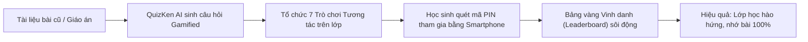

> **Tóm tắt nhanh (TL;DR):** Một trong những bí quyết giúp giáo viên thu hút 100% sự tập trung của học sinh trong kỷ nguyên số là biến các tiết học lý thuyết khô khan thành các đấu trường kiến thức kịch tính. Bằng việc ứng dụng các **trò chơi trắc nghiệm tương tác bằng AI miễn phí (free)**, thầy cô chỉ mất chưa đầy 1 phút để tạo game show khởi động (Warm-up) hấp dẫn, giúp lớp học sôi nổi từ giây đầu tiên.

---

## 1. Sức Mạnh Của Gamification (Trò Chơi Hóa) Trong Lớp Học Hiện Đại

Theo các hướng dẫn về đổi mới phương pháp giảng dạy của Bộ GD&ĐT (tiêu biểu là **Công văn 5588/BGDĐT-GDPT**), việc kích thích cảm xúc tích cực và tính chủ động của người học là thước đo hàng đầu của một tiết dạy thành công:

* **Tăng 80% mức độ ghi nhớ:** Học sinh tiếp thu kiến thức nhanh hơn gấp 2 lần khi được tham gia thi đấu giải đố thay vì ngồi nghe giảng thụ động.
* **Xóa bỏ áp lực kiểm tra bài cũ:** Thay vì gọi từng em lên bảng "trả bài" gây căng thẳng, cả lớp cùng tham gia đấu trường trắc nghiệm trên màn hình máy chiếu.
* **Đo lường mức độ hiểu bài tức thì:** Giáo viên biết ngay câu hỏi nào có nhiều em làm sai để kịp thời củng cố trước khi bước vào bài mới.

---

## 2. Top 7 Trò Chơi Trắc Nghiệm Tương Tác Được Yêu Thích Nhất 2026

| Tên trò chơi | Cách thức vận hành | Thời lượng phù hợp | Mục tiêu sư phạm |
| :--- | :--- | :--- | :--- |
| **1. Đấu trường sinh tồn (Battle Royale Quiz)** | Học sinh trả lời sai bị trừ mạng, người trụ lại cuối cùng giành ngôi vương | 7 – 10 phút | Khởi động đầu giờ (Warm-up), tạo kịch tính đỉnh cao |
| **2. Tiếp sức đồng đội (Team Relay)** | Lớp chia làm 4 tổ, mỗi thành viên lần lượt trả lời 1 câu hỏi trên QuizKen | 10 – 15 phút | Rèn luyện kỹ năng làm việc nhóm và trách nhiệm tập thể |
| **3. Thử thách 60 giây (Speed Lightning)** | Trả lời càng nhanh và chính xác thì điểm số cộng dồn càng cao | 5 phút | Kiểm tra phản xạ từ vựng hoặc công thức tính nhanh |
| **4. Chiếc hộp bí ẩn (Lucky Box Quiz)** | Trả lời đúng câu trắc nghiệm được bốc thăm nhận phần thưởng hoặc tráo điểm | 10 phút | Tạo yếu tố bất ngờ, giữ vững năng lượng giữa tiết học |
| **5. Ai là triệu phú học đường** | Bộ 10 câu hỏi độ khó tăng dần từ Nhận biết đến Vận dụng cao | 15 phút | Tổng kết ôn tập cuối chương / chuyên đề |
| **6. Đào vàng tri thức (Gold Rush)** | Mỗi câu trả lời đúng giúp đội đào được một lượng vàng ảo trên màn hình | 10 phút | Kích thích tinh thần thi đua giữa các tổ |
| **7. Thám tử tìm lỗi sai (Fact or Fake)** | Học sinh cùng mổ xẻ các câu hỏi Đúng/Sai 4 ý để tìm ra mệnh đề bị "gài bẫy" | 10 phút | Rèn luyện tư duy phản biện chuẩn đề thi THPT 2026 |

---

## 3. Cách Tạo Trò Chơi Lớp Học Bằng AI QuizKen Chỉ Sau 30 Giây (Free)

Nhiều thầy cô e ngại việc tổ chức game show vì sợ mất thời gian chuẩn bị slide PowerPoint hay nhập liệu phức tạp. Với **QuizKen AI**, quy trình đã được tự động hóa hoàn toàn:

1. **Bước 1: Tải tài liệu bài học lên QuizKen:** Thầy cô chỉ cần thả file giáo án Word hoặc bài đọc tiếng Anh, AI sẽ tự động trích xuất các câu đố vui nhộn.
2. **Bước 2: Chọn chế độ "Đấu trường Multiplayer":** Hệ thống tạo ngay một mã PIN 6 chữ số và mã QR trực quan để thầy cô chiếu lên máy chiếu.
3. **Bước 3: Học sinh tham gia và thi đấu:** Học sinh dùng điện thoại hoặc máy tính bảng quét mã PIN để vào phòng chơi mà không cần cài đặt phần mềm.
4. **Bước 4: Xem bảng vàng xếp hạng:** Sau mỗi câu hỏi, bảng vàng vinh danh (Leaderboard) sẽ tự động cập nhật điểm số và hiệu ứng âm thanh cổ vũ sôi động.

👉 **Tạo game show ngay:** [Thiết lập trò chơi trắc nghiệm AI miễn phí cho lớp học trên QuizKen](https://quizken.com) ngay hôm nay!

---

## Câu hỏi thường gặp (FAQ)

### 1. Nếu lớp học không có wifi hoặc mạng yếu thì có chơi được không?
QuizKen được tối ưu hóa băng thông siêu nhẹ, chỉ tiêu tốn vài kilobytes dữ liệu cho mỗi câu hỏi, hoạt động mượt mà ngay cả trên mạng 3G/4G cơ bản.

### 2. Tổ chức trò chơi trên QuizKen có bị giới hạn số người chơi không?
Hoàn toàn **miễn phí (free)** cho các lớp học từ 30 đến hơn 100 học sinh tham gia thi đấu cùng lúc mà không lo gián đoạn.

### 3. Giáo viên có thể tùy chỉnh thời gian trả lời cho từng câu hỏi không?
Có. Thầy cô có thể cài đặt thời gian linh hoạt từ 10 giây, 20 giây đến 60 giây tùy thuộc vào độ khó của bài toán.
