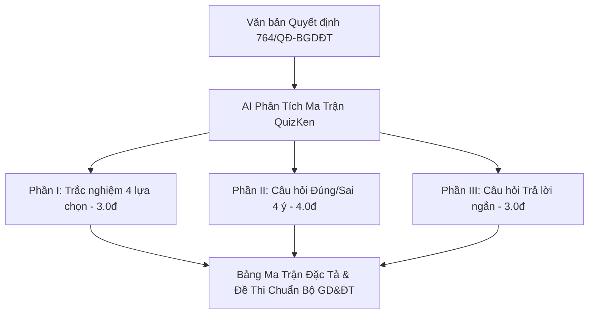

> **Tóm tắt nhanh (TL;DR):** Căn cứ theo **Quyết định số 764/QĐ-BGDĐT** và **Thông tư số 22/2021/TT-BGDĐT** của Bộ Giáo dục và Đào tạo, việc xây dựng ma trận đề thi đòi hỏi sự phân bổ chặt chẽ theo 4 cấp độ tư duy: Nhận biết, Thông hiểu, Vận dụng và Vận dụng cao. Với sự hỗ trợ của công nghệ AI trên nền tảng **QuizKen**, giáo viên chỉ cần tải lên đề cương bài học, hệ thống sẽ tự động lập bảng ma trận đặc tả và sinh ngân hàng câu hỏi 3 dạng thức mới (Nhiều lựa chọn, Đúng/Sai 4 ý, Trả lời ngắn) trong vòng 60 giây.

---

## 1. Căn Cứ Pháp Lý & Thách Thức Khi Xây Dựng Ma Trận Đề Thi Chuẩn GDPT 2018

Theo **Quyết định số 764/QĐ-BGDĐT** (ngày 08/03/2024 của Bộ GD&ĐT quy định cấu trúc định dạng đề thi tốt nghiệp THPT từ năm 2025/2026) cùng hướng dẫn tại **Thông tư 22/2021/TT-BGDĐT**, đề kiểm tra định kỳ không còn kiểm tra ghi nhớ máy móc mà chuyển hẳn sang đánh giá năng lực thực tiễn.

Cấu trúc đề thi trắc nghiệm hiện hành quy định tối đa **3 dạng thức câu hỏi**:
1. **Dạng thức 1 (Trắc nghiệm nhiều lựa chọn):** Chọn 1 đáp án đúng trong 4 phương án (0.25đ/câu).
2. **Dạng thức 2 (Trắc nghiệm Đúng/Sai):** Mỗi câu gồm 4 ý độc lập (a, b, c, d). Điểm số tính theo bậc thang lũy tiến: đúng 1 ý được 0.1đ; đúng 2 ý được 0.25đ; đúng 3 ý được 0.5đ; đúng cả 4 ý được 1.0đ.
3. **Dạng thức 3 (Trắc nghiệm Trả lời ngắn):** Thí sinh tự giải và điền kết quả vào ô đáp án, triệt tiêu hoàn toàn khả năng khoanh lụi may rủi.

Việc tính toán số lượng câu hỏi sao cho đúng tỉ lệ 40% Nhận biết – 30% Thông hiểu – 20% Vận dụng – 10% Vận dụng cao thủ công tiêu tốn từ **3 đến 5 giờ** của giáo viên cho mỗi bài kiểm tra.

---

## 2. Bảng Ma Trận Đề Thi 45 Phút Chuẩn Hóa Của Bộ GD&ĐT

Dưới đây là khung ma trận phân hóa tiêu chuẩn cho bài kiểm tra định kỳ (Toán, KHTN, Lịch sử - Địa lý):

| Phần thi | Dạng thức câu hỏi | Nhận biết (40%) | Thông hiểu (30%) | Vận dụng (20%) | Vận dụng cao (10%) | Tổng điểm |
| :--- | :--- | :---: | :---: | :---: | :---: | :---: |
| **Phần I** | Trắc nghiệm 4 lựa chọn (12 câu) | 8 câu (2.0đ) | 4 câu (1.0đ) | - | - | **3.0 điểm** |
| **Phần II** | Trắc nghiệm Đúng/Sai (4 câu × 4 ý) | 1 câu (1.0đ) | 2 câu (2.0đ) | 1 câu (1.0đ) | - | **4.0 điểm** |
| **Phần III** | Trắc nghiệm Trả lời ngắn (6 câu) | - | - | 4 câu (2.0đ) | 2 câu (1.0đ) | **3.0 điểm** |
| **Tổng cộng** | **22 câu hỏi chuẩn hóa** | **4.0 điểm** | **3.0 điểm** | **2.0 điểm** | **1.0 điểm** | **10.0 điểm (45 phút)** |

---

## 3. Hướng Dẫn 3 Bước Tạo Ma Trận & Đề Thi Bằng AI QuizKen

Để hoàn thành bảng ma trận và đề thi theo chuẩn Bộ trong tích tắc, giáo viên thực hiện như sau:

### Bước 1: Tải tài liệu bài giảng hoặc nhập đề cương
Truy cập [QuizKen Tạo Đề Bằng AI](https://quizken.com), dán văn bản bài học hoặc tải lên file Word (`.docx`), PDF đề cương ôn tập môn học.

### Bước 2: Chọn khung phân bố theo Quyết định 764/QĐ-BGDĐT
Tại màn hình tùy chỉnh, chọn cấu trúc phân bổ:
- Tỉ lệ nhận thức Bloom (4:3:2:1 hoặc 3:3:2:2).
- Kích hoạt trọn vẹn 3 dạng thức câu hỏi: *4 lựa chọn*, *Đúng/Sai 4 ý*, và *Trả lời ngắn*.

### Bước 3: AI phân tích và xuất bản đề thi
Bấm nút **Tạo Đề Tức Thì**. Trong 3 giây, trí tuệ nhân tạo của QuizKen sẽ:
1. Xuất bảng ma trận đặc tả chi tiết từng câu hỏi ứng với chuẩn kiến thức kỹ năng.
2. Sinh đề thi trắc nghiệm kèm đáp án chính xác và lời giải chi tiết.
3. Xuất file PDF/Word có mã đề trộn ngẫu nhiên sẵn sàng in ấn cho học sinh.

---

## 4. Ưu Điểm Khi Sử Dụng AI QuizKen So Với Soạn Đề Thủ Công

1. **Bám sát 100% ngữ liệu SGK mới:** Tương thích hoàn toàn với các bộ sách Kết nối tri thức, Chân trời sáng tạo, Cánh diều.
2. **Ngăn chặn triệt để khoanh bừa:** Tích hợp câu hỏi Đúng/Sai và Trả lời ngắn giúp phân hóa học sinh chính xác.
3. **Tiết kiệm 95% thời gian:** Giúp giáo viên tập trung thời gian vào đổi mới phương pháp giảng dạy trên lớp.

👉 **Khám phá ngay:** Trải nghiệm công cụ [Tạo Đề Thi Trắc Nghiệm Bằng AI QuizKen](https://quizken.com) hoàn toàn miễn phí ngay hôm nay!

---

## 5. Câu Hỏi Thường Gặp (FAQ)

### Cách tính điểm câu hỏi Đúng/Sai trong Quyết định 764/QĐ-BGDĐT như thế nào?
Theo quy định chính thức: Thí sinh chọn chính xác 1 ý được 0,1 điểm; đúng 2 ý được 0,25 điểm; đúng 3 ý được 0,5 điểm; và đúng trọn vẹn cả 4 ý được 1,0 điểm.

### Giáo viên có thể tùy chỉnh số lượng câu hỏi trong từng phần không?
Hoàn toàn được. QuizKen cho phép tùy biến linh hoạt số lượng câu hỏi ở từng dạng thức để phù hợp với bài kiểm tra 15 phút, 45 phút hoặc thi học kỳ 90 phút.
