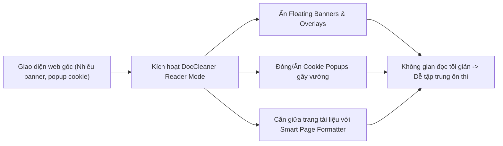

> **TL;DR (Tóm tắt nhanh):**  
> Chế độ đọc sách tích hợp sẵn của trình duyệt thường không hoạt động trên các trang xem tài liệu dạng trang giấy như Studocu hay Scribd. Giải pháp thay thế tốt nhất là cài miễn phí (free) **[DocCleaner - Better Studocu & Scribd Reader](https://chromewebstore.google.com/detail/doccleaner-better-studocu/fnhdoegoihnkgggnaiemommemdejhbkb?hl=vi)** để tự động bật **Reader Mode cho Studocu**, dọn sạch banner quảng cáo và popup cookie, kết hợp ôn luyện kiến thức cùng **[QuizKen](https://app.quizken.com)**.

---

# Cách Bật Reader Mode Cho Studocu.vn Và Scribd Để Đọc Tập Trung Tối Đa

Nếu bạn hay dùng chế độ *Reading Mode (Chế độ đọc)* trên Chrome hoặc Edge khi đọc báo, hẳn bạn rất thích cảm giác màn hình sạch sẽ chỉ còn chữ, không quảng cáo nhấp nháy. Tuy nhiên, khi áp dụng tính năng mặc định đó lên `studocu.vn`, `studocu.com` hay `scribd.com`, trình duyệt thường bó tay vì đây là các trình xem tài liệu đa trang phức tạp.

Đó chính là lý do **DocCleaner** ra đời như một **Reader Mode cho Studocu** và Scribd chuyên dụng, giúp sinh viên loại bỏ toàn bộ yếu tố gây nhiễu thị giác ngay khi mở trang.

---

## 1. Những Yếu Tố Khiến Bạn Mất Tập Trung Khi Đọc Tài Liệu Online

Các nghiên cứu về nhận thức thị giác cho thấy sinh viên đọc trên màn hình nhiều thành phần thừa dễ bị mỏi mắt và giảm tốc độ đọc hiểu. Khi mở tài liệu trên Studocu hay Scribd ở trạng thái mặc định, bạn thường phải đối mặt với:

* **Hộp thoại đồng ý Cookie (Cookie Consent Popups):** Chiếm tới 20–30% diện tích bên dưới hoặc giữa màn hình khi mới truy cập.
* **Banner nổi và lớp phủ khuyến mãi (Floating Banners & Overlays):** Cố định ở cạnh trên, cạnh dưới hoặc che ngang luồng cuộn trang.
* **Khung giao diện xung quanh chật chội:** Đặc biệt bất tiện trên màn hình laptop 13–14 inch khi cần đọc các bảng biểu, sơ đồ hoặc công thức nhỏ.

---

## 2. DocCleaner Tạo Ra Trải Nghiệm Reader Mode Như Thế Nào?

Khi được cài đặt từ Chrome Web Store, **DocCleaner - Better Studocu & Scribd Reader** hoạt động như một "bộ lọc dọn dẹp" thông minh:

### Dọn sạch Clutter tự động ngay lúc tải trang
Không cần bạn phải nhấn tắt từng dấu `X` trên mỗi banner hay popup cookie, DocCleaner nhận diện trang tài liệu ngay từ quá trình điều hướng (`webNavigation`) và ẩn đi các thành phần gây nhiễu thị giác.

### Giữ nguyên 100% nội dung học thuật gốc
Khác với các chế độ đọc văn bản thuần túy làm hỏng bố cục bảng biểu hoặc mất hình ảnh minh họa, **Reader Mode cho Studocu** của DocCleaner giữ nguyên vẹn cấu trúc trang tài liệu gốc — bao gồm slide PowerPoint, sơ đồ mạch điện, bảng số liệu kinh tế và công thức toán học.

### Hỗ trợ cả hai nền tảng lớn: Studocu & Scribd
Bạn chỉ cần cài duy nhất một tiện ích gọn nhẹ để tối ưu giao diện cho cả `studocu.com`, `studocu.vn` lẫn `scribd.com`.

---

## 3. So Sánh Trải Nghiệm Đọc Tài Liệu Trước Và Sau Khi Bật DocCleaner

| Yếu tố trải nghiệm | Giao diện mặc định | Khi bật DocCleaner Reader Mode |
| :--- | :--- | :--- |
| **Popup cookie & banner nổi** | Xuất hiện thường xuyên, che góc nhìn | **Tự động dọn sạch** |
| **Không gian hiển thị trang** | Bị thu hẹp bởi khung web xung quanh | **Thoáng đãng, tập trung vào trang giấy** |
| **Khả năng giữ nguyên bảng/công thức** | Tốt | **Giữ nguyên 100% định dạng gốc** |
| **Thao tác in / lưu PDF** | Dễ lẫn menu website vào bản in | **Có nút nổi 1-Click Print Format riêng** |
| **Chi phí** | Miễn phí kèm quảng cáo hiển thị | **Free 100%, không quảng cáo chèn thêm** |

---

## 4. Kết Hợp Đọc Tập Trung Với Phương Pháp Học Chủ Động Trên QuizKen

Sau khi đã có một không gian **Reader Mode** sạch sẽ để đọc lướt và nắm ý chính giáo trình:

1. **Đánh dấu chương trọng tâm:** Dùng DocCleaner đọc xuyên suốt những phần kiến thức cốt lõi mà không bị popup cắt ngang mạch tư duy.
2. **Lưu bản PDF gọn đẹp:** Nhấn nút **1-Click Print Format** để lưu tài liệu về máy qua Chrome `Save as PDF`.
3. **Tạo bài test kiểm tra nhanh trên QuizKen:** Mở **[QuizKen](https://app.quizken.com)**, tải file PDF vừa lưu lên để AI tự động sinh câu hỏi trắc nghiệm và giải thích đáp án. Cách này giúp bạn biết ngay phần nào mình đã hiểu và phần nào còn hổng kiến thức.

---

## 5. Câu Hỏi Thường Gặp (FAQ)

### 1. Chế độ Reader Mode của DocCleaner có tự bật mỗi lần mở Studocu.vn không?
Có. Ngay sau khi cài đặt từ Chrome Web Store, tiện ích tự động kích hoạt mỗi khi bạn truy cập các trang tài liệu trên Studocu (`studocu.com`, `studocu.vn`) và Scribd.

### 2. Bật Reader Mode có ảnh hưởng đến các trang web khác như YouTube hay Google Docs không?
Không. DocCleaner chỉ hoạt động trên các nền tảng đọc tài liệu được hỗ trợ, hoàn toàn không can thiệp vào giao diện của các trang web khác.

### 3. Tiện ích có miễn phí hoàn toàn không?
Có, DocCleaner hoàn toàn free và không có giới hạn tính năng.

---

**Cài đặt ngay:** [DocCleaner - Better Studocu & Scribd Reader trên Chrome Web Store](https://chromewebstore.google.com/detail/doccleaner-better-studocu/fnhdoegoihnkgggnaiemommemdejhbkb?hl=vi) và đừng quên ghé **[QuizKen](https://quizken.com)** để biến tài liệu thành bộ đề luyện thi thông minh!
