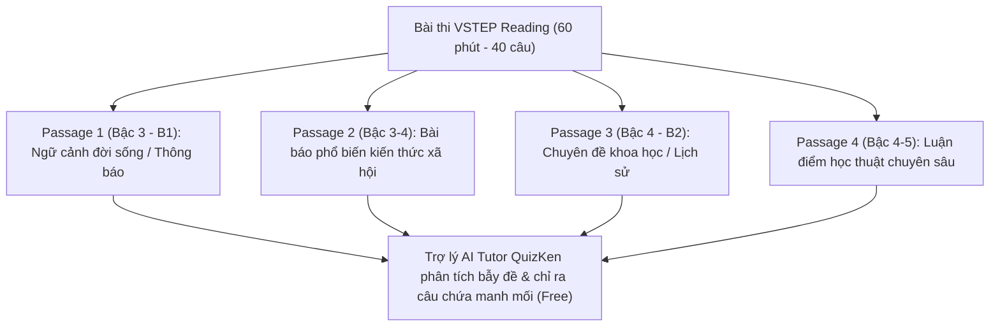

> **Tóm tắt nhanh (TL;DR):** Phần thi **Đọc hiểu (Reading)** trong kỳ thi VSTEP gồm 4 bài đọc dài với 40 câu hỏi trắc nghiệm trong vòng 60 phút là "hòn đá tảng" ngáng đường nhiều thí sinh đạt chuẩn Bậc 3 (B1) và Bậc 4 (B2). Thiếu vốn từ vựng học thuật và không biết cách định vị thông tin nhanh (Skimming & Scanning) khiến nhiều người bị hết giờ. Bài viết này chia sẻ chiến lược làm bài đọc hiểu bách chiến bách thắng cùng sự đồng hành của **Gia sư ảo AI Tutor miễn phí (free)**.

---

## 1. Cấu Trúc Và Độ Khó Của 4 Phần Thi VSTEP Reading

Bài thi VSTEP Reading được thiết kế với độ khó tăng dần theo thang chuẩn khung 6 bậc:

* **Passage 1:** Văn bản ngắn mang tính thông tin thực tế (email công việc, tờ rơi du lịch, hướng dẫn sinh hoạt). Dễ lấy trọn điểm nếu cẩn thận.
* **Passage 2:** Bài báo về sức khỏe, giáo dục, tâm lý học đại chúng. Bắt đầu xuất hiện các câu hỏi suy luận ý ngầm (Inference) và từ quy chiếu (Reference).
* **Passage 3 & Passage 4:** Văn bản học thuật dài từ 450 đến 550 từ về các đề tài khảo cổ học, sinh học tiến hóa, thiên văn học. Mật độ từ vựng B2–C1 dày đặc và các phương án gây nhiễu rất tinh vi.

---

## 2. 3 Kỹ Năng Cốt Tử Để Không Bị Cháy Giờ Khi Làm VSTEP Reading

| Kỹ năng làm bài | Cách áp dụng thực chiến | Cách AI QuizKen hỗ trợ luyện tập (Free) |
| :--- | :--- | :--- |
| **Skimming (Đọc lướt lấy ý chính)** | Đọc câu đầu và câu cuối mỗi đoạn trong 30 giây để nắm cấu trúc tổng thể | AI tự động tóm tắt ý chính của từng đoạn văn chỉ sau 1 giây |
| **Scanning (Đọc quét tìm từ khóa)** | Dò tìm các con số, tên riêng, mốc thời gian hoặc thuật ngữ chuyên ngành | AI highlight trực tiếp các từ khóa then chốt trong văn bản |
| **Giải mã từ mới theo ngữ cảnh** | Dựa vào các từ nối tương phản (*however, whereas*) hoặc từ đồng nghĩa | AI Tutor gợi ý các manh mối ngữ cảnh xung quanh để người học tự đoán nghĩa |

---

## 3. Cách Luyện Đề Cùng Gia Sư Ảo AI Tutor QuizKen (Free 100%)

Nhiều thí sinh làm đề thi thử trên mạng nhưng điểm số không cải thiện vì chỉ biết câu đó mình chọn sai chứ không hiểu vì sao đáp án khác mới đúng. Tính năng **AI Tutor của QuizKen** giải quyết triệt để vấn đề này:

### Bước 1: Làm bài đọc hiểu có tính giờ
Thí sinh đọc bài trên giao diện chuẩn thi máy của QuizKen, trả lời các câu hỏi trắc nghiệm với đồng hồ đếm ngược 60 phút.

### Bước 2: Xem giải thích câu chứa manh mối (Clue sentence)
Khi nộp bài, hệ thống sẽ tự động gạch chân chính xác câu văn trong bài đọc chứa thông tin trả lời, kèm theo bảng phân tích so sánh giữa từ ngữ trong câu hỏi và từ ngữ trong bài đọc (Paraphrasing Mapping).

### Bước 3: Đặt câu hỏi trực tiếp cho AI Tutor
Nếu bạn vẫn còn băn khoăn: *"Tại sao phương án C sai khi bài đọc có nhắc đến từ X?"*, bạn chỉ cần bấm nút Chat với AI Tutor. Gia sư ảo sẽ phân tích cụ thể lỗi đánh tráo khái niệm của đề bài để bạn rút kinh nghiệm cho các bài thi sau hoàn toàn **miễn phí (free)**.

👉 **Nâng trình đọc hiểu:** [Luyện đọc hiểu VSTEP B1 B2 cùng gia sư AI Tutor miễn phí trên QuizKen](https://quizken.com) ngay hôm nay!

---

## Câu hỏi thường gặp (FAQ)

### 1. Cần đúng bao nhiêu câu Reading để đạt chuẩn VSTEP B1?
Để đạt B1, bạn cần đạt điểm tổng trung bình 4 kỹ năng từ 4.0 đến 5.5/10, tương đương với việc trả lời đúng khoảng 18 đến 22 câu trên tổng số 40 câu Reading.

### 2. Sử dụng tính năng AI Tutor trên QuizKen có mất phí không?
Không. QuizKen cung cấp hạn ngạch hỏi đáp cùng **AI Tutor miễn phí (free)** mỗi ngày, giúp thí sinh tự học tại nhà hiệu quả mà không cần thuê gia sư tốn kém.

### 3. Có thể nạp thêm từ vựng gặp trong bài đọc vào Flashcard để ôn lại không?
Có. Khi đọc bài trên QuizKen, bạn chỉ cần bôi đen từ mới và chọn "Thêm vào Flashcard", hệ thống sẽ tự động lưu lại vào lộ trình Spaced Repetition cá nhân của bạn.
