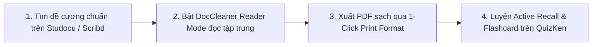

> **TL;DR (Tóm tắt nhanh):**  
> Đừng chỉ đọc đi đọc lại đề cương một cách thụ động trước ngày thi! Hãy áp dụng **bí quyết ôn thi cuối kỳ Studocu** theo chuỗi 3 bước: dùng miễn phí (free) **DocCleaner** để bật Reader Mode dọn sạch màn hình học tập, xuất đề cương gọn đẹp sang PDF bằng **1-Click Print Format**, sau đó luyện **Active Recall** bằng bộ đề AI và Flashcard trên **[QuizKen](https://app.quizken.com)**.

---

# Bí Quyết Ôn Thi Cuối Kỳ Điểm Cao: Kết Hợp Studocu, DocCleaner Và Active Recall

Mỗi kỳ thi cuối kỳ tới gần, kịch bản quen thuộc của rất nhiều sinh viên là tải về hàng chục tab tài liệu trên `studocu.vn`, ngồi đọc lướt từ đầu đến cuối trong vô vọng rồi đến lúc bước vào phòng thi lại... quên sạch những phần mình tưởng đã thuộc.

Khoa học nhận thức đã chứng minh: **đọc thụ động (passive reading)** là phương pháp ôn thi kém hiệu quả nhất, vì nó tạo ra *"ảo giác năng lực"* — mắt bạn thấy chữ quen nên não tưởng mình đã nhớ, nhưng thực chất không thể tự truy xuất kiến thức khi làm bài.

Để thay đổi hoàn toàn kết quả học tập mùa thi này, **QuizKen** gợi ý cho bạn quy trình ôn thi 4 bước kết hợp giữa kho học liệu, tiện ích **DocCleaner** và kỹ thuật **Active Recall (Chủ động gợi nhớ)**.

---

## 1. Mô Hình Ôn Thi 4 Bước Từ Đề Cương Đến Phòng Thi

### Bước 1: Chọn lọc đúng 1–2 bộ đề cương cốt lõi
Thay vì mở 20 tab cùng lúc khiến laptop giật lag và rối trí, hãy chọn 1 bộ slide giảng viên và 1 bộ đề cương tổng hợp sát đề thi nhất trên Studocu hoặc Scribd.

### Bước 2: Đọc hiểu lần đầu trong không gian sạch của DocCleaner
Cài đặt **[DocCleaner - Better Studocu & Scribd Reader](https://chromewebstore.google.com/detail/doccleaner-better-studocu/fnhdoegoihnkgggnaiemommemdejhbkb?hl=vi)** để tự động ẩn toàn bộ banner quảng cáo và popup cookie gây mất tập trung. Nhờ **Smart Page Formatter**, bạn có thể lướt nhanh mục lục và đọc liền mạch các chương mà không bị ngắt quãng bởi trang trắng.

### Bước 3: Lưu bản PDF chuẩn A4 để học offline không xao nhãng
Khi cần cắt kết nối mạng xã hội để tập trung 100% hoặc muốn in tài liệu ra giấy, hãy bấm nút nổi **1-Click Print Format** của DocCleaner để lưu nhanh tài liệu thành PDF (`Save as PDF`) qua Chrome.

### Bước 4: Kích hoạt Active Recall cùng QuizKen AI
Đây là bước tạo nên sự khác biệt giữa điểm C và điểm A+:
* Tải file PDF đề cương vừa lưu lên **[QuizKen](https://app.quizken.com)**.
* Để AI tự động tạo đề thi thử 20–40 câu theo từng chương.
* Làm bài thi thử ngay lập tức mà không mở tài liệu. Những câu làm sai sẽ tự động chỉ ra **lỗ hổng kiến thức (Knowledge Gaps)** để bạn quay lại đọc kỹ đúng phần đó trong file PDF.

---

## 2. So Sánh Hai Phương Pháp Ôn Thi Cuối Kỳ

| Tiêu chí | Cách ôn thi truyền thống | Quy trình DocCleaner + QuizKen (Active Recall) |
| :--- | :--- | :--- |
| **Môi trường đọc tài liệu** | Nhiều popup, banner dễ xao nhãng | **Reader Mode sạch sẽ, không quảng cáo** |
| **Cách tiếp thu kiến thức** | Đọc đi đọc lại thụ động | **Kiểm tra chủ động qua bài Quiz AI** |
| **Phát hiện phần hổng** | Chỉ biết khi nhận điểm thi | **Biết ngay lập tức sau mỗi lần làm bài test** |
| **Quản lý thời gian** | Dễ buồn ngủ, mất tập trung | **Tăng tốc độ ôn bài lên gấp 2–3 lần** |

---

## 3. Lịch Ôn Thi Mẫu Cho 1 Môn Học Trong 3 Ngày Cuối

* **Ngày 1 (Nắm khung kiến thức):** Dùng DocCleaner đọc sạch toàn bộ đề cương, xuất file PDF chuẩn và chạy bộ Quiz tổng quan trên QuizKen để đo mức độ nền tảng.
* **Ngày 2 (Lấp lỗ hổng kiến thức):** Tập trung ôn lại các chương làm sai nhiều và luyện thẻ **Flashcard Spaced Repetition** cho các khái niệm, định luật dễ nhầm lẫn.
* **Ngày 3 (Thi thử tổng hợp):** Làm 1–2 đề thi mô phỏng bấm giờ trên QuizKen, đọc lướt lại bản PDF sạch trước giờ ngủ 30 phút.

---

## 4. Câu Hỏi Thường Gặp (FAQ)

### 1. Vì sao phải dọn sạch giao diện bằng DocCleaner trước khi ôn thi?
Bởi vì mỗi lần bạn bị popup hoặc banner quảng cáo làm ngắt quãng, não bộ mất thêm thời gian để quay lại trạng thái tập trung sâu (deep focus). Reader Mode giúp bảo toàn năng lượng tư duy cho việc ghi nhớ.

### 2. Tôi có thể chia sẻ bộ đề tạo từ đề cương Studocu cho bạn cùng nhóm học không?
Có. Trên QuizKen, bạn có thể xuất bản hoặc mời bạn bè tham gia chế độ **Đấu trường Multiplayer** để cùng thi thử và trao đổi đáp án cực vui.

### 3. Quy trình kết hợp DocCleaner và QuizKen có mất phí không?
Cả DocCleaner trên Chrome Web Store lẫn tính năng cơ bản của QuizKen đều có gói free miễn phí cho sinh viên sử dụng dễ dàng.

---

**Chúc bạn một mùa thi bùng nổ điểm A+!** Hãy cài đặt ngay **[DocCleaner](https://chromewebstore.google.com/detail/doccleaner-better-studocu/fnhdoegoihnkgggnaiemommemdejhbkb?hl=vi)** và tạo đề ôn tập đầu tiên của bạn tại **[QuizKen](https://app.quizken.com)**.
