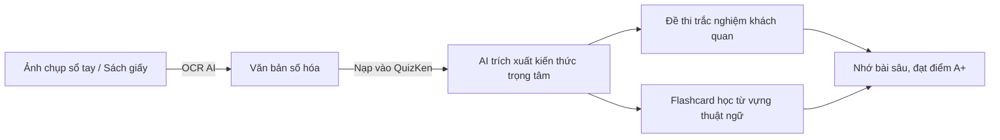

> **TL;DR (Tóm tắt nhanh):**  
> Thay vì mất hàng giờ ngồi gõ lại từng trang sổ tay viết tay hoặc sách giáo trình photo dày cộp, sinh viên có thể dùng các công nghệ **OCR AI (Nhận dạng ký tự quang học)** thông minh như Google Keep, vFlat Scan hoặc tính năng OCR AI Vision của **QuizKen**. Các công cụ này tự động nhận diện chữ viết tay và văn bản in tiếng Việt có dấu chuẩn xác đến 98%. Sau khi số hóa, bạn có thể ném ngay văn bản vào **QuizKen** để AI tự động trích xuất thành bộ câu hỏi trắc nghiệm ôn tập chỉ trong 3 giây!

---

# Cách Chuyển Ảnh Chụp Sổ Tay, Sách Giáo Trình Thành Chữ Bằng OCR AI Miễn Phí (2026)

Trước mỗi kỳ thi học phần, tình huống quen thuộc của hầu hết sinh viên là mượn được quyển vở ghi chép cực kỳ chi tiết của "thủ khoa" hoặc cuốn sách giáo trình photo tài liệu nội bộ. Tuy nhiên, nhìn tập tài liệu giấy dày hàng chục trang chữ viết tay, việc ngồi gõ lại từng chữ vào Word để làm đề cương là một "cơn ác mộng" tốn thời gian.

May mắn thay, với sự bùng nổ của **Trí tuệ nhân tạo (AI) và công nghệ OCR (Optical Character Recognition)** năm 2026, bạn chỉ cần dùng điện thoại chụp lại trang giấy là đã có thể trích xuất toàn bộ nội dung thành văn bản số hóa có thể chỉnh sửa, copy và tạo đề thi tự động.

---

## 1. Công Nghệ OCR AI Nhận Dạng Chữ Tiếng Việt Hoạt Động Ra Sao?

OCR truyền thống trước đây thường gặp khó khăn với tiếng Việt do có hệ thống dấu thanh phức tạp (huyền, sắc, hỏi, ngã, nặng) và chữ viết tay không thẳng hàng. 

Hiện nay, các mô hình học sâu (Deep Learning) kết hợp thị giác máy tính (Computer Vision) đã có thể:
* **Tự động làm phẳng trang giấy bị cong:** Loại bỏ bóng mờ của ngón tay hoặc nếp gấp giữa gáy sách.
* **Nhận diện ngữ cảnh từ vựng tiếng Việt:** Tự động sửa lỗi sai chính tả dựa trên ngữ cảnh câu (ví dụ: phân biệt chữ "học" và "học").
* **Giữ nguyên định dạng phân cấp:** Giữ nguyên các tiêu đề lớn, gạch đầu dòng và số thứ tự danh sách.

---

## 2. Top 3 Công Cụ Chuyển Ảnh Thành Văn Bản Tiếng Việt Tốt Nhất

### 1. vFlat Scan (Ứng Dụng Di Động Miễn Phí)
* **Ưu điểm:** Khả năng tự động nắn thẳng trang sách bị uốn cong, xóa hình ảnh ngón tay giữ mép trang cực kỳ ảo diệu. Hỗ trợ OCR tiếng Việt với độ chính xác trên 95%.
* **Cách thực hiện:** Mở ứng dụng vFlat Scan trên điện thoại $\rightarrow$ Chụp liên tục các trang sách giáo trình $\rightarrow$ Bấm nút **Chạy nhận dạng văn bản (Run Text Recognition)** $\rightarrow$ Sao chép toàn bộ văn bản hoặc xuất sang file TXT/PDF.

### 2. Google Keep / Google Drive OCR (Công Cụ Sẵn Có Cực Nhanh)
* **Cách làm với Google Keep:** Tải ảnh chụp trang vở lên một ghi chú mới trong Google Keep $\rightarrow$ Nhấn vào dấu 3 chấm góc dưới ảnh $\rightarrow$ Chọn **Tải chú thích hình ảnh (Grab image text)**. Toàn bộ chữ trong ảnh sẽ xuất hiện ngay phía dưới.
* **Cách làm với Google Drive:** Tải ảnh lên Google Drive $\rightarrow$ Nhấp chuột phải vào ảnh $\rightarrow$ Chọn **Mở bằng (Open with) > Google Tài liệu (Google Docs)**. Google sẽ tự động tạo file tài liệu có chứa ảnh và phần văn bản được số hóa bên dưới.

### 3. QuizKen AI Vision (Số Hóa & Tạo Đề Thi Trực Tiếp)
* **Nền tảng:** [QuizKen](https://app.quizken.com)
* **Tính năng đột phá:** Bạn không cần phải copy text qua lại giữa nhiều ứng dụng. Trong giao diện tạo đề của QuizKen, bạn chỉ cần bấm **Tải ảnh lên (Upload Image)**, AI sẽ tự động đọc chữ trong ảnh bài học và sinh ra bộ câu hỏi trắc nghiệm kiểm tra kiến thức ngay lập tức!

---

## 3. Bảng So Sánh Các Công Cụ OCR Tiếng Việt Hiện Nay

| Tiêu chí | vFlat Scan | Google Keep / Docs | QuizKen AI |
| :--- | :--- | :--- | :--- |
| **Nhận diện chữ in sách photo** | Rất tốt (Làm phẳng trang cong) | Tốt | Tốt |
| **Nhận diện chữ viết tay** | Khá (Cần nét chữ rõ ràng) | Trung bình | Tốt (Nhận diện theo ngữ cảnh) |
| **Xuất trực tiếp thành đề thi** | Không (Chỉ xuất text) | Không (Chỉ xuất text) | **Có (Tạo Quiz trắc nghiệm 3s)** |
| **Chi phí** | Miễn phí | Miễn phí | **Miễn phí** |

---

## 4. 💡 Từ Văn Bản Scan Đến Bứt Phá Điểm Số Cùng QuizKen

Sau khi đã có trong tay văn bản số hóa từ các trang tài liệu photo hoặc sổ tay ghi chép, bạn hãy đưa kiến thức vào chu trình ôn thi khoa học của **[QuizKen](https://app.quizken.com)**:

1. **Bước 1:** Dán văn bản vừa OCR vào ô nhập liệu tại [app.quizken.com](https://app.quizken.com).
2. **Bước 2:** Chọn số lượng câu hỏi mong muốn (10 - 40 câu) và chọn dạng thức câu hỏi (Nhiều lựa chọn hoặc Đúng/Sai).
3. **Bước 3:** Nhấn nút **Tạo đề thi**. Chỉ sau 3 giây, AI sẽ phân tích và trả về bộ câu hỏi trắc nghiệm có đầy đủ đáp án và lời giải chi tiết.

> 🎓 **Bắt đầu ngay:** [Biến ảnh chụp bài học thành đề thi trắc nghiệm AI với QuizKen tại đây!](https://app.quizken.com)

---

## Câu hỏi thường gặp về công nghệ OCR chuyển ảnh thành chữ

### Chữ viết tay nguệch ngoạc hoặc viết tắt công cụ có nhận diện được không?
Nếu chữ viết tay quá ẩu hoặc dùng quá nhiều ký hiệu viết tắt cá nhân, độ chính xác của OCR có thể giảm xuống khoảng 70 - 80%. Bạn nên dùng công cụ chụp ảnh rõ nét, đủ ánh sáng và chỉnh sửa lại một số từ ngữ chuyên ngành trước khi nạp vào AI.

### Có giới hạn số trang tài liệu scan khi đưa vào QuizKen không?
QuizKen hỗ trợ xử lý cả các đoạn văn bản ngắn lẫn các tập tài liệu giáo trình dài thông qua tính năng Kho Kiến Thức (Knowledge Base), giúp bạn thoải mái ôn tập toàn bộ chương trình học.

### Công cụ OCR có chuyển đổi được công thức Toán, Lý, Hóa phức tạp không?
Đối với các công thức Toán phân số, tích phân hoặc ma trận phức tạp, các công cụ chuyên biệt như Mathpix hoặc tính năng LaTeX của QuizKen sẽ cho kết quả vector sắc nét hơn các công cụ OCR văn bản thông thường.
