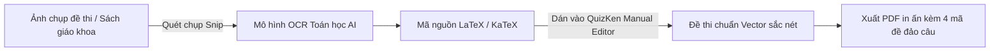

> **TL;DR (Tóm tắt nhanh):**  
> Việc gõ tay các công thức phân số, tích phân, căn bậc n hay ma trận bằng MathType hoặc Equation trong Word vừa chậm chạp vừa dễ bị lỗi vỡ font khi in ấn. Bằng cách ứng dụng các công cụ chuyển đổi quang học ảnh chụp sang mã **LaTeX/KaTeX** như Mathpix Snip hoặc trình nhận diện công thức AI trên **QuizKen**, bạn chỉ cần chụp màn hình công thức là mã nguồn LaTeX đã sẵn sàng trong 2 giây. Sau đó, dán mã vào Trình Soạn Thảo Thủ Công của **QuizKen** để xuất bản đề thi chuẩn vector sắc nét 100%!

---

# Cách Chuyển Ảnh Công Thức Toán, Lý, Hóa Thành Mã LaTeX/KaTeX Trong 2 Giây (2026)

Đối với giáo viên bộ môn STEM và sinh viên các khối ngành kỹ thuật, kinh tế lượng hay khoa học tự nhiên, **soạn thảo công thức Toán học** luôn là một trong những công việc ngốn nhiều thời gian và gây mệt mỏi nhất:
* Bộ gõ MathType thường xuyên bị xung đột phiên bản Office, khi gửi file sang máy tính khác thì công thức bị biến thành ảnh chất lượng thấp mờ căm.
* Việc học thuộc toàn bộ các cú pháp lệnh LaTeX phức tạp (như `\int_{a}^{b}`, `\frac{\partial f}{\partial x}`, `\sqrt[n]{x}`) đòi hỏi thời gian làm quen dài.
* Đề thi giấy sau khi in ra thường bị vỡ nét hạt ở các ký hiệu toán học nhỏ, gây khó khăn cho học sinh khi đọc đề.

Trong bài viết này, chúng tôi sẽ hướng dẫn bạn phương pháp **"chụp là có mã LaTeX"** chỉ trong tích tắc, giúp bạn chuẩn hóa mọi đề thi chuẩn vector in ấn chất lượng cao.

---

## 1. Vì Sao LaTeX và KaTeX Lại Là Chuẩn Mực Trong Soạn Thảo Đề Thi?

Không phải ngẫu nhiên mà các kỳ thi quốc tế, đề thi tốt nghiệp THPT quốc gia và các tạp chí khoa học đều sử dụng **LaTeX/KaTeX**:
1. **Định dạng Vector không bao giờ vỡ nét:** Dù bạn phóng to trên màn hình 4K hay in ấn khổ giấy lớn, các nét dấu tích phân hay phân số đều mượt mà tuyệt đối.
2. **Kích thước tệp siêu nhẹ:** Thay vì chèn hàng chục file ảnh nặng nề vào tài liệu, công thức LaTeX được lưu trữ dưới dạng chuỗi ký tự văn bản thuần túy.
3. **Hiển thị hoàn hảo trên web:** Thư viện **KaTeX** hiện đại cho phép trình duyệt hiển thị công thức toán học nhanh gấp 100 lần so với các thư viện cũ như MathJax.

---

## 2. Top 3 Cách Chuyển Ảnh Công Thức Thành Mã LaTeX Trong 2 Giây

### Cách 1: Sử Dụng Mathpix Snip (Tiêu Chuẩn Vàng Của Nhận Diện Toán Học)
* **Cách thực hiện:**
  1. Cài đặt ứng dụng Mathpix Snip trên máy tính hoặc điện thoại.
  2. Bấm tổ hợp phím tắt `Ctrl + Alt + M` (hoặc `Cmd + Option + M` trên Mac).
  3. Kéo chuột quét chọn vùng chứa công thức toán học trên màn hình (từ file PDF đề thi, ảnh chụp bảng đen hoặc sách giáo khoa).
  4. Mathpix tự động phân tích và sao chép ngay mã LaTeX (ví dụ: `\int_{0}^{\infty} e^{-x^2} dx = \frac{\sqrt{\pi}}{2}`) vào bộ nhớ tạm (Clipboard) của bạn.

### Cách 2: Tận Dụng Mô Hình AI Vision Đa Phương Thức
Nếu không muốn cài đặt phần mềm bên thứ ba, bạn có thể gửi ảnh công thức trực tiếp cho các mô hình AI Vision (như Gemini hoặc ChatGPT) với câu lệnh (prompt):
> *"Hãy chuyển đổi chính xác công thức toán học trong bức ảnh này sang định dạng mã KaTeX/LaTeX chuẩn, đặt trong cặp dấu $...$."*

### Cách 3: Nạp Đề Thi Trực Tiếp Vào QuizKen AI
* **Nền tảng:** [QuizKen](https://app.quizken.com)
* **Quy trình:** Trong giao diện tạo đề của QuizKen, bạn chỉ cần tải lên file đề thi môn Toán dạng PDF/Word chứa công thức hỗn hợp. Hệ thống AI tích hợp sẵn bộ chuyển đổi toán học tự động số hóa mọi biểu thức thành chuẩn KaTeX vector, hiển thị tuyệt đẹp trên cả giao diện thi trực tuyến lẫn bản in PDF 4 mã đề!

---

## 3. Bảng Cú Pháp LaTeX Cơ Bản Cần Biết Khi Soạn Đề

| Dạng công thức | Cú pháp LaTeX chuẩn | Hiển thị thực tế |
| :--- | :--- | :--- |
| **Phân số** | `\frac{a + b}{c - d}` | $\frac{a + b}{c - d}$ |
| **Căn bậc hai / n** | `\sqrt{x^2 + 1}` hoặc `\sqrt[3]{x}` | $\sqrt{x^2 + 1}$ hoặc $\sqrt[3]{x}$ |
| **Tích phân** | `\int_{a}^{b} f(x)dx` | $\int_{a}^{b} f(x)dx$ |
| **Giới hạn (Lim)** | `\lim_{x \to \infty} \frac{1}{x} = 0` | $\lim_{x \to \infty} \frac{1}{x} = 0$ |
| **Phương trình Hóa học** | `\text{H}_2 + \text{O}_2 \to \text{H}_2\text{O}` | $\text{H}_2 + \text{O}_2 \to \text{H}_2\text{O}$ |

---

## 4. 💡 Soạn Thảo Đề Thi Chuyên Nghiệp Với Trình Soạn Thảo Thủ Công Của QuizKen

Sau khi trích xuất được các công thức toán lý hóa chuẩn xác, bạn có thể sử dụng **Trình Soạn Thảo Đề Thi Thủ Công (Manual Quiz Editor)** trên QuizKen:
* Đặt công thức trong cặp dấu `$...$` để hiển thị công thức trong dòng (inline) hoặc `$$...$$` để căn giữa nổi bật (block).
* Hệ thống hiển thị bản xem trước trực tiếp (Live Preview) ngay lập tức khi bạn gõ phím.
* Tự động trộn 4 - 8 mã đề thi khác nhau mà không làm đảo lộn công thức Toán bên trong.
* Xuất file PDF sẵn sàng in ấn khổ giấy A4 chuẩn lề Bộ GD&ĐT.

> 📐 **Thử ngay:** [Trải nghiệm trình soạn thảo công thức Toán KaTeX chuyên nghiệp trên QuizKen tại đây!](https://app.quizken.com/quiz/create)

---

## Câu hỏi thường gặp về chuyển đổi công thức Toán sang LaTeX

### Công thức viết tay trên giấy nháp công cụ có nhận diện được không?
Có! Mathpix và mô hình AI Vision của QuizKen nhận diện được chữ viết tay toán học rất tốt, miễn là các dấu mũ lũy thừa, chỉ số dưới (subscript) và dấu ngoặc được viết rõ ràng.

### Khi xuất file PDF đề thi từ QuizKen thì công thức Toán có bị nhòe không?
Tuyệt đối không! QuizKen biên dịch toàn bộ mã KaTeX sang định dạng vector SVG độ nét cao trước khi kết xuất PDF, đảm bảo khi in ra giấy các ký hiệu toán học luôn sắc nét như sách giáo khoa chuẩn.

### QuizKen có tính phí tính năng soạn thảo công thức Toán không?
Tính năng soạn thảo công thức KaTeX/LaTeX và xuất đề thi PDF trên QuizKen hoàn toàn miễn phí phục vụ cộng đồng giáo viên và học sinh Việt Nam.
