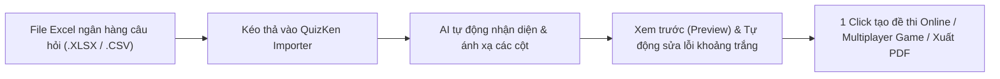

> **TL;DR (Tóm tắt nhanh):**  
> Việc sao chép (copy - paste) thủ công từng câu hỏi trắc nghiệm, từng đáp án và giải thích từ bảng tính **Microsoft Excel (.xlsx)** lên các hệ thống khảo thí trực tuyến là công việc tẻ nhạt, mất hàng giờ đồng hồ và rất dễ nhầm lẫn đáp án. Với tính năng **Smart Excel Importer** của **QuizKen**, hệ thống tự động nhận diện các cột: Câu hỏi, Phương án A, B, C, D, Đáp án đúng và Giải thích chi tiết mà không đòi hỏi định dạng cột cứng nhắc. Biến toàn bộ ngân hàng câu hỏi hàng trăm dòng thành phòng thi trực tuyến chỉ sau 1 cú nhấp chuột!

---

# Cách Chuyển Ngân Hàng Câu Hỏi Từ File Excel Thành Đề Thi Online Trong 5 Giây

Sau nhiều năm giảng dạy, hầu hết các thầy cô giáo, tổ chuyên môn và trung tâm khảo thí đều sở hữu những tệp **Excel** lưu trữ hàng ngàn câu hỏi trắc nghiệm được tích lũy qua các kỳ thi.

Tuy nhiên, khi muốn chuyển đổi kho dữ liệu này thành **bài thi trắc nghiệm trực tuyến** để học sinh làm bài trên điện thoại hoặc tổ chức đấu trường tương tác trên lớp, giáo viên thường gặp rào cản lớn:
* Nhiều phần mềm bắt buộc phải cài đặt template Excel mẫu cực kỳ phức tạp, sai một dấu cách là báo lỗi không nạp được.
* Không hỗ trợ câu hỏi có chứa công thức toán học, ký tự đặc biệt hoặc hình ảnh minh họa.
* Mất hàng buổi tối ngồi copy từng dòng thủ công.

Bài viết này sẽ hướng dẫn bạn phương pháp chuyển đổi thông minh và nhanh nhất hiện nay với **QuizKen**.

---

## 1. Cấu Trúc Bảng Excel Tiêu Chuẩn & Tính Năng Tự Động Khớp Cột (Auto-Mapping)

Khác với các phần mềm truyền thống bắt bạn phải xếp đúng thứ tự cột $A, B, C...$, **QuizKen AI** sử dụng thuật toán nhận diện ngữ nghĩa thông minh:

| Tên cột trong Excel | Các biến thể được QuizKen tự nhận diện | Dữ liệu mẫu minh họa |
| :--- | :--- | :--- |
| **Nội dung câu hỏi** | `Câu hỏi`, `Question`, `Nội dung`, `De bai` | *Thủ đô của Việt Nam là thành phố nào?* |
| **Phương án A** | `Option A`, `A`, `Dap an A`, `Lua chon 1` | *Hà Nội* |
| **Phương án B** | `Option B`, `B`, `Dap an B`, `Lua chon 2` | *Hải Phòng* |
| **Phương án C** | `Option C`, `C`, `Dap an C`, `Lua chon 3` | *Đà Nẵng* |
| **Phương án D** | `Option D`, `D`, `Dap an D`, `Lua chon 4` | *TP. Hồ Chí Minh* |
| **Đáp án chính xác** | `Correct`, `Dap an dung`, `Answer`, `Ket qua` | *A* (hoặc gõ hẳn chữ *Hà Nội*) |
| **Lời giải / Ghi chú** | `Explanation`, `Giai thich`, `Ghi chu` | *Hà Nội là thủ đô của nước CHXHCN Việt Nam từ năm 1976.* |

---

## 2. Hướng Dẫn 3 Bước Nạp File Excel Lên QuizKen

### Bước 1: Chuẩn bị tệp Excel của bạn
* Đảm bảo hàng đầu tiên của bảng tính là tiêu đề các cột (Câu hỏi, A, B, C, D, Đáp án đúng).
* Lưu tệp dưới định dạng `.xlsx` hoặc `.csv`.

### Bước 2: Tải tệp lên hệ thống QuizKen
1. Đăng nhập vào: [https://app.quizken.com](https://app.quizken.com).
2. Tại màn hình chính, nhấn vào nút **Nhập từ File (Import)** và chọn **Microsoft Excel / CSV**.
3. Kéo và thả file Excel của bạn vào khung tải lên.

### Bước 3: Xác nhận ánh xạ cột và kích hoạt đề thi
* Hệ thống hiển thị bảng xem trước (Preview) 3 câu hỏi đầu tiên để bạn kiểm tra.
* Nếu muốn hoán vị ngẫu nhiên thứ tự câu hỏi và thứ tự đáp án (để chống học sinh nhìn bài nhau), bạn chỉ cần tích chọn tính năng **Đảo câu hỏi tự động**.
* Bấm **Hoàn tất**, bộ đề thi lập tức sẵn sàng để gửi link cho học sinh làm bài hoặc trình chiếu trên máy chiếu lớp học.

---

## 3. Các Tính Năng Nâng Cao Khi Dùng QuizKen Với File Excel

1. **Hỗ trợ công thức Toán học KaTeX:** Trong các ô Excel, nếu có chứa công thức dạng `$x^2 + 2x + 1 = 0$` hoặc $\sqrt{x}$, QuizKen sẽ tự động chuyển thành công thức toán học lung linh mà không bị vỡ định dạng.
2. **Không giới hạn số lượng câu hỏi:** Bạn có thể nạp một file Excel chứa 500 câu hỏi. Hệ thống sẽ tự động phân tách hoặc cho phép bạn tạo nhiều đề thi con theo từng chuyên đề ôn tập.
3. **Chấm điểm và xuất bảng điểm về lại Excel:** Sau khi học sinh hoàn thành bài kiểm tra trực tuyến, giáo viên có thể xuất ngược bảng điểm chi tiết (Thời gian làm bài, số câu đúng, điểm số, lịch sử chọn đáp án) về lại file Excel để nhập vào sổ điểm điện tử của nhà trường.

---

## 4. Trải Nghiệm Tiết Kiệm Thời Gian Ngay Hôm Nay

Đừng để những thao tác thủ công làm hao mòn năng lượng giảng dạy của bạn. Hãy để công nghệ số hóa của QuizKen giải phóng thời gian cho bạn!

Trải nghiệm tính năng Import Excel thông minh tại: [https://app.quizken.com](https://app.quizken.com).
