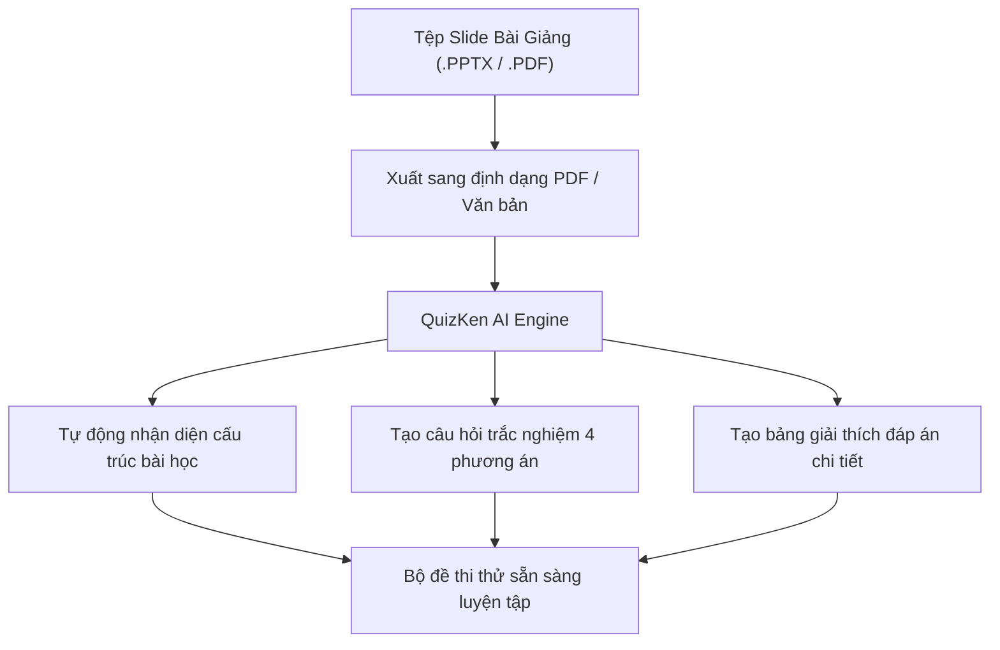

> **TL;DR (Tóm tắt nhanh):**  
> Học thuộc lòng hàng trăm trang slide bài giảng PowerPoint toàn các gạch đầu dòng khô khan là nguyên nhân hàng đầu khiến sinh viên bị quá tải và quên sạch kiến thức trong phòng thi. Bằng cách xuất file slide sang định dạng PDF và nạp trực tiếp vào **QuizKen**, hệ thống AI sẽ tự động phân tích các luận điểm cốt lõi trên từng slide, nhận diện mối quan hệ nguyên nhân - kết quả và sinh ra bộ đề thi trắc nghiệm 4 lựa chọn sát thực tế chỉ trong 3 giây. Vừa tiết kiệm 80% thời gian ôn bài, vừa ghi nhớ sâu nhờ phương pháp Active Recall!

---

# Cách Chuyển Slide PowerPoint Thành Bộ Đề Trắc Nghiệm Ôn Thi Bằng AI Cấp Tốc (2026)

Trước mỗi kỳ thi học kỳ tại trường đại học, nguồn tài liệu phổ biến nhất mà giảng viên cung cấp cho sinh viên chính là các tệp slide trình chiếu **PowerPoint (.pptx)** hoặc bản xuất PDF của slide.

Tuy nhiên, hầu hết sinh viên đều mắc phải một **sai lầm chí mạng trong phương pháp học tập**:
* Chỉ ngồi lật từng trang slide đọc đi đọc lại (Passive Re-reading).
* Slide bài giảng thường chỉ chứa các từ khóa vắn tắt, gạch đầu dòng ngắn cụt lủn, nếu không đi học nghe giảng thì khi đọc lại sẽ thấy rất rời rạc, khó hiểu.
* Khi bước vào phòng thi gặp các câu hỏi tình huống hoặc câu hỏi trắc nghiệm gài bẫy, sinh viên rất dễ chọn sai vì chưa từng được luyện tập phản xạ thực tế.

Giải pháp mang tính cách mạng hiện nay là **chuyển hóa toàn bộ slide thuyết trình thành bài thi trắc nghiệm tương tác bằng Trí tuệ nhân tạo (AI)**. Dưới đây là hướng dẫn chi tiết từng bước.

---

## 1. Cơ Chế AI Phân Tích Slide Và Sinh Câu Hỏi Trắc Nghiệm

Không giống như việc sao chép văn bản thông thường, mô hình AI sư phạm của **QuizKen** được huấn luyện theo các chuẩn khảo thí quốc tế:
1. **Trích xuất phân cấp tiêu đề (Heading & Bullet Parsing):** AI nhận diện đâu là chủ đề lớn của buổi học, đâu là các khái niệm con và đặc điểm phân biệt.
2. **Xác định các "bẫy" đề thi tiềm năng:** AI tự động phát hiện các cặp khái niệm dễ gây nhầm lẫn (ví dụ: nguyên nhân vs kết quả, ưu điểm vs nhược điểm) để tạo ra các phương án nhiễu (distractors) hợp lý.
3. **Phân loại độ khó theo thang Bloom:** Tự động tạo các câu hỏi ở nhiều mức độ: Nhận biết khái niệm, Thông hiểu bản chất và Vận dụng tình huống thực tiễn.

---

## 2. Hướng Dẫn 3 Bước Biến Slide Thành Đề Thi Thử Trên QuizKen

### Bước 1: Xuất tệp PowerPoint sang định dạng PDF
Để hệ thống AI xử lý nhanh và giữ nguyên bố cục chữ chuẩn xác nhất:
1. Mở file bài giảng trong Microsoft PowerPoint hoặc Google Slides.
2. Vào **File > Save As (Lưu dưới dạng)** hoặc **Export > Create PDF/XPS Document**.
3. Lưu tệp PDF về máy tính hoặc điện thoại của bạn.

### Bước 2: Tải tệp PDF lên QuizKen
1. Truy cập vào nền tảng: [https://app.quizken.com](https://app.quizken.com).
2. Tại màn hình Tạo đề thi AI, bấm vào nút **Tải file tài liệu** và chọn file PDF slide bạn vừa xuất.
3. Bạn có thể tùy chọn:
   * **Số lượng câu hỏi:** Từ 10 đến 50 câu tùy độ dài của buổi học.
   * **Cấu trúc dạng thức:** Trắc nghiệm nhiều lựa chọn A, B, C, D hoặc dạng thức Đúng/Sai 4 ý mới nhất.
   * **Mức độ nhận thức:** Cân bằng giữa nhận biết lý thuyết và vận dụng bài tập.

### Bước 3: Nhận đề thi và bắt đầu luyện tập
Nhấn nút **Tạo Quiz Ngay**. Chỉ mất khoảng 3 - 5 giây, QuizKen sẽ hoàn thành việc đọc toàn bộ các trang slide và hiển thị bộ đề thi trắc nghiệm hoàn chỉnh. Bạn có thể:
* Làm bài trực tiếp trên giao diện tương tác với đồng hồ đếm ngược.
* Bấm xem lời giải thích chi tiết vì sao phương án đó đúng hoặc sai.
* Bấm nút **Xuất file PDF** để in ra giấy tự làm bài kiểm tra thử trước ngày thi.

---

## 3. Bảng So Sánh Hiệu Quả Ôn Thi

| Phương pháp ôn tập | Khả năng ghi nhớ sau 7 ngày | Thời gian cần bỏ ra | Mức độ hứng thú |
| :--- | :--- | :--- | :--- |
| **Đọc lướt slide thụ động** | Dưới 25% (Rất dễ quên) | 4 - 6 tiếng ngồi đọc lặp lại | Thấp (Dễ buồn ngủ) |
| **Gõ lại đề cương tóm tắt** | Khoảng 50% | 3 - 5 tiếng gõ máy tính | Trung bình |
| **Luyện đề trắc nghiệm AI với QuizKen** | **Trên 85% (Active Recall)** | **Chỉ 30 - 45 phút luyện đề** | **Cao (Hào hứng như chơi game)** |

---

## 4. 💡 Mẹo Ôn Thi Nhóm Cực Hay: Đấu Trường Trực Tiếp (Multiplayer Arena)

Nếu bạn có một nhóm bạn cùng lớp hoặc câu lạc bộ học tập đang ôn thi chung một môn, bạn không cần phải học một mình:
1. Sau khi tạo xong bộ đề thi từ slide bài giảng trên QuizKen, bấm nút **Tổ chức thi đấu trực tiếp (Host Game)**.
2. Hệ thống sẽ cấp một **Mã PIN phòng chơi** và mã QR.
3. Chia sẻ mã PIN cho bạn bè cùng lớp đăng nhập trên điện thoại để cùng thi đua trả lời câu hỏi theo thời gian thực.
4. Bảng xếp hạng Top điểm cao sau mỗi câu hỏi sẽ biến buổi học nhóm ôn thi căng thẳng thành một trận đấu kịch tính và hào hứng như gameshow truyền hình!

> 🚀 **Trải nghiệm ngay:** [Nạp file slide bài giảng vào QuizKen để tạo đề thi AI miễn phí ngay bây giờ!](https://app.quizken.com)

---

## Câu hỏi thường gặp khi chuyển slide PowerPoint thành quiz

### Một file slide có dung lượng nặng hoặc nhiều hình ảnh QuizKen có đọc được không?
QuizKen tối ưu bộ lọc văn bản, tự động trích xuất các phần chữ lý thuyết quan trọng từ slide và bỏ qua các hình ảnh trang trí nặng nề, giúp tốc độ sinh đề luôn duy trì ở mức 3 - 5 giây.

### Giảng viên ra đề thi trắc nghiệm có bám sát nội dung slide không?
Đa số các trường đại học hiện nay đều xây dựng ngân hàng câu hỏi thi kết thúc học phần dựa trên các mục tiêu đầu ra (Learning Outcomes) được tóm tắt trên slide. Việc luyện tập trực tiếp từ slide giúp bạn bao quát toàn bộ trọng tâm của môn học.

### Tôi có thể chia sẻ bộ đề thi vừa tạo cho bạn bè không?
Hoàn toàn có thể. QuizKen cho phép bạn sao chép liên kết làm bài thi để gửi qua Zalo, Messenger hoặc xuất file PDF in ấn kèm bảng đáp án chi tiết.
