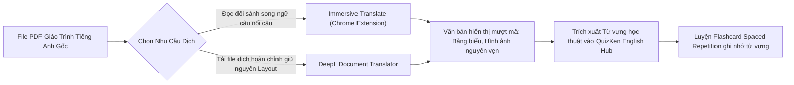

> **TL;DR (Tóm tắt nhanh):**  
> Khi học tài liệu, giáo trình hoặc bài báo nghiên cứu bằng tiếng Anh, việc copy từng đoạn sang Google Dịch vừa tốn thời gian vừa làm mất hoàn toàn hình ảnh minh họa và bảng biểu. Giải pháp **dịch song ngữ tài liệu PDF miễn phí** đỉnh cao nhất năm 2026 là sử dụng tiện ích **Immersive Translate** (Dịch song ngữ đối sánh Anh - Việt câu nối câu trực tiếp trên file PDF) kết hợp công cụ dịch tài liệu giữ nguyên 100% bố cục gốc của **DeepL Document Translator** (`deepl.com`). Sau khi đọc hiểu bản dịch, bạn có thể nhập các cặp từ vựng chuyên ngành vào **QuizKen English Hub** để tạo bộ flashcard ôn luyện phản xạ từ vựng tự động!

---

# Hướng Dẫn Dịch Song Ngữ Tài Liệu PDF Bằng AI Miễn Phí Giữ Nguyên Bố Cục 2026

Đối với học sinh học chương trình Tiếng Anh tăng cường, sinh viên luyện thi chứng chỉ IELTS/VSTEP B1-B2 hoặc sinh viên các trường đại học quốc tế, việc đọc giáo trình tiếng Anh là yêu cầu bắt buộc.

Tuy nhiên, dịch tài liệu PDF theo cách truyền thống luôn mang lại những trải nghiệm "ác mộng":
* Dùng công cụ dịch thông thường khiến các cột văn bản bị xô lệch, bảng biểu vỡ khung và hình ảnh minh họa bị đẩy xuống cuối trang.
* Khi dịch đè hoàn toàn sang tiếng Việt, bạn không thể tra cứu lại thuật ngữ gốc tiếng Anh là gì để dùng trong bài kiểm tra.
* Sao chép từng câu để dịch thủ công thì ngắt quãng mạch tư duy đọc hiểu, khiến bạn mất cả tiếng đồng hồ cho một bài đọc 3 trang.

Bài viết này từ **QuizKen** sẽ hướng dẫn bạn kỹ thuật **dịch song ngữ tài liệu PDF miễn phí** hiện đại nhất, giúp bạn vừa hiểu tường tận nội dung bài học vừa trau dồi vốn từ vựng tiếng Anh học thuật tự nhiên!

---

## 1. Ưu Điểm Tuyệt Đối Của Phương Pháp Đọc Tài Liệu Song Ngữ (Bilingual Reading)

Nghiên cứu của các chuyên gia ngôn ngữ học chỉ ra rằng: **Đọc song ngữ đối chiếu (Bilingual Parallel Reading) giúp tăng tốc độ tiếp thu kiến thức lên 2.5 lần** so với việc chỉ đọc bản dịch tiếng Việt hoặc vật lộn đọc bản tiếng Anh đơn thuần.

* **Hiểu sâu ngữ cảnh:** Bạn nhìn thấy câu tiếng Việt để nắm bắt ý chính ngay lập tức, nhưng mắt vẫn lướt qua câu tiếng Anh tương ứng để ghi nhớ cách tác giả dùng cụm từ (Collocations) và cấu trúc câu học thuật.
* **Không bị "lệch nghĩa" do máy dịch:** Nếu câu tiếng Việt có chỗ nào dịch chưa mượt mà, bạn chỉ cần liếc sang câu tiếng Anh gốc đối diện để kiểm chứng.

---

## 2. Top 3 Công Cụ Dịch Song Ngữ PDF Tốt Nhất 2026

### Cách 1: Immersive Translate (Dịch song ngữ đối sánh câu nối câu - Khuyên dùng)
[Immersive Translate (Dịch đắm chìm)](https://immersivetranslate.com) là tiện ích mở rộng trình duyệt dẫn đầu thế giới hiện nay về khả năng dịch song ngữ tài liệu:
1. Cài đặt tiện ích **Immersive Translate** trên Chrome, Cốc Cốc, Edge hoặc Firefox.
2. Mở file PDF tài liệu trên trình duyệt hoặc kéo thả file PDF vào trình đọc của tiện ích.
3. Bấm vào biểu tượng tiện ích và chọn **Dịch PDF (Bilingual Translation)**.
4. Ngay lập tức, bên dưới mỗi đoạn văn bản hoặc câu tiếng Anh, một dòng dịch tiếng Việt chuẩn xác sẽ xuất hiện song song.
5. Toàn bộ sơ đồ, hình ảnh minh họa, bảng số liệu và chỉ số trang đều được giữ nguyên 100%.

### Cách 2: DeepL Document Translator (Giữ nguyên định dạng trang gốc tuyệt đối)
Nếu bạn cần một file PDF hoặc Word tiếng Việt hoàn chỉnh để in ấn nộp bài tập:
1. Truy cập: `https://www.deepl.com/translator/files`.
2. Chọn dịch từ: **English** sang **Vietnamese**.
3. Tải file tài liệu định dạng `.pdf`, `.docx` hoặc `.pptx` lên hệ thống.
4. DeepL sử dụng mạng nơ-ron học sâu giúp bảo toàn tuyệt đối phông chữ, màu sắc và vị trí các khối hộp văn bản. Sau khi xử lý xong, bạn chỉ cần tải file đã dịch về máy.

### Cách 3: Google Tài liệu (Google Docs - Miễn phí không giới hạn dung lượng)
1. Tải file PDF lên Google Drive > Nhấp chuột phải chọn **Mở bằng Google Tài liệu**.
2. Trên thanh menu, chọn **Công cụ (Tools)** > **Dịch tài liệu (Translate document)**.
3. Đặt tên file mới và chọn ngôn ngữ dịch sang **Tiếng Việt**.
4. Google Docs sẽ tự động tạo một tệp tài liệu mới chứa toàn bộ nội dung đã dịch mà không tốn bất kỳ chi phí nào.

---

## 3. Bảng So Sánh Các Công Cụ Dịch Thuật PDF 2026

| Tiêu chí | Immersive Translate | DeepL Translator | Google Docs Translate |
| :--- | :--- | :--- | :--- |
| **Định dạng hiển thị** | **Song ngữ đối xứng (Anh - Việt)** | Tiếng Việt nguyên trang | Tiếng Việt dạng văn bản Word |
| **Bảo toàn hình ảnh & bảng biểu** | **Tuyệt đối 100%** | Rất tốt | Khá tốt |
| **Độ tự nhiên của bản dịch** | Tùy chọn nguồn AI (OpenAI, DeepL, Claude) | Rất mượt mà, văn phong học thuật | Khá tốt |
| **Chi phí** | Miễn phí gói cơ bản | Miễn phí file dung lượng nhỏ | **Miễn phí 100% không giới hạn** |

---

## 4. Cầu Nối QuizKen English Hub: Biến Bản Dịch Thành Vốn Từ Vựng Sống

Sau khi đã đọc xong tài liệu bằng phương pháp song ngữ, bạn sẽ tích lũy được hàng chục từ vựng và thuật ngữ chuyên ngành đắt giá. Tuy nhiên, nếu không ôn lại, bạn sẽ quên 80% số từ đó trong vòng 3 ngày tới!

Hãy kết hợp tính năng **English Hub trên [QuizKen](https://quizken.com)**:
1. **Lọc từ vựng mới:** Sao chép các cặp từ mới (Từ tiếng Anh - Nghĩa tiếng Việt) vừa học được trong bài đọc.
2. **Nhập vào QuizKen:** Chọn tính năng **Tạo Flashcard Tiếng Anh Thông Minh**.
3. **AI Tự Động Bổ Sung Phiên Âm IPA & Câu Ví Dụ:** QuizKen sẽ tự động phân loại cấp độ từ vựng theo khung CEFR (A1 đến C2), thêm phiên âm chuẩn IPA và tạo câu ví dụ thực tế.
4. **Ôn luyện ngắt quãng (Spaced Repetition):** Hệ thống sẽ tự động lên lịch nhắc bạn ôn lại từ vựng theo thuật toán ghi nhớ SM-2 khoa học, đảm bảo bạn làm chủ vốn từ để tự tin viết luận và làm bài thi tiếng Anh đạt điểm tối đa!

Áp dụng ngay bộ đôi công cụ dịch song ngữ và hệ thống ôn từ vựng **QuizKen** để việc đọc giáo trình tiếng Anh trở nên nhẹ nhàng và hiệu quả hơn bao giờ hết!
