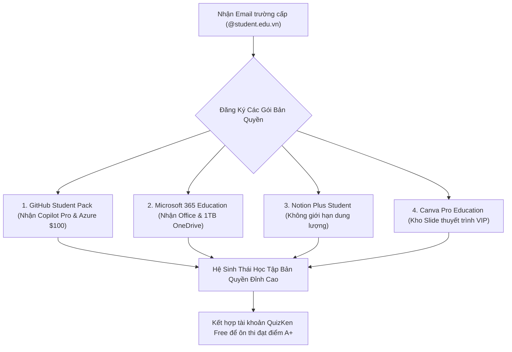

> **TL;DR (Tóm tắt nhanh):**  
> Khi nhập học đại học hoặc cao đẳng, mỗi sinh viên đều được nhà trường cấp một hòm thư điện tử có đuôi tên miền **`.edu`** hoặc **`.edu.vn`**. Thay vì chỉ dùng để nhận thông báo từ phòng đào tạo, bạn có thể dùng **email EDU nhận bản quyền phần mềm miễn phí** với tổng giá trị quà tặng lên tới hơn **$5,000/năm**: bao gồm trọn bộ Microsoft 365 (Word, Excel, 1TB OneDrive), Notion Plus, gói GitHub Student Developer Pack (miễn phí GitHub Copilot Pro, $100 Azure Cloud), bộ công cụ JetBrains và Canva Pro. Khi kết hợp cùng tài khoản học tập miễn phí trên **QuizKen**, bạn sẽ sở hữu bộ công cụ công nghệ đỉnh cao nhất suốt 4 năm đại học!

---

# Hướng Dẫn Tận Dụng Email .EDU Nhận Bản Quyền Phần Mềm Miễn Phí 2026

Rất nhiều bạn sinh viên ra trường mới ngậm ngùi tiếc nuối: *"Biết thế ngày xưa mình kích hoạt các gói tài khoản bản quyền dành riêng cho sinh viên sớm hơn!"* 

Để hỗ trợ thế hệ trẻ học tập và nghiên cứu, hầu hết các tập đoàn công nghệ lớn trên thế giới (Microsoft, GitHub, JetBrains, Notion, Canva, Spotify) đều có các chương trình tài trợ 100% chi phí bản quyền phần mềm cho sinh viên còn đang theo học. Tất cả những gì bạn cần chỉ là một chiếc thẻ sinh viên còn hạn và một địa chỉ **email có đuôi `.edu` hoặc `.edu.vn`**.

Dưới đây là danh sách tổng hợp và hướng dẫn chi tiết cách kích hoạt toàn bộ các gói ưu đãi này trong năm 2026!

---

## 1. Bảng Tổng Hợp Giá Trị Bản Quyền Dành Cho Sinh Viên Có Email .EDU

| Gói bản quyền | Đơn vị cung cấp | Giá thị trường | Quyền lợi sinh viên nhận được | Cổng đăng ký chính thức |
| :--- | :--- | :--- | :--- | :--- |
| **GitHub Student Pack** | GitHub / Microsoft | $2,000+/năm | **GitHub Copilot Pro miễn phí**, $100 Azure Credits, tên miền .me | `education.github.com` |
| **Microsoft 365 A1/A3** | Microsoft | $70/năm | Word, Excel, PowerPoint bản quyền + **1TB lưu trữ OneDrive** | `microsoft.com/education` |
| **Notion Plus Plan** | Notion | $120/năm | Gói Plus không giới hạn dung lượng tải file + tính năng cộng tác | `notion.so/students` |
| **JetBrains All Products** | JetBrains | $289/năm | Trọn bộ IDE lập trình (IntelliJ IDEA, PyCharm, WebStorm, CLion) | `jetbrains.com/community/education` |
| **Canva Pro Education** | Canva | $120/năm | Hàng triệu mẫu thiết kế slide, ảnh thuyết trình cao cấp | `canva.com/education` |
| **Spotify / Apple Music** | Spotify / Apple | $35/năm | Giảm 50% phí nghe nhạc bản quyền hàng tháng | Qua xác thực SheerID |

---

## 2. Hướng Dẫn Kích Hoạt Chi Tiết Từng Gói Ưu Đãi

### 1. Kích hoạt GitHub Student Developer Pack & Copilot Pro
1. Truy cập cổng chính thức: `https://education.github.com/pack`.
2. Bấm **Sign up for Student Developer Pack**.
3. Đăng nhập bằng tài khoản GitHub cá nhân và thêm email trường `.edu.vn` vào mục tài khoản.
4. Chụp ảnh rõ nét hai mặt của **Thẻ sinh viên** (hoặc Giấy xác nhận sinh viên / Bảng điểm học kỳ gần nhất có ghi rõ năm học 2025 - 2026).
5. **Mẹo duyệt tự động 100%:** Hãy bật định vị GPS trên điện thoại khi chụp ảnh thẻ tại khuôn viên trường đại học của bạn. Hệ thống của GitHub sẽ đối chiếu tọa độ và duyệt tài khoản chỉ sau 24 - 48 giờ.

### 2. Kích hoạt Microsoft 365 & 1TB OneDrive
1. Truy cập: `https://www.microsoft.com/vi-vn/education/products/office`.
2. Nhập địa chỉ email trường vào ô đăng ký > Nhấn **Bắt đầu**.
3. Chọn tùy chọn **"Tôi là sinh viên"**.
4. Mở hòm thư sinh viên để lấy mã xác thực 6 chữ số.
5. Ngay lập tức, bạn được cấp quyền sử dụng bộ ứng dụng Office trực tuyến và **1,000 GB (1TB) dung lượng lưu trữ đám mây OneDrive** để sao lưu toàn bộ giáo trình, đồ án suốt 4 năm học.

### 3. Kích hoạt Notion Plus Miễn Phí
1. Đăng ký tài khoản Notion bằng email đuôi `.edu` tại `https://www.notion.so`.
2. Vào phần **Settings & members** > **Plans**.
3. Kéo xuống mục **Student discount** > Bấm **Get free Education plan**.
4. Không gian làm việc của bạn sẽ được nâng cấp lên gói Plus lập tức, cho phép tải lên các file video, PDF giáo trình dung lượng hàng trăm MB mà không bị giới hạn 5MB như tài khoản thông thường.

---

## 3. Những Sai Lầm Phổ Biến Khi Dùng Email Sinh Viên Cần Tránh

> [!WARNING]
> * **Không dùng email trường để đăng ký các dịch vụ nhạy cảm cá nhân:** Khi bạn tốt nghiệp, một số trường sẽ thu hồi hoặc xóa hòm thư sinh viên sau 6 - 12 tháng. Vì vậy, các tài khoản ngân hàng, tài khoản mạng xã hội chính phải dùng Gmail cá nhân.
> * **Không mua bán hoặc chia sẻ email EDU trái phép:** Các hành vi rao bán email sinh viên trên mạng vi phạm nghiêm trọng chính sách bảo mật của các hãng công nghệ và có thể dẫn đến việc toàn bộ dải tên miền của trường bị đưa vào danh sách đen (Blacklist).

---

## 4. Cầu Nối QuizKen: Mảnh Ghép Cuối Cùng Cho Hành Trình Học Tập Xuất Sắc

Sau khi đã trang bị đầy đủ bộ công cụ bản quyền thế giới từ GitHub, Microsoft và Notion, mảnh ghép quan trọng nhất để giúp bạn chuyển hóa kiến thức thành điểm số thực tế chính là **nền tảng ôn thi trắc nghiệm [QuizKen](https://quizken.com)**:

1. **Soạn bài tập trên Word / PowerPoint:** Sử dụng bộ Office 365 bản quyền vừa nhận để thiết kế slide thuyết trình và đề cương học tập.
2. **Kéo thả đề cương vào QuizKen:** Hệ thống AI của QuizKen sẽ tự động phân tích bài viết và tạo ra các bộ đề trắc nghiệm thi thử sát với đề thi học kỳ của trường.
3. **Luyện tập trên nền tảng miễn phí:** QuizKen cung cấp đầy đủ các tính năng tạo đề AI, Flashcard Spaced Repetition và phòng thi Multiplayer hoàn toàn miễn phí cho học sinh, sinh viên Việt Nam.

Hãy kiểm tra hòm thư sinh viên và kích hoạt ngay các gói bản quyền tuyệt vời này để tối ưu hóa năng suất học tập của bạn ngay hôm nay!
