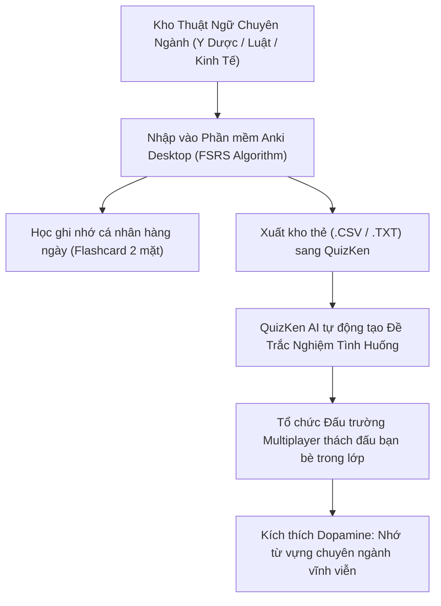

> **TL;DR (Tóm tắt nhanh):**  
> Việc **học từ vựng chuyên ngành Anki miễn phí** bằng phương pháp lặp lại ngắt quãng (Spaced Repetition) với thuật toán FSRS và SM-2 là "tiêu chuẩn vàng" để sinh viên các khối ngành Y Dược, Luật, Tài chính - Ngân hàng và Công nghệ ghi nhớ hàng nghìn thuật ngữ Latin hoặc tiếng Anh chuyên ngành. Tuy nhiên, việc chỉ học một mình trên Anki rất dễ gây cảm giác nhàm chán và bỏ dở sau vài tuần. Bằng cách xuất kho thẻ Anki sang **QuizKen**, bạn có thể biến bộ từ vựng đó thành các câu hỏi trắc nghiệm đối kháng trong phòng thi đấu Multiplayer cùng bạn bè, giúp tăng động lực học tập gấp 10 lần!

---

# Phương Pháp Học Hàng Nghìn Từ Vựng Chuyên Ngành Với Anki & QuizKen 2026

Học sinh, sinh viên các khối ngành đặc thù thường phải đối mặt với khối lượng từ vựng chuyên ngành khổng lồ:
* **Sinh viên Y khoa & Dược học:** Hàng nghìn tên thuốc, thuật ngữ giải phẫu học gốc Latin và cơ chế bệnh sinh học phức tạp.
* **Sinh viên Luật:** Các khái niệm pháp lý, điều khoản bộ luật và án lệ cần ghi nhớ chính xác từng từ ngữ.
* **Sinh viên Kinh tế & CNTT:** Từ vựng tiếng Anh chuyên ngành tài chính, logistics, cấu trúc dữ liệu và thuật toán.

Nếu chỉ ghi chép vào sổ tay hoặc học vẹt trước ngày thi, bạn sẽ quên tới 80% lượng từ vựng này chỉ sau một kỳ nghỉ hè. Đó là lý do vì sao **Anki** – phần mềm Flashcard mã nguồn mở lâu đời nhất thế giới – luôn là lựa chọn hàng đầu của các thủ khoa.

Bài viết này sẽ hướng dẫn bạn phương pháp **học từ vựng chuyên ngành Anki miễn phí** và cách kết hợp cùng QuizKen để việc học từ vựng trở nên thú vị và hiệu quả hơn bao giờ hết!

---

## 1. Cơ Chế Thuật Toán Lặp Lại Ngắt Quãng FSRS & SM-2 Của Anki

Não bộ con người tuân theo **Đường cong quên lãng Ebbinghaus**: Ngay sau khi học một từ mới, khả năng ghi nhớ sẽ giảm nhanh chóng theo hàm mũ.

Anki giải quyết vấn đề này bằng cách tự động tính toán thời điểm chính xác mà bạn **sắp sửa quên** một từ để đưa thẻ Flashcard đó xuất hiện trở lại:
* Lần 1: Học từ mới ➔ Nhắc lại sau 10 phút.
* Lần 2: Nếu bạn chọn "Good" ➔ Nhắc lại sau 1 ngày.
* Lần 3: Nhắc lại sau 3 ngày ➔ 7 ngày ➔ 16 ngày ➔ 1 tháng.
* Trong các phiên bản Anki mới nhất năm 2026, thuật toán **FSRS (Free Spaced Repetition Scheduler)** đã thay thế thuật toán SM-2 cũ, giúp tối ưu hóa khoảng thời gian ôn tập chính xác hơn 30% và giảm bớt số lượng thẻ cần xem mỗi ngày.

---

## 2. Hướng Dẫn Tải & Thiết Lập Anki Miễn Phí 100%

* **Trên máy tính (Windows / macOS / Linux):** Truy cập trang chính thức `https://apps.ankiweb.net` để tải bản **Anki Desktop** hoàn toàn miễn phí.
* **Trên điện thoại Android:** Cài đặt ứng dụng mã nguồn mở **AnkiDroid** miễn phí từ Google Play Store.
* **Đồng bộ hóa đám mây (Cloud Sync):** Đăng ký một tài khoản **AnkiWeb** miễn phí để đồng bộ tiến độ học giữa máy tính và điện thoại.

### Mẹo tải các bộ thẻ chia sẻ miễn phí (Shared Decks):
Cộng đồng Anki trên toàn cầu chia sẻ hàng triệu bộ thẻ có sẵn chất lượng cao:
1. Mở trang: `https://ankiweb.net/shared/decks/`.
2. Tìm kiếm theo từ khóa: *Medical Terminology*, *USMLE*, *IELTS Academic 8.0*, *Từ vựng Luật Dân sự*.
3. Bấm **Download** và mở file `.apkg` vừa tải, toàn bộ thẻ ghi nhớ kèm âm thanh phát âm và hình ảnh minh họa sẽ tự động nạp vào Anki của bạn.

---

## 3. Bảng So Sánh Thế Mạnh: Anki vs QuizKen

| Tiêu chí | Anki Desktop | Nền tảng QuizKen |
| :--- | :--- | :--- |
| **Thế mạnh cốt lõi** | Tùy biến thuật toán lặp lại ngắt quãng cực sâu | **Tạo đề AI siêu tốc từ PDF + Gamification tương tác** |
| **Hình thức ôn tập** | Lật thẻ Flashcard độc lập từng câu | **Đa dạng: Trắc nghiệm 4 lựa chọn, Đúng/Sai, Điền từ** |
| **Trải nghiệm học tập** | Nghiêm túc, dễ chán nếu học lâu | **Hào hứng, âm thanh sống động, bảng xếp hạng Live** |
| **Tính năng nhóm** | Không hỗ trợ chơi nhóm | **Đấu trường thi đấu đối kháng nhiều người chơi (Multiplayer)** |
| **Khả năng giải thích AI** | Không có (phải tự soạn câu trả lời) | **AI Tutor giải thích chi tiết ngữ cảnh sử dụng** |

---

## 4. Công Thức Kết Hợp Hoàn Hảo: Anki + QuizKen

Để duy trì động lực học tập bền bỉ và không bao giờ "bỏ cuộc giữa chừng" khi học từ vựng chuyên ngành:

1. **Ghi nhớ nền tảng trên Anki (15 phút mỗi sáng):** Mở Anki trên điện thoại và hoàn thành số lượng thẻ cần xem lại (Due cards) trong ngày theo đúng thuật toán FSRS.
2. **Xuất kho thẻ sang QuizKen:** Vào Anki > Chọn bộ thẻ > Bấm **Export** dạng file `.txt` hoặc bảng tính `.csv`.
3. **Nạp vào [QuizKen](https://quizken.com):** Sử dụng tính năng **Tạo Đề Thi Trắc Nghiệm Bằng AI** trên QuizKen. Hệ thống sẽ tự động chuyển hóa các định nghĩa từ vựng thành các câu hỏi tình huống thực tế.
4. **Thách đấu cùng bạn bè (Multiplayer Arena):** Tạo một phòng chơi trên QuizKen và rủ bạn cùng nhóm học tập tham gia thi đấu xem ai đạt điểm cao hơn. Sự cạnh tranh lành mạnh sẽ kích thích não bộ tiết ra dopamine, giúp việc học từ vựng chuyên ngành khô khan trở thành một trò chơi trí tuệ cuốn hút!

Bằng cách kết hợp kỷ luật cá nhân của **Anki** cùng không khí thi đấu sôi nổi của **QuizKen**, bạn sẽ dễ dàng làm chủ hàng nghìn từ vựng chuyên ngành và tự tin bứt phá trong kỳ thi học kỳ sắp tới!
