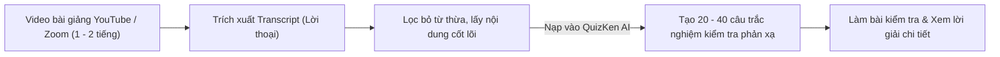

> **TL;DR (Tóm tắt nhanh):**  
> Xem các video bài giảng chuyên đề dài 1 - 2 tiếng trên YouTube hoặc bản ghi lớp học Zoom thường khiến người học bị quá tải và không kiểm tra được mức độ hiểu bài thực tế. Bằng cách áp dụng mẹo trích xuất phụ đề tự động (Transcript) miễn phí trên YouTube và nạp phần văn bản này vào **QuizKen**, hệ thống AI sẽ tự động phân tích toàn bộ lời giảng của thầy cô và tạo ra bộ câu hỏi trắc nghiệm kiểm tra phản xạ chỉ trong 3 giây. Vừa giúp bạn nắm chắc kiến thức cốt lõi, vừa biến giờ tự học thụ động thành buổi luyện thi tương tác sôi nổi!

---

# Cách Lấy Transcript Và Tạo Câu Hỏi Trắc Nghiệm Từ Video Bài Giảng YouTube Bằng AI (2026)

Học tập qua các video bài giảng trên **YouTube**, bài giảng lưu trữ trên **Google Drive** hoặc các buổi ghi âm **Zoom Webinar** đã trở thành thói quen phổ biến của học sinh, sinh viên trong kỷ nguyên số.

Tuy nhiên, việc học qua video thường tồn tại một "cái bẫy tâm lý" lớn: **Ảo tưởng về sự thành thạo (Illusion of Competence)**. Khi ngồi nghe giảng viên nói thao thao bất tuyệt và gật gù hiểu bài, bạn tưởng rằng mình đã nắm chắc kiến thức. Nhưng ngay khi tắt video và nhìn vào một tờ đề thi trắng, bạn bỗng thấy đầu óc trống rỗng vì chưa từng thực hành tư duy phản biện.

Bài viết này sẽ hướng dẫn bạn phương pháp **chuyển đổi lời giảng video thành bài thi trắc nghiệm trắc nghiệm AI** cực nhanh để kiểm tra độ hiểu bài ngay lập tức!

---

## 1. Cách Lấy Transcript (Lời Thoại) Từ Video YouTube Trong 10 Giây

Bạn hoàn toàn không cần phải cài đặt thêm bất kỳ phần mềm phức tạp nào để lấy văn bản phụ đề từ YouTube:

1. **Bước 1:** Mở video bài giảng bạn đang xem trên YouTube (trên máy tính).
2. **Bước 2:** Nhìn xuống bên dưới tiêu đề video, tại phần mô tả (Description), nhấn vào chữ **"...thêm" (Show more)**.
3. **Bước 3:** Kéo xuống dưới cùng phần mô tả và nhấp vào nút **Hiện bản chép lời (Show transcript)**.
4. **Bước 4:** Một khung phụ đề sẽ xuất hiện ở góc phải màn hình kèm mốc thời gian. Bạn có thể nhấn vào dấu 3 chấm ở góc khung transcript và chọn **Chuyển đổi dấu thời gian (Toggle timestamps)** để ẩn bớt các con số phút giây.
5. **Bước 5:** Bôi đen và sao chép (Copy) toàn bộ đoạn văn bản lời thoại này.

*(Mẹo bổ sung: Nếu video trên Zoom hoặc Google Drive không có phụ đề sẵn, bạn có thể tải file âm thanh lên các công cụ nhận diện giọng nói tiếng Việt miễn phí như Whisper AI của OpenAI để trích xuất văn bản).*

---

## 2. Các Bước Biến Lời Thoại Video Thành Đề Thi Thử Trên QuizKen

Sau khi đã có trong tay đoạn văn bản lời thoại bài giảng:

1. **Bước 1: Truy cập QuizKen:** Mở trình duyệt và vào trang [https://app.quizken.com](https://app.quizken.com).
2. **Bước 2: Dán văn bản Transcript:** Dán toàn bộ nội dung lời thoại mà bạn vừa sao chép từ YouTube vào ô nhập văn bản của QuizKen.
3. **Bước 3: Tùy chỉnh thông số bài thi:**
   * Chọn số lượng câu hỏi trắc nghiệm mong muốn (từ 10 đến 30 câu).
   * Chọn mức độ nhận thức (Nhận biết định nghĩa, Thông hiểu nguyên lý hoặc Vận dụng giải bài tập).
4. **Bước 4: Nhấn nút Tạo Quiz Ngay:** AI của QuizKen sẽ quét toàn bộ lời nói của giảng viên, tự động loại bỏ những câu nói đùa hay lời chào hỏi bên lề, giữ lại các luận điểm học thuật đắt giá nhất để tạo thành bộ câu hỏi trắc nghiệm 4 lựa chọn chuẩn xác 100%.

---

## 3. Bảng So Sánh Hiệu Quả Tiếp Thu Video Bài Giảng

| Cách học | Mức độ tập trung | Khả năng ghi nhớ sau 3 ngày | Thời gian ôn lại |
| :--- | :--- | :--- | :--- |
| **Chỉ ngồi xem video tua 1.5x** | Thấp (Dễ lơ đễnh, buồn ngủ) | Dưới 30% | Phải xem lại cả video 1 tiếng |
| **Vừa xem vừa ghi chép tay** | Trung bình | Khoảng 55% | Đọc lại 5 - 10 trang vở |
| **Lấy transcript làm Quiz AI trên QuizKen** | **Rất cao (Não bộ vận động trả lời)** | **Trên 85% (Kiểm tra hiểu bài tức thì)** | **Chỉ mất 5 phút làm lại Quiz** |

---

## 4. 💡 Mẹo Cho Giáo Viên & Giảng Viên Online

Nếu bạn là giáo viên đang dạy học trực tuyến hoặc xây dựng khóa học trên mạng:
* Thay vì chỉ giao video cho học sinh tự xem về nhà (học sinh thường xem lướt hoặc không xem hết), bạn hãy lấy transcript video tạo thành một bài kiểm tra nhanh 5 câu hỏi trên QuizKen.
* Gửi mã PIN phòng thi hoặc liên kết làm bài cho học sinh sau mỗi video.
* Bảng thống kê kết quả sẽ cho bạn biết chính xác phần kiến thức nào trong video mà đa số học sinh còn đang hiểu sai để kịp thời giải đáp trong buổi học tiếp theo!

> 🎬 **Tối ưu việc học ngay:** [Sao chép transcript bài giảng và tạo đề thi AI miễn phí trên QuizKen tại đây!](https://app.quizken.com)

---

## Câu hỏi thường gặp khi tạo đề thi từ video bài giảng

### Phụ đề tự động của YouTube có bị sai chính tả tiếng Việt không?
YouTube hiện nay áp dụng mô hình nhận diện giọng nói AI tiếng Việt rất chuẩn xác đối với các bài giảng có âm thanh rõ ràng. QuizKen cũng có bộ lọc ngôn ngữ thông minh giúp tự động sửa các lỗi chính tả ngữ cảnh trước khi sinh đề.

### Video dài trên 2 tiếng có đưa được vào QuizKen không?
Có! Với những video dài có lượng transcript lớn, bạn có thể nạp toàn bộ văn bản vào mục **Kho Kiến Thức (Knowledge Base)** của QuizKen để AI xử lý toàn diện mà không lo bị giới hạn ký tự.

### Tôi có thể chuyển câu hỏi vừa tạo thành slide trò chơi không?
Được! Sau khi tạo quiz từ video bài giảng, bạn có thể bấm nút **Tổ chức thi đấu trực tiếp (Host Game)** để biến toàn bộ câu hỏi thành một đấu trường multiplayer trực tiếp cho cả lớp cùng tham gia.
