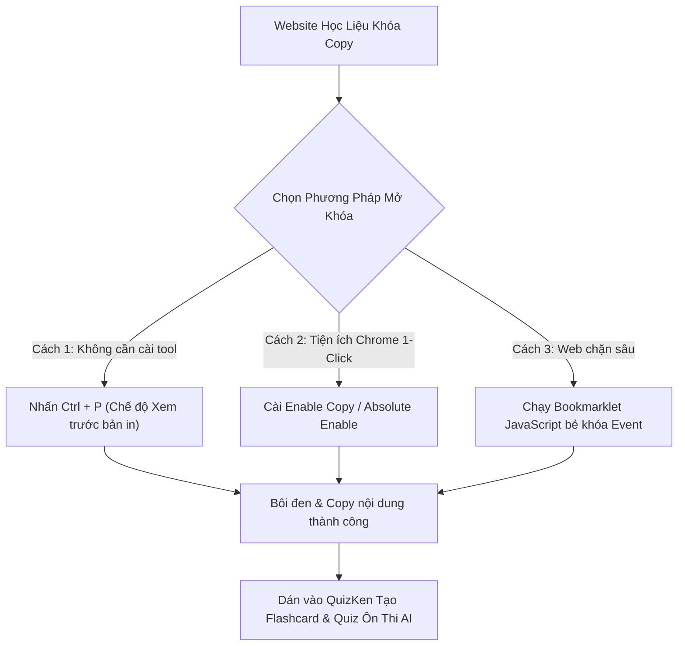

> **TL;DR (Tóm tắt nhanh):**  
> Để **mở khóa copy chuột phải web tài liệu miễn phí** trên các trang học liệu, thư viện số hay website đề thi trực tuyến chặn bôi đen, bạn có 3 giải pháp cực nhanh: dùng phím tắt Chế độ In (`Ctrl + P`), sử dụng tiện ích mở rộng **Enable Copy** / **Absolute Enable Right Click**, hoặc chạy một đoạn mã Bookmarklet JavaScript 1-click. Sau khi sao chép được các đoạn trích hoặc câu hỏi quan trọng, hãy dán ngay vào **QuizKen** để AI tự động tạo đề thi thử hoặc bộ thẻ Flashcard Spaced Repetition ôn bài mọi lúc mọi nơi!

---

# Hướng Dẫn Cách Mở Khóa Copy & Chuột Phải Trên Mọi Web Tài Liệu Học Tập (2026)

Trong quá trình học tập, làm tiểu luận, nghiên cứu khóa luận hoặc tổng hợp đề cương ôn thi, chắc hẳn bạn đã không ít lần gặp phải tình trạng:

* Tìm thấy một bài viết học thuật hoặc đề cương phân tích cực kỳ hữu ích nhưng **không thể bôi đen văn bản**.
* Nhấp chuột phải để sao chép thì màn hình hiện thông báo khó chịu: *"Nội dung trang web này được bảo vệ bản quyền, chức năng sao chép đã bị vô hiệu hóa!"*
* Kéo chuột chọn chữ thì bị nhảy trang hoặc mất dấu con trỏ chuột.

Điều này khiến bạn phải tốn hàng giờ đồng hồ ngồi gõ lại từng câu chữ một cách thủ công. Trong bài viết này, đội ngũ **QuizKen** sẽ hướng dẫn bạn các kỹ thuật **mở khóa copy chuột phải web tài liệu miễn phí** an toàn, nhanh gọn nhất trên các trình duyệt Chrome, Cốc Cốc, Edge và Brave!

> [!NOTE]
> **Lưu ý đạo đức học thuật:** Việc mở khóa chức năng sao chép chỉ nhằm phục vụ mục đích ghi chú học tập cá nhân và trích dẫn khoa học. Khi đưa nội dung vào bài luận hoặc khóa luận tốt nghiệp, bạn luôn phải trích dẫn nguồn theo chuẩn APA/Harvard để tránh vi phạm liêm chính học thuật.

---

## 1. Cơ Chế Website Chặn Bạn Bôi Đen & Copy Văn Bản Như Thế Nào?

Để hóa giải lớp khóa này, bạn cần hiểu website dùng kỹ thuật gì để ngăn chặn:

1. **Khóa bằng CSS (`user-select: none`):** Đoạn mã CSS này làm cho trình duyệt không cho phép con trỏ chuột quét chọn vùng văn bản.
2. **Khóa bằng JavaScript Event Listeners:** Trang web chèn các hàm chặn sự kiện của chuột như:
   * `oncontextmenu="return false;"` (Chặn menu chuột phải)
   * `onselectstart="return false;"` (Chặn bắt đầu quét bôi đen)
   * `oncopy="return false;"` (Chặn phím tắt sao chép `Ctrl + C`)
   * `onmousedown="return false;"` (Chặn nhấp chuột trái)



---

## 2. Top 3 Cách Mở Khóa Copy Chuột Phải Web Tài Liệu Miễn Phí

### Cách 1: Sử dụng tiện ích mở rộng Chrome Web Store (Khuyên dùng)

Đây là phương pháp triệt để và tiện lợi nhất cho sinh viên:

* **Tiện ích 1: Enable Copy**
  1. Truy cập Chrome Web Store, tìm kiếm tiện ích **Enable Copy**.
  2. Bấm **Thêm vào Chrome (Add to Chrome)**.
  3. Khi vào bất kỳ trang web nào bị chặn chuột phải, bạn chỉ cần nhấn vào biểu tượng của tiện ích trên thanh công cụ trình duyệt (biểu tượng chuyển từ màu xám sang màu xanh lục).
  4. Lúc này bạn đã có thể bôi đen, nhấp chuột phải và bấm Copy bình thường.
* **Tiện ích 2: Absolute Enable Right Click & Copy**
  * Tiện ích này sở hữu tính năng **"Absolute Mode" (Chế độ Vô hiệu hóa Tuyệt đối)**. Nó buộc trình duyệt gỡ bỏ mọi đoạn mã JavaScript can thiệp vào chuột, giúp vượt qua cả những trang web học tập bảo mật gắt gao nhất.

---

### Cách 2: Phím tắt Chế độ In (`Ctrl + P`) – Không cần cài phần mềm

Nếu bạn đang dùng máy tính thư viện trường hoặc không muốn cài thêm tiện ích mở rộng:

1. Tại trang web bị chặn copy, nhấn tổ hợp phím **`Ctrl + P`** (hoặc `Cmd + P` trên Macbook) để mở giao diện in tài liệu.
2. Tại màn hình xem trước bản in (Print Preview), toàn bộ các đoạn mã JavaScript chặn chuột phải **đều bị trình duyệt tạm dừng hoạt động**.
3. Bạn thoải mái dùng chuột bôi đen đoạn văn bản cần lấy trong khung xem trước và nhấn `Ctrl + C` để copy dữ liệu sạch 100%.

---

### Cách 3: Sử dụng Bookmarklet JavaScript (Chạy tức thì trên Bookmark Bar)

Bạn có thể tự tạo một nút "bẻ khóa" trên thanh dấu trang (Bookmarks) của trình duyệt mà không cần cài tiện ích:

1. Nhấn `Ctrl + Shift + O` để mở trình quản lý dấu trang > Chọn **Thêm dấu trang mới (Add new bookmark)**.
2. Đặt tên: `🔓 Mở Khóa Copy`.
3. Tại ô URL, dán đoạn mã JavaScript sau:
```javascript
javascript:(function(){var d=document;d.oncontextmenu=null;d.onselectstart=null;d.ondragstart=null;d.onmousedown=null;var e=d.querySelectorAll('*');for(var i=0;i<e.length;i++){e[i].style.userSelect='auto';e[i].style.webkitUserSelect='auto';}})();
```
4. Lưu lại. Mỗi khi vào trang web bị khóa chuột phải, bạn chỉ cần nhấp vào nút **`🔓 Mở Khóa Copy`** trên thanh Bookmark, trang web sẽ lập tức được giải phóng.

---

## 3. Bảng So Sánh Hiệu Quả Các Phương Pháp Mở Khóa

| Phương pháp | Tốc độ thao tác | Vượt chặn JavaScript sâu | Vượt chặn CSS user-select | Cần cài đặt thêm |
| :--- | :--- | :--- | :--- | :--- |
| **Enable Copy Extension** | 1-Click tự động | Rất tốt | Có | Cần cài extension |
| **Chế độ In (`Ctrl + P`)** | 2 giây | Tuyệt đối | Có | Không cần cài đặt |
| **Bookmarklet JavaScript** | 1-Click | Tốt | Có | Cần tạo 1 lần |
| **Tắt JavaScript trong DevTools** | Mất 10 giây | Tuyệt đối | Cần chỉnh thêm CSS | Không cần cài đặt |

---

## 4. Cầu Nối QuizKen: Biến Trích Dẫn Sao Chép Thành Kiến Thức Khắc Sâu

Sau khi đã sao chép được các đoạn phân tích đề thi, câu hỏi ôn tập hoặc tóm tắt lý thuyết quan trọng từ trang web, bước tiếp theo là biến chúng thành kiến thức của riêng bạn:

1. **Dán trực tiếp vào QuizKen:** Truy cập [QuizKen](https://quizken.com), chọn tính năng **Tạo Đề Thi Trắc Nghiệm Bằng AI**.
2. **Dán đoạn văn bản vừa copy:** Nhập nội dung vào khung soạn thảo. AI của QuizKen sẽ tự động phân tích cấu trúc ngữ nghĩa, tìm ra các khái niệm cốt lõi và sinh ra bộ câu hỏi trắc nghiệm kèm lời giải thích logic.
3. **Luyện tập Active Recall:** Làm bài quiz ngay trên web hoặc điện thoại để kiểm tra xem bạn đã thực sự hiểu đoạn tài liệu đó chưa.
4. **Đồng bộ Flashcard:** Đưa những câu bạn trả lời sai vào bộ thẻ Spaced Repetition của QuizKen để hệ thống nhắc nhở bạn ôn lại sau 1 ngày, 3 ngày và 7 ngày.

Nhờ sự kết hợp giữa thủ thuật mở khóa copy thông minh và nền tảng học tập **QuizKen**, bạn sẽ tối ưu hóa 100% thời gian nghiên cứu và ghi nhớ tài liệu bền vững!
