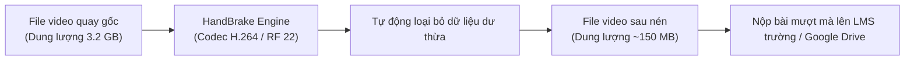

> **TL;DR (Tóm tắt nhanh):**  
> Khi quay video thuyết trình bài tập nhóm bằng điện thoại hoặc xuất file từ phần mềm dựng phim (Premiere, CapCut, DaVinci Resolve), dung lượng tệp tin thường nặng từ 2GB đến 5GB. Trong khi đó, hệ thống cổng thông tin sinh viên (LMS Moodle, Canvas, Google Classroom) thường giới hạn dung lượng tải lên dưới 100MB - 200MB, và Google Drive miễn phí thì nhanh chóng bị đầy bộ nhớ. **HandBrake** là phần mềm chuyển đổi và nén video mã nguồn mở miễn phí 100% cho cả Windows và Mac, giúp giảm 90% dung lượng video mà mắt thường không thể phân biệt được sự suy giảm chất lượng!

---

# Cách Nén Video Bài Tập Lớn Từ 3GB Xuống 150MB Bằng HandBrake Vẫn Giữ Nét 1080p

Cứ vào mỗi mùa thi học kỳ và làm đồ án tốt nghiệp, cảnh tượng quen thuộc lại diễn ra trong các nhóm chat sinh viên:
* *"Mọi người ơi, video thuyết trình quay xong nặng tận 3.5GB, cổng LMS của trường chỉ cho nộp tối đa 150MB thì làm sao bây giờ?"*
* *"Tải lên Google Drive thì tài khoản báo hết dung lượng lưu trữ!"*
* Dùng các trang web nén video trực tuyến thì bị giới hạn dung lượng tải lên, tốc độ upload chậm như rùa và bị chèn hình mờ (watermark) xấu xí.

**HandBrake** – công cụ chuyển mã video mã nguồn mở huyền thoại – chính là chiếc chìa khóa giúp bạn nén video siêu tốc ngay trên máy tính của mình mà không tốn một đồng chi phí nào.

---

## 1. Cơ Chế Nén Video Giữ Nguyên Độ Nét Của HandBrake

Tại sao một video quay từ điện thoại lại có dung lượng nặng khủng khiếp? Đó là vì camera điện thoại thường ghi hình với mức **Bitrate (tốc độ truyền dữ liệu)** quá cao và không cần thiết cho các bài tập học đường.

**HandBrake tối ưu hóa video bằng cách:**
1. **Sử dụng bộ giải mã tiên tiến H.264 hoặc H.265 (HEVC):** Nén chặt các khung hình tĩnh lặp lại (ví dụ phông nền lớp học hay slide bài giảng không thay đổi nhiều giữa các giây).
2. **Thuật toán Constant Quality (Chất lượng không đổi - RF):** Tự động phân bổ dung lượng thông minh: Đoạn nào chuyển động nhiều thì tăng dữ liệu, đoạn nào nói chuyện tĩnh thì giảm dữ liệu xuống mức tối thiểu.
3. **Giữ nguyên độ phân giải Full HD (1920x1080) và âm thanh trong trẻo:** Giảng viên chấm bài khi mở trên máy chiếu vẫn thấy chữ trên slide rõ mồn một.

---

## 2. Hướng Dẫn Từng Bước Thiết Lập Thông Số Nén Chuẩn

### Bước 1: Tải và cài đặt HandBrake
Truy cập trang chủ: `handbrake.fr` và tải phiên bản phù hợp với hệ điều hành của bạn (Windows hoặc macOS). Phần mềm hoàn toàn miễn phí, không có bất kỳ quảng cáo hay phần mềm rác đi kèm.

### Bước 2: Kéo video bài tập vào HandBrake
Mở HandBrake lên, kéo thả tệp video nặng của bạn vào giao diện phần mềm.

### Bước 3: Cấu hình "Bộ thông số vàng"
* Tại tab **Summary:** Chọn định dạng tệp là **MP4** và tích vào ô **Web Optimized** (giúp video có thể phát ngay trên web mà không cần đợi tải hết file).
* Tại tab **Dimensions:** Giữ nguyên độ phân giải gốc `1080p Full HD`.
* Tại tab **Video (Quan trọng nhất):**
  * **Video Codec:** Chọn `H.264 (x264)` (tương thích 100% với mọi trình duyệt và hệ thống LMS).
  * **Framerate (FPS):** Chọn `Peak Framerate` và để `30 fps` (hoặc `Same as source`).
  * **Constant Quality:** Kéo thanh trượt về mức **`RF 22` hoặc `RF 23`** (Đây là điểm cân bằng hoàn hảo giữa dung lượng siêu nhỏ và chất lượng cực nét).
* Tại tab **Audio:** Chọn codec `AAC` với Bitrate `128 kbps` hoặc `160 kbps` (giúp giọng nói thuyết trình rõ ràng, ấm áp).

### Bước 4: Bắt đầu nén
Chọn thư mục lưu file và nhấn nút **Start Encode** (Hình tam giác màu xanh) ở thanh công cụ phía trên. Sau vài phút, bạn sẽ nhận được một tệp video hoàn hảo chỉ nặng từ 100MB - 180MB!

---

## 3. Khai Thác Nội Dung Video Ôn Thi Cùng QuizKen

Sau khi hoàn thành video thuyết trình bài tập nhóm:
1. Bạn có thể trích xuất đoạn âm thanh hoặc phụ đề của buổi thuyết trình.
2. Nạp vào tính năng **Audio/Video-to-Quiz** trên nền tảng [https://app.quizken.com](https://app.quizken.com).
3. QuizKen sẽ tự động phân tích các luận điểm trong video và tạo ra một mini-game trắc nghiệm 5 câu để các thành viên trong nhóm tự kiểm tra xem mình đã hiểu bài sâu sắc chưa trước khi lên bục bảo vệ đề tài trước hội đồng giảng viên!

Trải nghiệm học tập và ôn luyện thông minh ngay hôm nay tại: [https://app.quizken.com](https://app.quizken.com).
