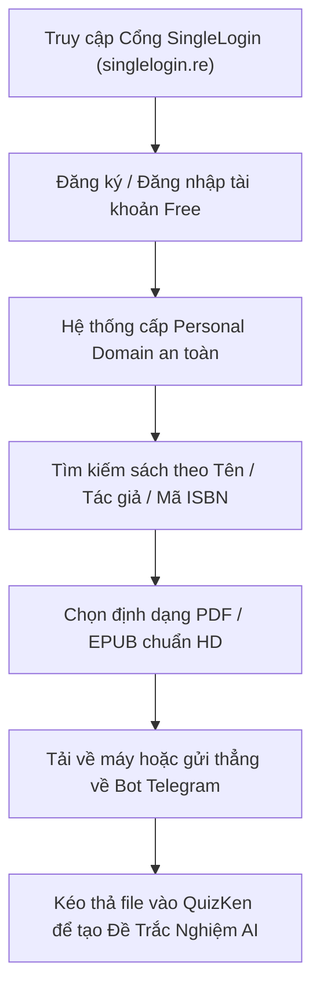

> **TL;DR (Tóm tắt nhanh):**  
> Để **tải sách giáo trình PDF miễn phí Z-Library** và Library Genesis (LibGen) mà không lo bị chặn tên miền hay vào nhầm website lừa đảo, sinh viên nên sử dụng cổng đăng nhập chính thức **SingleLogin** (`singlelogin.re`), Bot Telegram chính chủ hoặc trang tổng hợp **Anna’s Archive** (`annas-archive.org`). Sau khi tải tài liệu PDF chất lượng cao về máy, bạn có thể tải thẳng lên **QuizKen** để AI tự động chuyển hóa giáo trình thành bộ câu hỏi trắc nghiệm ôn tập và flashcard chỉ trong 10 giây!

---

# Hướng Dẫn Tải Sách Giáo Trình PDF Miễn Phí Trên Z-Library & LibGen Mới Nhất 2026

Trong quá trình học đại học, cao học hoặc làm nghiên cứu khoa học, chi phí mua sách giáo trình (Textbook) và bài báo quốc tế luôn là gánh nặng lớn đối với sinh viên. Nhiều cuốn giáo trình chuyên ngành Kinh tế, Y khoa, Công nghệ thông tin hay Luật quốc tế có giá từ $50 đến hơn $200 trên Amazon.

Chính vì vậy, nhu cầu **tải sách giáo trình PDF miễn phí Z-Library** và các kho lưu trữ tri thức mở luôn đứng đầu danh sách tìm kiếm của sinh viên mỗi mùa tựu trường. Tuy nhiên, tình trạng nhà mạng chặn DNS cùng với hàng loạt website giả mạo mọc lên khiến việc tiếp cận nguồn học liệu này trở nên khó khăn.

Bài viết này từ đội ngũ **QuizKen** sẽ cung cấp cho bạn cẩm nang an toàn, đầy đủ và chuẩn xác nhất để tìm kiếm, tải giáo trình bản quyền mở và quy trình biến tài liệu vừa tải thành điểm số cao trong kỳ thi!

> [!NOTE]
> **Tuyên bố miễn trừ & Liêm chính học thuật:** Bài viết hướng dẫn sinh viên tiếp cận các tài liệu phục vụ cho mục đích học tập, nghiên cứu cá nhân phi thương mại và các tài nguyên giáo dục mở (Open Educational Resources - OER). Hãy luôn ủng hộ tác giả và nhà xuất bản khi có điều kiện tài chính.

---

## 1. So Sánh Các Kho Học Liệu Số Mở Phổ Biến Nhất 2026

Trước khi bắt đầu, hãy xem bảng so sánh thực tế giữa 4 kho tài nguyên học thuật lớn nhất hiện nay:

| Nền tảng | Địa chỉ chính thức | Điểm mạnh nổi bật | Hạn mức tải miễn phí | Khả năng tìm sách tiếng Việt |
| :--- | :--- | :--- | :--- | :--- |
| **Z-Library** | `singlelogin.re` / `singlelogin.rs` | Giao diện thân thiện, xem trước mục lục, hỗ trợ gửi sách về Kindle | 10 cuốn / ngày (Tài khoản Free) | Rất nhiều giáo trình & sách dịch |
| **LibGen (Library Genesis)** | `libgen.rs` / `libgen.is` | Kho sách học thuật khoa học cơ bản khổng lồ, không cần đăng nhập | Không giới hạn lượt tải | Chủ yếu sách tiếng Anh & Nga |
| **Anna’s Archive** | `annas-archive.org` | Máy chủ tổng hợp dữ liệu từ cả Z-Lib, LibGen và Sci-Hub | Tải tốc độ tiêu chuẩn miễn phí | Phong phú nhờ gộp đa nguồn |
| **Sci-Hub** | `sci-hub.se` / `sci-hub.st` | Mở khóa trực tiếp bài báo nghiên cứu qua mã định danh DOI | Miễn phí 100% | Chỉ dành cho Paper học thuật |

---

## 2. Hướng Dẫn Tải Sách Giáo Trình PDF Miễn Phí Z-Library Không Bị Chặn

Z-Library hiện nay không còn dùng một tên miền cố định công khai do chính sách bản quyền. Thay vào đó, hệ thống vận hành theo cơ chế **Personal Domain (Tên miền cá nhân hóa)**.

### Bước 1: Đăng nhập qua cổng SingleLogin chính thức
* Truy cập địa chỉ xác thực duy nhất: `https://singlelogin.re` hoặc `https://singlelogin.rs`.
* Nếu trang web bị nhà mạng chặn DNS, bạn chỉ cần đổi DNS máy tính sang Google (`8.8.8.8 / 8.8.4.4`) hoặc Cloudflare (`1.1.1.1`).
* Đăng ký một tài khoản miễn phí bằng email học tập.

### Bước 2: Nhận tên miền cá nhân và tìm kiếm sách
* Sau khi đăng nhập, hệ thống sẽ tự động chuyển hướng bạn tới một tên miền riêng biệt không bị kiểm duyệt.
* **Mẹo tìm kiếm chính xác 100%:** Hãy lên Amazon hoặc Google Books, sao chép **mã số ISBN-10 hoặc ISBN-13** của cuốn giáo trình bạn cần, sau đó dán vào thanh tìm kiếm Z-Library. Cách này giúp bạn tìm đúng phiên bản tái bản mới nhất (Edition) mà giảng viên yêu cầu.

### Bước 3: Sử dụng Bot Telegram của Z-Library (Khuyên dùng)
* Trong mục tài khoản cá nhân, Z-Library cung cấp tùy chọn liên kết với **Z-Library Telegram Bot**.
* Sau khi liên kết, mỗi khi cần tải sách, bạn chỉ cần gửi tên sách hoặc mã ISBN vào đoạn chat Telegram, Bot sẽ gửi ngược lại file `.pdf` ngay lập tức mà không cần mở trình duyệt web.

---

## 3. Cách Tải Sách Trên LibGen & Anna's Archive Khi Z-Library Bảo Trì

Trong trường hợp Z-Library bảo trì máy chủ, **LibGen** và **Anna’s Archive** là hai cứu cánh hoàn hảo:

1. **Tìm trên Anna's Archive:** Truy cập `https://annas-archive.org`, nhập tên giáo trình. Bấm vào kết quả tìm kiếm và chọn link tải từ đối tác (Slow Partner Server) hoặc IPFS Gateway hoàn toàn miễn phí.
2. **Tìm trên LibGen:** Truy cập mirror `libgen.rs`, gõ từ khóa, chọn cột *Mirrors* (nhấn vào [1] hoặc [2]), sau đó bấm **GET** ở đầu trang để tải trực tiếp file PDF.

---

## 4. Tải Được File Giáo Trình 500 Trang Rồi: Làm Sao Để Học Kịp Thi?

Tải được sách giáo trình mới chỉ là 10% chặng đường. Vấn đề nan giải lớn nhất của sinh viên là: **Giáo trình quá dày (thường 400 - 800 trang tiếng Anh hoặc thuật ngữ chuyên ngành phức tạp), kỳ thi chỉ còn 1 tuần, làm sao để "nhồi" hết kiến thức?**

Đọc thụ động từng trang sách từ đầu đến cuối là phương pháp có tỷ lệ ghi nhớ thấp nhất (dưới 15% theo nghiên cứu đường cong quên lãng Ebbinghaus). Thay vào đó, bạn hãy áp dụng quy trình **Active Recall (Gợi nhớ chủ động)** cùng nền tảng **QuizKen**:

1. **Trích xuất chương cần ôn:** Dùng công cụ tách trang để lấy riêng chương sắp kiểm tra (khoảng 30 - 50 trang).
2. **Nhập vào QuizKen:** Truy cập [QuizKen](https://quizken.com), kéo thả file PDF vào giao diện **Tạo Đề Thi Bằng AI**.
3. **AI Phân Tích & Sinh Đề Trắc Nghiệm:** Chỉ sau 15 giây, công nghệ RAG của QuizKen sẽ quét sạch nội dung, tự động tạo bộ 40 - 60 câu hỏi trắc nghiệm kèm giải thích chi tiết từng đáp án.
4. **Ôn Luyện & Đồng Bộ Flashcard:** Chuyển các câu sai thành thẻ Flashcard Spaced Repetition để lặp lại ngắt quãng, đảm bảo hiểu sâu từng định lý và khái niệm học thuật.

---

## 5. Checklist An Toàn Khi Tải Sách Trực Tuyến

* [x] **Chỉ tải file có đuôi `.pdf` hoặc `.epub`:** Tuyệt đối không mở các file có đuôi `.exe`, `.scr`, `.bat` hoặc `.zip` yêu cầu mật khẩu.
* [x] **Cảnh giác website giả mạo:** Các website mạo danh Z-Library thường yêu cầu nạp tiền "VIP trọn đời" qua thẻ tín dụng ngay từ trang chủ. Z-Library chính thống luôn cho phép tài khoản Free tải 10 cuốn mỗi ngày.
* [x] **Quét mã độc:** Sử dụng công cụ quét virus tích hợp của trình duyệt trước khi mở tài liệu.

Bằng cách tận dụng kho sách giáo trình phong phú cùng phương pháp ôn tập thông minh trên QuizKen, bạn sẽ tiết kiệm hàng triệu đồng tiền sách và tối ưu hóa thời gian ôn thi đạt điểm số cao nhất!
