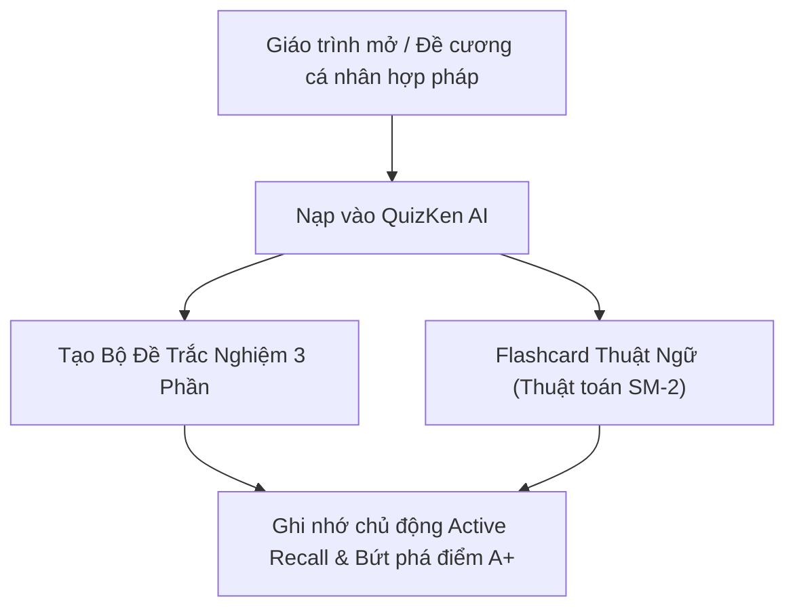

> **TL;DR (Tóm tắt nhanh):**  
> Khi tìm kiếm đề tài nghiên cứu, khóa luận hay giáo trình đại học trên các trang thư viện số Việt Nam như 123doc hay TaiLieu.vn, nhiều tài liệu chỉ hiển thị bản xem trước (Preview). Thay vì sử dụng các website get link trôi nổi tiềm ẩn rủi ro bảo mật và vi phạm bản quyền, sinh viên nên áp dụng các phương pháp **chính thống và hợp pháp 100%**: tham gia chương trình đóng góp tài liệu nhận điểm thưởng tải miễn phí, tra cứu kho **Học liệu mở (Open Access / DSpace)** của các trường đại học, và nạp đề cương vào **[QuizKen](https://app.quizken.com)** để AI tự động sinh đề kiểm tra ôn tập tức thì!

---

# Cách Khai Thác Tài Liệu 123doc, TaiLieu.vn & Kho Học Liệu Mở Hợp Pháp (Cập Nhật 2026)

Tại Việt Nam, các nền tảng thư viện tài liệu số trực tuyến như **123doc**, **TaiLieu.vn** cùng hệ thống thư viện số nội bộ của các trường đại học chứa kho tư liệu đồ sộ về các đề án tốt nghiệp, bài tập lớn, đề cương môn học và sáng kiến kinh nghiệm sư phạm.

Để bảo vệ quyền tác giả và duy trì hạ tầng, các nền tảng thương mại thường áp dụng cơ chế:
* Cho phép đọc xem trước **từ 3 đến 10 trang đầu tiên** để người học đánh giá mức độ phù hợp của tài liệu.
* Yêu cầu dùng điểm thưởng đóng góp cộng đồng hoặc phí bản quyền để tải bản đầy đủ.

Trong bài viết này, đội ngũ **QuizKen** sẽ tổng hợp những phương pháp **chính thống, an toàn và tuân thủ pháp luật bản quyền** giúp bạn khai thác nguồn tư liệu học thuật hiệu quả nhất mà không tốn kém chi phí hay đối mặt với nguy cơ mã độc.

---

## 1. Hiểu Đúng Về Cơ Chế Bản Xem Trước (Preview) & Rủi Ro Từ Web Get Link Lạ

Nhiều sinh viên vì vội vàng trước kỳ thi thường tìm kiếm các trang web "get link" bên thứ ba. Tuy nhiên:
1. **Rủi ro an ninh mạng nghiêm trọng:** Hầu hết các trang get link không chính thống đều chèn nhiều lớp link rút gọn độc hại, popup lừa đảo hoặc yêu cầu cài đặt phần mềm lạ đánh cắp phiên đăng nhập trình duyệt.
2. **Tôn trọng bản quyền tác giả:** Các trang thư viện số cắt trang từ phía máy chủ (Server-Side Preview) đối với tài liệu có bản quyền để bảo vệ công sức của người biên soạn.

Việc sử dụng các kênh hợp pháp vừa giúp bạn có file tài liệu chuẩn định dạng gốc (Word/PDF rõ nét), vừa đảm bảo an toàn tuyệt đối cho máy tính cá nhân.

---

## 2. 3 Phương Pháp Tải & Tìm Tài Liệu Miễn Phí Hợp Pháp Cho Sinh Viên

### Phương pháp 1: Đóng Góp Tài Liệu Cá Nhân Để Nhận Lượt Tải Miễn Phí (Upload for Points)
Đây là chính sách **chính thống và bền vững nhất** được 123doc, TaiLieu.vn và nhiều thư viện học thuật khuyến khích:
* Các nền tảng này đều có cơ chế cộng điểm thưởng hoặc tặng lượt tải miễn phí cho thành viên chia sẻ tài liệu mới do chính mình biên soạn.
* Bạn có thể biên tập lại các ghi chú môn học, slide thuyết trình nhóm, bài tập lớn hoặc đề cương tổng hợp của bản thân và tải lên hệ thống. Sau khi được duyệt, bạn sẽ nhận được điểm thưởng để tải hợp pháp các tài liệu tham khảo khác.

### Phương pháp 2: Tra Cứu Trực Tiếp Trên Kho Học Liệu Mở Đại Học (DSpace & Open Access)
Rất nhiều khóa luận, đề cương và giáo trình trên các trang thương mại thực chất có bản gốc miễn phí 100% tại thư viện số chính thức của các trường đại học:
* **Cú pháp tìm kiếm Google Scholar / Google:** Sử dụng toán tử `filetype:pdf site:edu.vn "tên giáo trình hoặc chủ đề"` để tìm trực tiếp bản PDF công khai từ cổng thông tin các trường đại học (`*.edu.vn`).
* **Hệ thống DSpace thư viện trường:** Đăng nhập bằng email sinh viên (`.edu.vn`) vào cổng thư viện số của trường bạn để tải toàn văn luận văn, giáo trình nội bộ hoàn toàn miễn phí và hợp pháp.

### Phương pháp 3: Sử Dụng Kho Lưu Trữ Học Thuật Mở Quốc Tế (OER)
Với các môn khoa học tự nhiên, kinh tế, công nghệ thông tin và ngoại ngữ, bạn có thể khai thác các kho học liệu mở (Open Educational Resources) hợp pháp như:
* **MIT OpenCourseWare**, **OpenStax**, **Directory of Open Access Journals (DOAJ)** và **Google Scholar**.

---

## 3. So Sánh Các Kênh Khai Thác Tài Liệu Học Thuật

| Phương pháp | Chất lượng file | Độ an toàn & Pháp lý | Khuyến nghị cho sinh viên |
| :--- | :--- | :--- | :--- |
| **Kho Học liệu mở (`site:edu.vn` / OER)** | Bản gốc PDF vector sắc nét | **An toàn & Hợp pháp 100%** | **Ưu tiên số 1** |
| **Upload tài liệu đổi điểm thưởng chính thống** | File gốc Word / PDF đầy đủ | **Chính thống, tuân thủ điều khoản** | **Rất khuyên dùng** |
| **Thư viện số nội bộ trường đại học** | Giáo trình chuẩn của khoa | **Hợp pháp 100% cho sinh viên** | **Khai thác tối đa bằng mail `.edu.vn`** |
| **Website Get Link trôi nổi** | Thường lỗi font, thiếu trang | **Nguy hiểm (Rủi ro mã độc & bản quyền)** | **Không sử dụng** |

---

## 4. 💡 Từ Đề Cương Hợp Pháp Đến Bứt Phá Điểm Số Cùng QuizKen

Sau khi tải được đề cương môn học, bài giảng mở hay ngân hàng câu hỏi từ thư viện trường hoặc qua chương trình trao đổi tài liệu hợp pháp, làm thế nào để ôn thi hiệu quả nhất?

Đừng đọc thuộc lòng theo lối mòn truyền thống! Hãy biến file đề cương của bạn thành công cụ ôn tập tương tác trên **[QuizKen](https://app.quizken.com)**:

* **Bước 1:** Đăng nhập vào [app.quizken.com](https://app.quizken.com).
* **Bước 2:** Bấm nút **Tải file tài liệu** và chọn file Word/PDF giáo trình hoặc ghi chú học tập của bạn.
* **Bước 3:** AI của QuizKen sẽ phân tích văn bản giáo trình, tạo câu hỏi trắc nghiệm kiểm tra mức độ hiểu bài kèm bảng giải thích đáp án chi tiết.

> 🚀 **Học thông minh hơn:** [Thử tạo đề trắc nghiệm AI từ file tài liệu miễn phí trên QuizKen ngay!](https://app.quizken.com)

---

## Câu hỏi thường gặp (FAQ)

### 1. Các công cụ get link tài liệu trôi nổi trên mạng có an toàn không?
Không. Phần lớn các website get link không chính thống yêu cầu vượt qua nhiều lớp link rút gọn tiềm ẩn mã độc, quảng cáo giả mạo và không đảm bảo tính pháp lý về bản quyền. Bạn nên sử dụng kho học liệu mở `site:edu.vn`, thư viện số của trường hoặc chương trình trao đổi điểm tải chính thống.

### 2. Làm sao để tìm nhanh giáo trình PDF miễn phí từ các trường đại học Việt Nam?
Bạn chỉ cần gõ trên Google theo cú pháp: `"tên môn học" filetype:pdf site:edu.vn`. Google sẽ trả về danh sách các bài giảng và giáo trình được các trường đại học công bố công khai phục vụ giảng dạy.

### 3. Tôi có thể tải file Word (.docx) đề cương cá nhân lên QuizKen để làm quiz không?
Hoàn toàn được! QuizKen hỗ trợ nạp cả file Word (`.docx`), PDF và văn bản ghi chú cá nhân để AI tự động trích xuất nội dung và sinh đề thi trắc nghiệm trong vài giây, hoặc bạn có thể dùng công cụ [Chuyển Đề Word Sang Trắc Nghiệm](/cong-cu/chuyen-de-word-docx-sang-trac-nghiem) hoàn toàn miễn phí trên trình duyệt.
