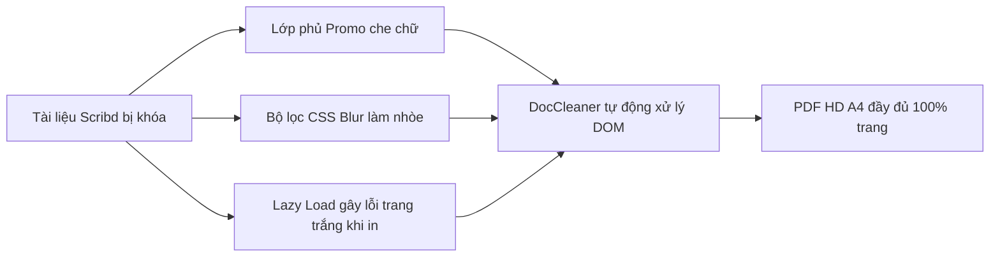

> **TL;DR (Tóm tắt nhanh):**  
> Để xem và tải toàn bộ tài liệu bị làm mờ trên Scribd hoàn toàn miễn phí mà không cần trả phí thuê bao hàng tháng, bạn có thể sử dụng tiện ích mở rộng mã nguồn mở **DocCleaner** (hỗ trợ cả Studocu và Scribd). Tiện ích tự động xóa bộ lọc CSS blur, loại bỏ lớp quảng cáo che chữ `.page_blur_promo`, kích hoạt chế độ Auto-Scroll Preload chống lỗi trang trắng và cho phép xuất PDF chuẩn in ấn A4 chỉ với 1 cú click. Sau khi tải tài liệu về, bạn có thể ném ngay vào **QuizKen** để AI trích xuất bài tập và câu hỏi trắc nghiệm tự luyện trong 5 giây!

---

# Cách Xem và Tải Tài Liệu Scribd Miễn Phí Không Bị Mờ Với DocCleaner (Mới Nhất 2026)

Bên cạnh Studocu, **Scribd** được mệnh danh là một trong những "thư viện số mở" lớn nhất thế giới với hàng triệu đầu sách nghiên cứu, luận văn thạc sĩ, đề tài khoa học và slide bài giảng chuyên ngành quốc tế bằng tiếng Anh. 

Thế nhưng, bất kỳ sinh viên nào từng tra cứu trên Scribd đều phải đối mặt với rào cản khó chịu: **chỉ cho đọc lướt vài trang đầu**, các trang tiếp theo bị áp hiệu ứng làm mờ chữ (CSS blur filter) dày đặc, kèm theo khung thông báo *"Unlock this document with a free 30-day trial"* che kín màn hình.

Bài viết này sẽ hướng dẫn bạn phương pháp xem nội dung rõ nét và tải trọn vẹn tài liệu Scribd dưới dạng PDF chất lượng cao bằng tiện ích mở rộng mã nguồn mở **DocCleaner** do tác giả **KhanhNKQ** phát triển.

---

## 1. Cơ Chế Khóa Trang Và Làm Mờ Của Scribd Hoạt Động Như Thế Nào?

Khác với các trang web thông thường, Scribd sử dụng cơ chế bảo vệ giao diện DOM phân tầng:
1. **Lớp phủ quảng cáo khuyến mãi (`.page_blur_promo`, `.promo_wrapper`):** Che khuất tầm nhìn của người đọc và vô hiệu hóa con trỏ chuột, ngăn cản việc bôi đen sao chép văn bản.
2. **Bộ lọc CSS làm mờ văn bản (`filter: blur(...)`):** Khiến chữ hiển thị nhòe nhoẹt, không thể đọc được nội dung lý thuyết hay công thức.
3. **Ảo hóa cuộn trang (Virtual Scrolling):** Chỉ nạp các trang bạn đang nhìn thấy vào bộ nhớ. Nếu bạn dùng lệnh in thông thường của trình duyệt, các trang chưa cuộn tới sẽ bị lỗi trắng trang (Blank Pages).

---

## 2. Vì Sao Nên Dùng DocCleaner Để Tải Tài Liệu Scribd?

So với các website get link trực tuyến thường xuyên bị die hoặc chứa mã độc độc hại, **[DocCleaner (GitHub)](https://github.com/khanhnkq/DocCleaner)** mang lại độ tin cậy tuyệt đối:

| Tiêu chí so sánh | DocCleaner Extension | Website Get Link Trực Tuyến | Mua gói thuê bao Scribd |
| :--- | :--- | :--- | :--- |
| **Chi phí** | **100% Miễn phí** | Miễn phí (Chứa quảng cáo) | ~200.000đ / tháng |
| **Độ an toàn** | **Mã nguồn mở minh bạch trên GitHub** | Tiềm ẩn mã độc / pop-up lừa đảo | Tuyệt đối an toàn |
| **Khả năng hiển thị chữ** | **Khôi phục 100% chữ nét** | Đôi khi bị vỡ font / mất hình | Chuẩn nét |
| **Tự động Preload** | **Có (Chống lỗi trang trắng khi in)** | Không kiểm soát được | Tải file gốc |
| **Nền tảng hỗ trợ** | **Cả Scribd lẫn Studocu** | Thường chỉ hỗ trợ 1 trang | Chỉ Scribd |

---

## 3. Hướng Dẫn Cài Đặt DocCleaner Từng Bước

DocCleaner là tiện ích dạng Manifest V3, tương thích tuyệt đối với Google Chrome, Microsoft Edge, Cốc Cốc và Brave:

1. **Bước 1:** Tải mã nguồn tiện ích từ GitHub chính thức tại: [https://github.com/khanhnkq/DocCleaner](https://github.com/khanhnkq/DocCleaner) (Bấm nút **Code** > chọn **Download ZIP** và giải nén vào máy tính).
2. **Bước 2:** Mở trình duyệt, truy cập địa chỉ `chrome://extensions/` (hoặc `edge://extensions/` nếu dùng Edge).
3. **Bước 3:** Gạt công tắc góc trên bên phải để bật chế độ **Developer mode (Dành cho nhà phát triển)**.
4. **Bước 4:** Bấm nút **Load unpacked (Tải tiện ích đã giải nén)** và chọn thư mục DocCleaner vừa giải nén.
5. **Bước 5:** Biểu tượng DocCleaner sẽ xuất hiện trên thanh tiện ích, sẵn sàng hoạt động!

---

## 4. Cách Xem Và Tải File PDF Scribd Bằng DocCleaner

Sau khi cài đặt tiện ích, bạn chỉ cần thực hiện theo các bước sau:

1. **Truy cập tài liệu Scribd:** Mở bất kỳ đường link bài viết, giáo trình hoặc slide nào trên `scribd.com`.
2. **Tiện ích tự động dọn dẹp:** DocCleaner lập tức ẩn đi khung thông báo mời mua VIP và gỡ bỏ hoàn toàn hiệu ứng mờ chữ. Bạn có thể đọc trực tiếp toàn bộ tài liệu ngay trên trang web.
3. **Bấm nút Download PDF:** Nhấp vào nút nổi **"Download PDF"** ở góc phải màn hình.
4. **Chờ Auto-Scroll chạy hoàn tất:** Màn hình sẽ tự động cuộn qua các trang để nạp trước toàn bộ nội dung vào bộ nhớ, đảm bảo không có trang nào bị bỏ sót hay hiển thị trắng.
5. **Lưu file PDF:** Khi hộp thoại in xuất hiện, chọn máy in là **Save as PDF (Lưu dưới dạng PDF)** và nhấn **Lưu**. Bạn đã có trong tay tệp tài liệu hoàn chỉnh, chuẩn khổ giấy A4!

---

## 5. 💡 Bí Quyết Ôn Thi Điểm Cao: Biến Tài Liệu Scribd Thành Đề Thi Thử Trên QuizKen

Tài liệu trên Scribd phần lớn là các giáo trình học thuật chuẩn quốc tế hoặc tài liệu tiếng Anh chuyên ngành. Đọc hàng chục trang tài liệu tiếng Anh một cách thụ động rất dễ gây quá tải não bộ.

Giải pháp tối ưu nhất là nạp file PDF vừa tải về vào nền tảng **[QuizKen](https://app.quizken.com)**:
* **Tự động quét thuật ngữ & kiến thức trọng tâm:** AI của QuizKen sẽ tóm lược các định nghĩa cốt lõi trong tài liệu.
* **Tạo đề trắc nghiệm khách quan trong 3 giây:** Sinh ra 20 - 50 câu hỏi trắc nghiệm kiểm tra khả năng đọc hiểu và ghi nhớ thông tin bám sát văn bản.
* **Tạo bộ Flashcard từ vựng chuyên ngành:** Giúp bạn học sâu theo phương pháp lặp lại ngắt quãng SM-2 trên QuizKen English Hub.

> 👉 **Thử ngay:** [Truy cập QuizKen để tải file PDF lên và làm đề thi AI miễn phí ngay hôm nay!](https://app.quizken.com)

---

## Câu hỏi thường gặp về cách tải tài liệu Scribd và DocCleaner

### Sử dụng DocCleaner để đọc Scribd có bị lộ thông tin cá nhân không?
Không. DocCleaner hoàn toàn chạy trên máy client nội bộ (Local Client-Side), mã nguồn mở công khai trên GitHub nên không có bất kỳ đoạn mã theo dõi hay gửi cookie nào ra ngoài máy chủ.

### Tại sao khi tôi tải một số tài liệu dài trên Scribd lại bị mất 1-2 trang cuối?
Điều này xảy ra nếu bạn bấm phím in quá vội trước khi tiện ích kịp cuộn hết trang. Hãy để tính năng **Auto-Scroll Preload** của DocCleaner chạy đủ 100% tiến trình cho tới khi tự động mở hộp thoại in.

### DocCleaner có hoạt động được trên cả Studocu không?
Có! DocCleaner được xây dựng để hỗ trợ tối ưu cho cả hai nền tảng tài liệu học tập lớn nhất hiện nay là Studocu (`studocu.com`, `studocu.vn`) và Scribd (`scribd.com`).
