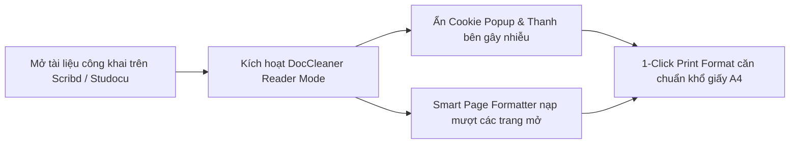

> **TL;DR (Tóm tắt nhanh):**  
> Khi đọc các tài liệu học tập được chia sẻ công khai trên Scribd hoặc Studocu, sinh viên thường bị phân tâm bởi hộp thoại cookie, thanh công cụ thừa và hiện tượng trang trắng khi cuộn nhanh. Bạn có thể cài đặt miễn phí tiện ích **[DocCleaner - Better Studocu & Scribd Reader](https://chromewebstore.google.com/detail/doccleaner-better-studocu/fnhdoegoihnkgggnaiemommemdejhbkb?hl=vi)** trên Chrome Web Store để bật **Reader Mode**, kích hoạt **Smart Page Formatter** nạp mượt trang tài liệu mở và căn chỉnh bố cục in A4 qua **1-Click Print Format**, sau đó kết hợp ôn tập chủ động cùng **[QuizKen](https://app.quizken.com)**!

---

# Cách Đọc Tập Trung & Định Dạng In Ấn Tài Liệu Công Khai Trên Scribd Với DocCleaner (2026)

Bên cạnh các thư viện học liệu đại học, **Scribd** là một trong những nền tảng chia sẻ tài liệu lớn với hàng triệu bài thuyết trình, ghi chú học thuật, tài liệu tham khảo mở và đề cương chuyên ngành bằng tiếng Anh lẫn tiếng Việt.

Tuy nhiên, khi đọc các tài liệu công khai dài hàng chục trang trên trình duyệt, sinh viên thường gặp phải những bất tiện về hiển thị:
* **Nhiều thành phần giao diện gây xao nhãng:** Các hộp thoại đồng ý Cookie (Cookie Consent), banner thông báo nổi và thanh điều hướng bên lề chiếm nhiều diện tích trên màn hình laptop 13–14 inch.
* **Ảo hóa cuộn trang (Virtual Scrolling):** Trình duyệt chỉ dựng các trang nằm trong tầm nhìn hiện tại, khiến việc cuộn nhanh hoặc định dạng in các tài liệu được phép chia sẻ dễ gặp lỗi khoảng trắng.

Bài viết này sẽ hướng dẫn bạn cách tối ưu hóa không gian đọc tập trung (**Reader Mode**) và định dạng trang in A4 sạch đẹp trên Scribd bằng tiện ích **DocCleaner - Better Studocu & Scribd Reader** đã được kiểm duyệt trên Chrome Web Store.

---

## 1. Vì Sao Giao Diện Đọc Tài Liệu Web Mặc Định Dễ Gây Mỏi Mắt & Lỗi Trang Trắng?

Khi hiển thị một tài liệu đa trang trên nền tảng web, trình duyệt phải xử lý đồng thời nhiều lớp giao diện:
1. **Khung điều hướng và thông báo Cookie:** Chiếm từ 20% đến 30% không gian hiển thị dọc, làm thu hẹp vùng văn bản học thuật.
2. **Cơ chế Lazy-Loading theo khung nhìn:** Chỉ tải nội dung các trang bạn đang dừng mắt. Nếu bạn cuộn nhanh để đối chiếu mục lục hoặc dùng lệnh in mặc định của trình duyệt mà chưa nạp đủ trang, bản xem trước sẽ xuất hiện các khoảng trắng (Blank Sections).

---

## 2. Lợi Ích Khi Dùng DocCleaner (Chrome Web Store) Cho Việc Học Tập

**[DocCleaner - Better Studocu & Scribd Reader](https://chromewebstore.google.com/detail/doccleaner-better-studocu/fnhdoegoihnkgggnaiemommemdejhbkb?hl=vi)** là tiện ích trình duyệt chuẩn Manifest V3 giúp cải thiện trải nghiệm đọc hợp pháp và an toàn:

| Tiêu chí so sánh | Giao diện Web Mặc định | Khi bật DocCleaner Reader Mode |
| :--- | :--- | :--- |
| **Chi phí** | Miễn phí | **100% Miễn phí trên Chrome Web Store** |
| **Độ an toàn & Pháp lý** | Chuẩn gốc | **Xử lý giao diện 100% cục bộ, tuân thủ Chrome Web Store** |
| **Không gian đọc** | Nhiều banner nổi & hộp thoại cookie | **Reader Mode tối giản, tập trung 100% vào bài học** |
| **Hỗ trợ cuộn trang dài** | Dễ khựng khi kéo nhanh | **Smart Page Formatter pre-render mượt mà** |
| **Định dạng in A4** | Dễ lẫn thanh menu web vào bản in | **1-Click Print Format gom gọn khung trang giấy** |

---

## 3. Hướng Dẫn Cài Đặt DocCleaner 1-Click Từ Chrome Web Store

DocCleaner tương thích với Google Chrome, Microsoft Edge, Cốc Cốc và Brave:

1. **Bước 1:** Truy cập trang tiện ích chính thức trên Chrome Web Store: [DocCleaner - Better Studocu & Scribd Reader](https://chromewebstore.google.com/detail/doccleaner-better-studocu/fnhdoegoihnkgggnaiemommemdejhbkb?hl=vi).
2. **Bước 2:** Nhấn nút **Thêm vào Chrome (Add to Chrome)** và xác nhận **Add extension**.
3. **Bước 3:** Nhấn biểu tượng mảnh ghép trên thanh công cụ trình duyệt và chọn **Ghim (Pin)** biểu tượng DocCleaner để dễ dàng chuyển đổi ngôn ngữ Tiếng Việt / Tiếng Anh.

---

## 4. Cách Bật Reader Mode & Định Dạng Bản In A4 Trên Scribd

Sau khi cài đặt tiện ích, quy trình đọc và ghi chú tài liệu trở nên cực kỳ gọn gàng:

1. **Mở tài liệu học tập công khai:** Truy cập bài giảng hoặc tài liệu mở bạn đang nghiên cứu trên `scribd.com` hoặc `studocu.com`.
2. **Tự động bật Reader Mode:** DocCleaner tự động ẩn các hộp thoại cookie và khung thông báo thừa xung quanh, giúp trang tài liệu hiển thị rộng rãi ngay chính giữa màn hình.
3. **Cuộn mượt với Smart Page Formatter:** Đợi vài giây hoặc cuộn nhẹ để bộ định dạng nạp đầy đủ các trang tài liệu mở vào bộ nhớ hiển thị.
4. **Định dạng in A4 sạch đẹp:** Với các tài liệu công khai hoặc ghi chú cá nhân được phép lưu trữ, bạn có thể nhấn nút **1-Click Print Format** để ẩn khung menu web và dùng hộp thoại `Save as PDF` của Chrome.

---

## 5. 💡 Bí Quyết Ôn Thi Điểm Cao: Biến Giáo Trình Tiếng Anh Thành Đề Thi Thử Trên QuizKen

Các tài liệu học thuật quốc tế bằng tiếng Anh thường chứa lượng thuật ngữ chuyên ngành rất lớn. Đọc hàng chục trang tài liệu một cách thụ động rất dễ gây quá tải.

Giải pháp tối ưu là kết hợp ghi chú và tài liệu học tập hợp pháp của bạn với nền tảng **[QuizKen](https://app.quizken.com)**:
* **Tự động tóm lược kiến thức trọng tâm:** AI của QuizKen giúp hệ thống hóa các định nghĩa cốt lõi trong bài học.
* **Tạo đề trắc nghiệm khách quan trong vài giây:** Sinh câu hỏi trắc nghiệm kiểm tra khả năng đọc hiểu và ghi nhớ thông tin bám sát văn bản.
* **Tạo bộ Flashcard từ vựng chuyên ngành:** Học sâu theo phương pháp lặp lại ngắt quãng SM-2 trên QuizKen English Hub.

> 👉 **Thử ngay:** [Truy cập QuizKen để tạo đề thi trắc nghiệm AI miễn phí từ giáo trình của bạn!](https://app.quizken.com)

---

## Câu hỏi thường gặp (FAQ)

### 1. Sử dụng DocCleaner có an toàn cho thông tin cá nhân không?
Hoàn toàn an toàn. DocCleaner chạy 100% cục bộ trên trình duyệt của bạn (Client-Side), đã qua kiểm duyệt trên Chrome Web Store và không thu thập hay gửi bất kỳ dữ liệu cá nhân nào ra máy chủ bên ngoài.

### 2. Lưu ý về bản quyền khi đọc và lưu tài liệu trực tuyến là gì?
Bạn chỉ nên sử dụng các tính năng định dạng đọc và in ấn cho các tài liệu học tập công khai (Open Access), bài giảng được phép chia sẻ hoặc tài liệu thuộc quyền sở hữu của bạn nhằm mục đích tự học cá nhân, tuyệt đối tôn trọng bản quyền của tác giả và điều khoản dịch vụ của nền tảng.

### 3. DocCleaner có hỗ trợ cả Studocu lẫn Scribd không?
Có! Tiện ích hỗ trợ tối ưu giao diện Reader Mode cho cả hai nền tảng tài liệu học tập phổ biến là Studocu (`studocu.com`, `studocu.vn`) và Scribd (`scribd.com`).
