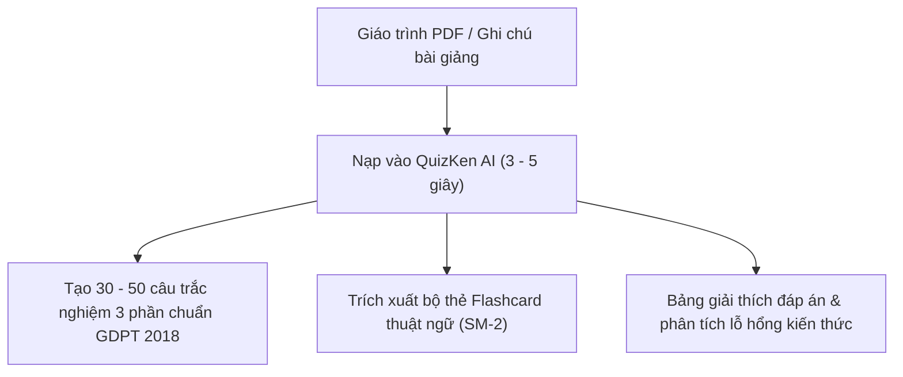

> **TL;DR (Tóm tắt nhanh):**  
> Để đọc các đề cương, bài giảng công khai trên Studocu và Scribd trong không gian tối giản không bị làm phiền bởi hộp thoại cookie hay thanh điều hướng thừa, bạn có thể cài đặt miễn phí tiện ích **[DocCleaner - Better Studocu & Scribd Reader](https://chromewebstore.google.com/detail/doccleaner-better-studocu/fnhdoegoihnkgggnaiemommemdejhbkb?hl=vi)** từ Chrome Web Store. Tiện ích giúp bật **Reader Mode**, hỗ trợ **Smart Page Formatter** giảm lỗi trang trắng khi cuộn tài liệu dài và căn chỉnh bố cục in A4 sạch đẹp, kết hợp cùng **[QuizKen](https://app.quizken.com)** để chuyển hóa giáo trình thành bộ đề trắc nghiệm ôn thi trong 5 giây!

---

# Cách Tối Ưu Giao Diện Đọc Tập Trung (Reader Mode) & Định Dạng In A4 Trên Studocu (2026)

Mỗi mùa thi cử hoặc làm tiểu luận, **Studocu** và **Scribd** là hai nguồn tham khảo quen thuộc được sinh viên đại học sử dụng để tra cứu đề cương ôn tập, ghi chú bài giảng và slide thuyết trình do cộng đồng sinh viên chia sẻ.

Tuy nhiên, khi đọc các tài liệu dài trực tiếp trên trình duyệt máy tính, người học thường gặp phải các bất tiện về giao diện:
* Màn hình bị thu hẹp bởi nhiều thanh điều hướng, hộp thoại xin quyền Cookie (OneTrust/Didomi) và các banner nổi gây mất tập trung.
* Khi cuộn nhanh qua các tài liệu dài 50–100 trang, cơ chế tải chậm (Lazy Loading) đôi khi khiến các trang chưa kịp hiển thị, gây ra hiện tượng khoảng trắng (Blank Pages).
* Khi cần in ấn các tài liệu công khai được phép chia sẻ để học offline, lệnh in mặc định của trình duyệt dễ dính cả khung menu web khiến trang giấy bị lệch bố cục.

Trong bài viết này, đội ngũ **QuizKen** sẽ hướng dẫn bạn cách sử dụng **DocCleaner - Better Studocu & Scribd Reader** – tiện ích mở rộng Chrome miễn phí trên Chrome Web Store giúp tối ưu hóa không gian đọc tập trung (Reader Mode) và căn chỉnh bố cục in A4 chuẩn xác!

---

## 1. Vì Sao Đọc Tài Liệu Dài Trên Web Thường Bị Khựng Trang Trắng?

Khi hiển thị tài liệu nhiều trang trên trình duyệt, các nền tảng học liệu sử dụng hai kỹ thuật chính:
1. **Ảo hóa danh sách trang (Virtual Scrolling / Lazy Loading):** Để tiết kiệm băng thông ban đầu, trình duyệt chỉ dựng nội dung cho các trang đang nằm trong khung nhìn (viewport). Khi bạn cuộn nhanh, các trang bên dưới cần thời gian để nạp vào DOM.
2. **Nhiều lớp giao diện phụ (UI Clutter):** Các khung thông báo cookie, thanh công cụ nổi và sidebar chiếm dụng diện tích màn hình và tài nguyên bộ nhớ khi mở nhiều tab cùng lúc.

---

## 2. Giới Thiệu DocCleaner: Trải Nghiệm Reader Mode Gọn Sạch Trên Chrome Web Store

**[DocCleaner - Better Studocu & Scribd Reader](https://chromewebstore.google.com/detail/doccleaner-better-studocu/fnhdoegoihnkgggnaiemommemdejhbkb?hl=vi)** là tiện ích trình duyệt chuẩn Manifest V3 được thiết kế nhằm mang lại không gian đọc tối giản (Reader Mode) và hỗ trợ định dạng trang in A4 cho các tài liệu học tập công khai trên **Studocu** (`studocu.com`, `studocu.vn`) và **Scribd** (`scribd.com`).

| Tiêu chí | DocCleaner (Chrome Web Store) | Giao diện Web Mặc định | Website Trung Gian Trôi Nổi |
| :--- | :--- | :--- | :--- |
| **Chi phí** | **Miễn phí 100%** | Miễn phí | Tiềm ẩn rủi ro quảng cáo |
| **Độ an toàn** | **Đã qua kiểm duyệt Chrome Web Store** | An toàn | Nguy cơ dính pop-up độc hại |
| **Không gian đọc** | **Reader Mode sạch sẽ, căn giữa trang** | Nhiều popup cookie & thanh bên | Không hỗ trợ đọc trực tiếp |
| **Hỗ trợ cuộn trang** | **Smart Page Formatter pre-render mượt** | Dễ gặp khoảng trắng khi kéo nhanh | Không có |
| **Định dạng in A4** | **1-Click Print Format ẩn menu thừa** | Dễ dính khung giao diện web | Thường lỗi font chữ |

### Các Tính Năng Cốt Lõi Của DocCleaner:
* **Reader Mode tự động:** Nhận diện trang đọc tài liệu trên Studocu và Scribd để ẩn các hộp thoại cookie và thanh nổi gây xao nhãng.
* **Smart Page Formatter:** Hỗ trợ nạp trước (pre-render) và căn chỉnh các trang tài liệu mở theo luồng đọc liền mạch, giảm thiểu lỗi trang trắng khi cuộn hoặc in.
* **1-Click Print Format:** Tự động gom gọn khung trang giấy theo chuẩn A4 và gọi hộp thoại in gốc của trình duyệt (`Save as PDF`) cho các tài liệu học tập được phép lưu trữ.
* **Giao diện song ngữ Việt – Anh:** Chuyển đổi ngôn ngữ nhanh ngay trong popup của tiện ích trên thanh công cụ.

---

## 3. Hướng Dẫn Cài Đặt DocCleaner Trên Chrome, Edge, Cốc Cốc, Brave

Hiện tại bạn có thể cài đặt DocCleaner trực tiếp từ **Chrome Web Store** chỉ với 1 cú nhấp chuột (không cần giải nén thủ công):

1. **Bước 1:** Mở trình duyệt nhân Chromium (Google Chrome, Microsoft Edge, Cốc Cốc hoặc Brave) và truy cập liên kết chính thức: [DocCleaner - Better Studocu & Scribd Reader trên Chrome Web Store](https://chromewebstore.google.com/detail/doccleaner-better-studocu/fnhdoegoihnkgggnaiemommemdejhbkb?hl=vi).
2. **Bước 2:** Nhấn vào nút **Thêm vào Chrome (Add to Chrome)** và chọn **Thêm tiện ích (Add extension)**.
3. **Bước 3:** Nhấn vào biểu tượng mảnh ghép (Extensions) ở góc phải trình duyệt và bấm **Ghim (Pin)** để đưa biểu tượng DocCleaner ra thanh công cụ.

---

## 4. Cách Sử Dụng Reader Mode & Xuất Bản In A4 Chuẩn Đẹp

1. **Bước 1:** Mở tài liệu học tập công khai trên Studocu hoặc Scribd mà bạn đang ôn luyện.
2. **Bước 2:** Tiện ích DocCleaner sẽ tự động kích hoạt chế độ **Reader Mode**, ẩn các hộp thoại cookie và căn giữa trang tài liệu giúp bạn đọc tập trung.
3. **Bước 3:** Khi cần in hoặc lưu bản PDF sạch cho tài liệu được phép chia sẻ, hãy đợi **Smart Page Formatter** nạp đủ các trang rồi nhấn nút nổi **1-Click Print Format** ở góc phải màn hình.
4. **Bước 4:** Khi hộp thoại in của trình duyệt xuất hiện, tại mục *Destination (Máy in đích)*, chọn **Save as PDF (Lưu dưới dạng PDF)**, bật tùy chọn *Background graphics (Đồ họa nền)* và nhấn **Lưu**.

---

## 5. 💡 Mẹo Học Tập Đột Phá: Biến Giáo Trình PDF Thành Đề Trắc Nghiệm AI Cùng QuizKen

Đọc tài liệu sạch sẽ mới chỉ là bước khởi đầu. Nghiên cứu khoa học về nhận thức chỉ ra rằng việc ngồi đọc thụ động (Passive Reading) khiến não bộ quên hơn 80% kiến thức chỉ sau 48 giờ. Để ghi nhớ sâu và đạt điểm số tối đa, phương pháp hiệu quả nhất là **Gợi nhớ chủ động (Active Recall)** và **Luyện đề thực chiến**.

Hãy kết hợp giáo trình và ghi chú học tập của bạn với nền tảng **[QuizKen](https://app.quizken.com)**:

### Quy trình 3 bước tự ôn thi cấp tốc với QuizKen:
1. **Tải tệp PDF/Word lên QuizKen:** Truy cập [app.quizken.com](https://app.quizken.com), nhấn vào mục *Tải file tài liệu* và chọn tệp giáo trình hoặc đề cương của bạn.
2. **Chọn cấu trúc đề thi mong muốn:** Tùy chỉnh mức độ nhận thức (Nhận biết, Thông hiểu, Vận dụng) và dạng câu hỏi (Nhiều lựa chọn, Đúng/Sai 4 ý, Trả lời ngắn).
3. **Bắt đầu làm bài & Luyện tập:** AI của QuizKen sẽ sinh ra bộ đề thi trắc nghiệm hoàn chỉnh kèm lời giải thích chi tiết cho từng phương án.

> 🚀 **Trải nghiệm ngay:** [Bấm vào đây để tạo đề thi AI miễn phí trên QuizKen](https://app.quizken.com) hoặc sử dụng ngay [58 Công Cụ Học Tập & Tiện Ích Miễn Phí](/cong-cu) chạy trực tiếp trên trình duyệt!

---

## 6. Lưu Ý Về Bản Quyền Và Liêm Chính Học Thuật

QuizKen luôn khuyến khích học sinh, sinh viên tôn trọng quyền tác giả, điều khoản dịch vụ của các nền tảng và liêm chính học thuật:
* Chỉ sử dụng tài liệu học tập công khai (Open Access), tài liệu được phép chia sẻ hoặc tài liệu thuộc quyền sở hữu hợp pháp của bạn nhằm mục đích **nghiên cứu, tự học cá nhân hoặc chuẩn bị bài giảng**.
* Tuyệt đối không sao chép nguyên văn để gian lận học thuật hoặc phân phối trái phép tài liệu có bản quyền vì mục đích thương mại.
* Khuyến khích sinh viên tham gia đóng góp ghi chú bài giảng của chính mình lên các cộng đồng học thuật hoặc ủng hộ gói bản quyền chính thức của nền tảng để hệ sinh thái tri thức phát triển bền vững.

---

## Câu hỏi thường gặp (FAQ)

### 1. Tiện ích DocCleaner có an toàn cho máy tính và tài khoản của tôi không?
Hoàn toàn an toàn. DocCleaner đã được kiểm duyệt và phát hành chính thức trên Chrome Web Store. Tiện ích hoạt động 100% cục bộ (Client-Side) ngay trong trình duyệt của bạn, không thu thập dữ liệu cá nhân, không gửi cookie hay mật khẩu về bất kỳ máy chủ bên ngoài nào.

### 2. DocCleaner hỗ trợ những trình duyệt nào?
Mọi trình duyệt máy tính sử dụng nhân Chromium như **Google Chrome, Microsoft Edge, Cốc Cốc và Brave** đều có thể cài đặt trực tiếp từ Chrome Web Store chỉ với 1 click.

### 3. Sau khi có file PDF đề cương, làm thế nào để ôn thi hiệu quả nhất?
Thay vì đọc lướt qua tệp tài liệu hàng chục trang dễ gây buồn ngủ, bạn hãy nạp file PDF trực tiếp vào nền tảng [QuizKen](https://app.quizken.com). Trí tuệ nhân tạo sẽ giúp bạn tóm tắt nội dung cốt lõi và biến giáo trình thành các câu hỏi trắc nghiệm kiểm tra phản xạ, giúp bạn nhớ bài sâu trước giờ thi.
