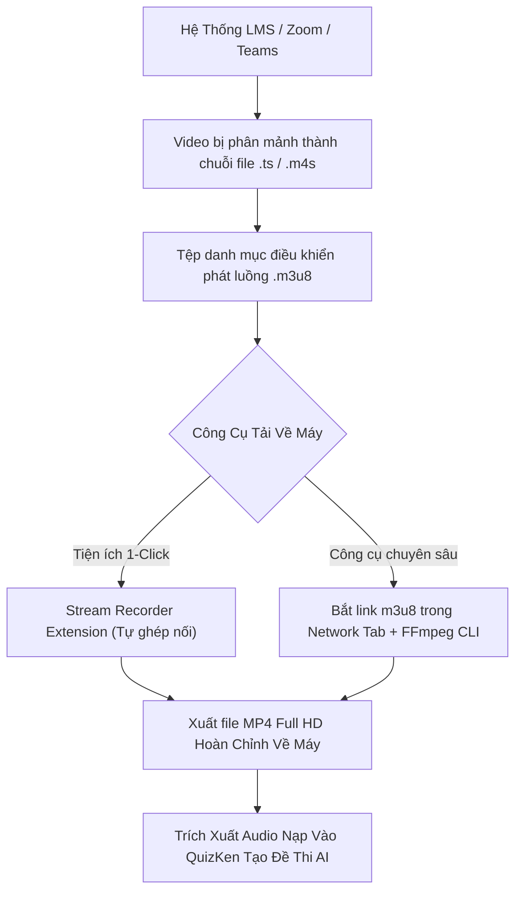

> **TL;DR (Tóm tắt nhanh):**  
> Để **tải video bài giảng LMS miễn phí** trên các hệ thống học tập trực tuyến (Canvas, Moodle, Zoom Cloud Recording, Microsoft Teams) khi giảng viên tắt tính năng cho phép Download, sinh viên có thể sử dụng tiện ích **Stream Recorder** (chuyên bắt luồng HLS/m3u8) hoặc trích xuất link phát trực tiếp qua cửa sổ **Inspect Network** của Chrome. Sau khi có file video bài giảng, bạn có thể trích xuất âm thanh và nạp thẳng vào **QuizKen** để AI tự động tạo đề thi trắc nghiệm bám sát 100% nội dung ôn tập của thầy cô!

---

# Hướng Dẫn Cách Tải Video Bài Giảng Zoom, Teams & LMS Về Máy Tính Xem Offline 2026

Trong các kỳ thi cuối kỳ hoặc ôn thi chứng chỉ, việc xem lại video các buổi học trực tuyến (Recorded Lectures) là phương pháp tốt nhất để ghi chép bổ sung kiến thức. Tuy nhiên, sinh viên thường gặp phải nhiều trở ngại lớn:

* Giảng viên hoặc trường đại học **tắt nút Tải xuống (Download)** trên cổng LMS, Zoom hoặc Microsoft Teams Stream.
* Mạng Internet tại phòng trọ hoặc ký túc xá chập chờn, video liên tục bị giật lag hoặc quay vòng tròn lúc đêm khuya ôn thi.
* Hệ thống LMS trường thường **tự động xóa bản ghi âm sau 30 hoặc 60 ngày**, khiến bạn mất toàn bộ tài liệu khi bước vào giai đoạn ôn thi nước rút.

Trong bài viết này, **QuizKen** sẽ hướng dẫn bạn các phương pháp kỹ thuật **tải video bài giảng LMS miễn phí** chuẩn chất lượng gốc 1080p, giúp bạn lưu trữ an toàn và học tập linh hoạt mọi lúc mọi nơi!

> [!NOTE]
> **Quy định bản quyền học tập:** Toàn bộ video bài giảng tải về chỉ phục vụ mục đích học tập cá nhân, nghiên cứu phi thương mại. Tuyệt đối không đăng tải công khai lên mạng xã hội hoặc kinh doanh dưới mọi hình thức khi chưa được sự đồng ý của giảng viên và nhà trường.

---

## 1. Cơ Chế Phát Video Trực Tuyến Trên Các Hệ Thống LMS

Tại sao bạn nhấp chuột phải vào video trên LMS nhưng không thấy nút "Lưu video thành..."? 

Bởi vì các nền tảng hiện đại như Microsoft Teams, Canvas, Moodle và Zoom Cloud sử dụng giao thức **HLS (HTTP Live Streaming)** hoặc **DASH**:
* Video không được lưu dưới dạng 1 file `.mp4` nguyên khối duy nhất.
* Thay vào đó, video bị chia nhỏ thành hàng trăm phân đoạn nhỏ (chunk) dài từ 2 đến 6 giây (đuôi `.ts` hoặc `.m4s`) và điều khiển bởi một file danh sách phát định dạng **`.m3u8`**.
* Trình duyệt sẽ liên tục nạp các đoạn này theo thời gian thực để chống tình trạng tải lậu tài liệu.



---

## 2. Cách Tải Video Bài Giảng Bằng Tiện Ích Stream Recorder (Dễ Nhất)

[Stream Recorder](https://chrome.google.com/webstore) là một trong những tiện ích mở rộng Chrome chuyên dụng nhất để bắt luồng video HLS m3u8 mà không cần cài đặt phần mềm bên ngoài:

1. Cài đặt tiện ích **Stream Recorder** trên trình duyệt Chrome, Edge hoặc Cốc Cốc.
2. Mở trang web chứa video bài giảng trên LMS trường hoặc Zoom Cloud.
3. Bấm **Phát video (Play)** và chọn mức chất lượng cao nhất (1080p hoặc 720p).
4. Quan sát góc trên bên phải thanh tiện ích: Biểu tượng Stream Recorder sẽ chuyển sang chấm đỏ nhấp nháy, báo hiệu đã phát hiện luồng phát m3u8.
5. Nhấp vào biểu tượng tiện ích:
   * **Chế độ Thông thường (Normal Mode):** Tiện ích sẽ tải và ghép nối các mảnh video trong vài chục giây.
   * **Chế độ Ghi màn hình (Capture Mode):** Nếu video bị mã hóa DRM bản quyền đặc biệt, bật Capture Mode để tiện ích ghi lại luồng phát trực tiếp ở tốc độ chuẩn mà không làm suy giảm chất lượng âm thanh.
6. Sau khi tiến trình đạt 100%, nhấn **Save** để tải file `.mp4` hoàn chỉnh về ổ cứng máy tính.

---

## 3. Cách Bắt Link Trực Tiếp Bằng Chrome DevTools & FFmpeg (Dành Cho File Dung Lượng Lớn)

Đối với các buổi học dài 3 đến 4 tiếng dung lượng trên 2GB, phương pháp dòng lệnh FFmpeg sẽ giúp bạn tải với tốc độ mạng tối đa:

### Bước 1: Lấy link luồng m3u8
1. Tại trang phát video, nhấn phím **F12** (hoặc chuột phải chọn **Kiểm tra / Inspect**).
2. Chuyển sang tab **Network (Mạng)** > Gõ vào ô lọc tìm kiếm: `m3u8`.
3. Tải lại trang (F5) và bấm phát video.
4. Bạn sẽ thấy một hoặc nhiều dòng xuất hiện dạng `master.m3u8` hoặc `index.m3u8`. Nhấp chuột phải vào dòng đó > chọn **Copy** > **Copy link address**.

### Bước 2: Tải video siêu tốc bằng FFmpeg
Mở Terminal (Mac/Linux) hoặc Command Prompt (Windows) đã cài sẵn FFmpeg và chạy lệnh:
```bash
ffmpeg -i "PASTE_LINK_M3U8_VAO_DAY" -c copy -bsf:a aac_adtstoasc "bai_giang_buoi_1.mp4"
```
Lệnh này sẽ tự động tải đồng thời toàn bộ các phân mảnh và ghép lại thành một file MP4 duy nhất trong vòng 2 - 3 phút mà không phải giải mã lại (Zero-loss quality).

---

## 4. Bảng So Sánh Các Công Cụ Tải Video Bài Giảng

| Công cụ | Tải được Zoom tắt nút tải | Tải được MS Teams / Canvas | Tốc độ ghép nối | Yêu cầu kỹ thuật |
| :--- | :--- | :--- | :--- | :--- |
| **Stream Recorder Extension** | Có | Có | Rất nhanh | Cơ bản (1-Click) |
| **FFmpeg CLI** | Có | Có | Cực nhanh | Biết dùng Terminal cơ bản |
| **Cốc Cốc Tải Video** | Chỉ một số web | Thường bị lỗi không bắt được luồng | Trung bình | Cơ bản |
| **Quay màn hình OBS** | Có | Có | Phải chờ hết thời lượng video (1:1) | Cần máy cấu hình tốt |

---

## 5. Cầu Nối QuizKen: Từ Video Bài Giảng Offline Đến Điểm A+ Trong Kỳ Thi

Sau khi đã tải được trọn bộ video bài giảng về máy tính, bí quyết để biến những video dài 2 tiếng thành điểm số cao là gì? Xem lại từ đầu đến cuối rất tốn thời gian. Thay vào đó, hãy để **QuizKen** hỗ trợ bạn:

1. **Trích xuất âm thanh buổi học:** Sử dụng công cụ trực tuyến tách âm thanh video thành file `.mp3` hoặc dùng công cụ Speech-to-Text để lấy bản ghi lời giảng (Transcript).
2. **Nạp văn bản vào [QuizKen](https://quizken.com):** Đưa toàn bộ nội dung thầy cô đã nhấn mạnh trong buổi học vào QuizKen AI.
3. **Sinh đề thi trắc nghiệm trọng tâm:** QuizKen sẽ tự động phân tích những phần giảng viên nhắc đi nhắc lại nhiều lần để tạo ra bộ đề thi trắc nghiệm 4 lựa chọn, câu hỏi đúng/sai và bài tập tình huống bám sát 100% đề thi thực tế.
4. **Luyện tập Active Recall:** Kiểm tra lại kiến thức ngay trên điện thoại, đánh giá lỗ hổng kiến thức và xem giải thích chi tiết cho từng câu trả lời sai.

Hãy áp dụng ngay các thủ thuật tải video bài giảng trên kết hợp cùng sức mạnh ôn thi của **QuizKen** để làm chủ toàn bộ kiến thức môn học một cách dễ dàng nhất!
