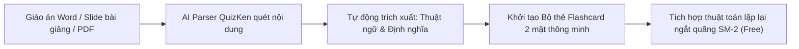

> **Tóm tắt nhanh (TL;DR):** Thẻ ghi nhớ (Flashcard) kết hợp phương pháp gợi nhớ chủ động (Active Recall) và lặp lại ngắt quãng (Spaced Repetition) được khoa học chứng minh là phương thức ghi nhớ kiến thức hiệu quả số 1 hiện nay. Tuy nhiên, việc ngồi gõ thủ công từng tấm thẻ mặt trước và mặt sau cho một chương học dài hàng chục trang là rào cản lớn nhất khiến người học bỏ cuộc. Bài viết này hướng dẫn cách sử dụng công cụ **AI tạo Flashcard tự động từ giáo án miễn phí (free)** chỉ sau 30 giây.

---

## 1. Vì Sao Bạn Nên Chuyển Đổi Giáo Án Thành Bộ Thẻ Flashcard?

Đọc lại sách giáo khoa (Passive Reading) hay dùng bút highlight tô màu khắp trang sách là thói quen học tập phổ biến nhưng mang lại hiệu quả ghi nhớ rất thấp. Não bộ chỉ thực sự lưu giữ thông tin lâu dài khi bị buộc phải thực hiện thao tác truy xuất dữ liệu từ sâu trong trí nhớ:

* **Active Recall (Gợi nhớ chủ động):** Khi nhìn mặt trước của thẻ (Câu hỏi/Khái niệm), não bộ phải chủ động suy nghĩ tìm câu trả lời trước khi lật mặt sau.
* **Spaced Repetition (Lặp lại ngắt quãng):** Các khái niệm khó sẽ được lặp lại thường xuyên hơn, trong khi các khái niệm bạn đã thuộc sẽ được giãn cách thời gian ôn tập.
* **Học mọi lúc mọi nơi:** Thay vì mang theo cuốn giáo trình nặng nề, bạn có thể lướt ôn tập 20 thẻ flashcard trên smartphone trong lúc đợi xe buýt hoặc giải lao.

---

## 2. So Sánh Tạo Flashcard Thủ Công vs. Tạo Tự Động Bằng AI QuizKen

| Tiêu chí | Làm thẻ thủ công (Anki / Thẻ giấy) | Tạo tự động bằng AI QuizKen (Free) |
| :--- | :--- | :--- |
| **Thời gian tạo 1 bộ 50 thẻ** | Mất 2–3 tiếng copy dán từng khái niệm | **Chỉ mất 30 giây** bằng cách tải file tài liệu lên |
| **Xử lý tài liệu tiếng Việt** | Dễ lỗi font khi tải trên các ứng dụng nước ngoài | **Tối ưu hóa 100% cho tiếng Việt** và thuật ngữ chuyên ngành |
| **Khả năng sinh câu hỏi ngữ cảnh** | Thẻ tĩnh, chỉ hiển thị định nghĩa ngắn gọn | AI tự động sinh thêm ví dụ thực tế và câu trắc nghiệm kiểm tra |
| **Chi phí sử dụng** | Các app nước ngoài thường thu phí đồng bộ đám mây | **Miễn phí trọn đời (Free 100%)** đồng bộ trên web và mobile |

---

## 3. Quy Trình 3 Bước Biến Giáo Án Thành Bộ Thẻ Flashcard Thông Minh

### Bước 1: Chuẩn bị tài liệu nguồn
Bạn chỉ cần chuẩn bị một đoạn văn bản tóm tắt, file Word bài giảng môn Sinh học, Lịch sử, Địa lý hoặc danh sách từ vựng tiếng Anh bất kỳ.

### Bước 2: Tải lên QuizKen và chọn "Tạo Flashcard AI"
Truy cập tính năng Flashcard trên QuizKen. Tải tài liệu lên và chọn số lượng thẻ mong muốn (ví dụ: 20 thẻ, 40 thẻ).

### Bước 3: AI tự động phân tích và học tập
Hệ thống AI sẽ tự động:
* Tách các cặp **Thuật ngữ (Mặt trước) - Định nghĩa & Ví dụ minh họa (Mặt sau)**.
* Kích hoạt sẵn thuật toán phân phối ngày học ngắt quãng.
* Bạn có thể bắt đầu lướt thẻ học ngay trên điện thoại hoặc chia sẻ bộ thẻ cho cả lớp cùng ôn tập hoàn toàn **miễn phí (free)**.

👉 **Bắt đầu ngay:** [Tạo bộ thẻ Flashcard AI tự động miễn phí trên QuizKen](https://quizken.com) để biến việc ghi nhớ trở nên dễ dàng!

---

## Câu hỏi thường gặp (FAQ)

### 1. Flashcard tạo ra có thể in ra giấy được không?
Có. QuizKen hỗ trợ tính năng xuất bộ thẻ Flashcard ra file PDF định dạng 2 mặt chuẩn in ấn để bạn cắt ra thành các tấm thẻ giấy bỏ túi tiện lợi.

### 2. Giáo viên có thể chia sẻ bộ thẻ flashcard cho học sinh cả lớp cùng học không?
Hoàn toàn được. Thầy cô chỉ cần sao chép liên kết chia sẻ hoặc cấp mã QR để học sinh truy cập vào bộ thẻ và tự giác ôn tập ở nhà.

### 3. QuizKen có giới hạn số lượng bộ thẻ Flashcard tạo miễn phí không?
Không. Mọi người dùng đều có thể tạo và lưu trữ các bộ flashcard học tập bằng **AI miễn phí (free)** mỗi ngày trên nền tảng QuizKen.
