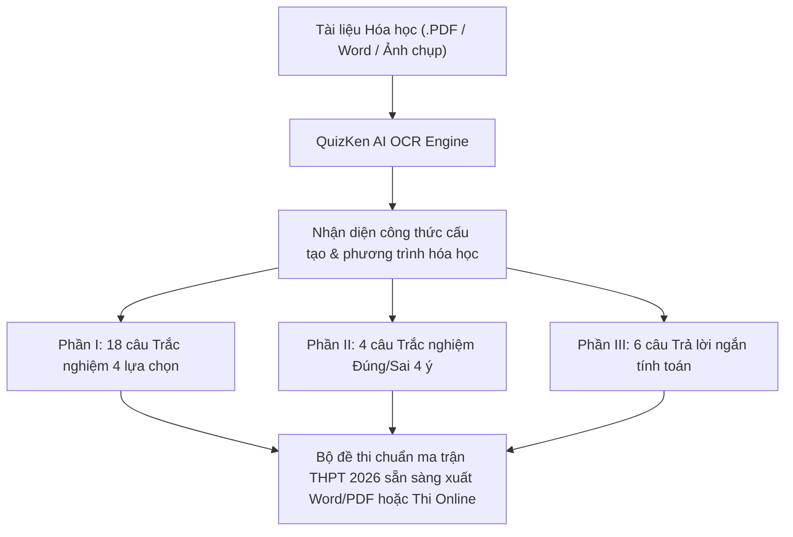

> **TL;DR (Tóm tắt nhanh):**  
> Kỳ thi tốt nghiệp THPT 2026 áp dụng cấu trúc đề thi Hóa học hoàn toàn mới theo Chương trình GDPT 2018 với 28 câu hỏi chia làm 3 phần trong thời gian 50 phút. Việc biên soạn các câu hỏi trắc nghiệm Đúng/Sai 4 ý và câu hỏi tính toán trả lời ngắn ngốn hàng giờ của thầy cô giáo. Với **QuizKen AI**, giáo viên và học sinh chỉ cần nạp tài liệu bài giảng, chuyên đề PDF hoặc hình ảnh sơ đồ phản ứng, hệ thống sẽ tự động trích xuất công thức hóa học chuẩn xác và sinh bộ đề thi chuẩn ma trận Bộ GD&ĐT chỉ sau 5 giây.

---

# Cách Dùng AI Tạo Đề Trắc Nghiệm Hóa Học THPT 2026 Chuẩn 3 Phần Cực Nhanh

Kỳ thi tốt nghiệp THPT năm 2026 đánh dấu bước chuyển mình toàn diện khi toàn bộ học sinh lớp 12 trên cả nước đều thi theo **Chương trình Giáo dục phổ thông mới (GDPT 2018)**. Môn Hóa học không còn là các câu hỏi trắc nghiệm tính toán thuần túy công thức máy móc như format cũ trước năm 2025, mà chuyển dịch mạnh mẽ sang kiểm tra **năng lực thực nghiệm, bản chất hóa học và ứng dụng thực tiễn**.

Thách thức lớn nhất đối với giáo viên hiện nay là **ngân hàng câu hỏi theo format mới còn rất khan hiếm**, đặc biệt là dạng câu hỏi **Đúng/Sai 4 mệnh đề** và **câu hỏi trả lời ngắn**. Bài viết này sẽ hướng dẫn bạn phương pháp ứng dụng Trí tuệ Nhân tạo (AI) sư phạm của QuizKen để xây dựng đề thi Hóa học chuẩn ma trận 2026 chỉ trong vài thao tác đơn giản.

---

## 1. Cấu Trúc Ma Trận Đề Thi Hóa Học THPT 2026 Chuẩn Bộ GD&ĐT

Để tạo được đề thi chất lượng, trước tiên cần nắm vững khung cấu trúc 28 câu hỏi (thời gian làm bài: 50 phút) được Bộ GD&ĐT quy định:

| Phần thi | Dạng thức câu hỏi | Số lượng câu | Thang điểm tối đa | Bản chất đánh giá năng lực |
| :--- | :--- | :---: | :---: | :--- |
| **Phần I** | Trắc nghiệm nhiều lựa chọn (4 chọn 1) | 18 câu | 4,5 điểm *(0,25đ/câu)* | Nhận biết và thông hiểu kiến thức cốt lõi: Este - Lipit, Amin, Polime, Đại cương kim loại... |
| **Phần II** | Trắc nghiệm dạng Đúng / Sai (4 mệnh đề a, b, c, d) | 4 câu *(16 ý)* | 4,0 điểm *(tối đa 1đ/câu)* | Đánh giá năng lực thực hành thí nghiệm, hiện tượng hóa học, phân tích biểu đồ phản ứng và ứng dụng đời sống. |
| **Phần III** | Trắc nghiệm dạng Trả lời ngắn (Tô kết quả số) | 6 câu | 1,5 điểm *(0,25đ/câu)* | Tư duy giải toán hóa học thực tế, tính hiệu suất phản ứng, nồng độ pH, chuẩn độ dung dịch mà không có đáp án gợi ý. |

> [!IMPORTANT]
> Quy chế tính điểm Phần II cực kỳ khắt khe: Thí sinh chọn đúng 1 ý được 0,1đ; đúng 2 ý được 0,25đ; đúng 3 ý được 0,5đ; và phải đúng trọn vẹn cả 4 ý mới nhận được 1,0đ. Vì vậy, câu hỏi AI sinh ra phải có 4 mệnh đề liên kết logic và có độ nhiễu sư phạm cao.

---

## 2. Quy Trình 3 Bước Tạo Đề Thi Hóa Học 2026 Bằng QuizKen AI

### Bước 1: Chuẩn bị ngữ liệu và tài liệu Hóa học
Hệ thống **QuizKen AI** hỗ trợ đa dạng định dạng đầu vào:
* Tệp PDF giáo trình, chuyên đề Hóa học 10, 11, 12 (bộ sách Kết nối tri thức, Cánh diều, Chân trời sáng tạo).
* Tệp Word tóm tắt lý thuyết hoặc bài tập chưa có đáp án.
* Ảnh chụp sách bài tập hoặc đề cương ôn tập viết tay (nhờ công nghệ OCR AI chuyên sâu).

### Bước 2: Nạp dữ liệu vào QuizKen và cấu hình đề thi
1. Truy cập nền tảng: [https://app.quizken.com](https://app.quizken.com).
2. Chọn tính năng **Tạo đề thi bằng AI**.
3. Tải tài liệu Hóa học của bạn lên hệ thống.
4. Chọn cấu hình đề thi:
   * **Môn học:** Hóa học THPT.
   * **Cấu trúc:** Chuẩn THPT 2026 (Tự động phân bổ Phần I, Phần II và Phần III).
   * **Mức độ nhận thức:** Cân đối giữa Nhận biết (40%), Thông hiểu (30%), Vận dụng (30%).

### Bước 3: Xem trước, chỉnh sửa công thức KaTeX và xuất bản
* AI sẽ tự động sinh đề cùng lời giải chi tiết từng bước.
* Các công thức hóa học phức tạp (như $CH_3COOC_2H_5$, $Fe_2(SO_4)_3$, $pH = -\log[H^+]$) được hiển thị sắc nét bằng chuẩn KaTeX/LaTeX.
* Thầy cô có thể chọn **Xuất file Word/PDF** để in đề kiểm tra trên lớp, hoặc kích hoạt **Chế độ Phòng thi Online** để học sinh làm bài trực tiếp trên điện thoại/máy tính với tính năng chống gian lận tự động.

---

## 3. Ví Dụ Câu Hỏi Hóa Học Format Mới Do QuizKen AI Khởi Tạo

### Ví dụ Phần II: Trắc nghiệm Đúng / Sai 4 ý (Thực nghiệm hóa học)
**Câu 1:** Tiến hành thí nghiệm tráng bạc của glucose theo các bước sau:
* *Bước 1:* Cho vào ống nghiệm sạch 1 mL dung dịch $AgNO_3$ 1%.
* *Bước 2:* Thêm từng giọt dung dịch $NH_3$ 5% và lắc đều đến khi kết tủa tan hết.
* *Bước 3:* Thêm tiếp 1 mL dung dịch glucose 1%, lắc đều rồi ngâm ống nghiệm trong cốc nước nóng ($60 - 70^\circ C$).

Xét tính đúng / sai của các mệnh đề sau:
* a) Ở bước 2, ban đầu xuất hiện kết tủa màu nâu đen $AgOH$, sau đó tan tạo phức chất $[Ag(NH_3)_2]OH$. *(Đúng)*
* b) Ở bước 3, xảy ra phản ứng khử glucose thành ammonium gluconate. *(Sai - Glucose bị oxi hóa)*
* c) Có thể thay thế dung dịch glucose bằng dung dịch fructose thì hiện tượng tráng bạc vẫn xảy ra tương tự trong môi trường kiềm. *(Đúng)*
* d) Phản ứng tráng bạc chứng minh trong phân tử glucose có chứa 5 nhóm hydroxyl (-OH) kề nhau. *(Sai - Chứng minh có nhóm aldehyde -CHO)*

---

## 4. Lợi Ích Khi Giáo Viên & Học Sinh Ứng Dụng QuizKen Môn Hóa Học

* **Tiết kiệm 90% thời gian ra đề:** Không còn phải thức đêm gõ từng công thức hay vắt óc nghĩ ra 4 mệnh đề Đúng/Sai cân bằng độ khó.
* **Chấm điểm tự động dạng Đúng/Sai phức hợp:** QuizKen tự động chấm điểm theo đúng barem lẻ (0.1 - 0.25 - 0.5 - 1.0) của Bộ GD&ĐT mà giáo viên không phải mất công tính toán thủ công.
* **Phân tích lỗ hổng kiến thức:** Báo cáo chi tiết chỉ ra ngay học sinh đang yếu phần Hóa học hữu cơ hay Vô cơ, hay nhầm lẫn ở khâu đọc đồ thị hay tính toán nồng độ.

Bắt đầu trải nghiệm công cụ tạo đề thi Hóa học thế hệ mới ngay hôm nay tại: [https://app.quizken.com](https://app.quizken.com).
