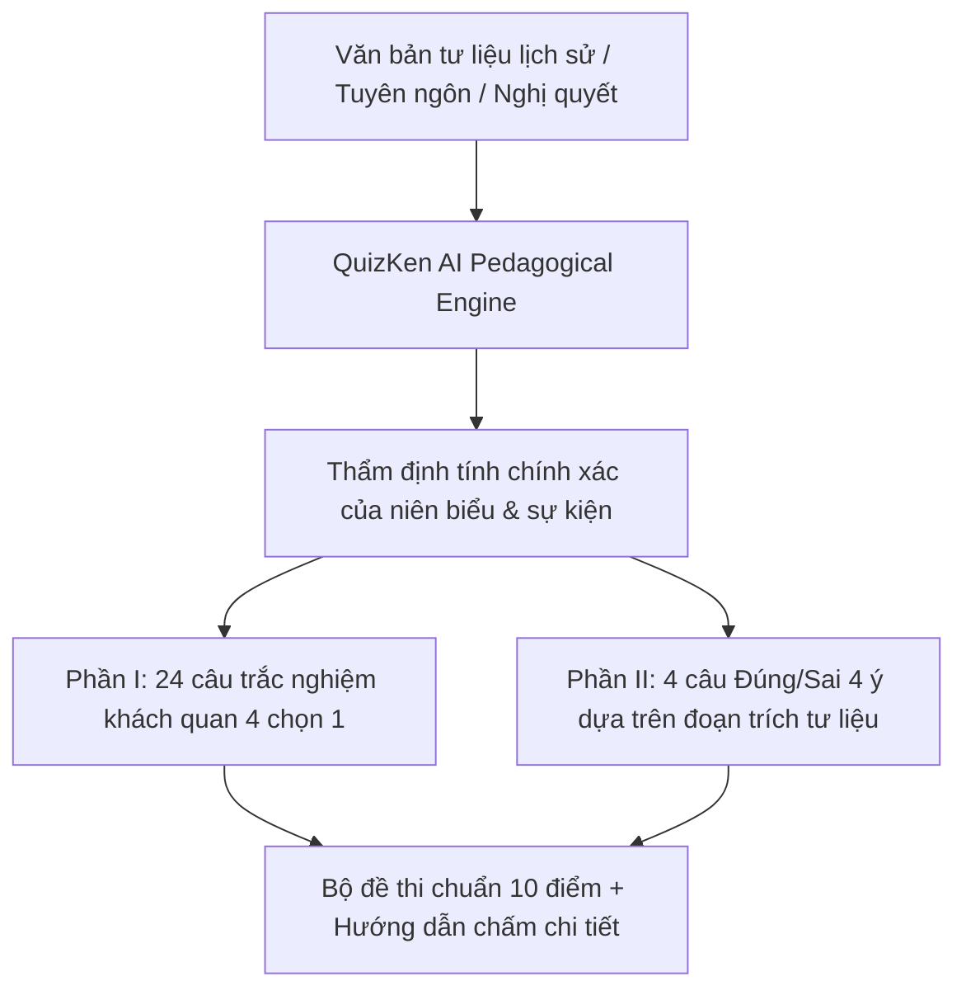

> **TL;DR (Tóm tắt nhanh):**  
> Đề thi tốt nghiệp THPT môn Lịch sử năm 2026 theo Chương trình GDPT 2018 có sự chuyển dịch mang tính bước ngoặt: Gồm 28 câu hỏi (24 câu trắc nghiệm nhiều lựa chọn và 4 câu trắc nghiệm Đúng/Sai 4 ý) làm bài trong 50 phút. Đặc biệt, môn Lịch sử **không áp dụng câu hỏi trả lời ngắn** nhưng lại tăng cường tối đa các đoạn trích tư liệu lịch sử ngoài sách giáo khoa. Bài viết này hướng dẫn thầy cô cách dùng **QuizKen AI** để tự động tìm kiếm ngữ liệu lịch sử tin cậy và tạo chùm câu hỏi Đúng/Sai đánh giá năng lực tư duy phê phán chỉ trong 5 giây.

---

# Bí Quyết Tạo Đề Trắc Nghiệm Lịch Sử THPT 2026 Chuẩn Format Mới Bằng AI

Trước đây, môn Lịch sử thường gắn liền với định kiến "học vẹt", học thuộc lòng các mốc thời gian, niên biểu và số lượng chiến dịch. Tuy nhiên, trong **Kỳ thi tốt nghiệp THPT 2026**, định dạng đề thi đã thay đổi căn bản nhằm đánh giá **năng lực tìm hiểu lịch sử, nhận thức lịch sử và vận dụng bài học lịch sử vào thực tiễn**.

Thầy cô và các bạn học sinh không thể chỉ dựa vào các câu hỏi trắc nghiệm truyền thống. Hãy cùng khám phá giải pháp tạo đề thi Lịch sử format mới với trợ lý sư phạm **QuizKen AI**.

---

## 1. Cấu Trúc Đề Thi Tốt Nghiệp THPT Môn Lịch Sử 2026

Khác với các môn Khoa học tự nhiên, môn Lịch sử chỉ gồm **2 Phần** (tổng cộng 28 câu hỏi, 50 phút làm bài):

| Phần | Dạng thức | Số câu | Điểm tối đa | Yêu cầu đánh giá |
| :--- | :--- | :---: | :---: | :--- |
| **Phần I** | Trắc nghiệm 4 phương án (Chọn 1) | 24 câu | 6,0 điểm *(0,25đ/câu)* | Đánh giá kiến thức cơ bản về lịch sử Việt Nam và lịch sử thế giới (cận - hiện đại). |
| **Phần II** | Trắc nghiệm Đúng / Sai (4 mệnh đề a, b, c, d) | 4 câu *(16 ý)* | 4,0 điểm *(tối đa 1đ/câu)* | Đánh giá năng lực giải mã tư liệu: Đọc hiểu văn kiện lịch sử, hồi ký, hiệp định, phân tích nguyên nhân - hệ quả và rút ra bài học kinh nghiệm. |

> [!NOTE]
> Điểm đặc biệt của Phần II: Mỗi câu hỏi bắt đầu bằng một đoạn trích tư liệu lịch sử (từ 100 - 250 từ). Thí sinh phải căn cứ vào tư liệu kết hợp kiến thức đã học để xác định tính Đúng/Sai của 4 mệnh đề độc lập.

---

## 2. Hướng Dẫn Sử Dụng QuizKen Tạo Đề Thi Lịch Sử Chuẩn 2026

### Bước 1: Nạp tư liệu hoặc chọn chủ đề
Trên giao diện của [https://app.quizken.com](https://app.quizken.com), giáo viên có thể:
* Tải lên tệp Word/PDF bài học lịch sử lớp 12 (ví dụ: Chuyên đề Hoạt động đối ngoại của Việt Nam, Cách mạng tháng Tám 1945, Kháng chiến chống Mỹ cứu nước...).
* Hoặc chỉ cần nhập yêu cầu: *"Tạo chùm câu hỏi Đúng/Sai 4 ý phân tích ý nghĩa lịch sử của Hiệp định Genève 1954 dựa trên văn kiện chính thức"*.

### Bước 2: AI thiết lập đề thi chuẩn Bộ GD&ĐT
* QuizKen sẽ tự động phân loại các câu hỏi Phần I trải dài theo 4 mức độ: Nhận biết, Thông hiểu, Vận dụng và Vận dụng cao.
* Đối với Phần II, AI trích dẫn chính xác tư liệu lịch sử chuẩn mực từ các nguồn sách giáo khoa và tư liệu chính thống, sau đó sinh 4 mệnh đề có độ phân hóa cao.

### Bước 3: Xem lại và tổ chức kiểm tra
* Kiểm tra các mốc thời gian và danh xưng sự kiện.
* Xuất file đề thi PDF/Word chuẩn định dạng in ấn của các trường THPT.
* Phát mã QR hoặc link để học sinh thi thử trực tuyến trên nền tảng QuizKen.

---

## 3. Mẫu Câu Hỏi Lịch Sử Đúng/Sai 4 Ý Khai Thác Ngữ Liệu

Dưới đây là một câu hỏi thực tế được tạo bởi **QuizKen AI**:

**Đọc đoạn tư liệu sau:**  
*"Thắng lợi của cuộc kháng chiến chống Mỹ, cứu nước đã kết thúc 21 năm chiến đấu chống đế quốc Mỹ xâm lược và 30 năm chiến tranh giải phóng dân tộc bảo vệ Tổ quốc, chấm dứt ách thống trị của chủ nghĩa thực dân, đế quốc kéo dài hơn một thế kỷ trên đất nước ta; hoàn thành cách mạng dân tộc dân chủ nhân dân trong cả nước, thống nhất đất nước về mặt lãnh thổ..."*  
*(Trích: Văn kiện Đảng Toàn tập, NXB Chính trị quốc gia, Hà Nội, 2004)*

**Xét tính Đúng / Sai của các mệnh đề sau:**
* a) Đoạn tư liệu khẳng định cuộc kháng chiến chống Mỹ cứu nước đã hoàn thành trọn vẹn cả hai nhiệm vụ độc lập dân tộc và người cày có ruộng. *(Sai - Chỉ nói về hoàn thành cách mạng dân tộc dân chủ nhân dân, thống nhất đất nước)*
* b) Thắng lợi năm 1975 đã mở ra kỷ nguyên mới của dân tộc: Kỷ nguyên độc lập, thống nhất và đi lên chủ nghĩa xã hội. *(Đúng)*
* c) Thắng lợi này đã đập tan ách thống trị của chủ nghĩa thực dân kiểu cũ trên phạm vi toàn thế giới. *(Sai - Chỉ chấm dứt ách thống trị tại Việt Nam và góp phần làm suy yếu chủ nghĩa thực dân kiểu mới)*
* d) Tư liệu thể hiện sự gắn kết biện chứng giữa cuộc kháng chiến chống Mỹ với toàn bộ tiến trình đấu tranh giải phóng dân tộc kéo dài suốt 30 năm (1945 - 1975). *(Đúng)*

---

## 4. Ưu Thế Khi Luyện Thi Lịch Sử Cùng QuizKen

1. **Khắc phục nỗi sợ ghi nhớ ngày tháng:** Chuyển từ học thuộc niên đại sang tư duy giải mã ngữ cảnh lịch sử.
2. **Kho tài liệu tư liệu mở rộng:** Hệ thống tự động đề xuất các đoạn tư liệu thực tế bên ngoài sách giáo khoa, giúp học sinh mở rộng góc nhìn và không bị bỡ ngỡ khi bước vào phòng thi chính thức.
3. **Chấm điểm minh bạch theo barem thi THPT:** Học sinh biết chính xác mình mất điểm ở ý nào và nhận được phân tích lời giải chi tiết ngay lập tức.

Tham gia sáng tạo và luyện tập đề thi Lịch sử format mới cùng QuizKen tại: [https://app.quizken.com](https://app.quizken.com).
