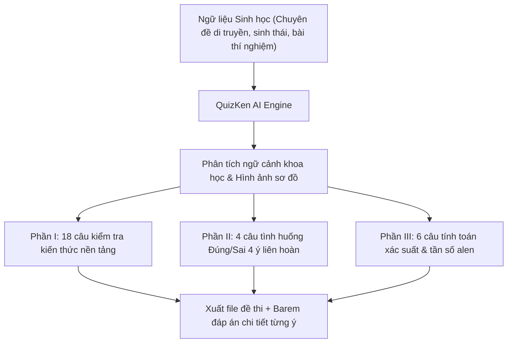

> **TL;DR (Tóm tắt nhanh):**  
> Đề thi tốt nghiệp THPT môn Sinh học 2026 theo Chương trình GDPT 2018 có độ khó và phân hóa rất cao với 28 câu hỏi (18 câu nhiều lựa chọn, 4 câu Đúng/Sai 4 ý, 6 câu trả lời ngắn) trong 50 phút. Đặc biệt các dạng bài tập phả hệ, di truyền quần thể và công nghệ tế bào đòi hỏi tư duy logic phức hợp. Bài viết này hướng dẫn chi tiết cách dùng **QuizKen AI** để quét tài liệu chuyên đề và sinh tự động bộ đề thi Sinh học chuẩn ma trận khảo thí quốc gia chỉ trong vài giây.

---

# Hướng Dẫn Tạo Đề Trắc Nghiệm Sinh Học THPT 2026 Chuẩn Ma Trận Bằng AI

Với định hướng phát triển phẩm chất và năng lực của **Chương trình GDPT 2018**, đề thi tốt nghiệp THPT môn Sinh học năm 2026 đã loại bỏ hoàn toàn các câu hỏi tính toán mẹo mực toán học phi thực tế. Thay vào đó, đề tập trung vào **khả năng phân tích thí nghiệm sinh học, đọc hiểu sơ đồ cơ chế phân tử, biểu đồ sinh thái học và giải quyết các vấn đề thực tiễn (biến đổi khí hậu, an ninh lương thực, y sinh học)**.

Đối với thầy cô giáo dạy Sinh học, việc xây dựng các chùm câu hỏi **Đúng/Sai 4 ý** và **Trả lời ngắn** chuẩn chỉnh tốn rất nhiều thời gian thẩm định nội dung. Công cụ **QuizKen AI** chính là trợ thủ đắc lực giúp giải quyết triệt để vấn đề này.

---

## 1. Chi Tiết Cấu Trúc Đề Thi Tốt Nghiệp THPT Sinh Học 2026

Đề thi gồm 28 câu hỏi, làm bài trong 50 phút với phân bổ như sau:

| Phần thi | Hình thức | Số câu hỏi | Điểm số | Yêu cầu năng lực cốt lõi |
| :--- | :--- | :---: | :---: | :--- |
| **Phần I** | Trắc nghiệm 4 lựa chọn (chọn 1) | 18 câu | 4,5 điểm | Nhận biết, thông hiểu các quy luật di truyền Menđen, liên kết gen, đột biến NST, tiến hóa và sinh thái. |
| **Phần II** | Trắc nghiệm Đúng / Sai (4 ý a,b,c,d) | 4 câu *(16 ý)* | 4,0 điểm | Đánh giá năng lực nghiên cứu khoa học, phân tích kết quả thí nghiệm sinh học phân tử, phả hệ bệnh di truyền người. |
| **Phần III** | Trắc nghiệm Trả lời ngắn (Điền số) | 6 câu | 1,5 điểm | Tính toán xác suất di truyền, tần số alen quần thể, hiệu suất sinh thái và phân tích số liệu thực nghiệm. |

---

## 2. Các Bước Tạo Đề Thi Sinh Học Chuẩn Bằng QuizKen

### Bước 1: Chuẩn bị nội dung kiến thức
Thầy cô có thể tải lên tệp Word giáo án, tệp PDF sách giáo khoa lớp 12 (bộ sách Kết nối tri thức, Chân trời sáng tạo hoặc Cánh diều) hoặc các bài báo khoa học về sinh học hiện đại.

### Bước 2: Khởi tạo đề thi trên QuizKen
1. Đăng nhập vào nền tảng: [https://app.quizken.com](https://app.quizken.com).
2. Vào mục **Tạo Đề Thi Bằng AI**.
3. Chọn môn học: **Sinh học THPT**.
4. Chọn định dạng: **Đề thi THPT 2026 (3 Phần)**.
5. Thiết lập độ khó mong muốn (ví dụ: Đề kiểm tra học kỳ 45 phút hoặc Đề thi thử tốt nghiệp THPT 50 phút).

### Bước 3: Xuất đề thi và tổ chức kiểm tra
Sau khi QuizKen sinh xong đề thi, giáo viên có thể:
* Tinh chỉnh lại các mệnh đề Đúng/Sai nếu muốn thêm dữ kiện riêng của lớp học.
* Tải tệp PDF/Word đã căn chỉnh lề chuẩn sư phạm để in ấn.
* Tạo link thi trực tuyến chống gian lận để học sinh làm bài ngay trên lớp hoặc giao bài tập về nhà.

---

## 3. Mẫu Câu Hỏi Sinh Học Đúng/Sai 4 Ý Điển Hình

Dưới đây là một ví dụ câu hỏi Phần II được sinh bởi QuizKen AI:

**Câu 1:** Một nhóm học sinh tiến hành nghiên cứu ảnh hưởng của ánh sáng và nhiệt độ đến cường độ quang hợp ở một loài thực vật C3. Kết quả đo đạc lượng $CO_2$ hấp thụ được thể hiện qua bảng số liệu thực nghiệm. Mỗi phát biểu sau đây là Đúng hay Sai?
* a) Ở điểm bù ánh sáng, cường độ quang hợp bằng cường độ hô hấp. *(Đúng)*
* b) Khi tăng cường độ ánh sáng vượt quá điểm bão hòa, cường độ quang hợp của cây sẽ tiếp tục tăng tỷ lệ thuận. *(Sai - Quang hợp sẽ đạt cực đại rồi không tăng nữa hoặc giảm do bị ức chế quang năng)*
* c) Nếu đưa cây vào môi trường có nồng độ $O_2$ cao ($21\%$), hiện tượng hô hấp sáng sẽ xảy ra làm giảm năng suất quang hợp. *(Đúng)*
* d) Thực vật C3 thích nghi tốt hơn thực vật C4 trong điều kiện khí hậu khô hạn, nhiệt độ cao và cường độ bức xạ mạnh. *(Sai - Thực vật C4 thích nghi tốt hơn)*

---

## 4. Tại Sao Nên Sử Dụng QuizKen Để Luyện Thi Sinh Học?

* **Chống học vẹt và khoanh lụi:** Dạng thức Đúng/Sai và Trả lời ngắn trên QuizKen giúp học sinh buộc phải hiểu bản chất sinh học thay vì trông chờ vào may mắn.
* **Tự động chấm điểm barem Bộ GD&ĐT:** Tính điểm chính xác đến từng 0,1 điểm cho các câu hỏi 4 ý.
* **Ngân hàng đề thi cập nhật liên tục:** QuizKen liên tục bổ sung các chuyên đề sinh học phân tử, công nghệ gen mới nhất.

Trải nghiệm tạo đề thi Sinh học chuẩn 2026 ngay tại: [https://app.quizken.com](https://app.quizken.com).
