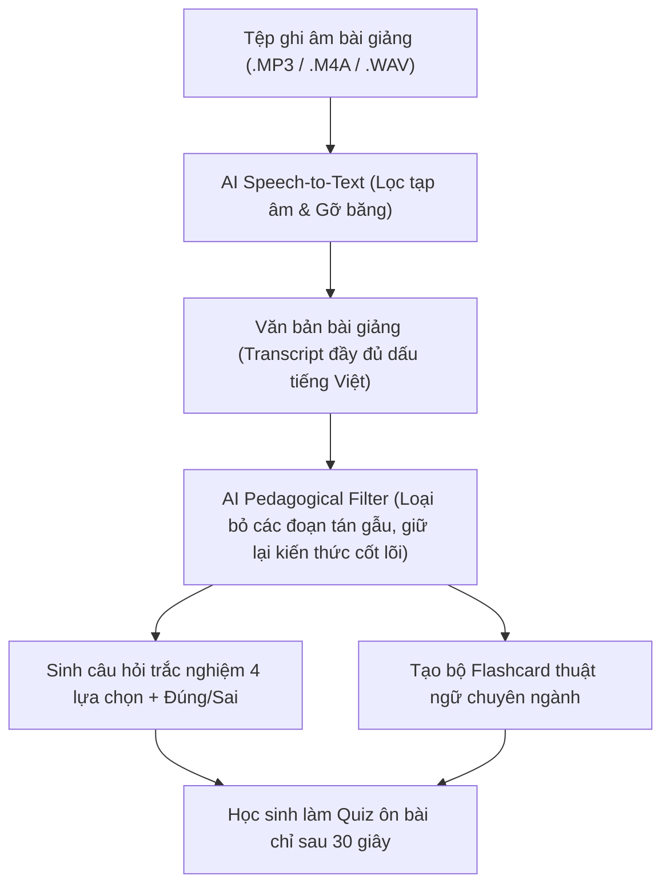

> **TL;DR (Tóm tắt nhanh):**  
> Ngồi nghe lại hàng chục giờ ghi âm bài giảng trên giảng đường (Voice Memos, MP3, M4A) là thói quen tốn thời gian mà hiệu quả ôn thi lại cực thấp. Sinh viên thường ngủ gật hoặc xao nhãng sau 15 phút nghe thụ động. Với tính năng **Audio-to-Quiz AI** của **QuizKen**, bạn chỉ cần tải tệp ghi âm hoặc đường dẫn podcast bài giảng lên hệ thống: AI sẽ tự động gỡ băng (Whisper Transcription), tóm tắt các luận điểm cốt lõi và khởi tạo ngay một bộ đề thi trắc nghiệm tương tác giúp bạn ôn luyện phản xạ tức thì!

---

# Cách Chuyển File Ghi Âm Bài Giảng & Podcast Thành Đề Trắc Nghiệm AI Trong 5 Giây

Tại các trường đại học và các lớp học thêm cuối cấp, việc sinh viên dùng điện thoại hoặc máy ghi âm để lưu lại lời giảng của thầy cô là điều diễn ra hàng ngày.

Tuy nhiên, **"nghịch lý ghi âm"** luôn xảy ra vào mùa thi cử:
* Bạn tích lũy hàng chục gigabyte tệp ghi âm nhưng hiếm khi có đủ kiên nhẫn để nghe lại từ đầu đến cuối một buổi học kéo dài 2 - 3 tiếng.
* Giọng giảng bài thường xen lẫn tạp âm, tiếng ho, tiếng nói chuyện hoặc những đoạn ngắt quãng không liên quan đến trọng tâm thi cử.
* Nghe lại thụ động (Passive Listening) không tạo ra kích thích thần kinh để não bộ ghi nhớ kiến thức lâu dài.

Giải pháp tối ưu nhất năm 2026 là **chuyển hóa âm thanh thành câu hỏi trắc nghiệm phản xạ chủ động bằng AI**.

---

## 1. Cơ Chế Xử Lý Âm Thanh Thành Quiz Của QuizKen AI

Hệ thống QuizKen kết hợp chuỗi công nghệ tiên tiến:

| Giai đoạn | Thách thức của phương pháp thủ công | Sự vượt trội của QuizKen AI |
| :--- | :--- | :--- |
| **Gỡ băng âm thanh** | Phải tua đi tua lại, gõ từng câu mất 3 - 4 giờ cho 1 file ghi âm 60 phút. | Tự động phiên âm tiếng Việt độ chính xác trên 98% chỉ trong 30 giây. |
| **Chắt lọc nội dung** | Dễ bị cuốn vào các câu chuyện phiếm bên lề của giảng viên. | AI tự động phát hiện đâu là khái niệm thi cử, đâu là ví dụ minh họa và loại bỏ từ ngữ thừa. |
| **Kiểm tra kiến thức** | Nghe lại thụ động dễ buồn ngủ, không biết mình hiểu bài đến đâu. | Biến toàn bộ buổi học thành một đấu trường giải đố tương tác với đáp án và lời giải chi tiết. |

---

## 2. Hướng Dẫn 3 Bước Biến Tệp Ghi Âm Thành Đề Thi Thử

### Bước 1: Chuẩn bị tệp âm thanh bài giảng
* Bạn có thể sử dụng ứng dụng Ghi âm (Voice Memos) trên iPhone/Android hoặc tệp âm thanh ghi từ Zoom, Microsoft Teams, Google Meet.
* Hỗ trợ mọi định dạng phổ biến: `.mp3`, `.m4a`, `.wav`, `.aac`.

### Bước 2: Tải lên QuizKen
1. Truy cập nền tảng: [https://app.quizken.com](https://app.quizken.com).
2. Chọn mục **Tạo Đề Thi Bằng AI** và chọn phương thức **Tải File Âm Thanh / Video**.
3. Chọn tệp ghi âm từ thiết bị của bạn.

### Bước 3: Nhận bài trắc nghiệm và bắt đầu luyện tập
* Trong vòng vài chục giây, hệ thống sẽ trả về:
  1. Bản tóm tắt các đề mục cốt lõi của bài giảng.
  2. Bộ câu hỏi trắc nghiệm kiểm tra mức độ hiểu bài.
  3. Bộ thẻ Flashcard thuật ngữ để học thuộc lòng.
* Bạn có thể làm bài kiểm tra trực tuyến ngay trên điện thoại hoặc chia sẻ link cho các bạn cùng nhóm học tập để cùng nhau thi đấu xếp hạng.

---

## 3. Các Tình Huống Ứng Dụng Thực Tiễn Đỉnh Cao

1. **Ôn thi các môn Triết học Mác - Lênin, Tư tưởng Hồ Chí Minh:** Giảng viên thường nói rất nhiều luận điểm sâu sắc không có trong slide. AI sẽ bắt trọn các câu nói "đắt giá" đó và biến thành câu hỏi trắc nghiệm sát đề thi học kỳ.
2. **Học tiếng Anh qua Podcast TED Talks, BBC Learning English:** Nạp tệp podcast tiếng Anh vào để AI tạo bài tập nghe - điền từ khuyết và kiểm tra từ vựng chuyên sâu.
3. **Tổng hợp nội dung họp nhóm, hội thảo chuyên đề:** Nhanh chóng kiểm tra xem các thành viên có nắm bắt đúng tinh thần buổi họp hay không thông qua một mini-quiz 5 câu vui nhộn.

---

## 4. Trải Nghiệm Học Tập Thông Minh Cùng QuizKen

Đừng để những chiếc máy ghi âm trở thành "kho lưu trữ chết". Hãy biến từng phút nghe giảng trên lớp thành điểm số cao trong bảng điểm của bạn!

Bắt đầu chuyển đổi file ghi âm đầu tiên của bạn tại: [https://app.quizken.com](https://app.quizken.com).
