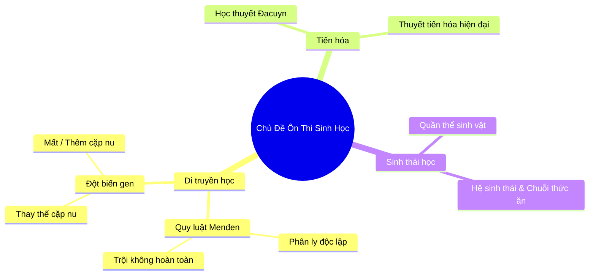

> **TL;DR (Tóm tắt nhanh):**  
> Việc **tạo sơ đồ tư duy mindmap bằng AI miễn phí** từ các file giáo trình PDF hoặc slide bài giảng dài hàng chục trang hiện nay chỉ mất đúng 10 giây nhờ công cụ mã nguồn mở **Markmap** (`markmap.js.org`) và cú pháp biểu đồ **Mermaid.js**. Thay vì phải ngồi vẽ thủ công từng nhánh vẽ mũi tên mất cả buổi tối, bạn chỉ cần dùng AI tóm tắt tài liệu thành cấu trúc Markdown phân cấp, sau đó chuyển hóa tức thì thành sơ đồ tư duy tương tác trực quan. Từ các nhánh kiến thức đã phân loại, bạn có thể nạp thẳng vào **QuizKen** để làm bài test kiểm tra kiến thức theo phương pháp vi mô (Microlearning) đạt hiệu quả cao nhất!

---

# Hướng Dẫn Tạo Sơ Đồ Tư Duy Mindmap Từ Slide & PDF Bằng AI Trong 10 Giây (2026)

Trước các kỳ thi quan trọng như thi Tốt nghiệp THPT Quốc gia hay thi kết thúc học phần đại học, não bộ con người thường bị quá tải nếu chỉ nhìn vào những dòng chữ dài dòng liên miên trong sách giáo khoa. Các nghiên cứu về tâm lý học nhận thức chứng minh rằng: **Hình ảnh và cấu trúc phân nhánh giúp não bộ ghi nhớ thông tin nhanh gấp 6 lần so với văn bản thuần túy (Text-only)**.

Tuy nhiên, rào cản lớn nhất của phương pháp sơ đồ tư duy (Mindmap) truyền thống là:
* Ngồi vẽ tay bằng bút màu hoặc kéo thả chuột trên các phần mềm như XMind, MindNode rất tốn thời gian (mất 2 - 3 tiếng cho một chương học).
* Khi cần bổ sung một ý mới, bạn phải xóa đi vẽ lại hoặc bố cục các nhánh bị xô lệch, mất thẩm mỹ.
* Nhiều ứng dụng vẽ mindmap AI thương mại bắt trả phí đắt đỏ hoặc giới hạn chỉ cho xuất ảnh chất lượng thấp.

Trong bài viết này, **QuizKen** sẽ hướng dẫn bạn phương pháp **tạo sơ đồ tư duy mindmap bằng AI miễn phí** 100% bằng cách kết hợp trí tuệ nhân tạo và công nghệ mã nguồn mở Markmap!

---

## 1. Nguyên Lý Chuyển Đổi Tài Liệu Thành Mindmap Trong 10 Giây

Bí quyết để tạo sơ đồ tư duy siêu tốc mà không cần kéo thả thủ công chính là sử dụng **định dạng Markdown phân cấp**:
* Tiêu đề lớn `#` (Heading 1) tương ứng với Chủ đề trung tâm (Gốc rễ của Mindmap).
* Tiêu đề `##` (Heading 2) tương ứng với các Nhánh chính (Main Branches).
* Tiêu đề `###` (Heading 3) và các dấu gạch đầu dòng `-` tương ứng với các Nhánh con và ví dụ chi tiết.



Khi văn bản đã có cấu trúc cây phân cấp như trên, công cụ **Markmap** sẽ sử dụng thư viện đồ họa D3.js để kết xuất thành một sơ đồ tư duy SVG tương tác sống động, cho phép bạn thu phóng, gấp gọn từng nhánh chỉ với 1 cú nhấp chuột!

---

## 2. Các Bước Tạo Sơ Đồ Tư Duy Mindmap Từ PDF Bằng AI Miễn Phí

### Bước 1: Yêu cầu AI chuyển giáo trình PDF thành cấu trúc Markdown
Mở ChatGPT, Claude hoặc DeepSeek và dán nội dung chương sách bạn cần học (hoặc tải file PDF bài giảng lên), sau đó sử dụng prompt chuẩn hóa:

```text
Hãy đọc nội dung tài liệu sau và đóng vai trò là một chuyên gia sư phạm.
Nhiệm vụ của bạn là chuyển toàn bộ kiến thức trong tài liệu thành một cấu trúc Sơ đồ tư duy (Mindmap) theo định dạng Markdown phân cấp nghiêm ngặt:
- Dùng # cho Chủ đề trung tâm
- Dùng ## cho các Luận điểm chính
- Dùng ### cho các Khái niệm / Công thức thành phần
- Dùng dấu gạch đầu dòng (-) cho các ví dụ minh họa và từ khóa cốt lõi
Yêu cầu: Ngắn gọn, súc tích, giữ nguyên các thuật ngữ chuyên ngành quan trọng.

[DÁN NỘI DUNG TÀI LIỆU VÀO ĐÂY]
```

### Bước 2: Dán vào Markmap để tạo Mindmap tức thì
1. Truy cập trang web mã nguồn mở miễn phí: `https://markmap.js.org/repl`.
2. Ở khung bên trái, xóa đoạn mã mẫu và dán toàn bộ cấu trúc Markdown mà AI vừa tạo ra.
3. Ngay lập tức ở khung bên phải, một **sơ đồ tư duy đầy màu sắc, tự động căn chỉnh khoảng cách hoàn hảo** sẽ xuất hiện!
4. Bạn có thể nhấp vào các nút tròn để thu gọn hoặc mở rộng từng nhánh bài học.
5. Bấm nút **Export** ở góc dưới để tải về file ảnh `.svg` siêu nét hoặc xuất file `.html` tương tác để lưu trữ trên máy tính.

---

## 3. Bảng So Sánh Các Công Cụ Tạo Sơ Đồ Tư Duy AI 2026

| Nền tảng | Địa chỉ chính thức | Chi phí | Tốc độ tạo | Khả năng xuất file HD |
| :--- | :--- | :--- | :--- | :--- |
| **Markmap (Khuyên dùng)** | `markmap.js.org` | **Miễn phí 100% mã nguồn mở** | **Tức thì (1 giây)** | Xuất SVG / HTML vô hạn độ phân giải |
| **Mermaid Live Editor** | `mermaid.live` | Miễn phí 100% | Tức thì | Xuất PNG / SVG |
| **Chatmind** | `chatmind.tech` | Giới hạn 3 sơ đồ/ngày | 15 giây | Cần mua bản Pro |
| **GitMind** | `gitmind.com` | Trả phí định kỳ | 30 giây | Bản Free bị dính Watermark |

---

## 4. Cầu Nối QuizKen: Từ Nhánh Tư Duy Đến Điểm Số Thực Tế

Nhiều bạn học sinh sau khi vẽ xong sơ đồ tư duy thì chỉ ngồi "ngắm" sơ đồ. Đây vẫn là hình thức học thụ động. Để thực sự làm chủ kiến thức và phản xạ nhanh trong phòng thi:

1. **Học theo từng nhánh vi mô (Microlearning):** Thay vì cố nuốt trọn cả cuốn giáo trình, hãy học dứt điểm từng nhánh nhỏ trên Mindmap (ví dụ: xong nhánh *Đột biến gen* rồi mới chuyển sang nhánh *Quy luật Menđen*).
2. **Kiểm tra tức thì trên [QuizKen](https://quizken.com):** Dán nội dung của nhánh đó vào tính năng **Tạo Đề Thi AI của QuizKen**.
3. **Thực hành trắc nghiệm chuyên sâu:** QuizKen sẽ tạo ra bộ 10 - 15 câu hỏi bám sát từng nhánh kiến thức, giúp bạn xác nhận xem mình đã nhớ chính xác các định nghĩa và công thức chưa.
4. **Lặp lại ngắt quãng (Spaced Repetition):** Những câu hỏi ở nhánh nào bạn làm sai sẽ được lưu vào hệ thống Flashcard thông minh của QuizKen để ôn lại sau 24 giờ.

Sự kết hợp giữa **tư duy trực quan của Mindmap (Markmap)** và **phương pháp gợi nhớ chủ động của QuizKen** chính là vũ khí tối thượng giúp bạn chinh phục mọi kỳ thi trong năm 2026!
