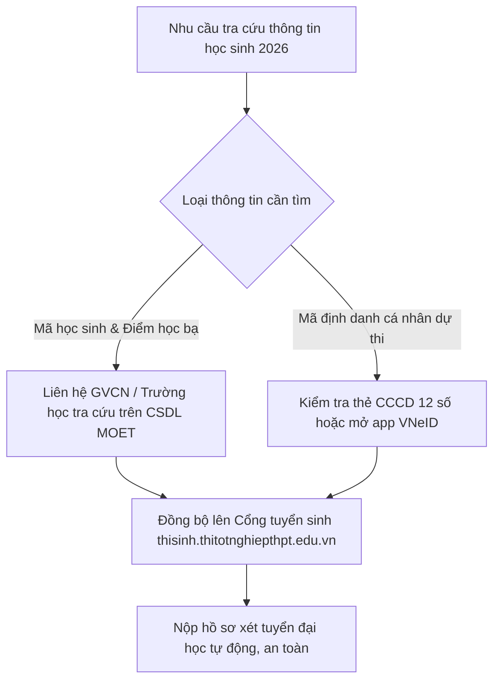

> **TL;DR (Tóm tắt nhanh):**  
> Trong kỳ thi tốt nghiệp và xét tuyển đại học bằng học bạ năm 2026, học sinh bắt buộc phải sử dụng **Mã định danh học sinh** và **Mã định danh cá nhân (12 số trên Căn cước công dân / VNeID)** để đồng bộ điểm số lên Cổng thông tin tuyển sinh của Bộ Giáo dục và Đào tạo. Mã định danh học sinh được cấp độc quyền bởi hệ thống CSDL ngành GD&ĐT ([csdl.moet.gov.vn](https://csdl.moet.gov.vn)) thông qua nhà trường. Sau khi tra cứu điểm học bạ, học sinh có thể tự kiểm tra và củng cố các môn học còn yếu bằng các bài kiểm tra trắc nghiệm AI trên **QuizKen**.

---

# Hướng Dẫn Tra Cứu Mã Định Danh Học Sinh & Điểm Học Bạ Điện Tử Trên CSDL Bộ GD&ĐT (2026)

Chuyển đổi số trong ngành Giáo dục đã đạt bước tiến vượt bậc với việc triển khai toàn diện **Học bạ điện tử (Digital Transcripts)** và **Cơ sở dữ liệu ngành giáo dục (CSDL MOET)**.

Học sinh lớp 12 khi chuẩn bị đăng ký thi tốt nghiệp THPT hoặc nộp hồ sơ xét học bạ vào các trường đại học thường xuyên gặp phải các câu hỏi:
* *Mã định danh học sinh là gì? Có giống số Căn cước công dân (CCCD) không?*
* *Làm thế nào để tra cứu mã định danh nếu chưa được cấp thẻ CCCD?*
* *Làm sao để kiểm tra xem điểm tổng kết từng học kỳ trên hệ thống học bạ điện tử của Bộ GD&ĐT đã chính xác hay chưa?*

Bài viết này sẽ hướng dẫn bạn tường tận quy trình tra cứu chính thống, an toàn và chuẩn xác nhất theo quy định của Bộ Giáo dục và Đào tạo.

---

## 1. Phân Biệt Hai Loại Mã Định Danh Cần Biết

Rất nhiều học sinh và phụ huynh thường nhầm lẫn giữa hai khái niệm này:

| Tiêu chí phân biệt | Mã Định Danh Cá Nhân (Bộ Công An) | Mã Định Danh Học Sinh (Bộ GD&ĐT) |
| :--- | :--- | :--- |
| **Cơ quan cấp** | Cục Cảnh sát QLHC về TTXH – Bộ Công an | Bộ Giáo dục và Đào tạo |
| **Định dạng số** | **12 chữ số** (In trực tiếp trên thẻ CCCD) | Dãy ký tự số do hệ thống CSDL trường học sinh ra |
| **Mục đích sử dụng** | Định danh công dân, đăng nhập VNeID, làm thủ tục thi THPT | Quản lý kết quả học tập, học bạ số, chuyển trường |
| **Nơi tra cứu** | Ứng dụng VNeID hoặc Cổng Dịch vụ công cư trú | Giáo viên chủ nhiệm hoặc hệ thống quản lý trường học |

*Lưu ý quan trọng:* Trong quá trình đăng ký thi tốt nghiệp THPT quốc gia và xét tuyển đại học trực tuyến, hệ thống tuyển sinh của Bộ GD&ĐT sẽ tự động đồng bộ hai mã này với nhau để liên kết điểm học bạ 3 năm THPT với hồ sơ cá nhân của thí sinh.

---

## 2. Cách Tra Cứu Mã Định Danh Học Sinh Chuẩn Xác Nhất

### Cách 1: Liên Hệ Trực Tiếp Giáo Viên Chủ Nhiệm / Ban Giám Hiệu
Vì hệ thống Cơ sở dữ liệu ngành ([truong.csdl.moet.gov.vn](https://truong.csdl.moet.gov.vn)) là hệ thống nội bộ bảo mật cao, chỉ tài khoản quản trị của nhà trường và giáo viên mới có quyền đăng nhập:
* **Học sinh/Phụ huynh:** Nhắn tin hoặc liên hệ trực tiếp với giáo viên chủ nhiệm lớp để được trích xuất mã định danh học sinh từ sổ theo dõi điện tử.
* **Giáo viên:** Đăng nhập vào trang quản trị trường $\rightarrow$ Chọn mục **Quản lý học sinh** $\rightarrow$ **Danh sách học sinh** $\rightarrow$ Tìm tên học sinh để lấy mã số định danh duy nhất.

### Cách 2: Tra Cứu Mã Định Danh Cá Nhân Qua VNeID (Cho Thí Sinh Đăng Ký Thi)
Đối với học sinh từ đủ 14 tuổi đã làm thẻ Căn cước công dân:
1. Dãy 12 số in ở mặt trước thẻ CCCD chính là mã định danh cá nhân của bạn.
2. Nếu chưa có thẻ cứng hoặc bị mất, mở ứng dụng **VNeID** trên điện thoại (đã kích hoạt tài khoản định danh điện tử mức 2), đăng nhập và vào mục **Ví giấy tờ** để xem số định danh.

### Cách 3: Tra Cứu Qua Cổng Dịch Vụ Công Quản Lý Cư Trú
Dành cho học sinh chưa làm thẻ CCCD:
1. Truy cập vào Cổng dịch vụ công: [https://dichvucong.dancuquocgia.gov.vn](https://dichvucong.dancuquocgia.gov.vn).
2. Phụ huynh đăng nhập bằng tài khoản Cổng Dịch vụ công Quốc gia hoặc VNeID.
3. Vào mục **Thông tin công dân / Thành viên hộ gia đình** để xem thông tin mã định danh cá nhân của con em mình.

---

## 3. Cách Tra Cứu Điểm Học Bạ Điện Tử Online

Sau khi được nhà trường đồng bộ dữ liệu lên Cổng thông tin của Bộ GD&ĐT hoặc cổng dịch vụ giáo dục địa phương (như VnEdu, SMAS, eNetViet):
1. **Qua tài khoản Kỳ thi tốt nghiệp THPT:** Khi mở cổng đăng ký thi, thí sinh đăng nhập vào [thisinh.thitotnghiepthpt.edu.vn](https://thisinh.thitotnghiepthpt.edu.vn) bằng mã CCCD và mã đăng nhập do trường cấp. Tại đây, mục **Tra cứu học bạ** sẽ hiển thị đầy đủ điểm trung bình từng môn của cả 3 năm lớp 10, 11 và 12.
2. **Kiểm tra chéo điểm số:** Nếu phát hiện điểm số trên hệ thống điện tử bị lệch so với sổ học bạ gốc bằng giấy, học sinh cần báo ngay cho giáo viên chủ nhiệm để nhà trường làm thủ tục điều chỉnh dữ liệu trước thời hạn khóa sổ.

---

## 4. 💡 Cải Thiện Điểm Số & Chuẩn Bị Xét Tuyển Với QuizKen

Xét tuyển học bạ là phương thức cạnh tranh khốc liệt đòi hỏi điểm số trung bình các môn tổ hợp (Toán, Lý, Hóa, Văn, Anh, Sinh, Sử, Địa) phải đạt từ 8.0 đến 9.0 trở lên. 

Nếu điểm số một số môn học kỳ trước chưa được như ý, bạn hoàn toàn có thể bứt phá điểm thi tốt nghiệp và kỳ thi Đánh giá năng lực bằng **[QuizKen](https://app.quizken.com)**:
* **Chẩn đoán lỗ hổng kiến thức:** QuizKen tự động thống kê phần bài học nào bạn hay làm sai để gợi ý bài tập rèn luyện bù đắp ngay tức thì.
* **Luyện đề thi thử không giới hạn:** Hàng trăm bộ đề trắc nghiệm chuẩn cấu trúc mới, giúp bạn rèn phản xạ làm bài nhanh và chuẩn xác.
* **Học từ vựng tiếng Anh chủ động:** Tăng cường điểm số môn Ngoại ngữ với kho flashcard CEFR A2 - B2 trên QuizKen English Hub.

> 📊 **Bứt phá học bạ ngay:** [Kiểm tra năng lực và làm đề thi thử AI miễn phí trên QuizKen tại đây!](https://app.quizken.com)

---

## Câu hỏi thường gặp về mã định danh và học bạ điện tử

### Một học sinh có thể có hai mã định danh học sinh khác nhau không?
Không. Mã định danh học sinh trên CSDL ngành Giáo dục là duy nhất và bất biến trong suốt quá trình từ bậc tiểu học cho đến hết cấp trung học phổ thông, kể cả khi bạn chuyển trường từ tỉnh này sang tỉnh khác.

### Nếu mất tài khoản đăng nhập xem điểm học bạ thì lấy lại như thế nào?
Thí sinh có thể bấm vào chức năng "Quên mã đăng nhập" trên cổng tuyển sinh của Bộ GD&ĐT để nhận mã qua email đã đăng ký, hoặc liên hệ trực tiếp với cán bộ phụ trách công nghệ thông tin tại trường THPT đang theo học để được cấp lại mật khẩu.

### Học bạ điện tử có giá trị pháp lý thay thế hoàn toàn học bạ giấy không?
Có! Theo Thông tư của Bộ GD&ĐT, học bạ điện tử có chữ ký số xác thực của Hiệu trưởng nhà trường có giá trị pháp lý đầy đủ tương đương học bạ giấy truyền thống trong mọi thủ tục xét tuyển đại học và du học.
