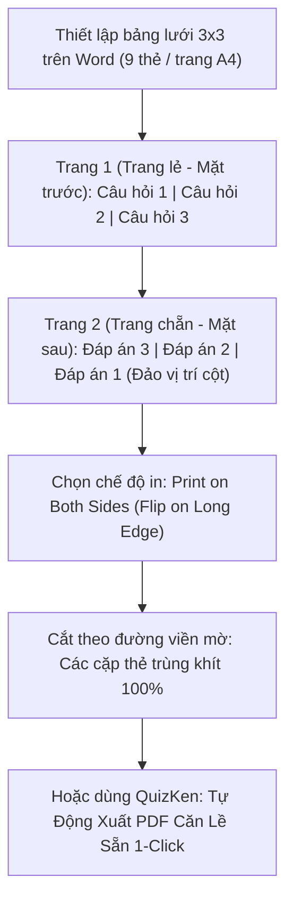

> **TL;DR (Tóm tắt nhanh):**  
> Dù các ứng dụng học tập số ngày càng phát triển, việc cầm trên tay những chiếc thẻ Flashcard bằng giấy cứng để lật học mọi lúc mọi nơi vẫn mang lại cảm giác xúc giác chân thực và không gây mỏi mắt cho học sinh. Để **tự làm thẻ flashcard in ấn miễn phí** 2 mặt chuẩn khổ giấy A4 mà không bị lệch dòng giữa mặt câu hỏi (Front) và mặt đáp án (Back), bạn chỉ cần thiết lập bảng lưới 3x3 đối xứng trong Word hoặc sử dụng tính năng **Xuất PDF In Ấn 1-Click của QuizKen**. Bài viết này sẽ hướng dẫn bạn toàn bộ kỹ thuật căn lề in đảo mặt chuẩn xác từng milimet!

---

# Hướng Dẫn Tự Làm & In Thẻ Flashcard 2 Mặt Chuẩn A4 Tiết Kiệm Nhất (2026)

Đối với các bạn học sinh ôn thi vào lớp 10, thi Tốt nghiệp THPT Quốc gia môn Lịch sử - Địa lý, hay người học ngoại ngữ cần nhồi nhét hàng nghìn từ vựng mới, thẻ ghi nhớ cầm tay (Flashcard) là phương pháp học tập kinh điển không thể thay thế:
* Học offline bất cứ lúc nào: Ngồi trên xe bus, giờ ra chơi hoặc trước khi đi ngủ mà không bị ánh sáng xanh của màn hình điện thoại làm hại mắt.
* Phân loại hộp ghi nhớ vật lý (Hệ thống hộp Leitner 5 ngăn) cực kỳ trực quan: Thẻ nào thuộc thì chuyển sang hộp sau, thẻ nào quên thì để lại hộp đầu tiên.

Tuy nhiên, mua các bộ thẻ in sẵn ngoài hiệu sách thường có giá khá đắt (từ 150.000đ - 300.000đ/bộ) và không bám sát đề cương riêng của trường bạn. Nếu tự in bằng Word thì thường gặp lỗi **mặt trước và mặt sau bị lệch tâm**, khi dùng kéo cắt ra thì chữ mặt sau bị đứt nét hoặc mất góc.

Dưới đây là cẩm nang chi tiết giúp bạn **tự làm thẻ flashcard in ấn miễn phí** đẹp như xưởng in chỉ trong 5 phút!

---

## 1. Nguyên Lý Căn Lề In Đảo Mặt (Duplex Printing) Không Bị Lệch

Lý do chính khiến mặt trước (Câu hỏi) và mặt sau (Đáp án) không khớp nhau khi in hai mặt là do **cột 1 của trang lẻ sẽ tương ứng với cột 3 của trang chẵn khi lật giấy theo cạnh dài**:

---

## 2. Các Bước Tự Tạo File In Flashcard Bằng Microsoft Word / Excel

### Bước 1: Chuẩn bị danh sách từ vựng trên Excel
Tạo bảng tính Excel đơn giản gồm 2 cột:
* Cột A: Câu hỏi / Từ vựng tiếng Anh / Thuật ngữ.
* Cột B: Đáp án / Nghĩa tiếng Việt / Ví dụ minh họa.

### Bước 2: Thiết lập trang in khổ A4 trong Microsoft Word
1. Vào **Layout** > **Margins** > Chọn **Custom Margins**: Đặt cả 4 lề Trên (Top), Dưới (Bottom), Trái (Left), Phải (Right) bằng nhau tuyệt đối: **1.0 cm**.
2. Bấm **Insert** > **Table** > Tạo bảng **3 cột x 3 hàng** (9 ô thẻ trên một trang A4 là kích thước cầm tay vừa vặn nhất: xấp xỉ 6.3 cm x 9.2 cm).
3. Bôi đen toàn bộ bảng > Nhấp chuột phải chọn **Table Properties**:
   * Tab **Row (Hàng):** Đánh dấu vào *Specify height*, đặt chiều cao cố định là **9.0 cm** và chọn chế độ **Exactly**.
   * Tab **Column (Cột):** Đặt chiều rộng cố định cho cả 3 cột là **6.3 cm**.
4. Căn chỉnh chữ: Chọn chế độ căn giữa ô cả theo chiều ngang lẫn chiều dọc (Align Center).

### Bước 3: Thiết lập lệnh in đảo mặt trên máy in
1. Nhấn `Ctrl + P` để mở cửa sổ in.
2. Tại mục **Print on Both Sides (In hai mặt)**: Chọn **Flip on Long Edge (Lật theo cạnh dài)**.
3. **Mẹo chọn loại giấy:** Thay vì dùng giấy in văn phòng mỏng 70gsm (dễ bị nhìn xuyên thấu chữ mặt sau), hãy mua xấp **giấy bìa cứng Couche hoặc Bristol định lượng 200gsm - 250gsm** ngoài tiệm photocopy (giá chỉ khoảng 30.000đ - 40.000đ cho 100 tờ A4, in được tới 900 chiếc thẻ flashcard siêu dày dặn!).

---

## 3. Bảng So Sánh Các Phương Pháp Làm Flashcard

| Tiêu chí | Tự căn chỉnh bảng Word thủ công | Mua bộ thẻ in sẵn ngoài hiệu sách | Dùng tính năng Xuất PDF QuizKen |
| :--- | :--- | :--- | :--- |
| **Chi phí** | Rất rẻ (chỉ tốn tiền giấy in) | Đắt (150k - 300k/bộ) | **Miễn phí 100%** |
| **Độ khớp 2 mặt khi cắt** | Dễ bị lệch nếu đo sai lề | Chuẩn xưởng in | **Chuẩn xác tuyệt đối 100%** |
| **Nội dung bài học** | Tự soạn bằng tay | Cố định, không sửa được | **AI tự động tạo theo đúng giáo trình của bạn** |
| **Thời gian chuẩn bị** | Mất 1 - 2 tiếng định dạng | Mua ngay | **1 cú click chuột (3 giây)** |

---

## 4. Giải Pháp Đột Phá: Xuất File PDF In Ấn 2 Mặt 1-Click Cùng QuizKen

Nếu bạn không muốn mất thời gian đo đạc từng milimet trong Word, hãy để **[QuizKen](https://quizken.com)** làm thay bạn toàn bộ công đoạn kỹ thuật phức tạp này:

1. **Tạo bộ thẻ trong 5 giây:** Kéo thả tài liệu giáo trình hoặc dán danh sách câu hỏi vào QuizKen. AI sẽ tự động phân tách thành các cặp thẻ Mặt trước (Câu hỏi) và Mặt sau (Đáp án kèm giải thích).
2. **Nhấn nút "Xuất File In Ấn A4":** QuizKen tích hợp sẵn thuật toán dàn trang in hai mặt thông minh. Hệ thống tự động căn chỉnh lề đối xứng, tự động đảo cột trang chẵn và chèn sẵn các đường kẻ đứt mờ (Cutting Marks) siêu mảnh để bạn dễ dàng dùng kéo hoặc dao rọc giấy cắt theo.
3. **In ấn tiết kiệm & tiện lợi:** Tải file PDF từ QuizKen về máy, mang ra tiệm in hoặc in trực tiếp tại nhà để có ngay bộ thẻ ghi nhớ cứng cáp, chuyên nghiệp.

Kết hợp giữa việc học tương tác trực tuyến trên ứng dụng **QuizKen** và mang theo bộ thẻ giấy in ấn nhỏ gọn bỏ túi để ôn luyện lúc rảnh rỗi chính là bí quyết giúp bạn làm chủ mọi kỳ thi một cách nhẹ nhàng và hiệu quả nhất!
