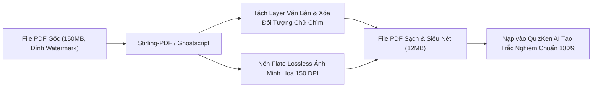

> **TL;DR (Tóm tắt nhanh):**  
> Để **xóa watermark nén file PDF miễn phí** cho các tệp giáo trình, đề cương dung lượng lớn (100MB - 300MB) mà không làm vỡ nét chữ hay lộ dữ liệu cá nhân, sinh viên nên sử dụng công cụ mã nguồn mở **Stirling-PDF** (GitHub: `Stirling-Tools/Stirling-PDF`) hoặc bộ lọc Ghostscript của PDF24. Tài liệu sau khi được xóa chữ chìm và nén gọn dưới 15MB sẽ giúp bạn in ấn tiết kiệm mực và nạp thẳng vào **QuizKen** để AI trích xuất câu hỏi trắc nghiệm siêu tốc mà không bị lỗi nhận diện ký tự rác!

---

# Hướng Dẫn Xóa Watermark & Nén Dung Lượng File PDF Giáo Trình Cực Nét 2026

Khi tải tài liệu học tập, giáo trình hoặc đề thi mẫu từ các diễn đàn và website chia sẻ học liệu, sinh viên rất thường gặp 2 vấn đề gây ức chế:

1. **File PDF dung lượng quá nặng (trên 100MB):** Do tài liệu scan độ phân giải cao hoặc chưa được tối ưu, không thể gửi qua Zalo, nộp lên cổng LMS trường hoặc tốn nhiều thời gian khi tải lên điện thoại.
2. **Bị đóng dấu Watermark (chữ chìm, số điện thoại, logo website) dày đặc:** Chữ chìm màu xám hoặc đỏ in đè lên nội dung bài học, khiến mắt bị mỏi khi đọc, in ấn tốn mực đen và đặc biệt làm các công cụ AI OCR đọc sai lệch nội dung câu hỏi.

Trong bài viết này, **QuizKen** sẽ hướng dẫn bạn phương pháp **xóa watermark nén file PDF miễn phí** bằng công cụ mã nguồn mở hiện đại nhất 2026, đảm bảo giữ nguyên 100% độ sắc nét của vector văn bản.

---

## 1. Vì Sao Các Web Nén PDF Online Thông Thường Làm Mờ Chữ?

Hầu hết các trang web chuyển đổi trực tuyến (như iLovePDF bản miễn phí, Smallpdf) nén dung lượng bằng cách **hạ độ phân giải DPI của toàn bộ trang sách** từ 300 DPI xuống 72 DPI hoặc biến trang vector thành ảnh nén JPEG chất lượng thấp. Kết quả là dung lượng giảm nhưng chữ bị nhòe hạt, công thức toán học bị đứt nét.

Ngược lại, các công cụ chuyên sâu như **Stirling-PDF** hay **PDF24** sử dụng cơ chế xử lý thông minh:

* **Tách lớp (Layer Separation):** Nhận diện layer chữ vector riêng biệt và không nén chữ, chỉ nén ảnh minh họa đính kèm.
* **Loại bỏ siêu dữ liệu thừa (Metadata Stripping):** Xóa các bảng màu trùng lặp, phông chữ nhúng dư thừa và lịch sử chỉnh sửa.
* **Tối ưu hóa luồng nhị phân (Flate Compression):** Tái cấu trúc cấu trúc nén không tổn hao (Lossless) của định dạng chuẩn Adobe PDF.

---

## 2. Giới Thiệu Stirling-PDF: Bộ Công Cụ PDF Mã Nguồn Mở Đỉnh Cao

[Stirling-PDF](https://github.com/Stirling-Tools/Stirling-PDF) là dự án phần mềm mã nguồn mở nổi tiếng do cộng đồng phát triển (dẫn đầu bởi Anthony Stirling - Frooodle). Dự án cung cấp hơn 50 tính năng xử lý PDF chuyên nghiệp hoàn toàn **miễn phí 100%, không giới hạn số trang, không quảng cáo và chạy trực tiếp trên máy tính của bạn**.

| Tiêu chí | Stirling-PDF (Khuyên dùng) | PDF24 Creator | Web Nén PDF Trực Tuyến Miễn Phí |
| :--- | :--- | :--- | :--- |
| **Chi phí** | **Miễn phí 100% vĩnh viễn** | Miễn phí 100% | Giới hạn 2 file/ngày hoặc bắt mua VIP |
| **Bảo mật dữ liệu** | **Tuyệt đối (Chạy cục bộ trên máy)** | Cục bộ trên máy | Tải file lên máy chủ bên thứ 3 |
| **Xóa Watermark** | Hỗ trợ xóa theo Text, Vùng chọn & Mã màu | Xóa theo trang | Thường không hỗ trợ hoặc xóa nham nhở |
| **Giữ nét chữ khi in** | Chuẩn Vector in ấn A4 | Chuẩn Vector | Dễ bị mờ vỡ hạt khi in |
| **Tốc độ xử lý** | Tức thì bằng CPU máy tính | Rất nhanh | Phụ thuộc tốc độ mạng Upload/Download |

---

## 3. Cách Xóa Watermark Chữ Chìm Trên PDF Miễn Phí

### Cách 1: Sử dụng tính năng "Remove Watermark" trên Stirling-PDF
1. Mở giao diện Stirling-PDF (chạy qua bản Desktop hoặc Web Docker nội bộ tại `localhost:8080`).
2. Chọn menu **Other** > **Remove Watermark**.
3. Tải file PDF giáo trình cần xử lý lên.
4. **Nhập chuỗi văn bản Watermark:** Gõ chính xác từ ngữ bị in chìm (ví dụ: `123doc`, `tailieu.vn`, `Thư viện đề thi`, số điện thoại quảng cáo).
5. Nhấn **Remove & Download**: Stirling-PDF sẽ bóc tách đối tượng text watermark nằm ở background mà không làm suy chuyển một ký tự nào của nội dung chính.

### Cách 2: Sử dụng Google Docs (Dành cho tài liệu ngắn dưới 30 trang)
1. Tải file PDF lên **Google Drive**.
2. Nhấp chuột phải vào file > chọn **Mở bằng (Open with)** > **Google Tài liệu (Google Docs)**.
3. Khi Google Docs chuyển đổi văn bản qua công nghệ OCR, lớp watermark ảnh nền thường sẽ bị tự động tách riêng. Bạn chỉ cần click chọn khung ảnh chữ chìm và nhấn phím **Delete**, sau đó xuất lại file PDF sạch sẽ.

---

## 4. Hướng Dẫn Nén Dung Lượng File PDF Giảm 80% Nhưng Chữ Vẫn Sắc Nét

Để giảm file giáo trình từ 150MB xuống dưới 15MB mà khi zoom 200% chữ vẫn không vỡ:

1. Trong Stirling-PDF, chọn chức năng **Optimize** > **Compress PDF**.
2. Chọn mức độ nén: **Recommended (Medium Compression - 150 DPI)**. Mức này tối ưu cho việc đọc trên màn hình iPad/Laptop và in ấn tài liệu giấy A4.
3. Bật tùy chọn **Strip Metadata (Xóa siêu dữ liệu)** và **Linearize (Tối ưu tải trang nhanh Web Fast View)**.
4. Nhấn **Compress**: Chỉ sau vài giây, file tải về sẽ nhẹ đi từ 70% đến 85%.

---

## 5. Cầu Nối QuizKen: Vì Sao Cần Tài Liệu Sạch Trước Khi Tạo Đề AI?

Nhiều bạn thắc mắc: *Tại sao tải tài liệu lên các công cụ AI tạo trắc nghiệm thường bị lẫn các câu hỏi vô nghĩa như: "Website nào chia sẻ tài liệu này?" hoặc "Liên hệ số điện thoại nào để mua tài liệu?"*

Nguyên nhân chính là do **các dòng Watermark quảng cáo chìm bị mô hình AI đọc nhầm thành một phần của bài giảng!**

Bằng việc áp dụng quy trình làm sạch tài liệu:
1. **Làm sạch Watermark & Nén gọn PDF:** Sử dụng Stirling-PDF để có file PDF tinh gọn, không rác.
2. **Kéo thả vào [QuizKen](https://quizken.com):** Đưa file sạch vào QuizKen để hệ thống AI tập trung 100% vào các định lý, công thức và dữ liệu khoa học.
3. **Sinh đề thi & Flashcard chuẩn xác:** QuizKen sẽ tạo ra đề thi trắc nghiệm 4 lựa chọn, đúng/sai hoặc trả lời ngắn chuẩn ma trận thi cử, kèm theo giải thích chi tiết và phân loại độ khó theo thang Bloom.

Áp dụng ngay bộ đôi công cụ **Stirling-PDF + QuizKen** để biến mọi tài liệu nặng nề thành kho vũ khí ôn thi sắc bén nhất mùa thi này!
