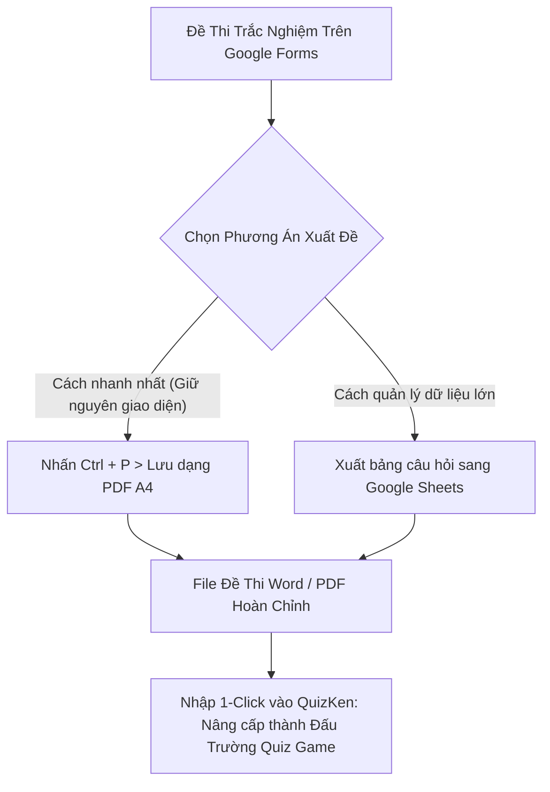

> **TL;DR (Tóm tắt nhanh):**  
> Việc **xuất đề thi Google Forms sang Word miễn phí** và in ấn đề thi ra giấy A4 chuẩn đẹp thường gặp rào cản do Google Forms không tích hợp sẵn nút "Export to Word". Thầy cô và học sinh có thể sử dụng 2 cách xử lý chuẩn xác nhất: dùng lệnh in hệ thống (`Ctrl + P` lưu PDF rồi chuyển sang Word) hoặc xuất toàn bộ ngân hàng câu hỏi qua Google Sheets kết hợp tiện ích miễn phí. Sau khi có file đề hoàn chỉnh, bạn có thể nhập 1-click vào **QuizKen** để tổ chức Đấu trường Trắc nghiệm Multiplayer trực tiếp trên lớp học sôi động gấp 10 lần so với giao diện tĩnh của Google Forms!

---

# Hướng Dẫn Cách Xuất Đề Thi Từ Google Forms Sang Word & PDF Chuẩn Đẹp 2026

Google Forms (Google Biểu mẫu) là một trong những công cụ tạo bài kiểm tra trực tuyến phổ biến nhất tại các trường học ở Việt Nam. Tuy nhiên, khi giáo viên cần:
* In đề kiểm tra ra giấy A4 để học sinh làm bài thi học kỳ trực tiếp trên lớp.
* Lưu trữ đề thi vào hồ sơ giáo án giảng dạy dưới dạng file Word (`.docx`).
* Chia sẻ đề thi cho đồng nghiệp trong tổ bộ môn biên soạn và chỉnh sửa lại câu hỏi.

Google Forms lại gây rất nhiều khó khăn vì **không có nút bấm xuất file Word trực tiếp**. Nếu chụp ảnh màn hình từng câu hỏi hoặc copy paste thủ công thì mất cả buổi tối và hình ảnh câu hỏi bị mờ nhạt.

Trong bài viết này, **QuizKen** sẽ hướng dẫn thầy cô và các bạn học sinh những cách **xuất đề thi Google Forms sang Word miễn phí** nhanh nhất và tối ưu hóa trải nghiệm kiểm tra đánh giá trong năm 2026!

---

## 1. Cách 1: Xuất Google Forms Thành PDF In Ấn Chuẩn Bằng Phím Tắt Hệ Thống

Đây là cách nhanh nhất và không cần cài đặt bất kỳ phần mềm bên ngoài nào:

1. Mở bài kiểm tra trên Google Forms (ở chế độ xem trước hoặc chế độ chỉnh sửa của giáo viên).
2. Nhấp vào biểu tượng **dấu 3 chấm dọc** ở góc trên cùng bên phải màn hình (cạnh nút Gửi) > chọn **In (Print)**, hoặc bấm tổ hợp phím **`Ctrl + P`** (trên Windows) / **`Cmd + P`** (trên Mac).
3. Tại cửa sổ cài đặt in của trình duyệt:
   * **Mục Đích đến (Destination):** Chọn **Lưu dưới dạng PDF (Save as PDF)**.
   * **Bố cục (Layout):** Chọn Hướng dọc (Portrait).
   * **Tùy chọn khác (More settings):** Bỏ chọn ô *Đầu trang và chân trang (Headers and footers)* để xóa các dòng địa chỉ web và ngày giờ rác; Đánh dấu tích vào ô *Đồ họa nền (Background graphics)* để giữ nguyên màu sắc và hình ảnh minh họa câu hỏi.
4. Nhấn **Lưu (Save)**. Bạn đã có một file PDF đề thi sạch sẽ, chuyên nghiệp.
5. Để chuyển từ file PDF này sang Word để chỉnh sửa chữ, chỉ cần dùng công cụ **Google Docs OCR** (Mở file PDF trong Google Docs) như đã hướng dẫn để xuất sang `.docx` chuẩn 100%.

---

## 2. Cách 2: Trích Xuất Ngân Hàng Câu Hỏi Qua Google Sheets

Nếu giáo viên muốn gom hàng trăm câu hỏi trắc nghiệm thành một bảng dữ liệu để dễ dàng xáo trộn và quản lý:

1. Trong giao diện chỉnh sửa Google Forms, chuyển sang tab **Câu trả lời (Responses)**.
2. Nhấn vào biểu tượng **Liên kết với Trang tính (Link to Sheets)** để mở bảng Google Sheets chứa dữ liệu.
3. Cài đặt tiện ích bổ sung (Add-on) miễn phí từ Google Workspace Marketplace mang tên **Form Builder** hoặc **Form Publisher**.
4. Tiện ích sẽ tự động ánh xạ (Mapping) từng cột câu hỏi và 4 phương án lựa chọn thành một file văn bản Word mẫu chuẩn khung phân trang giáo án của Bộ GD&ĐT.

---

## 3. So Sánh: Google Forms vs QuizKen Trong Giảng Dạy & Kiểm Tra

Mặc dù Google Forms rất tiện lợi để thu thập biểu mẫu khảo sát, nhưng khi dùng làm nền tảng kiểm tra kiến thức cho học sinh, Google Forms bộc lộ nhiều điểm hạn chế:

| Tiêu chí so sánh | Google Forms truyền thống | Nền tảng QuizKen EdTech 2026 |
| :--- | :--- | :--- |
| **Giao diện làm bài** | Đơn điệu, dễ gây buồn ngủ | **Gamification sống động, âm thanh kịch tính** |
| **Tính năng chống gian lận** | Học sinh dễ mở tab khác tra cứu | **Cảnh báo chuyển tab, khóa màn hình, xáo trộn mã đề** |
| **Hỗ trợ công thức Toán LaTeX** | Phải chụp ảnh cắt dán rất cực | **Tích hợp sẵn bộ gõ KaTeX / MathML siêu mượt** |
| **Tạo đề tự động bằng AI** | Không hỗ trợ (phải gõ tay 100%) | **Kéo thả PDF/Word, AI sinh đề chuẩn sau 10 giây** |
| **Chế độ thi đấu nhóm** | Không có (chỉ làm độc lập) | **Đấu trường Multiplayer thời gian thực (như Kahoot)** |

---

## 4. Nâng Tầm Lớp Học: Nhập Đề Google Forms Vào QuizKen Trong 1 Cú Click

Thay vì để học sinh làm bài kiểm tra trong im lặng với Google Forms, các thầy cô giáo hiện đại năm 2026 đang chuyển dịch sang tổ chức các tiết học tương tác cùng **QuizKen**:

1. **Nhập đề thi vào QuizKen:** Sau khi xuất file Word/PDF từ Google Forms, truy cập [QuizKen](https://quizken.com), chọn **Tạo Đề Từ File**.
2. **AI Tự Động Định Dạng & Gợi Ý Đáp Án:** Hệ thống sẽ nhận diện câu hỏi, tự động chia các phương án A, B, C, D và phân loại mức độ nhận thức (Nhận biết, Thông hiểu, Vận dụng).
3. **Bật Chế Độ Đấu Trường Multiplayer:** Chiếu màn hình máy chiếu lên bảng lớp, học sinh dùng điện thoại hoặc máy tính bảng quét mã QR để tham gia phòng chơi.
4. **Bảng Xếp Hạng Kịch Tính (Live Leaderboard):** Sau mỗi câu hỏi, bảng xếp hạng điểm số và chuỗi trả lời đúng (Streak) sẽ khuấy động không khí lớp học, kích thích tinh thần thi đua học tập của học sinh lên mức cao nhất!

Hãy xuất đề từ Google Forms và trải nghiệm ngay nền tảng **QuizKen** để mang lại những tiết học tràn đầy hứng khởi cho học sinh của bạn!
