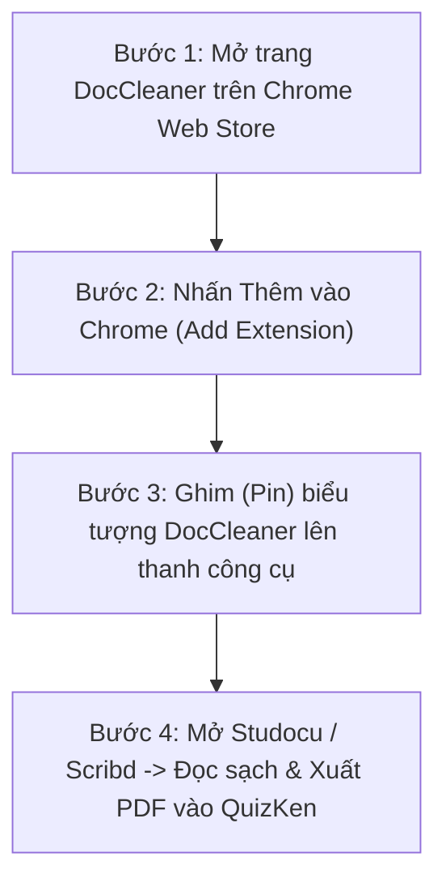

> **TL;DR (Tóm tắt nhanh):**  
> Để **cài đặt DocCleaner Better Studocu** miễn phí (free), bạn chỉ cần mở link Chrome Web Store chính thức trên Google Chrome, Microsoft Edge, Brave hoặc Cốc Cốc và bấm **Thêm vào Chrome**. Sau đó ghim biểu tượng ra thanh công cụ, mở tài liệu Studocu/Scribd để bật Reader Mode tự động và dùng nút nổi **Print Format** xuất PDF nạp vào **[QuizKen](https://app.quizken.com)** ôn thi!

---

# Hướng Dẫn Cài Đặt Và Sử Dụng DocCleaner - Better Studocu & Scribd Reader Từ A–Z

Trước đây, nhiều bạn sinh viên ngại sử dụng tiện ích đọc tài liệu vì phải tải file nén và bật chế độ lập trình viên khá rườm rà. Hiện tại, bạn có thể **cài đặt DocCleaner Better Studocu** trực tiếp từ Chrome Web Store chỉ trong chưa đầy 15 giây, an toàn và tự động chạy mỗi khi bạn tra cứu tài liệu.

Bài viết này của **QuizKen** sẽ hướng dẫn chi tiết từng bước cài đặt trên các trình duyệt phổ biến tại Việt Nam, cách tùy chỉnh ngôn ngữ Tiếng Việt/Tiếng Anh và mẹo sử dụng hiệu quả nhất.

---

## 1. Kiểm Tra Trình Duyệt Tương Thích Trước Khi Cài Đặt

**DocCleaner - Better Studocu & Scribd Reader** hỗ trợ toàn bộ các trình duyệt máy tính sử dụng nhân Chromium:

| Trình duyệt | Hệ điều hành hỗ trợ | Cài trực tiếp từ Chrome Web Store | Ghi chú |
| :--- | :--- | :--- | :--- |
| **Google Chrome** | Windows, macOS, Linux | Có (1-Click) | Khuyên dùng, đồng bộ tốt nhất |
| **Microsoft Edge** | Windows, macOS | Có (1-Click) | Bấm nút *Get / Thêm vào Chrome* |
| **Cốc Cốc** | Windows, macOS | Có (1-Click) | Cài trực tiếp như trên Chrome |
| **Brave Browser** | Windows, macOS, Linux | Có (1-Click) | Tương thích hoàn toàn |

---

## 2. Quy Trình 4 Bước Cài Đặt DocCleaner Better Studocu

### Bước 1: Truy cập trang chính thức trên Chrome Web Store
Mở trình duyệt Chrome, Edge, Cốc Cốc hoặc Brave và bấm vào liên kết sau:
* Link chính thức: [DocCleaner - Better Studocu & Scribd Reader](https://chromewebstore.google.com/detail/doccleaner-better-studocu/fnhdoegoihnkgggnaiemommemdejhbkb?hl=vi)

### Bước 2: Thêm tiện ích vào trình duyệt
1. Nhấn vào nút màu xanh **Thêm vào Chrome** (hoặc **Add to Chrome** / **Get** tùy trình duyệt).
2. Khi hộp thoại xác nhận xuất hiện, chọn **Thêm tiện ích (Add extension)**.
3. Chờ 3–5 giây để trình duyệt tải gói tiện ích gọn nhẹ về máy.

### Bước 3: Ghim biểu tượng DocCleaner lên thanh địa chỉ
Để tiện bật mở popup chuyển ngôn ngữ bất kỳ lúc nào:
1. Nhìn lên góc trên bên phải trình duyệt, nhấn vào biểu tượng **Mảnh ghép (Extensions)**.
2. Tìm tên **DocCleaner - Better Studocu & Scribd Reader**.
3. Nhấn biểu tượng **Cái ghim (Pin)** để đưa icon DocCleaner hiển thị cố định trên thanh công cụ.

### Bước 4: Tùy chỉnh ngôn ngữ Tiếng Việt / Tiếng Anh
1. Click vào biểu tượng **DocCleaner** vừa ghim.
2. Trong cửa sổ popup nhỏ hiện ra, bạn có thể chọn nhanh ngôn ngữ giao diện là **Tiếng Việt** hoặc **English**. Tùy chọn này được lưu cục bộ vào bộ nhớ trình duyệt (`storage`).

---

## 3. Hướng Dẫn Sử Dụng Các Tính Năng Cốt Lõi Hàng Ngày

Sau khi hoàn tất **cài đặt DocCleaner Better Studocu**, bạn không cần cấu hình thêm bất kỳ dòng lệnh nào:

1. **Chế độ Reader Mode tự động:** Khi truy cập `studocu.com`, `studocu.vn` hoặc `scribd.com`, tiện ích tự động ẩn các banner nổi, lớp phủ quảng cáo và hộp thoại đồng ý cookie gây che chữ.
2. **Cuộn mượt với Smart Page Formatter:** Các trang tài liệu được nạp trước (pre-render) và căn chỉnh ngay ngắn, giúp bạn đọc lướt đề cương dài không bị khựng hay dính khoảng trắng.
3. **Nút nổi 1-Click Print Format:** Khi cần lưu tài liệu học offline, bạn nhấn vào nút nổi ở góc màn hình. DocCleaner sẽ dọn sạch khung web, căn chuẩn trang in rồi bật hộp thoại Chrome Print để bạn chọn **Save as PDF**.

---

## 4. Biến Tài Liệu Vừa Lưu Thành Bộ Đề Ôn Tập Trên QuizKen

Sau khi cài đặt thành công và lưu được những bộ đề cương PDF gọn đẹp từ Studocu hay Scribd, đừng chỉ cất trong ổ cứng máy tính! Hãy tận dụng quy trình học chủ động cùng **[QuizKen](https://app.quizken.com)**:

* **Bước 1:** Truy cập [app.quizken.com](https://app.quizken.com) (tạo tài khoản free trong vài giây).
* **Bước 2:** Tải file PDF tài liệu bạn vừa xuất từ DocCleaner lên công cụ tạo đề AI.
* **Bước 3:** Nhận ngay bộ câu hỏi trắc nghiệm ôn tập, bài luyện trả lời ngắn và thẻ ghi nhớ Flashcard thông minh để kiểm tra mức độ hiểu bài ngay lập tức.

> 🚀 **Gợi ý cho nhóm học tập:** Bạn còn có thể dùng tính năng **Đấu trường Multiplayer** trên [QuizKen](https://quizken.com) để rủ bạn cùng lớp thi thử trực tiếp từ chính tài liệu vừa tìm được!

---

## 5. Câu Hỏi Thường Gặp (FAQ)

### 1. Cài đặt DocCleaner xong nhưng tab Studocu đang mở sẵn chưa thay đổi thì sao?
Với những tab bạn đã mở *trước lúc bấm cài đặt*, hãy nhấn phím **F5** (hoặc **Cmd + R** trên macOS) để tải lại trang một lần. Từ các lần mở tiếp theo, DocCleaner sẽ tự động kích hoạt ngay.

### 2. Cài trên Cốc Cốc hoặc Microsoft Edge có bị báo lỗi không tương thích không?
Không. Cả Cốc Cốc và Edge đều hỗ trợ 100% tiện ích chuẩn Manifest V3 từ Chrome Web Store. Trên Edge, nếu thấy thanh thông báo *"Allow extensions from other stores"*, bạn chỉ cần bấm **Allow (Cho phép)** rồi cài bình thường.

### 3. DocCleaner có yêu cầu đăng nhập tài khoản Google hay trả phí không?
Không. Bạn có thể cài đặt và sử dụng hoàn toàn miễn phí mà không cần đăng nhập bất kỳ tài khoản nào vào tiện ích.

---

**Lời kết:** Chỉ với vài thao tác **cài đặt DocCleaner Better Studocu** đơn giản, trình duyệt của bạn đã trở thành không gian đọc tài liệu sạch sẽ và hiệu quả hơn hẳn. Kết hợp ngay cùng **[QuizKen](https://app.quizken.com)** để biến mọi tài liệu học tập thành điểm số thực tế nhé!
