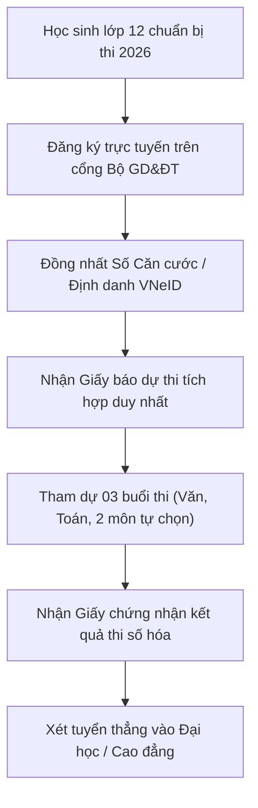

> **TL;DR (Tóm tắt nhanh):**  
> Kỳ thi tốt nghiệp THPT năm 2026 chính thức áp dụng quy chế theo **Văn bản hợp nhất số 02/VBHN-BGDĐT** (trên cơ sở Thông tư 24/2024/TT-BGDĐT và được sửa đổi, bổ sung bởi **Thông tư số 13/2026/TT-BGDĐT** của Bộ Giáo dục và Đào tạo). Kỳ thi giữ vững tính ổn định với **03 buổi thi** (Ngữ văn, Toán và 02 môn tự chọn), đồng thời thực hiện cải cách hành chính số đột phá: tích hợp Giấy báo dự thi và Giấy chứng nhận kết quả thi, rút ngắn thời hạn phúc khảo và siết chặt quy định định danh điện tử. Thí sinh có thể rèn luyện cấu trúc đề thi mới (Đúng/Sai 4 ý, Trả lời ngắn) trực tiếp trên nền tảng **QuizKen**.

---

# Cập Nhật Quy Chế Thi Tốt Nghiệp THPT 2026: Những Điểm Mới Quan Trọng Theo Thông Tư 13/2026/TT-BGDĐT

Năm 2026 đánh dấu bước hoàn thiện vững chắc của chương trình Giáo dục phổ thông (GDPT 2018). Để đảm bảo kỳ thi tốt nghiệp THPT diễn ra an toàn, nghiêm túc, giảm tải thủ tục hành chính và tạo điều kiện tối đa cho thí sinh xét tuyển đại học, Bộ Giáo dục và Đào tạo (Bộ GD&ĐT) đã ban hành **Thông tư số 13/2026/TT-BGDĐT** sửa đổi, bổ sung Quy chế thi (hợp nhất tại **Văn bản số 02/VBHN-BGDĐT**).

Bài viết này tổng hợp toàn bộ các căn cứ pháp lý chính thống, phân tích những thay đổi then chốt mà học sinh lớp 12 và giáo viên phụ trách ôn thi bắt buộc phải nắm vững.

---

## 1. Căn Cứ Pháp Lý & Tính Ổn Định Của Kỳ Thi 2026

Theo hướng dẫn từ Cục Quản lý chất lượng (Bộ GD&ĐT), kỳ thi tốt nghiệp THPT năm 2026 về cơ bản **giữ ổn định cấu trúc định dạng đề thi** đã được công bố từ năm 2024 - 2025 nhằm giúp học sinh yên tâm ôn tập:

* **Văn bản quy chuẩn:** Văn bản hợp nhất số 02/VBHN-BGDĐT ngày 17/04/2026.
* **Thời gian thi:** Gồm 03 buổi thi tập trung trong 02 ngày thi chính thức:
  * **Buổi 1:** Môn Ngữ văn (Hình thức tự luận, 120 phút).
  * **Buổi 2:** Môn Toán (Hình thức trắc nghiệm, 90 phút).
  * **Buổi 3:** Bài thi tự chọn gồm **02 môn** trong số các môn: Vật lí, Hóa học, Sinh học, Lịch sử, Địa lí, Giáo dục kinh tế và pháp luật, Tin học, Công nghệ, và Ngoại ngữ (Mỗi môn 50 phút).

---

## 2. Các Điểm Mới Đột Phá Trong Thông Tư 13/2026/TT-BGDĐT

So với các năm trước, các sửa đổi trong Thông tư 13 tập trung mạnh mẽ vào công cuộc **chuyển đổi số và tinh gọn thủ tục hành chính**:

### 1. Tích Hợp Giấy Tờ Đăng Ký & Chứng Nhận
* **Giấy báo dự thi:** Thẻ dự thi truyền thống và giấy báo dự thi được tích hợp thành **một loại giấy tờ điện tử duy nhất** mang tên *"Giấy báo dự thi"*, tra cứu trực tiếp qua tài khoản thí sinh trên cổng `thisinh.thitotnghiepthpt.edu.vn`.
* **Giấy chứng nhận kết quả thi:** Tích hợp Giấy chứng nhận tốt nghiệp tạm thời và Giấy chứng nhận kết quả thi thành một văn bản thống nhất, giúp thí sinh nộp hồ sơ xét tuyển đại học thuận tiện mà không phải xin xác nhận nhiều lần.
* **Đơn giản hóa lưu trữ hồ sơ:** Hồ sơ đăng ký dự thi của học sinh lớp 12 được số hóa và lưu trực tiếp tại trường phổ thông, không phát sinh thủ tục chuyển hồ sơ cồng kềnh.

### 2. Rút Ngắn Thời Gian Thu Nhận Đơn Phúc Khảo
Nhằm tạo điều kiện đẩy nhanh tiến độ công bố kết quả tuyển sinh đại học - cao đẳng đợt 1, thời hạn nộp đơn xin phúc khảo bài thi được điều chỉnh rút ngắn nhưng vẫn đảm bảo đầy đủ quyền lợi khiếu nại chính đáng của thí sinh.

### 3. Đồng Nhất Mã Định Danh Cá Nhân Khi Dự Thi
Thí sinh bắt buộc phải sử dụng thống nhất một loại giấy tờ tùy thân (Thẻ Căn cước công dân hoặc số Định danh cá nhân trên hệ thống VNeID) trong suốt quá trình đăng ký dự thi, nộp lệ phí trực tuyến và xét tuyển vào các trường đại học.

---

## 3. Cấu Trúc Đề Thi Trắc Nghiệm Mới: Thử Thách Cần Vượt Qua

Điểm cốt lõi trong kỳ thi theo chương trình GDPT 2018 là sự xuất hiện của **3 định dạng câu hỏi trắc nghiệm**:
1. **Dạng 1 (Nhiều lựa chọn):** 4 phương án chọn 1 đáp án đúng (Mức độ nhận biết và thông hiểu).
2. **Dạng 2 (Trắc nghiệm Đúng/Sai 4 ý):** Mỗi câu hỏi có 4 ý a, b, c, d. Thí sinh phải xác định chính xác tính Đúng/Sai của từng ý. Điểm số tăng lũy tiến: đúng 1 ý được 0.1 điểm, đúng 2 ý được 0.25 điểm, đúng 3 ý được 0.5 điểm, và chỉ khi đúng trọn vẹn cả 4 ý mới đạt trọn 1.0 điểm.
3. **Dạng 3 (Trắc nghiệm trả lời ngắn):** Thí sinh tự tính toán và điền kết quả vào ô trả lời, chấm dứt hoàn toàn tình trạng "đoán mò" đáp án.

---

## 4. Bảng So Sánh Các Điểm Điều Chỉnh 2026

| Tiêu chí | Quy định cũ (Trước 2025) | Quy định mới (Thông tư 13/2026/TT-BGDĐT) |
| :--- | :--- | :--- |
| **Số môn thi bắt buộc** | 4 bài thi (Toán, Văn, Ngoại ngữ, KHTN/KHXH) | **2 môn bắt buộc (Toán, Văn) + 2 môn tự chọn** |
| **Giấy tờ dự thi** | Thẻ dự thi + Giấy báo thi riêng biệt | **Tích hợp duy nhất 1 "Giấy báo dự thi" số hóa** |
| **Xác nhận tốt nghiệp** | Giấy tốt nghiệp tạm thời + Phiếu điểm riêng | **Tích hợp thống nhất thành Giấy chứng nhận kết quả** |
| **Dạng câu trắc nghiệm** | 100% trắc nghiệm 4 lựa chọn A, B, C, D | **Bổ sung Đúng/Sai 4 ý và Trả lời ngắn tính điểm lũy tiến** |

---

## 5. 💡 Chiến Lược Luyện Thi Bám Sát Ma Trận Của Bộ Trên QuizKen

Để không bị bỡ ngỡ trước định dạng đề thi mới có tính phân hóa cao, học sinh và giáo viên có thể ứng dụng nền tảng **[QuizKen](https://app.quizken.com)**:
* **Tạo đề thi chuẩn 3 phần cấu trúc GDPT 2018:** QuizKen tích hợp thuật toán sinh câu hỏi tự động bám sát ma trận năng lực của Bộ GD&ĐT: từ câu hỏi trắc nghiệm truyền thống, câu hỏi Đúng/Sai 4 ý phân hóa sâu đến dạng trả lời ngắn.
* **Tự động trộn 4 - 8 mã đề PDF kèm phiếu tô trắc nghiệm:** Giáo viên có thể xuất đề thi in ấn ra khổ giấy A4 chuẩn phông chữ sư phạm trong 3 giây.
* **Phân tích lỗ hổng kiến thức:** Báo cáo sau bài thi chỉ rõ học sinh đang hổng kiến thức ở mức độ nào (Nhận biết, Thông hiểu hay Vận dụng) để kịp thời bù đắp.

> 🎯 **Luyện đề ngay:** [Trải nghiệm ngân hàng đề thi thử THPT 2026 định dạng mới trên QuizKen hoàn toàn miễn phí tại đây!](https://app.quizken.com)

---

## Câu hỏi thường gặp về kỳ thi tốt nghiệp THPT 2026

### Thí sinh tự do có phải tham gia đầy đủ các môn thi không?
Thí sinh tự do (đã tốt nghiệp các năm trước hoặc thi lại để xét tuyển đại học) chỉ cần đăng ký dự thi các môn thuộc tổ hợp môn xét tuyển vào trường đại học mà mình mong muốn, không bắt buộc phải thi cả bài thi Ngữ văn hoặc Toán nếu không dùng điểm để xét tốt nghiệp.

### Ảnh thẻ đăng ký dự thi trên hệ thống có yêu cầu gì đặc biệt?
Theo Công văn hướng dẫn của Bộ GD&ĐT, ảnh thẻ nạp vào hệ thống thi trực tuyến phải có kích thước tối thiểu 400x600 pixels, phông nền trắng, chụp rõ khuôn mặt theo chuẩn Căn cước công dân và thời hạn chụp không quá 06 tháng gần nhất.

### Điểm phúc khảo được tính như thế nào nếu có sự chênh lệch?
Nếu kết quả chấm phúc khảo lệch so với điểm chấm đợt đầu từ 0.25 điểm trở lên (đối với bài thi tự luận) hoặc phát hiện sai sót do quét quang học (đối với bài thi trắc nghiệm), điểm số sau phúc khảo sẽ được công nhận chính thức để làm căn cứ xét tốt nghiệp và tuyển sinh.
