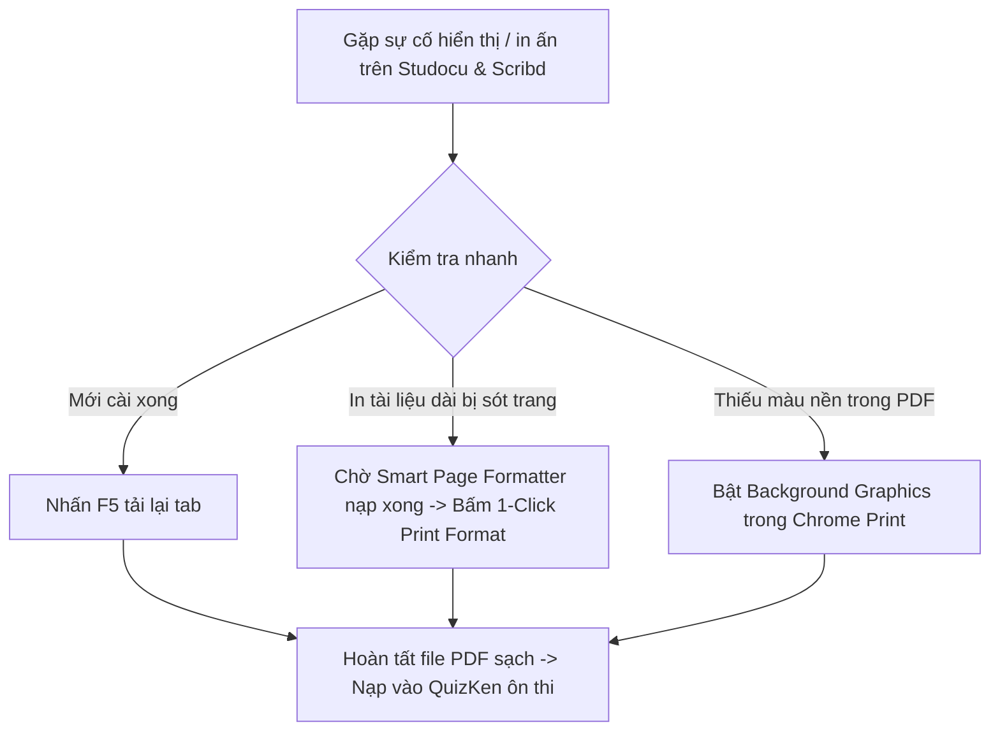

> **TL;DR (Tóm tắt nhanh):**  
> Gặp sự cố khi dùng tiện ích miễn phí (free) **DocCleaner - Better Studocu & Scribd Reader**? Đa số tình huống đều xử lý xong trong 5 giây bằng cách **tải lại tab (`F5`)**, đợi **Smart Page Formatter** nạp đủ trang trước khi bấm **1-Click Print Format**, hoặc kiểm tra quyền chạy trong `chrome://extensions/`. Xem bảng sửa lỗi chi tiết bên dưới và kết hợp luyện thi ngay trên **[QuizKen](https://app.quizken.com)**!

---

# FAQ DocCleaner: Giải Đáp Toàn Bộ Thắc Mắc & Hướng Dẫn Sửa Lỗi Nhanh

Trong quá trình sử dụng **[DocCleaner - Better Studocu & Scribd Reader](https://chromewebstore.google.com/detail/doccleaner-better-studocu/fnhdoegoihnkgggnaiemommemdejhbkb?hl=vi)**, đôi khi người dùng mới có thể gặp một vài tình huống nhỏ do bộ nhớ đệm trình duyệt hoặc thói quen thao tác trên tài liệu dài.

Đội ngũ **QuizKen** đã tổng hợp danh sách câu hỏi và cách khắc phục nhanh nhất giúp bạn sử dụng tiện ích trơn tru 100% trong suốt mùa học tập.

---

## 1. Bảng Tra Cứu Nhanh Lỗi Thường Gặp Và Cách Khắc Phục

| Tình huống gặp phải | Nguyên nhân phổ biến | Cách xử lý nhanh trong 5 giây |
| :--- | :--- | :--- |
| Cài xong nhưng tab đang mở chưa gọn | Tab được mở *trước khi* cài extension | Nhấn **`F5`** (hoặc `Cmd + R`) để tải lại trang |
| Một số trang cuối trắng khi Print | Tài liệu quá dài chưa kịp pre-render hết | Đợi thêm vài giây hoặc cuộn lướt nhẹ rồi mới bấm **Print Format** |
| Bản PDF mất màu khung hoặc bảng | Tắt tùy chọn đồ họa nền trong Chrome Print | Bật **Background graphics (Đồ họa nền)** ở mục *More settings* |
| Không thấy biểu tượng trên thanh công cụ | Chrome tự ẩn icon extension mới | Bấm biểu tượng **Mảnh ghép** -> Chọn **Pin (Ghim)** DocCleaner |
| Muốn đổi ngôn ngữ Việt / Anh | Chưa mở popup cài đặt của tiện ích | Click vào icon **DocCleaner** trên thanh công cụ để chuyển ngôn ngữ |

---

## 2. Mẹo Giữ DocCleaner Luôn Hoạt Động Ổn Định Nhất

1. **Không cài chồng hai bản (GitHub cũ + Store mới):** Nếu trước đây bạn từng cài bản giải nén thủ công (*Load unpacked*), hãy tắt hoặc xóa bản cũ trong `chrome://extensions/` để tránh xung đột script với bản chính thức từ Chrome Web Store.
2. **Đảm bảo trình duyệt ở phiên bản mới:** Chrome, Edge, Brave hoặc Cốc Cốc được cập nhật thường xuyên giúp tương thích hoàn hảo với chuẩn Manifest V3 và tính năng xuất `Save as PDF`.
3. **Tận dụng file PDF sạch cùng QuizKen:** Sau khi mọi lỗi hiển thị được giải quyết và bạn lưu file PDF về máy, đừng quên tải lên **[QuizKen](https://app.quizken.com)** để AI tự động biến tài liệu thành đề trắc nghiệm và bộ thẻ Flashcard ôn tập siêu tốc.

---

## 3. Câu Hỏi Thường Gặp (FAQ)

### 1. DocCleaner là gì và dùng cho những trang web nào?
**DocCleaner - Better Studocu & Scribd Reader** là tiện ích mở rộng Chrome miễn phí giúp bật chế độ Reader Mode sạch sẽ, loại bỏ banner/popup cookie, tối ưu pre-render trang và hỗ trợ định dạng in ấn nhanh cho **Studocu** (`studocu.com`, `studocu.vn`) và **Scribd**.

### 2. Tại sao tôi dùng điện thoại lại không tìm thấy nút cài đặt từ Chrome Web Store?
Chrome Web Store chỉ hỗ trợ cài đặt extension cho trình duyệt máy tính (Google Chrome, Microsoft Edge, Cốc Cốc, Brave trên Windows/macOS/Linux). Bạn có thể dùng DocCleaner trên laptop để xuất PDF sạch, sau đó đồng bộ file hoặc tạo quiz trên **[QuizKen](https://quizken.com)** để ôn tập trên điện thoại cực tiện lợi.

### 3. Dùng nút 1-Click Print Format có tốn phí hay cần phần mềm phụ trợ không?
Hoàn toàn không. Tiện ích sử dụng trực tiếp hộp thoại in gốc của trình duyệt (`Save as PDF`) nên hoàn toàn miễn phí và không cần cài thêm phần mềm bên thứ ba.

### 4. DocCleaner có tự cập nhật khi Studocu thay đổi giao diện không?
Có. Khi bạn cài từ [Chrome Web Store chính thức](https://chromewebstore.google.com/detail/doccleaner-better-studocu/fnhdoegoihnkgggnaiemommemdejhbkb?hl=vi), trình duyệt sẽ tự động tải về các bản cập nhật mới nhất mà bạn không cần thao tác gì thêm.

### 5. Tiện ích có làm chậm các trang web khác khi không đọc tài liệu không?
Không. DocCleaner chạy cục bộ siêu nhẹ và chỉ kích hoạt bộ định dạng trên các tên miền đọc tài liệu được hỗ trợ.

---

**Cài đặt hoặc cập nhật bản mới nhất:** [DocCleaner - Better Studocu & Scribd Reader trên Chrome Web Store](https://chromewebstore.google.com/detail/doccleaner-better-studocu/fnhdoegoihnkgggnaiemommemdejhbkb?hl=vi) — và trải nghiệm tạo đề ôn thi AI miễn phí tại **[QuizKen](https://app.quizken.com)**!
