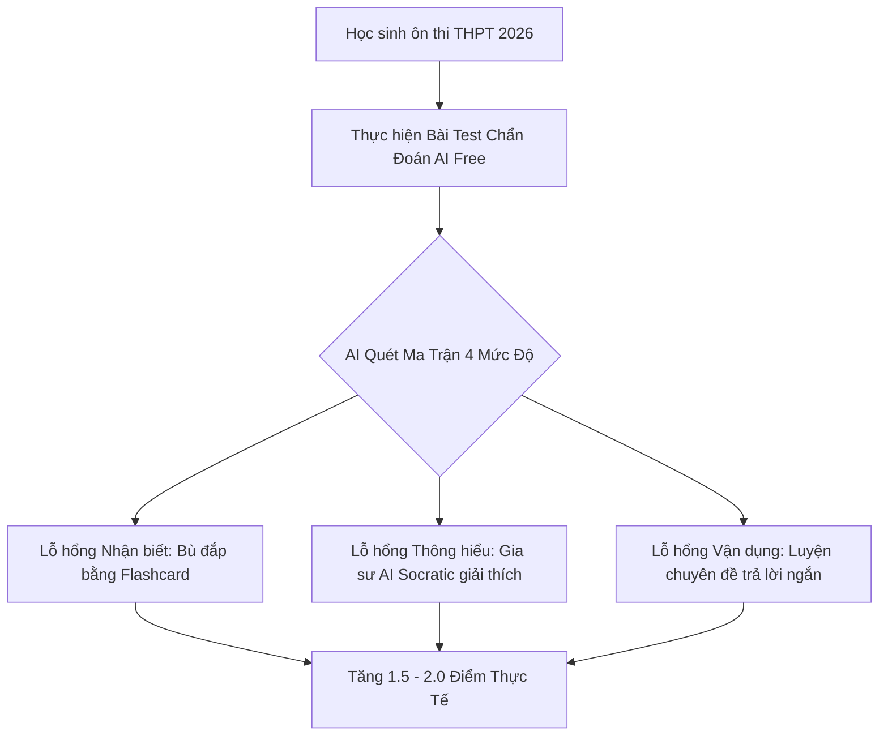

> **Tóm tắt nhanh (TL;DR):** Sai lầm phổ biến nhất của các sĩ tử chuẩn bị bước vào kỳ thi tốt nghiệp THPT 2026 là cắm đầu giải đề tràn lan theo kiểu "cày số lượng" mà không biết mình thực sự đang hổng ở phần nào. Bằng việc ứng dụng thuật toán **chẩn đoán lỗ hổng kiến thức bằng AI miễn phí (free diagnostic test)**, thí sinh có thể bóc tách điểm mù tư duy theo 4 cấp độ thang Bloom chuẩn GDPT 2018 để tăng 1–2 điểm trong thời gian ngắn nhất.

---

## 1. Vì Sao Giải Hàng Trăm Đề Thi Vẫn Không Thể Tăng Điểm?

Nhiều học sinh lớp 12 rơi vào trạng thái "bình ổn điểm số" (Plateau Effect) ở mốc 6–7 điểm dù đã giải qua hàng chục cuốn sách luyện đề. Nguyên nhân gốc rễ là vì:
1. **Lặp lại sai lầm trong vô thức:** Người học thường chỉ thích làm những dạng bài mình đã biết cách giải, né tránh các dạng bài lạ hoặc khó.
2. **Không phân biệt được bản chất lỗi sai:** Mất điểm do không thuộc lý thuyết (Nhận biết), do hiểu sai bản chất hiện tượng (Thông hiểu), hay do tính toán nhầm số liệu (Vận dụng)?
3. **Thiếu một lộ trình cá nhân hóa:** Mỗi học sinh có một điểm xuất phát và lỗ hổng riêng biệt, một bộ đề chung cho cả lớp 40 em không thể giải quyết bài toán của từng cá nhân.

---

## 2. Mô Hình Chẩn Đoán Kiến Thức Bằng AI Trên Nền Tảng QuizKen (Free)

Thuật toán của **QuizKen** áp dụng lý thuyết trắc lượng tri thức (Knowledge Tracing) kết hợp với Khung năng lực GDPT 2018 để vẽ nên "Bản đồ nhiệt tri thức" (Heatmap) của bạn:

| Cấp độ tư duy | Dấu hiệu nhận diện lỗ hổng | Giải pháp đề xuất từ QuizKen AI |
| :--- | :--- | :--- |
| **Nhận biết (Remembering)** | Quên công thức cơ bản, nhầm lẫn mốc thời gian, tên tác giả, định luật | Tự động sinh bộ 20 Flashcard Spaced Repetition ôn tập cấp tốc |
| **Thông hiểu (Understanding)** | Không giải thích được nguyên nhân, nhầm lẫn các mệnh đề Đúng/Sai Phần II | AI Tutor phân tích phản ví dụ (Counter-examples) để hiểu sâu |
| **Vận dụng (Applying)** | Biết công thức nhưng không biết cách biến đổi dữ kiện bài toán thực tế | Gợi ý 5 bài toán tương tự có độ phức tạp tăng dần |
| **Vận dụng cao (Analyzing)** | Lúng túng ở câu hỏi trả lời ngắn Phần III môn Toán, Lý, Hóa | Phân rã bài toán lớn thành 3 bài toán phụ nhỏ hơn để tìm hướng đi |

---

## 3. Quy Trình 3 Bước Quét Sạch Điểm Mù Kiến Thức Cùng QuizKen Free

### Bước 1: Làm bài Mini Diagnostic Test (15 phút)
Chọn môn học và chuyên đề bạn cảm thấy thiếu tự tin nhất (ví dụ: Sóng ánh sáng, Mũ & Logarit, Lịch sử Việt Nam giai đoạn 1945–1954). QuizKen AI sẽ tự động tạo một đề kiểm tra ngắn 15 câu phủ khắp 4 cấp độ tư duy hoàn toàn **miễn phí (free)**.

### Bước 2: Nhận báo cáo phân tích ma trận năng lực
Ngay khi nộp bài, hệ thống không chỉ trả về điểm số mà còn cung cấp một biểu đồ radar trực quan:
* Phần trăm độ vững chắc lý thuyết nền tảng.
* Danh sách chính xác 3 khái niệm trọng tâm bạn đang bị hiểu sai.
* Thời gian trung bình bạn tiêu tốn cho từng câu hỏi.

### Bước 3: Luyện tập theo đơn thuốc bù đắp kiến thức (Prescriptive Learning)
QuizKen AI sẽ tự động sinh ra một gói câu hỏi luyện tập riêng biệt chỉ nhắm thẳng vào các phần bạn vừa làm sai, giúp bạn "vá" lỗ hổng dứt điểm trước khi chuyển sang chuyên đề tiếp theo.

👉 **Bứt phá điểm số:** [Làm bài test chẩn đoán lỗ hổng kiến thức AI miễn phí trên QuizKen](https://quizken.com) ngay hôm nay!

---

## 4. Lời Khuyên Từ Các Thủ Khoa Dành Cho Sĩ Tử 2026

* **Thà hiểu sâu 1 câu sai còn hơn làm vẹt 10 câu đúng:** Mỗi lần làm sai một câu hỏi trên QuizKen, hãy ghi chép lại lý do sai vào mục Note cá nhân.
* **Tự kiểm tra lại sau mỗi 7 ngày:** Dùng thuật toán Spaced Repetition của QuizKen để làm lại đúng các câu hỏi mình từng làm sai tuần trước.

---

## Câu hỏi thường gặp (FAQ)

### 1. Tính năng chẩn đoán lỗ hổng kiến thức trên QuizKen có mất phí không?
Không. Mọi học sinh đều có thể thực hiện các bài test chẩn đoán kiến thức bằng **AI miễn phí (free)** mỗi ngày trên nền tảng QuizKen.

### 2. Bài test chẩn đoán có bám sát đề thi THPT 2026 chính thức không?
Có. Các câu hỏi được AI tạo ra hoàn toàn bám sát cấu trúc đề thi 3 phần và ma trận 4 cấp độ năng lực theo Chương trình GDPT 2018 của Bộ GD&ĐT.

### 3. Em học lực trung bình có sử dụng được tính năng này không?
Tính năng này đặc biệt phù hợp cho các bạn học lực trung bình - khá vì nó giúp bạn không bị ngợp giữa khối lượng kiến thức khổng lồ mà biết chính xác mình cần học gì ngay hôm nay.
