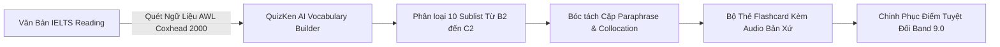

> **Tóm tắt nhanh (TL;DR):** Theo nghiên cứu ngôn ngữ học của **Tiến sĩ Averil Coxhead (Đại học Victoria Wellington, 2000)**, danh mục **Academic Word List (AWL)** gồm 570 họ từ vựng học thuật chiếm tới **10% tổng số từ** trong mọi bài đọc học thuật IELTS, nghiên cứu khoa học và báo chí chuyên ngành. Để bứt phá từ mức Band 6.5 lên **Band 8.5 - 9.0 IELTS Reading**, thí sinh bắt buộc phải làm chủ mạng lưới Paraphrase của 570 họ từ này. Nền tảng **QuizKen AI** giúp tự động bóc tách từ vựng AWL từ bài đọc thật và chuyển thành bộ thẻ Flashcard Spaced Repetition thông minh trong tích tắc.

---

## 1. Nghiên Cứu Academic Word List (Averil Coxhead 2000) & Bài Thi IELTS

Trong công trình nghiên cứu *"A New Academic Word List"* (TESOL Quarterly, 2000), TS. Averil Coxhead đã phân tích kho ngữ liệu 3.5 triệu từ học thuật và rút ra kết luận then chốt:
- 570 họ từ AWL (chia thành 10 Sublist từ phổ biến đến nâng cao) xuất hiện với tần suất dày đặc trong tất cả 4 phân ngành: *Khoa học tự nhiên, Khoa học xã hội, Thương mại và Nhân văn*.
- Người học chỉ cần làm chủ 570 họ từ này là có thể hiểu được hơn **90% dung lượng văn bản của bài đọc IELTS Reading Passage 1, 2 và 3**.

---

## 2. Bảng Phân Tích Cặp Paraphrase AWL Trong Đề Thi IELTS Reading Thật

| Câu hỏi trong đề IELTS | Đoạn văn gốc trong bài thi | Từ vựng AWL (Sublist Coxhead) |
| :--- | :--- | :--- |
| *The scheme was **abandoned** due to economic issues.* | *...the initiative was **terminated** owing to severe deficit.* | `abandon` (Sublist 8) ⬌ `terminate` (Sublist 8) |
| *Scientists **demonstrated** a link between the factors.* | *Researchers successfully **established** a correlation.* | `demonstrate` (Sublist 3) ⬌ `establish` (Sublist 3) |
| *The data **indicates** a significant transformation.* | *The statistics **reveal** an unprecedented evolution.* | `indicate` (Sublist 1) ⬌ `reveal` (Sublist 6) |
| *They encountered **financial constraints**.* | *The team faced **severe monetary limitations**.* | `constraint` (Sublist 3) ⬌ `limitation` (Sublist 5) |

---

## 3. Quy Trình 4 Bước Chinh Phục Từ Vựng IELTS Cùng QuizKen AI

### Bước 1: Thu thập đoạn văn IELTS đọc hiểu sai
Khi giải các đề thi trong bộ Cambridge IELTS (từ Cam 15 đến Cam 20), trích xuất lại các đoạn văn khiến bạn chọn sai đáp án dạng *True/False/Not Given* hoặc *Matching Information*.

### Bước 2: Sử dụng AI Vocabulary Builder trên QuizKen
Dán đoạn văn bản vào [QuizKen English Hub](https://quizken.com). Hệ thống AI sẽ:
- Tự động tô màu và phân loại các từ vựng thuộc danh mục 570 họ từ AWL và cấp độ C1-C2 CEFR.
- Liệt kê toàn bộ các cấu trúc danh từ hóa (*Nominalisation*) và cụm kết hợp từ tự nhiên (*Collocations*).

### Bước 3: Tạo bộ Flashcard thông minh 2 mặt
Chuyển đổi toàn bộ từ vựng vừa trích xuất thành bộ Flashcard cá nhân. Mỗi thẻ hiển thị:
1. Định nghĩa chuẩn ngữ cảnh học thuật.
2. Phiên âm IPA, phát âm giọng Anh-Anh / Anh-Mỹ.
3. Câu ví dụ trích xuất nguyên bản từ đề thi Cambridge.

### Bước 4: Luyện tập theo chu kỳ Spaced Repetition
Hệ thống QuizKen tự động lên lịch nhắc nhở ôn tập vào các mốc thời gian tối ưu (1 ngày, 3 ngày, 7 ngày, 21 ngày). Nhờ đó, bạn sẽ phản xạ nhận diện từ vựng ngay khi lướt qua trong bài thi thật.

---

## 4. 3 Bí Quyết Đạt Điểm 9.0 Từ Chuyên Gia IELTS

1. **Học theo họ từ (Word Family):** Khi học từ `analyse` (động từ), học luôn `analysis` (danh từ), `analytical` (tính từ) và `analytically` (trạng từ).
2. **Không tra từ đơn lẻ:** Luôn học từ vựng đi kèm giới từ và động từ đi kèm (ví dụ: *attribute something to something*).
3. **Phân tích bẫy Distractor:** Tìm hiểu nguyên nhân vì sao phương án sai lại xuất hiện trong bài đọc để tránh bị đánh lừa tâm lý.

👉 **Bứt phá band điểm:** Làm chủ 570 họ từ học thuật với [AI Vocabulary Builder QuizKen](https://quizken.com) hoàn toàn miễn phí!

---

## 5. Câu Hỏi Thường Gặp (FAQ)

### Danh mục Academic Word List (AWL) của Coxhead có bao nhiêu từ?
AWL gồm 570 họ từ (tương đương khoảng hơn 3.000 biến thể từ vựng), được chia thành 10 Sublist theo tần suất xuất hiện giảm dần.

### Làm thế nào để phân biệt True/False/Not Given chính xác 100%?
- **True:** Khẳng định đúng hoàn toàn theo logic và ngữ nghĩa của bài đọc.
- **False:** Có thông tin trực tiếp phủ định hoặc mâu thuẫn với nội dung câu hỏi.
- **Not Given:** Bài đọc có thể nhắc đến từ khóa nhưng không xác nhận tính đúng hay sai của mối quan hệ trong câu hỏi.
