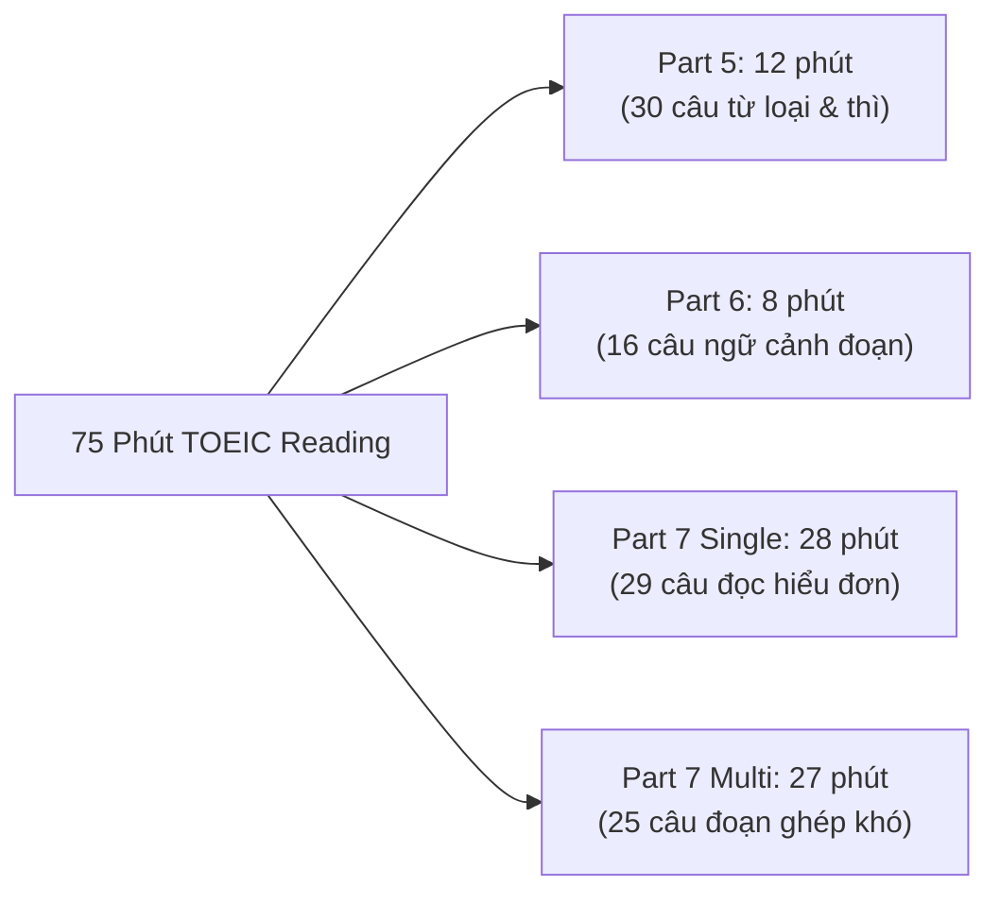

> **TL;DR (Tóm tắt nhanh):**  
> Trong bài thi TOEIC Listening & Reading, phần **Reading (100 câu hỏi trong 75 phút)** là "ác mộng" về tốc độ đối với hơn 80% thí sinh. Hầu hết các bạn bị hụt từ 15 đến 20 câu cuối ở Part 7 vì sa đà làm quá chậm ở Part 5 và Part 6. Chiến lược phân bổ thời gian chuẩn xác nhất hiện nay là: **Part 5 (12 phút) - Part 6 (8 phút) - Part 7 (55 phút)**. Ứng dụng **QuizKen AI** giúp bạn giải mã chi tiết các bẫy từ loại, bẫy thì ngữ pháp và tạo các bài test đọc quét vi mô (Micro-reading) rèn phản xạ dưới 30 giây mỗi câu!

---

# Chiến Lược Luyện Thi TOEIC Reading Format Mới: Phá Đảo Part 5, 6, 7 Bằng AI

Kỳ thi TOEIC format mới đòi hỏi người học không chỉ có ngữ pháp vững vàng mà còn phải có khả năng xử lý thông tin thực tế trong môi trường công sở đa quốc gia: Từ chuỗi tin nhắn văn bản (Text message chains), email trao đổi công việc, hóa đơn đến các bài báo trực tuyến gồm 2 hoặc 3 đoạn văn liên kết (Double & Triple Passages).

Nếu bạn đang bị "mắc kẹt" ở ngưỡng 500 - 650 điểm và muốn bứt phá lên **800+ TOEIC**, hãy nắm vững chiến lược tối ưu tốc độ đọc dưới đây.

---

## 1. Bản Đồ Cấu Trúc & Phân Bổ Thời Gian TOEIC Reading Chuẩn 75 Phút

Tổng thời gian cho 100 câu đọc là 75 phút. Bạn tuyệt đối không được nghe giám thị nhắc giờ mới vội vàng khoanh bừa:

| Phần thi | Dạng bài | Số câu | Thời gian mục tiêu | Tốc độ lý tưởng mỗi câu |
| :--- | :--- | :---: | :---: | :--- |
| **Part 5** | Hoàn thành câu (Ngữ pháp & Từ vựng đơn) | 30 câu | **10 - 12 phút** | $\approx 20 - 25$ giây/câu |
| **Part 6** | Hoàn thành đoạn văn (Điền từ & Điền câu) | 16 câu *(4 đoạn)* | **7 - 8 phút** | $\approx 30$ giây/câu |
| **Part 7 (Single)** | Đoạn đơn (Email, thông báo, tin nhắn chat) | 29 câu | **25 - 28 phút** | $\approx 50$ giây/câu |
| **Part 7 (Multi)** | Đoạn kép & Đoạn ba (Double & Triple) | 25 câu | **25 - 27 phút** | $\approx 60$ giây/câu |

---

## 2. Chiến Thuật Xử Lý Từng Phần Cùng QuizKen AI

### Part 5: Phương pháp "Nhìn trước ngó sau" trong 10 giây
* **Xác định loại câu hỏi:** Nhìn 4 phương án $A, B, C, D$. Nếu chung gốc từ nhưng khác đuôi $\rightarrow$ Câu hỏi ngữ pháp/từ loại. Nếu 4 từ khác nghĩa hoàn toàn $\rightarrow$ Câu hỏi từ vựng ngữ cảnh.
* **Không dịch toàn câu:** Đối với câu hỏi từ loại (Noun, Verb, Adj, Adv), chỉ cần xác định vị trí chỗ trống đứng sau mạo từ, giới từ hay ngoại động từ để chọn ngay phương án đúng trong 10 giây.
* **Luyện tập với QuizKen:** Tải bộ đề Part 5 lên QuizKen, AI sẽ tự động phân loại những câu bạn làm sai theo từng chuyên đề cụ thể (như: Mệnh đề quan hệ rút gọn, Câu điều kiện đảo ngữ, Liên từ so với Giới từ).

### Part 6: Chinh phục dạng bài điền nguyên cả câu (Sentence Insertion)
* Mỗi đoạn văn Part 6 luôn có 1 câu hỏi yêu cầu điền một câu hoàn chỉnh vào chỗ trống.
* **Quy tắc vàng:** Đọc kỹ câu ngay phía trước và câu ngay phía sau chỗ trống để tìm các liên từ nối logic (*However, Therefore, In addition*) hoặc đại từ thay thế (*This, These, Such steps*).

### Part 7: Kỹ thuật Skimming & Scanning kết hợp Cross-Referencing
* Với các bài đọc kép và đọc ba (Đoạn 1 là thông báo tuyển dụng, Đoạn 2 là email ứng tuyển, Đoạn 3 là lịch phỏng vấn):
* Luôn đọc câu hỏi trước để xác định từ khóa mục tiêu (Tên người, ngày tháng, địa điểm, mức giá).
* Các câu hỏi tổng hợp (Cross-questions) thường yêu cầu liên kết thông tin giữa 2 đoạn văn (Ví dụ: Thí sinh ứng tuyển vào thứ Ba thì sẽ làm việc với người quản lý nào ở đoạn 1).

---

## 3. Vì Sao Học TOEIC Cùng QuizKen Giúp Tăng 150 Điểm Sau 1 Tháng?

1. **Bộ đếm thời gian nghiêm ngặt theo từng câu:** Thay vì luyện đề tràn lan không giới hạn giờ, QuizKen mô phỏng áp lực phòng thi thật, cảnh báo khi bạn dừng lại ở 1 câu quá 45 giây.
2. **Giải thích chi tiết vì sao 3 đáp án còn lại sai:** Khác với sách giải đề thông thường chỉ ghi đáp án đúng, QuizKen AI phân tích cặn kẽ vì sao các phương án gây nhiễu là bẫy.
3. **Bộ Flashcard 600 từ vựng TOEIC công sở:** Học từ vựng theo cụm kinh doanh (Business Collocations) tích hợp nghe phát âm giọng Mỹ, Anh, Úc, Canada.

---

## 4. Tự Đoán Điểm Và Thi Thử Miễn Phí

Sẵn sàng kiểm tra trình độ TOEIC hiện tại và nhận lộ trình học cá nhân hóa do AI thiết kế tại: [https://app.quizken.com](https://app.quizken.com).
