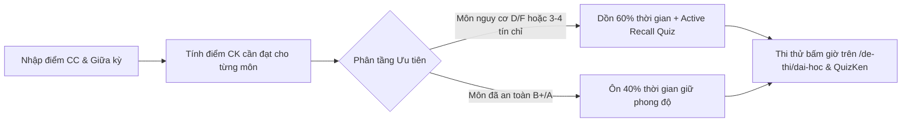

> **Tóm tắt nhanh (TL;DR):** Tháng 12 là cao điểm thi cuối kỳ 1 tại hầu hết các trường đại học theo hệ tín chỉ. Để không rơi vào cảnh "rớt môn oan" vì thiếu 0,1 điểm tổng kết hoặc dính điểm liệt cuối kỳ, sinh viên cần làm ngay 3 bước: **(1)** tính chính xác **điểm cuối kỳ tối thiểu cần đạt** theo trọng số quá trình (`10-30-60` hoặc `10-20-20-50`), **(2)** phân tầng môn học theo số tín chỉ để cứu GPA tổng, và **(3)** dùng kỹ thuật **Active Recall + Pomodoro** chuyển thẳng slide/đề cương PDF thành bộ đề trắc nghiệm luyện tập cấp tốc.

---

# Chiến Lược Ôn Thi Cuối Kỳ 1 Đại Học: Tính Điểm Qua Môn & Cày Đề Đại Cương Không Ngợp

Mùa thi cuối kỳ đại học hoàn toàn khác cấp 3: khối lượng slide một môn đại cương có thể dài 300–500 trang, mỗi môn có một công thức tính điểm thành phần riêng, và chỉ cần một môn 3 tín chỉ bị điểm `D` hoặc `F` là điểm **GPA học kỳ** lập tức tụt sâu, kéo theo nguy cơ mất học bổng hoặc chậm tiến độ ra trường.

## 1. Bước 1: Tính Chính Xác Ngưỡng Điểm Cuối Kỳ Cần Đạt Trước Khi Mở Sách

Sai lầm phổ biến nhất của tân sinh viên là ôn dàn trải mọi môn như nhau. Thực tế, **trọng số điểm quá trình và cuối kỳ quyết định chiến lược phân bổ thời gian**:

| Cơ cấu trọng số phổ biến | Ví dụ điểm thành phần hiện có | Mức cuối kỳ cần để qua môn (`4.0` - `D`) | Mức cuối kỳ cần để đạt `A` (`8.5+`) |
| :--- | :--- | :--- | :--- |
| **`10% CC + 30% GK + 60% CK`** | CC `9.0`, GK `7.0` (tích lũy `3.00đ`) | Tối thiểu **`1.67đ`** *(cẩn thận ngưỡng liệt cuối kỳ `>= 3.0` của trường!)* | Cần **`9.17đ`** cuối kỳ |
| **`10% CC + 20% BT + 20% GK + 50% CK`** | CC `8.0`, BT `7.5`, GK `6.5` (tích lũy `3.60đ`) | Tối thiểu **`0.80đ`** *(vẫn phải vượt điểm sàn phòng thi)* | Cần **`9.80đ`** cuối kỳ |
| **`20% GK + 30% TH + 50% CK`** | GK `6.0`, TH `8.0` (tích lũy `3.60đ`) | Tối thiểu **`0.80đ`** | Cần **`9.80đ`** cuối kỳ |

Thay vì tự bấm tay dễ nhầm công thức, bạn hãy nhập điểm chuyên cần và giữa kỳ vào công cụ [Tính điểm học phần tín chỉ & Điểm cuối kỳ cần đạt](/cong-cu/tinh-diem-hoc-phan-tin-chi-can-dat) để thấy ngay bảng mục tiêu cho từng mức `D, C, B, B+, A, A+`. Sau đó, hãy gộp các môn trong kỳ vào [Công cụ tính điểm GPA Đại học (Hệ 10 ↔ Hệ 4)](/cong-cu/tinh-diem-gpa-dai-hoc) để xem môn 3–4 tín chỉ nào cần ưu tiên kéo điểm nhất.

---

## 2. Bước 2: Chuyển Đề Cương Dài Thành Bộ Đề Trắc Nghiệm Active Recall

Với các môn đại cương có ngân hàng câu hỏi lớn như *Triết học Mác-Lênin, Kinh tế chính trị, Pháp luật đại cương, Tư tưởng Hồ Chí Minh, Lịch sử Đảng, Kinh tế vi mô, Xác suất thống kê*, việc đọc lướt giáo trình PDF từ trang 1 đến trang 200 là cách học kém hiệu quả nhất vì não bộ nhanh chóng rơi vào ảo giác "đọc thấy quen quen".

Thay vào đó, hãy áp dụng quy trình **3 vòng Active Recall**:
1. **Luyện trước ngân hàng đề đại cương chuẩn hóa:** Làm ngay các bộ câu hỏi có đáp án và giải thích chi tiết tại [Ngân hàng Đề thi Môn Đại cương Đại học](/de-thi/dai-hoc) (hoặc chọn thẳng môn đang thi như [Triết học Mác-Lênin](/de-thi/dai-hoc/triet-hoc-mac-lenin), [Kinh tế chính trị](/de-thi/dai-hoc/kinh-te-chinh-tri), [Pháp luật đại cương](/de-thi/dai-hoc/phap-luat-dai-cuong), [Xác suất thống kê](/de-thi/dai-hoc/xac-suat-thong-ke)).
2. **Biến slide giảng viên thành bài test riêng:** Tải trực tiếp file PDF slide bài giảng hoặc đề cương nhóm lớp lên [QuizKen](https://app.quizken.com) để AI bóc tách thành bộ câu hỏi 30–50 câu bám sát đúng bài giảng của thầy cô trên lớp.
3. **Ôn lại riêng nhóm câu hay sai:** Sau mỗi lượt làm bài, lọc lại danh sách câu làm sai để học sâu phần giải thích thay vì ôn lại cả những câu đã thuộc nằm lòng.

---

## 3. Bước 3: Quản Lý Nhịp Độ Ôn Thi Bằng Pomodoro & Khung Giờ Vàng

Trong tuần lễ cận thi (còn 3–5 ngày trước giờ G), thức trắng đêm nhồi nhét khiến trí nhớ ngắn hạn quá tải và dễ quên sạch ngay khi bước vào phòng thi. Hãy kết hợp:
* **Chu kỳ Pomodoro `50/10` hoặc `25/5`:** Mở [Đồng hồ Pomodoro học tập có tiếng mưa](/cong-cu/dong-ho-pomodoro-hoc-tap) ở chế độ toàn màn hình, tắt thông báo điện thoại, giải quyết trọn vẹn 1 chương đề cương trong 50 phút rồi nghỉ mắt 10 phút.
* **Quy tắc ôn xen kẽ (Interleaving):** Đừng học một môn liên tục 8 tiếng; hãy chia buổi sáng ôn môn tính toán (XSTK, Vi mô), buổi chiều chuyển sang môn lý luận (Triết học, Pháp luật) để não bộ phục hồi độ tập trung.

---

## Câu hỏi thường gặp (FAQ)

### 1. Điểm tổng kết trên 4.0 nhưng bài thi cuối kỳ bị 1.5 điểm thì có qua môn không?
Rất nhiều trường đại học áp dụng quy định **điểm liệt bài thi cuối kỳ** (thường yêu cầu điểm thi kết thúc học phần phải đạt từ `2.0` hoặc `3.0` trở lên mới được xét qua môn). Vì vậy bạn bắt buộc kiểm tra quy chế đào tạo của trường bên cạnh công thức cộng trọng số.

### 2. Làm sao tính được học kỳ này cần GPA bao nhiêu để giữ học bổng?
Bạn hãy nhập điểm các môn dự kiến vào [Công cụ tính GPA Đại học](/cong-cu/tinh-diem-gpa-dai-hoc) để ra GPA học kỳ hệ 4, sau đó đối chiếu với điều kiện điểm rèn luyện (thường từ `80+` cho loại Giỏi, `90+` cho Xuất sắc) tại [Kho công cụ QuizKen](/cong-cu).

### 3. Nên đọc slide PDF hay làm trắc nghiệm trước khi ôn thi đại cương?
Hãy làm trước 1 bài kiểm tra nhanh 15–20 câu để xác định chương nào mình đang hổng nặng nhất, sau đó mới quay lại đọc đúng phần slide tương ứng — cách này giúp tiết kiệm 40–50% thời gian ôn thi cuối kỳ.

### 4. QuizKen có hỗ trợ ôn thi miễn phí các môn đại cương trên điện thoại không?
Có. Bạn có thể truy cập trực tiếp [Kho đề Đại học trên QuizKen](/de-thi/dai-hoc) hoặc [Thư viện QuizKen](https://app.quizken.com/quiz/library) trên trình duyệt điện thoại mà không cần cài thêm app.
