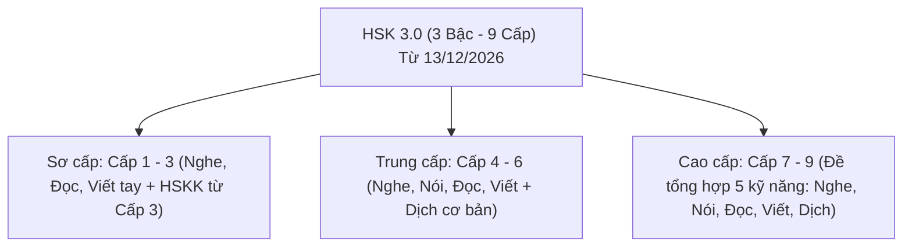

> **Tóm tắt nhanh (TL;DR):** Ngày **13/12/2026** đánh dấu bước ngoặt lớn nhất của cộng đồng học tiếng Trung tại Việt Nam khi hệ thống thi năng lực Hán ngữ chuẩn mới **HSK 3.0 ("Tam đẳng cửu cấp" — 3 bậc 9 cấp)** chính thức triển khai đồng loạt, khép lại hoàn toàn định dạng **HSK 2.0** cũ. So với trước đây, HSK 3.0 tăng mạnh lượng từ vựng, **bắt buộc viết tay chữ Hán ngay ở bậc Sơ cấp**, bổ sung phần Viết ở HSK 2, thi kèm khẩu ngữ **HSKK từ cấp 3** và tích hợp kỹ năng **Dịch thuật** ở bậc Trung–Cao cấp.

---

# Chính Thức Áp Dụng HSK 3.0 Từ 13/12/2026: Người Học Tiếng Trung Cần Thay Đổi Gì Ngay?

Nếu như thời HSK 2.0 nhiều người học có thể đạt HSK 4–5 khá nhanh nhờ nhận mặt chữ Hán trên máy tính và làm bài trắc nghiệm nhiều lựa chọn, thì **HSK 3.0** được thiết kế lại toàn diện theo hướng đánh giá năng lực sử dụng tiếng Trung thực tế, tiệm cận chuẩn khung tham chiếu châu Âu **CEFR** (từ A1 đến C2).

## 1. Bảng So Sánh HSK 2.0 (Cũ) vs HSK 3.0 (Áp Dụng Từ 13/12/2026)

| Tiêu chí so sánh | HSK 2.0 (Cũ — Dừng tổ chức) | HSK 3.0 (Mới — Từ 13/12/2026) |
| :--- | :--- | :--- |
| **Hệ thống cấp độ** | `6 cấp` (HSK 1 → HSK 6) | **`3 bậc – 9 cấp`** (Sơ cấp 1–3, Trung cấp 4–6, Cao cấp 7–9) |
| **Lượng từ vựng yêu cầu** | Khoảng 5.000 từ cho cấp cao nhất (HSK 6 cũ) | Sơ cấp ~`2.245` từ; Trung cấp ~`5.456` từ; Cao cấp 7–9 tới ~`11.092` từ |
| **Kỹ năng Viết (HSK 1–2)** | HSK 1 & 2 không thi Viết; HSK 3 trở lên mới viết | **HSK 2 đã có phần Viết**; Sơ cấp bắt buộc biết viết tay chữ Hán chuẩn nét |
| **Thi kèm Khẩu ngữ (HSKK)** | Tách riêng hoặc chỉ bắt buộc ở một số điểm thi | **Bắt buộc thi kèm HSKK cùng cấp từ HSK 3 trở lên** |
| **Kỹ năng Dịch thuật** | Không kiểm tra trực tiếp | Bắt đầu xuất hiện từ bậc Trung cấp (4–6) và chuyên sâu ở **HSK 7–9** |

---

## 2. Chi Tiết Cấu Trúc Theo Từng Cấp Độ Trong HSK 3.0

1. **HSK 1:** Gồm 2 kỹ năng **Nghe và Đọc** (chưa có Viết và Nói), phù hợp người mới làm quen ngữ âm Pinyin và chữ Hán nền tảng.
2. **HSK 2:** Mở rộng lên 3 kỹ năng **Nghe, Đọc và Viết** — đây là điểm mới quan trọng buộc người học sơ cấp phải luyện nhớ mặt chữ và viết câu ngay từ sớm.
3. **HSK 3 đến HSK 6:** Thi đủ **Nghe, Đọc, Viết** và **bắt buộc ghép thi Khẩu ngữ (HSKK)** tương ứng (ví dụ HSK 3 kèm HSKK Sơ cấp, HSK 4 kèm HSKK Trung cấp, HSK 5–6 kèm HSKK Cao cấp). Từ HSK 4 lượng từ vựng tăng vọt lên hơn `3.200` từ kèm bài đọc hiểu dài hơn.
4. **HSK 7–9 (Bậc Cao cấp):** Dùng chung một bài thi tích hợp 5 kỹ năng (**Nghe – Nói – Đọc – Viết – Dịch**) dành cho nghiên cứu sinh, phiên dịch viên và nhân sự cao cấp, đánh giá xếp hạng cấp 7, 8 hoặc 9 dựa trên tổng điểm đạt được.

Bạn có thể tra cứu nhanh bảng đối chiếu điểm & cấp bậc giữa **HSK 2.0 ↔ HSK 3.0 ↔ CEFR** tại công cụ miễn phí [Tính điểm thi HSK & JLPT + Quy đổi CEFR](/cong-cu/tinh-diem-thi-hsk-jlpt-quy-doi-cefr).

---

## 3. Bí Quyết Chuyển Đổi Phương Pháp Học Tiếng Trung Trước Thềm 2027

Để không bị "ngợp" trước khối lượng từ vựng tăng gần gấp đôi và yêu cầu viết tay chữ Hán + khẩu ngữ của HSK 3.0, người học cần đổi cách ôn tập ngay từ tháng 12/2026:

* **Luyện Flashcard Hán tự theo Spaced Repetition:** Đừng chỉ nhìn Pinyin rồi đoán nghĩa. Hãy tải file danh sách từ vựng HSK 3.0 PDF lên [QuizKen](https://app.quizken.com) để tự động sinh bộ thẻ Flashcard (mặt trước chữ Hán, mặt sau Pinyin + nghĩa + ví dụ) và ôn lặp lại ngắt quãng mỗi ngày.
* **Luyện đề đọc hiểu HSK bấm giờ:** Truy cập mục [Đề thi thử HSK](/de-thi/chung-chi/hsk) để rèn tốc độ đọc hiểu không nhìn phiên âm Pinyin.
* **Thực hành viết tay & đặt câu ngắn 15 phút/ngày:** Chia các phiên tập viết Hán tự kết hợp [Đồng hồ Pomodoro học tập](/cong-cu/dong-ho-pomodoro-hoc-tap) giúp duy trì thói quen nhớ mặt chữ bền vững mà không bị nản.

---

## Câu hỏi thường gặp (FAQ)

### 1. Chứng chỉ HSK 2.0 đã thi trước ngày 13/12/2026 có còn giá trị không?
Có. Chứng chỉ HSK 2.0 đã được cấp trước thời điểm chuyển đổi vẫn giữ nguyên giá trị sử dụng trong thời hạn quy định thông thường (2 năm kể từ ngày cấp) khi nộp hồ sơ học bổng, du học hoặc miễn thi ngoại ngữ THPT (nếu đủ điều kiện).

### 2. Thi HSK 3.0 từ cấp 3 trở lên có bắt buộc thi Nói (HSKK) không?
Có. Từ HSK cấp 3 đến cấp 6, thí sinh phải thi kết hợp cả bài thi viết/đọc/nghe và bài thi khẩu ngữ HSKK tương ứng theo quy định tích hợp kỹ năng của chuẩn HSK 3.0.

### 3. Lượng từ vựng của HSK 4 mới khác HSK 4 cũ nhiều không?
Khác biệt rất lớn. HSK 4 theo chuẩn 2.0 cũ chỉ khoảng `1.200` từ vựng, trong khi HSK 4 của HSK 3.0 yêu cầu hơn `3.200` từ và bổ sung kỹ năng dịch thuật thực tế.

### 4. Tôi muốn quy đổi xem trình độ HSK 3.0 tương đương bậc mấy của CEFR (A1–C2) thì xem ở đâu?
Bạn có thể tra cứu bảng đối chiếu chuẩn giữa HSK 2.0, HSK 3.0 (9 cấp) và khung CEFR ngay tại công cụ [Tính điểm HSK & JLPT quy đổi CEFR](/cong-cu/tinh-diem-thi-hsk-jlpt-quy-doi-cefr) trên QuizKen.
