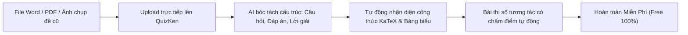

> **Tóm tắt nhanh (TL;DR):** Hầu hết các thầy cô giáo và nhà trường hiện nay đều sở hữu kho tài liệu ôn tập khổng lồ được lưu trữ dưới dạng file **Word (.docx)** hoặc **PDF**. Tuy nhiên, việc chuyển đổi những file tĩnh này thành bài thi trắc nghiệm trực tuyến có tính năng tự động chấm điểm và thống kê phổ điểm thường tốn hàng chục giờ copy-paste thủ công. Bài viết này hướng dẫn cách sử dụng công nghệ **AI miễn phí (free converter)** trên nền tảng QuizKen để biến mọi tài liệu thành bài thi số tương tác chỉ sau 30 giây.

---

## 1. Nỗi Khổ "Copy - Paste" Ngân Hàng Đề Thi Của Giáo Viên

Trong mục tiêu chuyển đổi số theo **Quyết định 131/QĐ-TTg** của Thủ tướng Chính phủ, các trường học được khuyến khích xây dựng kho học liệu số tương tác. Dù vậy, quy trình đưa đề thi lên môi trường mạng hiện nay vẫn còn rất lạc hậu:

* **Mất thời gian chia tách câu:** Một đề kiểm tra 50 câu hỏi đòi hỏi giáo viên phải bôi đen từng câu hỏi, cắt dán từng phương án A, B, C, D vào biểu mẫu Google Forms hoặc phần mềm thi cũ.
* **Lỗi định dạng công thức & bảng biểu:** Các công thức toán học, bảng số liệu địa lý hoặc hình vẽ thí nghiệm vật lý thường bị mất khi copy từ Word sang các hệ thống thông thường.
* **Chi phí phần mềm số hóa quá đắt:** Nhiều đơn vị cung cấp phần mềm quản trị trường học yêu cầu hợp đồng hàng chục triệu đồng để cài đặt tính năng import đề thi thông minh.

---

## 2. Vì Sao Công Nghệ AI Của QuizKen Vượt Trội Các Tool Import Cũ?

Khác với các công cụ import truyền thống dựa trên định dạng cố định (Regex) đòi hỏi giáo viên phải gắn thẻ tag rườm rà như ` `, `[#]`, `*A*`:

| Tiêu chí so sánh | Công cụ Import truyền thống | Công nghệ AI QuizKen (Free) |
| :--- | :--- | :--- |
| **Định dạng file yêu cầu** | Phải chuẩn hóa font chữ, gõ đúng từng dấu cách và ký tự quy định | **Chấp nhận mọi định dạng:** File Word, PDF scan, tài liệu lộn xộn, thậm chí cả ảnh chụp tài liệu |
| **Xử lý bảng đáp án** | Bắt buộc gõ đáp án đúng ở ngay cuối mỗi câu | Tự động đọc bảng đáp án ở cuối trang tài liệu và ghép nối chính xác |
| **Bảo lưu công thức toán học** | Thường xuyên bị lỗi font hoặc biến thành ký tự vô nghĩa | **Giữ nguyên 100% công thức KaTeX** và ký hiệu khoa học |
| **Chi phí sử dụng** | Tính phí theo số lượng câu hỏi import | **Miễn phí (free)** tạo đề hàng ngày cho mọi người dùng |

---

## 3. Hướng Dẫn 3 Bước Biến File Word/PDF Thành Đề Thi Online

### Bước 1: Tải tài liệu lên hệ thống
Truy cập trang tạo đề của QuizKen. Nhấp chọn mục **"Tạo từ tệp tài liệu"** và kéo thả file Word (.docx) hoặc file PDF của bạn vào khung xử lý.

### Bước 2: Chọn chế độ xử lý thông minh
* Chọn môn học và cấp độ lớp tương ứng.
* Bạn có thể chọn: **"Trích xuất nguyên bản đề thi có sẵn"** hoặc **"Yêu cầu AI sinh thêm các biến thể câu hỏi tương tự"** để làm phong phú thêm ngân hàng câu hỏi.

### Bước 3: Xem lại và phát hành bài thi
Chỉ sau 20–30 giây, QuizKen AI sẽ hiển thị toàn bộ bài thi trực quan trên màn hình:
* Câu hỏi, 4 phương án lựa chọn, đáp án đúng và lời giải chi tiết (nếu có trong file nguồn).
* Thầy cô có thể chỉnh sửa nhanh nếu muốn.
* Bấm **"Tạo liên kết làm bài"** để gửi cho học sinh làm trên điện thoại, hoặc nhấp **"Xuất file PDF chuẩn in ấn"** kèm 4 mã đề xáo trộn ngẫu nhiên.

👉 **Bắt đầu ngay:** [Chuyển đổi file tài liệu Word PDF thành bài thi online free cùng QuizKen](https://quizken.com) để giải phóng sức lao động ngay hôm nay!

---

## 4. Bảo Vệ Quyền Tác Giả & An Toàn Dữ Liệu Giáo Viên

Theo chuẩn an toàn dữ liệu, các file tài liệu thầy cô tải lên QuizKen:
1. **Được mã hóa hoàn toàn:** Không chia sẻ công khai cho bất kỳ bên thứ ba nào.
2. **Quyền sở hữu thuộc về giáo viên:** Thầy cô có toàn quyền thiết lập chế độ riêng tư (chỉ học sinh trong lớp mới được truy cập) hoặc chia sẻ cộng đồng.

---

## Câu hỏi thường gặp (FAQ)

### 1. File PDF dạng scan (chụp từ sách giấy) có chuyển thành đề thi được không?
Có. QuizKen tích hợp công nghệ nhận dạng ký tự quang học (AI OCR) tiên tiến, có khả năng đọc và bóc tách chữ từ tài liệu scan và ảnh chụp rõ nét.

### 2. Có giới hạn dung lượng file tải lên không?
Hệ thống hỗ trợ file tài liệu dung lượng lên đến 10MB, tương đương với một cuốn tài liệu hoặc đề thi dài hàng trăm trang.

### 3. Công cụ chuyển đổi này có thực sự miễn phí không?
Hoàn toàn **miễn phí (free)**. Giáo viên và học sinh đều có thể sử dụng tính năng chuyển đổi tài liệu sang đề trắc nghiệm bằng AI mỗi ngày trên QuizKen.
