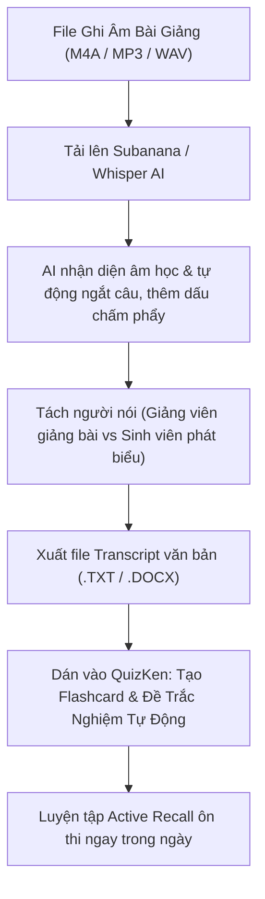

> **TL;DR (Tóm tắt nhanh):**  
> Việc **chuyển ghi âm bài giảng thành văn bản miễn phí** bằng công nghệ AI Speech-to-Text hiện nay đã đạt độ chính xác trên 95% tiếng Việt nhờ mô hình **OpenAI Whisper** mã nguồn mở và nền tảng chuyên biệt **Subanana** (`subanana.com`). Bạn không còn phải tốn 2 tiếng ngồi tua lại file ghi âm giọng nói rè rè của giảng viên; AI sẽ tự động tách lời người nói, khôi phục dấu câu chấm phẩy và trích xuất các ý chính. Sau khi có bản ghi chép bài học (Transcript), bạn chỉ cần dán vào **QuizKen** để AI tự động chuyển hóa thành bộ thẻ Flashcard Spaced Repetition và đề trắc nghiệm ôn bài trong ngày!

---

# Hướng Dẫn Chuyển File Ghi Âm Bài Giảng Thành Văn Bản Bằng AI Tiếng Việt (2026)

Ngồi trên giảng đường đại học, giảng viên thường giảng bài với tốc độ rất nhanh, liên tục mở rộng các ví dụ thực tiễn và nhấn mạnh những phần chắc chắn sẽ xuất hiện trong đề thi. Hầu hết sinh viên đều chọn giải pháp bật ứng dụng ghi âm (Voice Memos) trên điện thoại để "về nhà nghe lại".

Thế nhưng, thực tế là:
* File ghi âm dài 90 đến 120 phút chứa rất nhiều khoảng lặng, tiếng ồn quạt gió và tạp âm tiếng nói chuyện trong lớp.
* Cuối kỳ thi, bạn tích lũy hơn 20 file ghi âm và hoàn toàn không có thời gian để nghe lại từng file.
* Ngồi nghe lại và gõ tay từng chữ mất gấp 3 lần thời lượng buổi học (mất 4 - 6 tiếng cho 1 buổi học).

Năm 2026, các công cụ nhận dạng giọng nói tiếng Việt bằng trí tuệ nhân tạo (AI Speech-to-Text) đã hoàn toàn giải phóng sinh viên khỏi công việc ghi chép thủ công. Bài viết này sẽ hướng dẫn bạn quy trình **chuyển ghi âm bài giảng thành văn bản miễn phí** với độ chính xác cao nhất!

---

## 1. So Sánh Các Công Cụ Chuyển Giọng Nói Thành Văn Bản Tiếng Việt

| Công cụ | Nền tảng | Độ chính xác tiếng Việt | Khả năng tách người nói (Diarization) | Chi phí sử dụng |
| :--- | :--- | :--- | :--- | :--- |
| **Subanana** | `subanana.com` | **Xuất sắc (>96%)** | Có (phân biệt thầy cô & sinh viên) | Miễn phí trải nghiệm & gói học tập |
| **OpenAI Whisper** | Mã nguồn mở (GitHub / Google Colab) | **Rất tốt** | Cần code thêm PyAnnote | Miễn phí 100% không giới hạn |
| **Notta AI** | `notta.ai` | Rất tốt | Có | Miễn phí 120 phút ban đầu |
| **Gboard Voice Typing** | Bàn phím điện thoại | Khá tốt | Không | Miễn phí (chỉ dùng trực tiếp) |

---

## 2. Quy Trình 3 Bước Chuyển Đổi & Tóm Tắt Bài Giảng Bằng AI

### Bước 1: Chuẩn bị file ghi âm chất lượng
Để AI nhận dạng chuẩn xác không bị mất từ, khi ngồi trên giảng đường bạn nên:
* Đặt điện thoại ở bàn đầu hoặc gần bục giảng viên, hướng micro về phía loa phát thanh của lớp học.
* Định dạng file ghi âm phổ biến: `.m4a` (iPhone), `.mp3` hoặc `.wav` (Android / Máy ghi âm).

### Bước 2: Phiên âm và khôi phục dấu câu với Subanana
1. Truy cập trang web chính thức: `https://subanana.com`.
2. Tải file ghi âm bài học lên hệ thống (hỗ trợ cả dán link YouTube nếu bài giảng được lưu trên mạng).
3. Chọn ngôn ngữ nhận diện: **Tiếng Việt**.
4. AI sẽ xử lý file ghi âm 60 phút chỉ trong khoảng 3 đến 5 phút. Kết quả trả về là một văn bản hoàn chỉnh có đầy đủ dấu câu, chia đoạn theo từng ý và phân biệt rõ khi nào giảng viên đặt câu hỏi, khi nào sinh viên trả lời.
5. Nhấn **Tải xuống văn bản (Download Transcript)** dạng file `.txt` hoặc `.docx`.

### Bước 3: Tự động chạy Whisper AI miễn phí trên Google Colab (Dành cho file nặng)
Nếu bạn có hàng chục file ghi âm dài và muốn chuyển đổi hoàn toàn miễn phí không giới hạn:
1. Mở một notebook Google Colab miễn phí.
2. Cài đặt thư viện Whisper: `!pip install git+https://github.com/openai/whisper.git`.
3. Chạy mô hình `medium` hoặc `large-v3`: Whisper sẽ phiên âm toàn bộ file âm thanh tiếng Việt với độ chính xác học thuật đáng kinh ngạc.

---

## 3. Mẹo Dùng AI Tóm Tắt Ý Chính Từ Bản Ghi Lời

Sau khi có file văn bản thô (Transcript) dài 15 đến 20 trang giấy, bạn không nên đọc lại từng chữ mà hãy dùng câu lệnh tóm tắt:

> **Prompt mẫu:**  
> *"Dưới đây là toàn bộ bản ghi âm buổi học môn [Tên môn]. Hãy đóng vai trò là trợ giảng xuất sắc, trích xuất cho tôi:  
> 1. Ba luận điểm cốt lõi nhất mà giảng viên đã giảng.  
> 2. Các ví dụ minh họa thực tế được nêu trong bài.  
> 3. Danh sách các câu hỏi mà giảng viên nhấn mạnh 'phần này sẽ có trong đề thi cuối kỳ'."*

---

## 4. Cầu Nối QuizKen: Biến Lời Giảng Trên Lớp Thành Bộ Đề Thi AI

Mục tiêu cuối cùng của việc ghi chép bài học không phải là cất giữ file văn bản trong ổ cứng, mà là **nạp kiến thức đó vào não bộ để làm bài thi đạt điểm cao**:

1. **Dán nội dung transcript vào QuizKen:** Truy cập [QuizKen](https://quizken.com), chọn tính năng **Tạo Đề Thi Bằng AI**.
2. **AI Quét Trọng Tâm Bài Học:** QuizKen sẽ tự động phân tích những phần lý thuyết quan trọng mà giảng viên vừa truyền đạt để tạo ra bộ 30 - 40 câu hỏi trắc nghiệm kèm giải thích cặn kẽ.
3. **Chuyển hóa thành Flashcard Spaced Repetition:** Những định nghĩa và thuật ngữ mới xuất hiện trong buổi học sẽ được chuyển thành các thẻ ghi nhớ lặp lại ngắt quãng, giúp bạn thuộc bài ngay trong ngày mà không cần đợi đến tuần thi mới ôn bài.
4. **Chia sẻ với nhóm học tập:** Gửi link bài quiz vừa tạo cho bạn bè trong nhóm để cùng nhau ôn luyện và thi đấu điểm số vui vẻ sau giờ học.

Hãy bắt đầu ghi âm thông minh và ứng dụng **QuizKen** ngay từ buổi học hôm nay để trải nghiệm cảm giác thảnh thơi khi kỳ thi đến!
