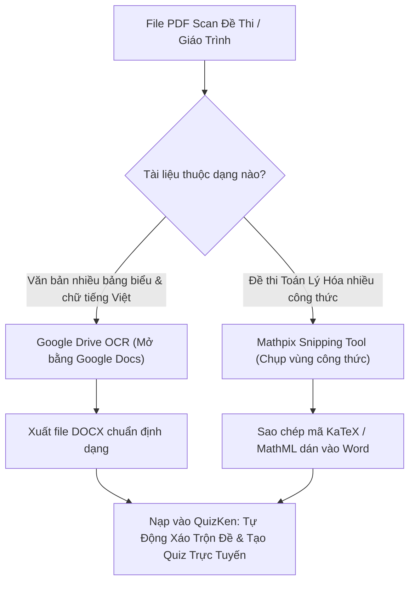

> **TL;DR (Tóm tắt nhanh):**  
> Việc **chuyển PDF scan sang Word miễn phí** đối với các tài liệu chứa bảng biểu phức tạp và công thức Toán - Lý - Hóa thường bị lỗi nhảy dòng, mất ký hiệu căn bậc hai, ma trận hoặc phân số. Giải pháp tối ưu nhất năm 2026 là kết hợp **Google Drive OCR** (đối với văn bản tiếng Việt có bảng) và công cụ **Mathpix Snipping Tool** (chuyên bóc tách công thức Toán sang mã LaTeX/MathML chuẩn). Sau khi có file đề thi hoàn chỉnh, bạn có thể nạp thẳng vào **QuizKen** – nền tảng tự động nhận diện KaTeX và xáo trộn 4 mã đề trắc nghiệm chuẩn Bộ GD&ĐT trong 5 giây!

---

# Hướng Dẫn Chuyển PDF Scan Sang Word Không Lỗi Font & Giữ Nguyên Công Thức Toán 2026

Giáo viên và học sinh thường xuyên phải làm việc với các tài liệu ôn thi THPT Quốc gia, đề thi học sinh giỏi hoặc giáo trình đại học lưu dưới dạng **file PDF scan (chụp từ sách giấy)**. Khi dùng các website chuyển đổi thông thường như Smallpdf hay Convertio, bạn sẽ gặp thảm họa định dạng:

* Phông chữ tiếng Việt có dấu bị lỗi biến thành các ký tự vuông `[]` hoặc dấu hỏi `?`.
* Bảng biểu bị vỡ khung, các cột bị xô lệch hoàn toàn.
* Công thức toán học (tích phân, đạo hàm, căn bậc hai, phân số) bị biến thành các đoạn ảnh bitmap mờ nhạt hoặc chuỗi ký tự vô nghĩa.

Bài viết này sẽ hướng dẫn bạn quy trình **chuyển PDF scan sang Word miễn phí** chuyên nghiệp nhất, giúp khôi phục văn bản có thể chỉnh sửa 100% kèm công thức toán học sắc nét.

---

## 1. So Sánh Các Công Cụ OCR Tài Liệu Học Thuật & STEM Phổ Biến

Không có một công cụ đơn lẻ nào hoàn hảo cho mọi nhu cầu. Hãy xem bảng so sánh thực tế sau để chọn đúng công cụ cho loại tài liệu của bạn:

| Công cụ OCR | Địa chỉ / Nền tảng | Độ chính xác tiếng Việt | Khả năng nhận diện công thức Toán | Chi phí |
| :--- | :--- | :--- | :--- | :--- |
| **Mathpix Snipping Tool** | `mathpix.com` | Rất tốt (hỗ trợ cả chữ viết tay) | **Đỉnh cao số 1 thế giới** (xuất LaTeX, MathType, MS Word) | Miễn phí gói cơ bản |
| **Google Drive OCR** | `drive.google.com` | **Rất tốt** (nhận diện dấu tiếng Việt chuẩn) | Trung bình (công thức bị chuyển thành text thường) | Miễn phí 100% |
| **Stirling-PDF (Tesseract)** | Mã nguồn mở (Docker/Desktop) | Khá tốt (cần tải data `vie.traineddata`) | Kém với công thức phức tạp | Miễn phí 100% không giới hạn |
| **Abbyy FineReader** | Bản cài đặt Windows/Mac | Xuất sắc | Rất tốt | Trả phí đắt đỏ |

---

## 2. Quy Trình Chuyển Đổi Tài Liệu Chứa Công Thức Toán & Bảng Biểu

Để đạt độ chuẩn xác cao nhất, hãy áp dụng quy trình 3 bước chuyên nghiệp:

### Bước 1: Xử lý phần văn bản và bảng biểu với Google Drive OCR
1. Truy cập **Google Drive**, tải file PDF scan cần chuyển đổi lên.
2. Nhấp chuột phải vào file > chọn **Mở bằng (Open with)** > **Google Tài liệu (Google Docs)**.
3. Chờ 5 - 10 giây để thuật toán thị giác máy tính của Google nhận diện.
4. Google Docs sẽ tự động tạo một trang mới: Phía trên là ảnh gốc, phía dưới là **toàn bộ văn bản tiếng Việt và bảng biểu đã được trích xuất thành chữ sống**.
5. Bấm **Tệp (File)** > **Tải xuống (Download)** > **Microsoft Word (.docx)**.

### Bước 2: Bóc tách công thức toán học chuyên sâu với Mathpix
Đối với các câu hỏi chứa tích phân $\int$, giới hạn $\lim$, ma trận hoặc ký hiệu hóa học mà Google Docs nhận diện chưa trọn vẹn:
1. Tải ứng dụng miễn phí **Mathpix Snipping Tool** (hỗ trợ Windows, Mac, iOS, Android).
2. Dùng phím tắt `Ctrl + Alt + M` (Windows) hoặc `Cmd + Ctrl + M` (Mac) để chụp nhanh vùng chứa công thức toán trên màn hình.
3. Mathpix sẽ tức thì nhận diện và cho phép bạn:
   * **Copy MS Word:** Dán trực tiếp vào Word thành định dạng MathType / Equation có thể sửa số liệu.
   * **Copy LaTeX / KaTeX:** Dán vào các hệ thống tạo bài thi trắc nghiệm trực tuyến như QuizKen.

---

## 3. Mẹo Xử Lý File Scan Bị Nghiêng Và Mờ Trước Khi OCR

Độ chính xác của quá trình nhận diện chữ phụ thuộc 80% vào chất lượng file đầu vào:

* **Tự động làm thẳng trang bị nghiêng (Deskew):** Dùng tính năng *Deskew* của Stirling-PDF hoặc CamScanner để xoay góc tài liệu về phương ngang 0 độ.
* **Tăng độ tương phản (Black & White Threshold):** Chuyển ảnh màu chụp điện thoại về dạng tài liệu đen trắng thuần túy (Grayscale). Chữ đen trên nền giấy trắng tinh sẽ giúp công cụ OCR không bị nhầm dấu tiếng Việt (ví dụ dấu ngã `~` và dấu hỏi `?`).

---

## 4. Tối Ưu Hóa Với QuizKen: Biến Đề Thi Word Thành Đấu Trường Quiz AI

Sau khi đã hoàn tất việc chuyển đổi tài liệu scan thành file Word hoặc văn bản số hóa, công việc tiếp theo của giáo viên và học sinh là gì? Thay vì ngồi gõ từng đáp án A, B, C, D thủ công vào Google Forms rất mất thời gian:

1. **Nhập trực tiếp vào QuizKen:** Truy cập [QuizKen](https://quizken.com), chọn tính năng **Tạo Đề Thi Từ File Word / PDF**.
2. **AI Tự Động Phân Tích Công Thức KaTeX:** Hệ thống của QuizKen tích hợp sẵn trình biên dịch KaTeX, tự động hiển thị mượt mà mọi ký hiệu toán học từ cơ bản đến nâng cao trên cả máy tính lẫn điện thoại.
3. **Xáo Trộn Mã Đề Chống Gian Lận:** QuizKen tự động đảo trật tự câu hỏi và hoán vị các phương án A-B-C-D, xuất ra 4 đến 8 mã đề thi kèm bảng đáp án chi tiết.
4. **Tổ Chức Kiểm Tra Trực Tuyến:** Phát mã PIN để học sinh quét mã QR tham gia thi đấu thời gian thực trên lớp học hoặc giao bài tập về nhà có tính giờ làm bài.

Áp dụng phương pháp này giúp các thầy cô và các bạn học sinh tiết kiệm ít nhất 5 đến 8 giờ gõ lại đề thi mỗi tuần, dành trọn vẹn thời gian cho việc củng cố kiến thức và luyện thi hiệu quả!
