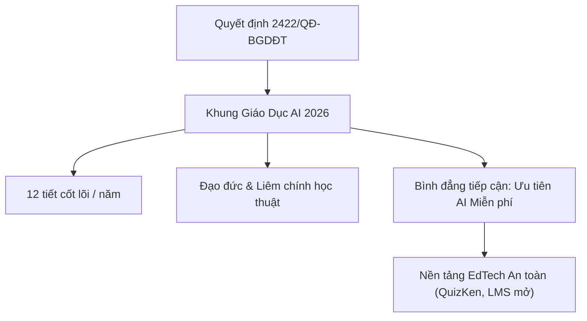

> **Tóm tắt nhanh (TL;DR):** Từ năm học 2026–2027, Bộ Giáo dục và Đào tạo chính thức triển khai đại trà nội dung giáo dục Trí tuệ nhân tạo (AI) cho học sinh phổ thông theo **Quyết định 2422/QĐ-BGDĐT** và **Công văn 5588/BGDĐT-GDPT**. Quy định mới nêu rõ nguyên tắc công bằng tiếp cận, nghiêm cấm việc yêu cầu phụ huynh mua tài khoản dịch vụ AI có phí bắt buộc. Bài viết này tổng hợp 5 **công cụ AI học tập miễn phí (free)** tốt nhất, an toàn và chuẩn hóa cho học sinh, giáo viên Việt Nam.

---

## 1. Quy Định Của Bộ GD&ĐT Về Giáo Dục AI Năm 2026: Điều Giáo Viên & Phụ Huynh Cần Biết

Ngày 18/8/2026, Bộ GD&ĐT đã ký ban hành **Quyết định số 2422/QĐ-BGDĐT** phê duyệt "Khung nội dung giáo dục trí tuệ nhân tạo (AI) cho học sinh phổ thông", tiếp nối bằng **Công văn số 5588/BGDĐT-GDPT** (ngày 19/8/2026). Những định hướng cốt lõi bao gồm:

* **Thời lượng tối thiểu:** Tối thiểu 12 tiết/lớp/năm học dành cho nội dung cốt lõi về nhận thức AI, đạo đức sử dụng AI và kỹ năng kiểm chứng dữ liệu.
* **Không môn học riêng biệt:** Tích hợp linh hoạt vào các môn Tin học, Khoa học Tự nhiên, Ngoại ngữ và hoạt động trải nghiệm.
* **Bình đẳng số & Miễn phí tiếp cận:** Nghiêm cấm tình trạng các trường ép buộc học sinh mua phần mềm bản quyền đắt đỏ. Các nền tảng **AI free (miễn phí)** có cam kết bảo vệ dữ liệu cá nhân (theo Luật Bảo vệ Dữ liệu Cá nhân) được ưu tiên hàng đầu.

---

## 2. Tiêu Chí Lựa Chọn Công Cụ AI Học Tập Miễn Phí Đạt Chuẩn

Để hỗ trợ học tập hiệu quả mà không vi phạm quy chuẩn liêm chính học thuật hay gây rò rỉ dữ liệu cá nhân, một **công cụ AI học tập miễn phí** cần thỏa mãn 4 tiêu chí khắt khe:

1. **Gói dùng thử / Miễn phí thực chất (Free Tier):** Cung cấp đầy đủ các tính năng tạo câu hỏi ôn tập, giải thích kiến thức mà không "bẫy" người dùng bằng chi phí ẩn.
2. **Nội dung bám sát Chương trình GDPT 2018:** Đảm bảo dữ liệu trắc nghiệm phân bổ đúng 4 cấp độ tư duy: *Nhận biết – Thông hiểu – Vận dụng – Vận dụng cao*.
3. **Cơ chế chống bịa đặt thông tin (Anti-Hallucination):** Ứng dụng công nghệ RAG (Retrieval-Augmented Generation) truy xuất trực tiếp từ tài liệu sách giáo khoa hoặc tài liệu người dùng tải lên.
4. **Bảo mật danh tính người học:** Không thu thập thông tin định danh trái phép theo Nghị định 13/2023/NĐ-CP.

---

## 3. Top 5 Công Cụ AI Học Tập Miễn Phí (Free) Tốt Nhất 2026

| Nền tảng | Tính năng nổi bật | Gói miễn phí (Free) | Phù hợp với |
| :--- | :--- | :--- | :--- |
| **QuizKen** | Tạo đề trắc nghiệm Đúng/Sai 4 ý, Trả lời ngắn từ file Word/PDF; Chat Socratic chữa bài; Flashcard Spaced Repetition | **Miễn phí trọn đời** (Tạo quiz AI hàng ngày, phòng đấu multiplayer free) | Học sinh THPT ôn thi, Giáo viên soạn đề chuẩn GDPT 2018 |
| **Google Gemini Edu** | Phân tích bài toán, tóm tắt tài liệu văn bản dài, hỗ trợ prompt nghiên cứu | Miễn phí qua tài khoản Google Workspace for Education | Tra cứu tài liệu và dịch thuật mở rộng |
| **Claude AI (Free Tier)** | Phân tích logic sâu, hỗ trợ viết luận có trích dẫn và lập dàn ý học thuật | Giới hạn số lượt prompt/ngày | Học sinh chuyên văn, sinh viên đại học |
| **Khanmigo Free Sandbox** | Hướng dẫn tư duy Toán & Khoa học theo phương pháp gợi mở không giải hộ | Miễn phí trong một số chuyên đề STEM | Học sinh tự học toán cấp 2 và cấp 3 |
| **PhET Interactive Simulations + AI** | Mô phỏng thí nghiệm Vật lý - Hóa học tương tác kèm câu hỏi trắc nghiệm AI | Miễn phí 100% mã nguồn mở | Học sinh THCS & THPT học thực hành Khoa học tự nhiên |

---

## 4. Trải Nghiệm Học Tập Tối Ưu Cùng QuizKen AI

Trong số các nền tảng EdTech Make-in-Vietnam, **QuizKen** tự hào là giải pháp tiên phong áp dụng Trí tuệ Nhân tạo tuân thủ chặt chẽ định hướng của Bộ GD&ĐT:

* **Tạo đề thi tự động hoàn toàn miễn phí:** Chỉ cần tải file giáo trình (Word, PDF, ảnh chụp tài liệu), hệ thống AI của QuizKen sẽ trích xuất ma trận câu hỏi đa dạng (4 lựa chọn, Đúng/Sai 4 ý, điền đáp số ngắn) chỉ sau 30 giây.
* **Gia sư ảo AI Tutor 24/7:** Không đưa ngay đáp án để học sinh chép phạt, QuizKen ứng dụng phương pháp vấn đáp Socratic để gợi ý từng bước tư duy, giúp học sinh thực sự hiểu bản chất bài học.
* **Đấu trường Multiplayer tương tác:** Giáo viên có thể tổ chức trò chơi kiểm tra bài cũ (Warm-up Quiz) ngay trên lớp hoàn toàn **free** mà không cần cài đặt thêm phần mềm phức tạp.

👉 **Khám phá ngay:** Trải nghiệm [Tạo đề thi trắc nghiệm AI miễn phí trên QuizKen](https://quizken.com) để nâng tầm phương pháp học tập thông minh!

---

## 5. Lời Khuyên Cho Học Sinh Khi Sử Dụng AI Học Tập Free

1. **Tuyệt đối không biến AI thành công cụ chép bài:** Việc yêu cầu AI viết toàn bộ bài văn hay giải hộ 100% bài tập về nhà vi phạm chuẩn mực liêm chính học thuật theo Thông tư 49/2026/TT-BGDĐT.
2. **Luôn kiểm chứng nguồn tin:** AI có thể có tỷ lệ sai số nhất định; hãy luôn đối chiếu lại công thức và số liệu với Sách giáo khoa chính thống.
3. **Tập trung vào câu hỏi chất lượng (Prompting):** Đặt câu hỏi rõ ràng, yêu cầu giải thích "tại sao" và "như thế nào" thay vì chỉ xin đáp án A, B, C, D.

---

## Câu hỏi thường gặp (FAQ)

### 1. Học sinh phổ thông có được phép sử dụng công cụ AI học tập không?
Hoàn toàn được phép. Theo Quyết định 2422/QĐ-BGDĐT và Công văn 5588/BGDĐT-GDPT, Bộ GD&ĐT khuyến khích học sinh làm quen và làm chủ AI an toàn, có trách nhiệm từ năm học 2026–2027.

### 2. Dùng các tính năng AI trên QuizKen có mất phí không?
QuizKen cung cấp gói sử dụng **miễn phí (free)** hàng ngày cho học sinh và giáo viên, bao gồm tạo quiz bằng AI từ tài liệu, làm bài tập flashcard và tham gia phòng thi đấu tương tác.

### 3. Làm sao để nhận biết công cụ AI học tập an toàn?
Hãy chọn các nền tảng có cam kết bảo mật thông tin học sinh, không chia sẻ dữ liệu cho bên thứ ba, và có thuật toán kiểm soát liêm chính học thuật như QuizKen.
