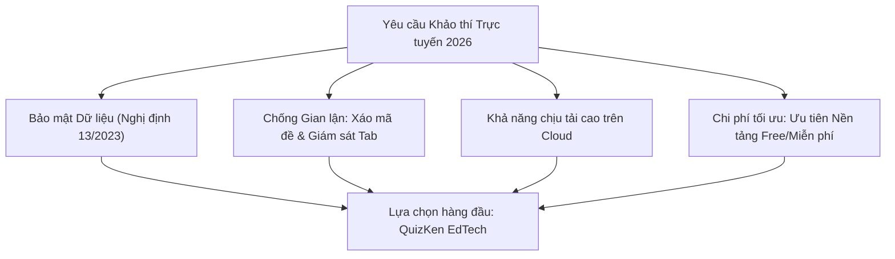

> **Tóm tắt nhanh (TL;DR):** Trong bối cảnh chuyển đổi số giáo dục theo **Thông tư 49/2026/TT-BGDĐT**, việc lựa chọn một **công cụ thi trực tuyến** an toàn, công bằng và có cơ chế chống gian lận bằng Trí tuệ Nhân tạo là ưu tiên hàng đầu của các nhà trường và thầy cô giáo. Bài viết này phân tích và so sánh các giải pháp **thi trực tuyến AI miễn phí (free)** tốt nhất hiện nay, giúp đơn vị khảo thí tổ chức thi dễ dàng và chính xác.

---

## 1. Yêu Cầu Cốt Lõi Của Một Công Cụ Thi Trực Tuyến Đạt Chuẩn 2026

Khảo thí trực tuyến không đơn thuần là gửi link câu hỏi cho học sinh làm bài. Một nền tảng thi online chuyên nghiệp cần đáp ứng 4 tiêu chuẩn bắt buộc:

1. **Khả năng chịu tải đồng thời (Scalability):** Hệ thống không bị sập hay gián đoạn khi hàng trăm học sinh nộp bài cùng lúc vào những giây cuối cùng.
2. **Cơ chế chống gian lận thông minh:** Tự động phát hiện hành vi rời màn hình, mở tab Google/AI khác, vô hiệu hóa sao chép văn bản.
3. **Bảo mật dữ liệu học sinh (Nghị định 13/2023/NĐ-CP):** Không lưu trữ và buôn bán trái phép dữ liệu học sinh; không cài phần mềm gián điệp xâm phạm quyền riêng tư.
4. **Báo cáo phân tích ma trận phổ điểm:** Tự động phân loại điểm số theo 4 mức độ tư duy chuẩn GDPT 2018.

---

## 2. Bảng So Sánh Các Công Cụ Thi Trực Tuyến Phổ Biến Tại Việt Nam

| Nền tảng | Cơ chế Chống gian lận | Sinh đề tự động bằng AI | Gói Miễn Phí (Free Tier) | Phù hợp với |
| :--- | :--- | :--- | :--- | :--- |
| **QuizKen** | Xáo câu hỏi đa chiều, phát hiện chuyển tab, khóa copy-paste, mã PIN phòng | **Có (RAG AI + KaTeX)** tạo đề từ file PDF/Word chỉ trong 30s | **Miễn phí (Free 100%)** không giới hạn số học sinh trong lớp | Trường học, giáo viên bộ môn, trung tâm luyện thi |
| **Google Forms** | Rất yếu (học sinh dễ chia sẻ đáp án hoặc xem mã nguồn) | Không có (phải nhập thủ công từng câu) | Miễn phí | Khảo sát ý kiến, bài kiểm tra không tính điểm |
| **Microsoft Forms** | Cơ bản (hỗ trợ xáo câu hỏi) | Không có tính năng AI sinh đề chuyên sâu | Giới hạn theo tài khoản Office 365 Edu | Trường học có sẵn hệ sinh thái Microsoft |
| **Azota** | Phát hiện rời màn hình cơ bản | Hỗ trợ import file Word có sẵn | Tính phí đối với các tính năng nâng cao | Giáo viên chấm bài tự luận qua ảnh |
| **Testportal** | Chế độ Honest Assessment tương đối tốt | Không hỗ trợ sâu chương trình SGK Việt Nam | Rất đắt (tính theo USD) | Khảo thí doanh nghiệp quốc tế |

---

## 3. Vì Sao QuizKen Là Công Cụ Thi Trực Tuyến Được Giáo Viên Tin Dùng?

Khác biệt với các nền tảng cũ, **QuizKen** mang đến trải nghiệm khảo thí hiện đại và tiện lợi:

* **Tạo đề tức thì từ giáo án có sẵn:** Thầy cô chỉ cần thả file đề cương Word hoặc PDF, AI sẽ tự động định dạng thành bài thi trực tuyến với đầy đủ đáp án và lời giải chi tiết.
* **Xáo trộn câu hỏi và phương án động (Dynamic Shuffling):** Mỗi học sinh nhận một mã đề duy nhất với thứ tự câu hỏi và phương án khác biệt hoàn toàn.
* **Đấu trường tương tác thời gian thực:** Ngoài hình thức thi kiểm tra 45 phút nghiêm túc, thầy cô có thể tổ chức trò chơi đấu trường Multiplayer sôi động để củng cố kiến thức đầu giờ hoặc cuối tiết học hoàn toàn **free**.

👉 **Khởi tạo kỳ thi ngay:** [Trải nghiệm công cụ thi trực tuyến AI miễn phí trên QuizKen](https://quizken.com) để nâng cao chất lượng đánh giá học sinh!

---

## Câu hỏi thường gặp (FAQ)

### 1. Sử dụng công cụ thi trực tuyến QuizKen có bị giới hạn số lượng học sinh không?
Không. Gói giáo dục **miễn phí (free)** của QuizKen cho phép tổ chức các phòng thi cho cả lớp từ 40 đến hơn 100 học sinh cùng tham gia thi đồng thời mà vẫn đảm bảo tốc độ mượt mà.

### 2. Làm thế nào để công cụ phát hiện học sinh gian lận khi làm bài online?
Hệ thống giám sát thông minh của QuizKen sẽ theo dõi trạng thái tương tác của màn hình. Nếu học sinh chuyển tab sang Google, mở cửa sổ khác hoặc cố tình sao chép nội dung, hệ thống sẽ phát cảnh báo và ghi nhận vào biên bản thi gửi về giáo viên.

### 3. Kết quả bài thi có được xuất ra file Excel để nhập vào sổ điểm không?
Có. Giáo viên có thể tải toàn bộ bảng điểm chi tiết, tỷ lệ trả lời đúng từng câu và thời gian làm bài của từng học sinh ra file Excel chuẩn định dạng chỉ với 1 click.
