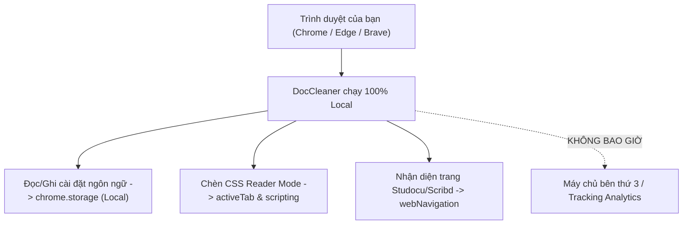

> **TL;DR (Tóm tắt nhanh):**  
> Nếu bạn đang băn khoăn **DocCleaner có an toàn không**, câu trả lời là **CÓ**. Tiện ích **DocCleaner - Better Studocu & Scribd Reader** trên Chrome Web Store chạy **100% cục bộ (local)** ngay trong trình duyệt, không thu thập dữ liệu, không gắn mã theo dõi và không có máy chủ trung gian. Tất cả quyền trình duyệt đều dùng đúng mục đích hiển thị Reader Mode, để bạn yên tâm đọc tài liệu và kết hợp ôn thi trên **[QuizKen](https://app.quizken.com)**.

---

# DocCleaner Có An Toàn Không? Phân Tích Minh Bạch Quyền Truy Cập & Quyền Riêng Tư

Khi cài đặt bất kỳ tiện ích mở rộng (Extension) nào trên Chrome hay Edge, câu hỏi đầu tiên mà người dùng có ý thức bảo mật luôn đặt ra là: *"Tiện ích này xin những quyền gì và liệu có theo dõi lịch sử duyệt web của mình không?"*

Đây là một thói quen rất đáng khen ngợi, nhất là trong bối cảnh nhiều extension trôi nổi gắn mã quảng cáo ngầm hoặc thu thập cookie trình duyệt. Trong bài viết hôm nay, **QuizKen** sẽ kiểm tra kỹ thuật chi tiết từng quyền truy cập của **[DocCleaner - Better Studocu & Scribd Reader](https://chromewebstore.google.com/detail/doccleaner-better-studocu/fnhdoegoihnkgggnaiemommemdejhbkb?hl=vi)** để giúp bạn trả lời triệt để câu hỏi **DocCleaner có an toàn không**.

---

## 1. Giải Mã 5 Quyền Trình Duyệt Của DocCleaner

Khi xem xét hồ sơ kỹ thuật của một Chrome Extension chuẩn Manifest V3 như DocCleaner, mỗi quyền được cấp đều phải phục vụ trực tiếp cho tính năng cốt lõi mới vượt qua khâu kiểm duyệt của Chrome Web Store:

| Quyền (Permission) | Chức năng thực tế trong DocCleaner | Có gửi dữ liệu ra ngoài không? |
| :--- | :--- | :--- |
| **`storage`** | Lưu tùy chọn giao diện người dùng (ví dụ: chọn ngôn ngữ Tiếng Việt hoặc Tiếng Anh trong popup). | **Không** (chỉ lưu local trên máy bạn) |
| **`activeTab`** | Cho phép tiện ích thao tác trên tab tài liệu đang mở khi bạn tương tác với nút điều khiển. | **Không** |
| **`scripting`** | Chèn CSS dọn dẹp banner/popup và định dạng bố cục **Reader Mode / 1-Click Print Format**. | **Không** |
| **`webNavigation`** | Phát hiện thời điểm bạn mở hoặc tải lại trang Studocu / Scribd để tự động dọn giao diện kịp thời. | **Không** |
| **`cookies`** | Xóa trạng thái hiển thị cũ được lưu cục bộ trên trang tài liệu khi cần làm sạch lại khung đọc. | **Không** |

---

## 2. 4 Lý Do Chứng Minh DocCleaner An Toàn Cho Sinh Viên

### 1. Kiến trúc 100% Local – Không máy chủ thu thập dữ liệu
DocCleaner hoạt động hoàn toàn phía trình duyệt khách (client-side). Tiện ích không cần tạo tài khoản, không có hệ thống backend để lưu trữ file bạn đọc và không thu thập bất kỳ dữ liệu nhận dạng cá nhân (PII) nào.

### 2. Không Tracking, Không Quảng Cáo Ngầm
Nhiều công cụ miễn phí (free) trên mạng bù đắp chi phí bằng cách chèn quảng cáo vào trình duyệt hoặc chuyển hướng liên kết mua sắm. DocCleaner cam kết **không tracking, không analytics ẩn và không chèn quảng cáo**, giữ trải nghiệm đọc tài liệu thuần khiết nhất.

### 3. Đã qua kiểm duyệt chính thức của Chrome Web Store
Trước khi xuất hiện công khai trên kho tiện ích của Google, gói cài đặt của **DocCleaner - Better Studocu & Scribd Reader** phải tuân thủ chính sách bảo mật Manifest V3 nghiêm ngặt của Chrome Web Store, minh bạch mô tả quyền và mục đích sử dụng.

### 4. Miễn phí hoàn toàn, không bẫy thu phí
Bạn không phải nhập thẻ tín dụng, không có gói dùng thử tự gia hạn và không cần cấp quyền truy cập Google Drive hay Gmail của bạn.

---

## 3. Lưu Ý Bảo Mật Khi Sử Dụng Extension Học Tập

Để luôn giữ trình duyệt an toàn tối đa trong suốt 4 năm đại học, bạn nên ghi nhớ 3 nguyên tắc vàng:

1. **Chỉ cài từ nguồn chính thức:** Luôn cài DocCleaner trực tiếp qua liên kết [Chrome Web Store](https://chromewebstore.google.com/detail/doccleaner-better-studocu/fnhdoegoihnkgggnaiemommemdejhbkb?hl=vi), tuyệt đối không tải file cài đặt trôi nổi từ các diễn đàn không rõ nguồn gốc.
2. **Dùng trình duyệt sạch cho các tác vụ học tập:** Kết hợp các công cụ uy tín như DocCleaner (đọc tài liệu) và **[QuizKen](https://app.quizken.com)** (tạo đề thi AI & Flashcard ôn bài) thay vì bấm vào các website get link chứa đầy popup lạ.
3. **Kiểm tra danh sách tiện ích định kỳ:** Vào `chrome://extensions/` mỗi học kỳ để gỡ bỏ những extension cũ bạn không còn sử dụng.

---

## 4. Câu Hỏi Thường Gặp (FAQ)

### 1. DocCleaner có đọc được mật khẩu hay thông tin ngân hàng trên các tab khác không?
Không. DocCleaner không chứa mã thu thập form nhập liệu và chỉ kích hoạt xử lý giao diện trên các nền tảng đọc tài liệu học tập được hỗ trợ như Studocu và Scribd.

### 2. Quyền `cookies` của DocCleaner có lấy trộm phiên đăng nhập Facebook/Google của tôi không?
Hoàn toàn không. Quyền này chỉ được dùng cục bộ để làm mới trạng thái hiển thị cached của trang tài liệu khi cần thiết, không đọc hay gửi cookie đăng nhập của bạn ra bất kỳ đâu.

### 3. Tôi có thể kiểm tra và tắt tiện ích tạm thời không?
Có. Bạn có thể bật/tắt hoặc gỡ DocCleaner chỉ với 1 click trong mục Quản lý tiện ích (`chrome://extensions/`).

---

**Kết luận:** Với kiến trúc chạy cục bộ 100%, không tracking và minh bạch quyền truy cập trên Chrome Web Store, câu trả lời cho thắc mắc **DocCleaner có an toàn không** chắc chắn là có. Hãy yên tâm cài đặt **[DocCleaner](https://chromewebstore.google.com/detail/doccleaner-better-studocu/fnhdoegoihnkgggnaiemommemdejhbkb?hl=vi)** và kết hợp cùng **[QuizKen](https://quizken.com)** để học tập hiệu quả mỗi ngày!
