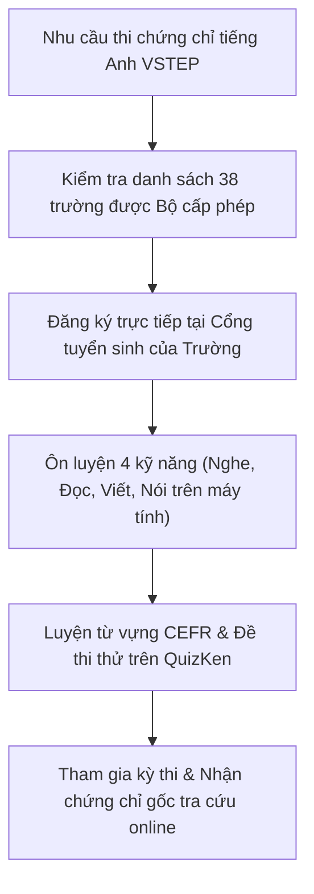

> **TL;DR (Tóm tắt nhanh):**  
> Tính đến năm 2026, Bộ Giáo dục và Đào tạo (Bộ GD&ĐT) đã chính thức công nhận và cấp phép cho **38 trường đại học, học viện** trên cả nước được quyền tổ chức thi và cấp chứng chỉ tiếng Anh theo Khung năng lực ngoại ngữ 6 bậc dùng cho Việt Nam (VSTEP). Thí sinh cần đặc biệt lưu ý: **chỉ có các trường đại học trong danh sách này mới có thẩm quyền cấp chứng chỉ hợp lệ**; các trung tâm ngoại ngữ tư nhân bên ngoài chỉ có chức năng giảng dạy luyện thi. Để đạt chuẩn B1, B2 đầu ra đại học hoặc miễn thi tốt nghiệp, bạn có thể rèn luyện các bộ đề đọc hiểu VSTEP và học kho từ vựng CEFR độc quyền trên **QuizKen English Hub**.

---

# Danh Sách 38 Trường Đại Học Được Bộ GD&ĐT Cấp Phép Thi VSTEP 2026 & Mẹo Luyện Thi Đạt Chuẩn

Trong những năm gần đây, **chứng chỉ tiếng Anh VSTEP (Vietnamese Standardized Test of English Proficiency)** đã trở thành một trong những điều kiện quan trọng nhất đối với học sinh, sinh viên và người đi làm tại Việt Nam:
* Là điều kiện chuẩn đầu ra ngoại ngữ bắt buộc tại hầu hết các trường đại học, cao đẳng trên toàn quốc (chuẩn B1 cho cử nhân, B2 cho thạc sĩ/giáo viên tiếng Anh).
* Được Bộ GD&ĐT công nhận quy đổi điểm để **miễn thi môn Ngoại ngữ trong kỳ thi tốt nghiệp THPT** và xét tuyển thẳng đại học.
* Là tiêu chuẩn bổ nhiệm, nâng ngạch đối với công chức, viên chức và giảng viên.

Tuy nhiên, rất nhiều thí sinh vì thiếu thông tin đã đăng ký thi tại các đơn vị không được cấp phép hoặc "mắc bẫy" các trung tâm cam kết bao đỗ giả mạo, dẫn đến việc chứng chỉ không được chấp nhận. Dưới đây là danh sách chính thức được cập nhật mới nhất từ **Cục Quản lý chất lượng – Bộ GD&ĐT**.

---

## 1. Danh Sách 38 Đơn Vị Được Cấp Phép Thi & Cấp Chứng Chỉ VSTEP

Các trường đại học được phân bố rộng khắp trên cả 3 miền, tạo điều kiện thuận lợi cho thí sinh đăng ký dự thi:

### A. Khu Vực Miền Bắc
1. Trường Đại học Ngoại ngữ – Đại học Quốc gia Hà Nội
2. Trường Đại học Sư phạm Hà Nội
3. Trường Đại học Hà Nội (HANU)
4. Trường Đại học Kinh tế Quốc dân (NEU)
5. Trường Đại học Bách khoa Hà Nội
6. Trường Đại học Thương mại
7. Trường Đại học Ngoại thương
8. Học viện Báo chí và Tuyên truyền
9. Học viện An ninh Nhân dân
10. Học viện Cảnh sát Nhân dân
11. Học viện Khoa học Quân sự
12. Đại học Thái Nguyên
13. Trường Đại học Phenikaa
14. Trường Đại học Thành Đông
15. Trường Đại học Hàng hải Việt Nam
16. Trường Đại học Nam Định

### B. Khu Vực Miền Trung & Tây Nguyên
17. Trường Đại học Ngoại ngữ – Đại học Huế
18. Trường Đại học Ngoại ngữ – Đại học Đà Nẵng
19. Trường Đại học Vinh
20. Trường Đại học Quy Nhơn
21. Trường Đại học Tây Nguyên
22. Trường Đại học Nha Trang
23. Trường Đại học Đà Lạt

### C. Khu Vực Miền Nam
24. Trường Đại học Sư phạm TP. Hồ Chí Minh
25. Trường Đại học Sài Gòn
26. Trường Đại học Cần Thơ
27. Trường Đại học Ngân hàng TP. Hồ Chí Minh
28. Trường Đại học Văn Lang
29. Trường Đại học Trà Vinh
30. Trường Đại học Đồng Tháp
31. Trường Đại học Công nghiệp TP. Hồ Chí Minh
32. Trường Đại học Mở TP. Hồ Chí Minh
33. Trường Đại học Kinh tế – Tài chính TP. Hồ Chí Minh (UEF)
34. Trường Đại học Công nghệ TP. Hồ Chí Minh (HUTECH)
35. Trường Đại học Khoa học Xã hội và Nhân văn – ĐHQG TP.HCM
36. Trường Đại học Bách khoa – ĐHQG TP.HCM
37. Trường Đại học An Giang
38. Trường Đại học Lạc Hồng

*(Nguồn tra cứu: Cục Quản lý chất lượng – Cổng thông tin điện tử Bộ Giáo dục và Đào tạo `moet.gov.vn`).*

---

## 2. Bảng Quy Đổi Điểm VSTEP Sang Các Khung Ngoại Ngữ Quốc Tế

Theo khung tham chiếu trình độ ngoại ngữ 6 bậc dùng cho Việt Nam (tương đương CEFR):

| Bậc VSTEP | Trình độ tương đương CEFR | Điểm VSTEP (Thang 10) | Tương đương IELTS | Tương đương TOEIC |
| :--- | :--- | :--- | :--- | :--- |
| **Bậc 3 (B1)** | Trung cấp (Intermediate) | **4.0 – 5.5 điểm** | 4.0 – 4.5 | 450 – 500 |
| **Bậc 4 (B2)** | Trung cao cấp (Upper-Intermediate) | **6.0 – 8.0 điểm** | 5.5 – 6.5 | 600 – 750 |
| **Bậc 5 (C1)** | Cao cấp (Advanced) | **8.5 – 10.0 điểm** | 7.0 – 8.0 | 850 – 990 |

---

## 3. Những Lưu Ý "Sống Còn" Khi Đăng Ký Thi VSTEP

1. **Hình thức thi 100% trên máy tính:** Bài thi VSTEP hiện nay được thực hiện hoàn toàn trên máy vi tính tại phòng thi chuẩn hóa của các trường. Thí sinh cần làm quen với thao tác gõ bàn phím (kỹ năng Viết) và đeo tai nghe microphone (kỹ năng Nói).
2. **Cảnh giác các lời mời "mua chứng chỉ":** Mọi chứng chỉ VSTEP hợp lệ đều có mã số hiệu riêng và được lưu trữ trên cơ sở dữ liệu tra cứu văn bằng điện tử của nhà trường. Bất kỳ chứng chỉ nào không qua thi tuyển thực tế đều là giả mạo và sẽ bị cơ quan quản lý thu hồi, xử lý kỷ luật nghiêm khắc.
3. **Lệ phí thi chuẩn quy định:** Thường dao động từ **1.200.000đ đến 1.800.000đ** tùy theo thí sinh tự do hay sinh viên nội bộ của trường tổ chức.

---

## 4. 💡 Bí Quyết Luyện Thi VSTEP B1, B2 Cấp Tốc Cùng QuizKen English Hub

Kỳ thi VSTEP có tính học thuật cao, đặc biệt là phần Đọc hiểu (Reading) và Từ vựng. Để chinh phục mục tiêu B1, B2 chỉ trong 1 - 2 tháng tự học:

* **Học 2000 từ vựng cốt lõi CEFR B1 - B2:** Truy cập **[QuizKen English Hub](https://app.quizken.com/english)** để ôn luyện bộ thẻ Flashcard Spaced Repetition thông minh. Hệ thống tự động chia nhỏ từ vựng theo chủ đề (Môi trường, Giáo dục, Công nghệ, Y tế) kèm phiên âm IPA và audio phát âm chuẩn bản ngữ.
* **Luyện đề thi thử trên giao diện máy tính:** QuizKen cung cấp các bài kiểm tra trắc nghiệm mô phỏng chính xác áp lực thời gian và giao diện thi trên máy của VSTEP, giúp bạn kiểm soát tốc độ làm bài và làm quen với dạng câu hỏi đọc hiểu 4 đoạn văn.
* **Chấm chữa chi tiết bằng AI:** Trợ lý ảo QuizKen phân tích chi tiết lỗi sai ngữ pháp và giải thích rõ vì sao đáp án đó là chính xác, giúp bạn nâng band điểm thần tốc.

> 🎓 **Bắt đầu ôn thi ngay:** [Khám phá kho đề thi thử VSTEP và Flashcard từ vựng miễn phí trên QuizKen tại đây!](https://app.quizken.com/english)

---

## Câu hỏi thường gặp về kỳ thi VSTEP

### Chứng chỉ VSTEP có thời hạn sử dụng trong bao lâu?
Quy chế của Bộ GD&ĐT không ghi thời hạn trên phôi chứng chỉ VSTEP (tương tự bằng đại học). Tuy nhiên, thời hạn chấp nhận chứng chỉ phụ thuộc vào quy định riêng của từng đơn vị sử dụng (ví dụ: các trường đại học thường quy định chứng chỉ có giá trị trong vòng 2 năm kể từ ngày cấp đối với xét tuyển đầu vào và đầu ra).

### Tôi có thể thi VSTEP tại trường này nhưng nộp bằng cho trường khác xét tốt nghiệp không?
Được! Chỉ cần trường tổ chức thi nằm trong danh sách 38 trường đại học được Bộ GD&ĐT cấp phép, chứng chỉ của bạn có giá trị công nhận trên toàn quốc theo quy định hiện hành.

### Cấu trúc bài thi VSTEP gồm những phần nào?
Bài thi VSTEP bậc 3 - 5 gồm 4 kỹ năng: Nghe (Listening - 40 phút, 35 câu), Đọc (Reading - 60 phút, 40 câu), Viết (Writing - 60 phút, 2 bài luận) và Nói (Speaking - 12 phút, 3 phần tương tác với máy tính).
