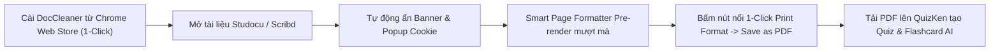

> **TL;DR (Tóm tắt nhanh):**  
> Tiện ích **DocCleaner - Better Studocu & Scribd Reader** đã chính thức phát hành miễn phí (free) trên **Chrome Web Store**. Người dùng không còn phải cài thủ công qua chế độ nhà phát triển mà có thể thêm vào Chrome, Edge, Cốc Cốc chỉ với 1 cú nhấp chuột để trải nghiệm **Reader Mode**, xóa banner/popup cookie, chạy **Smart Page Formatter** và xuất PDF với **1-Click Print Format**, sau đó nạp ngay vào **[QuizKen](https://app.quizken.com)** để tạo đề thi thử AI!

---

# DocCleaner Chính Thức Lên Chrome Web Store: Bước Ngoặt Mới Cho Việc Đọc Tài Liệu Học Tập

Sau thời gian dài được cộng đồng sinh viên đón nhận rộng rãi, tiện ích mở rộng **DocCleaner - Better Studocu & Scribd Reader** đã chính thức được kiểm duyệt và phát hành trên **Chrome Web Store**. Đây là bản nâng cấp quan trọng giúp mọi sinh viên tiếp cận công cụ đọc tài liệu tập trung chỉ bằng một lần bấm nút **Thêm vào Chrome**, hoàn toàn miễn phí và không cần thao tác kỹ thuật phức tạp.

Nếu bạn thường xuyên ôn thi bằng đề cương trên `studocu.com`, `studocu.vn` hoặc nghiên cứu giáo trình trên `scribd.com`, phiên bản **DocCleaner Chrome Web Store** mới nhất mang lại trải nghiệm ổn định, tự động cập nhật và bảo mật tuyệt đối ngay trên trình duyệt.

👉 **Cài đặt bản chính thức miễn phí:** [DocCleaner - Better Studocu & Scribd Reader trên Chrome Web Store](https://chromewebstore.google.com/detail/doccleaner-better-studocu/fnhdoegoihnkgggnaiemommemdejhbkb?hl=vi)

---

## 1. Có Gì Mới Trên Phiên Bản DocCleaner Chrome Web Store?

So với cách cài đặt thủ công trước đây, bản phát hành chính thức trên kho tiện ích của Google mang đến nhiều cải tiến rõ rệt cả về độ tiện lợi lẫn trải nghiệm người dùng:

### Cài đặt 1-Click và tự động cập nhật
Trước đây, người dùng phải tải gói mã nguồn, bật Developer Mode và nạp thủ công (*Load unpacked*). Giờ đây, chỉ cần truy cập liên kết **DocCleaner Chrome Web Store**, nhấn thêm tiện ích là xong. Mọi bản vá tương thích với giao diện mới của Studocu hay Scribd đều được trình duyệt cập nhật tự động.

### Trải nghiệm Reader Mode gọn sạch tức thì
Tiện ích tập trung tối đa vào không gian đọc. Ngay khi mở trang tài liệu, các lớp phủ gây nhiễu như banner quảng cáo nổi, hộp thoại thông báo cookie và thanh điều hướng thừa được tự động thu gọn.

### Smart Page Formatter chống trang trắng
Một trong những điểm nâng cấp đáng giá nhất là bộ định dạng trang thông minh (**Smart Page Formatter**), giúp trình duyệt pre-render các trang tiếp theo mượt mà hơn, hạn chế hiện tượng khoảng trắng khi bạn cuộn nhanh qua các bộ đề cương dài hàng trăm trang.

### Giao diện popup song ngữ Việt – Anh
Phiên bản trên Chrome Web Store tích hợp sẵn bộ chuyển đổi ngôn ngữ **Tiếng Việt / English** ngay trong popup điều khiển, thân thiện với cả sinh viên Việt Nam lẫn du học sinh.

---

## 2. Bảng So Sánh Phiên Bản Cài Thủ Công Và Bản Chrome Web Store

| Tiêu chí | Cài thủ công trước đây | Bản DocCleaner Chrome Web Store |
| :--- | :--- | :--- |
| **Thao tác cài đặt** | Phải giải nén, bật Developer Mode | **1-Click Thêm vào Chrome** |
| **Cập nhật tính năng** | Phải tải lại bản mới thủ công | **Tự động cập nhật qua Store** |
| **Kiểm duyệt bảo mật** | Tự kiểm tra mã nguồn | **Đã qua kiểm duyệt Chrome Web Store** |
| **Chi phí sử dụng** | Free 100% | **Free 100% (Miễn phí trọn đời)** |
| **Ngôn ngữ giao diện** | Tùy chỉnh cơ bản | **Song ngữ Tiếng Việt & Tiếng Anh** |
| **Hỗ trợ in / PDF** | Có | **Nút nổi 1-Click Print Format tối ưu** |

---

## 3. Tối Ưu Quy Trình Học Tập: Kết Hợp DocCleaner Và QuizKen AI

Đọc được tài liệu sạch sẽ mới là bước khởi đầu. Để thực sự nhớ kiến thức và đạt điểm cao trong các kỳ kiểm tra, bạn cần chuyển từ trạng thái *đọc thụ động* sang *chủ động kiểm tra lại trí nhớ (Active Recall)*.

Sau khi sử dụng tính năng **1-Click Print Format** của DocCleaner để lưu bộ tài liệu dưới dạng PDF chuẩn đẹp qua hộp thoại in của Chrome (`Save as PDF`), bạn có thể tận dụng hệ sinh thái **[QuizKen](https://app.quizken.com)**:

1. **Tải file PDF lên QuizKen AI:** Hệ thống tự động đọc hiểu nội dung slide, giáo trình hoặc đề cương bạn vừa lưu.
2. **Sinh đề thi trắc nghiệm trong 5 giây:** Tạo ngay bộ câu hỏi trắc nghiệm khách quan hoặc tự luận ngắn kèm lời giải chi tiết bám sát tài liệu gốc.
3. **Ôn luyện bằng Flashcard Spaced Repetition:** Thuật toán lặp lại ngắt quãng giúp bạn ghi nhớ công thức, thuật ngữ và định nghĩa trọng tâm trước ngày thi.

> 💡 **Mẹo học thông minh:** [Trải nghiệm QuizKen miễn phí ngay hôm nay](https://app.quizken.com) để biến mọi tài liệu bạn đọc bằng DocCleaner thành bài thi thử tương tác!

---

## 4. Câu Hỏi Thường Gặp (FAQ)

### 1. Tôi đã cài bản cũ thủ công thì có nên chuyển sang bản Chrome Web Store không?
Có. Bạn nên gỡ bản *Load unpacked* cũ trong `chrome://extensions/` và cài bản chính thức từ **Chrome Web Store** để nhận các bản vá giao diện và tính năng mới tự động, ổn định hơn.

### 2. DocCleaner trên Chrome Web Store có thu phí hay giới hạn lượt dùng không?
Không. Tiện ích hoàn toàn miễn phí (free), không giới hạn số lượng tài liệu đọc hoặc định dạng in mỗi ngày.

### 3. Tiện ích có chạy được trên Microsoft Edge hay Cốc Cốc không?
Có. Mọi trình duyệt nhân Chromium như Google Chrome, Microsoft Edge, Cốc Cốc và Brave đều cài đặt được trực tiếp từ đường dẫn Chrome Web Store của DocCleaner.

### 4. DocCleaner có thu thập dữ liệu cá nhân hay tài khoản Studocu của tôi không?
Không. Tiện ích chạy 100% cục bộ (local) ngay trên trình duyệt của bạn, không có máy chủ thu thập dữ liệu và không theo dõi lịch sử duyệt web.

---

**Tổng kết:** Sự xuất hiện của **DocCleaner Chrome Web Store** giúp hàng trăm nghìn sinh viên tiếp cận công cụ **Better Studocu & Scribd Reader** nhanh gọn và an toàn hơn bao giờ hết. Hãy cài đặt ngay DocCleaner kết hợp cùng **[QuizKen](https://quizken.com)** để nâng tầm hiệu suất học tập và ôn thi trong năm học này!
