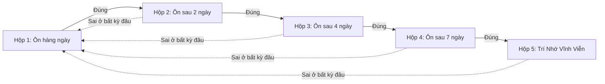

> **Tóm tắt nhanh (TL;DR):** Để đánh bại đường cong quên lãng của **Hermann Ebbinghaus**, nhà khoa học người Đức **Sebastian Leitner (1972)** đã phát minh ra hệ thống hộp **Leitner Box System**, và sau đó được **Piotr Wozniak (1987)** nâng cấp thành thuật toán toán học trứ danh **SM-2 (SuperMemo-2)**. Bằng việc kết hợp hệ thống này với trí tuệ nhân tạo, tính năng **Flashcard AI trên QuizKen** tự động tính toán hệ số dễ dàng (*Easiness Factor*) và khoảng cách ôn tập tối ưu cho từng thẻ bài học, giúp người học ghi nhớ trên 95% kiến thức với thời gian học ít hơn 70%.

---

## 1. Cơ Sở Khoa Học Của Hệ Thống Hộp Leitner (1972)

Trong cuốn sách kinh điển *"So lernt man lernen"* (1972), Sebastian Leitner đã đề xuất một mô hình phân loại thẻ học dựa trên mức độ thành thục:
- **Hộp 1 (Học hàng ngày):** Chứa các thẻ mới hoặc các thẻ trả lời sai.
- **Hộp 2 (Ôn tập sau 2 ngày):** Thẻ trả lời đúng ở Hộp 1 sẽ được chuyển lên Hộp 2.
- **Hộp 3 (Ôn tập sau 4 ngày):** Thẻ trả lời đúng ở Hộp 2 sẽ được thăng hạng lên Hộp 3.
- **Hộp 4 (Ôn tập sau 7 ngày):** Thẻ nắm vững.
- **Hộp 5 (Ôn tập sau 14-30 ngày):** Thẻ đã khắc sâu vào trí nhớ dài hạn (*Mastered*).

**Quy tắc then chốt:** Nếu bạn trả lời sai một thẻ ở bất kỳ hộp nào (kể cả Hộp 4 hay Hộp 5), thẻ đó lập tức bị **giáng cấp trở lại Hộp 1** để học lại từ đầu.

---

## 2. Thuật Toán SM-2 (Piotr Wozniak 1987) – Bước Tiến Kỹ Thuật Số Trên QuizKen

Năm 1987, nhà nghiên cứu Piotr Wozniak đã toán học hóa quy trình Leitner thành thuật toán **SM-2**, tính toán khoảng cách ngày ôn tập tiếp theo ($I(n)$) dựa trên điểm số đánh giá từ 0 đến 5 ($q$):

1. **Khoảng cách cơ sở:**
   - $I(1) = 1$ ngày
   - $I(2) = 6$ ngày
   - $I(n) = I(n-1) \times EF$ (với $n \ge 3$)
2. **Cập nhật hệ số dễ (*Easiness Factor - EF*):**
   $$EF' = EF + (0.1 - (5 - q) \times (0.08 + (5 - q) \times 0.02))$$
   *(Giá trị $EF$ khởi điểm là 2.5, giá trị tối thiểu không dưới 1.3)*

Trên nền tảng **QuizKen**, toàn bộ công thức toán học này được vận hành ngầm trong nền, giải phóng người học khỏi việc phải tự đếm ngày hay chia hộp thủ công.

---

## 3. Bảng So Sánh: Ôn Tập Dồn vs Leitner & Thuật Toán SM-2

| Tiêu chí | Ôn tập dồn trước ngày thi (*Cramming*) | Flashcard AI (Leitner + SM-2) trên QuizKen |
| :--- | :--- | :--- |
| **Phân bổ thời gian** | Học liên tục 6-8 tiếng sát ngày thi | Học 15-20 phút mỗi ngày theo lịch nhắc tự động |
| **Mức độ căng thẳng** | Rất cao, kiệt sức và dễ hoảng loạn | Nhẹ nhàng, tâm lý thoải mái và tự tin |
| **Tỉ lệ duy trì sau 30 ngày** | Dưới 15% (quên sạch sau khi thi xong) | Trên 90-95% (khắc sâu vào trí nhớ dài hạn) |
| **Phân hóa nội dung** | Ôn lại tất cả kiến thức (kể cả phần đã biết) | Chỉ tập trung vào những thẻ khó và thẻ hay quên |
| **Công cụ hỗ trợ** | Sách vở, đề cương giấy dày cộp | Ứng dụng điện thoại thông minh, làm bài mọi lúc mọi nơi |

---

## 4. Quy Trình 3 Bước Học Flashcard AI Chuẩn Khoa Học Trên QuizKen

### Bước 1: Tạo bộ Flashcard tự động từ tài liệu
Truy cập [QuizKen Flashcard Studio](https://quizken.com), tải lên file tài liệu học tập hoặc nhập danh sách từ khóa. AI sẽ tự động phân tách câu hỏi, định nghĩa và ví dụ thành các thẻ 2 mặt sinh động.

### Bước 2: Tự đánh giá mức độ ghi nhớ (0 - 5 sao)
Khi lật thẻ, bạn chọn mức độ ghi nhớ:
- **0 - 2 sao (Chưa nhớ / Quên hẳn):** Thuật toán xếp thẻ về chu kỳ ngắn (lặp lại sau vài phút/1 ngày).
- **3 - 5 sao (Nhớ tốt / Cực kỳ dễ):** Thuật toán tăng hệ số $EF$ và dời lịch ôn tập sang tuần sau.

### Bước 3: Tuân thủ thông báo ôn tập hàng ngày
Mỗi ngày, QuizKen sẽ thông báo số lượng thẻ đến hạn ôn tập (*Due Cards*). Bạn chỉ mất 10-15 phút để hoàn thành phiên ôn tập trong ngày.

---

## 5. Câu Hỏi Thường Gặp (FAQ)

### Một ngày nên tạo bao nhiêu thẻ Flashcard mới là vừa?
Khuyến nghị từ các chuyên gia nhận thức là từ **20 đến 30 thẻ mới mỗi ngày**. Điều này giúp tổng số thẻ cần ôn tập hàng ngày dao động ở mức vừa phải (khoảng 50-80 thẻ), không gây quá tải.

### QuizKen có cho phép chia sẻ bộ Flashcard cho bạn cùng lớp không?
Có. Bạn có thể xuất bản bộ thẻ Flashcard ở chế độ công khai hoặc gửi link trực tiếp để cả nhóm cùng học và theo dõi tiến độ thi đua.
