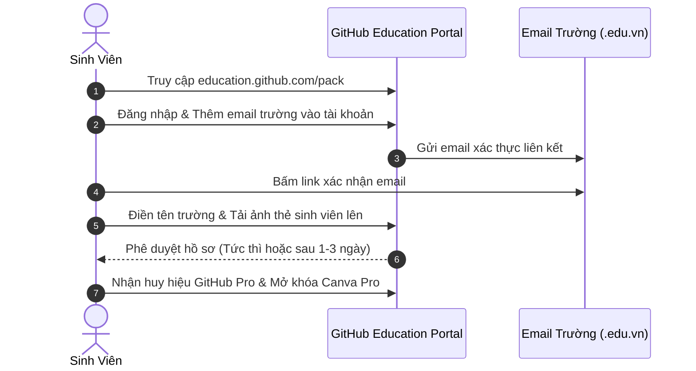

> **TL;DR (Tóm tắt nhanh):**  
> Chỉ cần sở hữu email đuôi trường đại học (`.edu.vn`) hoặc thẻ sinh viên còn hiệu lực, bạn có thể đăng ký nhận ngay gói đặc quyền **GitHub Student Developer Pack** (trị giá hơn 1.000$) kèm tài khoản **Canva Pro Giáo dục**, **Notion Plus/Pro**, **JetBrains All Products Pack** và tên miền `.me` miễn phí 1 năm. Kết hợp những công cụ thiết kế, ghi chép này với nền tảng ôn thi AI **QuizKen**, bạn sẽ có trọn bộ "vũ khí" học tập đỉnh cao trong suốt 4 năm đại học mà không tốn một đồng chi phí!

---

# Hướng Dẫn Nhận GitHub Student Developer Pack & Canva Pro Giáo Dục Miễn Phí (Mới Nhất 2026)

Trở thành sinh viên đại học mang lại cho bạn một "tấm vé vàng" mà rất nhiều người đi làm ao ước: **quyền truy cập miễn phí vào hàng loạt phần mềm bản quyền hàng đầu thế giới**.

Nhiều tập đoàn công nghệ lớn như GitHub, Microsoft, Canva, Notion hay JetBrains đều có các chính sách tài trợ hào phóng cho cộng đồng học thuật. Tuy nhiên, không ít bạn sinh viên Việt Nam chưa biết cách đăng ký hoặc thường xuyên bị từ chối do không nắm rõ quy trình xác thực.

Trong bài viết này, **QuizKen** sẽ hướng dẫn bạn chi tiết từng bước để đăng ký thành công 100% các gói phần mềm cao cấp này.

---

## 1. Gói GitHub Student Developer Pack Có Những Gì?

Khi kích hoạt thành công GitHub Student Pack, bạn sẽ nhận được quyền lợi tương đương hơn **1.000 USD**:
* **GitHub Pro & GitHub Copilot:** Sử dụng trợ lý AI lập trình hàng đầu hoàn toàn miễn phí trong suốt thời gian học.
* **Canva Pro Giáo dục:** Thiết kế slide thuyết trình, infographic, poster đồ án với hàng triệu mẫu template và ảnh premium không giới hạn.
* **JetBrains All Products Pack:** Bản quyền các IDE lập trình chuyên nghiệp (IntelliJ IDEA, PyCharm, WebStorm, CLion...).
* **Namecheap & Name.com:** Miễn phí 1 tên miền quốc tế (`.me` hoặc `.live`) và chứng chỉ bảo mật SSL trong 1 năm để làm web hồ sơ năng lực (Portfolio).
* **Microsoft Azure & DigitalOcean:** Tặng từ 100$ đến 200$ credit để thuê máy chủ đám mây chạy thử nghiệm dự án.

---

## 2. Điều Kiện & Chuẩn Bị Trước Khi Đăng Ký

Để không bị hệ thống AI kiểm duyệt của GitHub tự động từ chối hồ sơ, bạn cần chuẩn bị:
1. **Email sinh viên của trường:** Có định dạng đuôi `@...edu.vn` (ví dụ: `nguyenvana@hcmut.edu.vn` hoặc `khanhnkq@fpt.edu.vn`).
2. **Ảnh chụp thẻ sinh viên hoặc bảng điểm:** Thẻ sinh viên phải còn hạn sử dụng, ảnh chụp rõ nét 4 góc, đủ ánh sáng, không bị lóa mờ thông tin.
3. **Bật định vị GPS trên trình duyệt:** Hệ thống yêu cầu kiểm tra vị trí địa lý của bạn có nằm trong khu vực trường học hoặc tại Việt Nam hay không.

---

## 3. Quy Trình Đăng Ký GitHub Student Pack Chi Tiết

1. **Bước 1:** Truy cập vào trang chủ: [https://education.github.com/pack](https://education.github.com/pack) và nhấn nút **Sign up for Student Developer Pack**.
2. **Bước 2:** Đăng nhập vào tài khoản GitHub cá nhân của bạn. Vào mục **Settings > Emails** và thêm địa chỉ email trường (`.edu.vn`) vào tài khoản rồi xác nhận email.
3. **Bước 3:** Quay lại trang Education, tại mục *Select academic email*, chọn email trường bạn vừa thêm.
4. **Bước 4:** Nhập tên trường đại học của bạn bằng tiếng Anh hoặc tiếng Việt (hệ thống sẽ có gợi ý tự động).
5. **Bước 5:** Tải ảnh chụp mặt trước thẻ sinh viên hoặc giấy xác nhận sinh viên lên. Trong ô mô tả ngắn (*How do you plan to use GitHub?*), bạn có thể viết ngắn gọn bằng tiếng Anh:  
   > *"I use GitHub to study computer science, collaborate with my classmates on university course projects, and prepare for academic exams."*
6. **Bước 6:** Bấm **Submit your application**. Hệ thống sẽ xét duyệt tự động trong vài phút hoặc tối đa 48 giờ.

---

## 4. Cách Kích Hoạt Canva Pro & Notion Pro Sinh Viên

* **Kích hoạt Canva Pro Giáo dục:** Sau khi tài khoản GitHub được duyệt huy hiệu **Student**, bạn chỉ cần vào lại trang GitHub Education Pack, kéo xuống phần Canva và bấm nút liên kết tài khoản. Tài khoản Canva của bạn sẽ tự động nâng cấp lên gói Pro trọn đời sinh viên!
* **Kích hoạt Notion Plus/Pro:** Truy cập [notion.so/students](https://notion.so/students), đăng ký bằng email `.edu.vn`. Vào mục **Settings & Members > Upgrade > Get free student plan**, tài khoản của bạn sẽ lập tức nhận gói Plus không giới hạn dung lượng lưu trữ.

---

## 5. 💡 Kết Hợp Trọn Bộ Công Cụ Với QuizKen Để Đạt Điểm A+

Sau khi có Canva thiết kế slide đỉnh cao và Notion lưu trữ tài liệu môn học, làm thế nào để ôn thi nhàn hạ mà vẫn nắm chắc điểm 9, điểm 10?

Hãy kết hợp hệ thống ghi chép với **[QuizKen](https://app.quizken.com)**:
* Xuất các trang ghi chú từ Notion hoặc tài liệu nghiên cứu dưới dạng file PDF/TXT.
* Nạp vào tính năng **Kho Kiến Thức (Knowledge Base)** của QuizKen.
* AI của QuizKen sẽ tự động phân tích toàn bộ giáo trình và tạo ra các bộ đề trắc nghiệm kiểm tra phản xạ, kèm hệ thống Flashcard lặp lại ngắt quãng (SM-2) giúp bạn ghi nhớ mọi định nghĩa khoa học trước khi bước vào phòng thi.

> 🌟 **Khám phá ngay:** [Trải nghiệm nền tảng tạo đề thi trắc nghiệm AI QuizKen hoàn toàn miễn phí tại đây!](https://app.quizken.com)

---

## Câu hỏi thường gặp về GitHub Student Pack và Canva Edu

### Nếu trường của tôi không cấp email đuôi .edu.vn thì có đăng ký được không?
Được! Bạn có thể sử dụng email cá nhân (Gmail), sau đó tải lên ảnh chụp giấy xác nhận sinh viên có dấu mộc đỏ của nhà trường hoặc bảng điểm học kỳ gần nhất để đội ngũ GitHub xét duyệt thủ công.

### Sau khi tốt nghiệp thì các gói tài khoản này có bị khóa không?
Gói sinh viên có thời hạn xác thực định kỳ (thường là 2 năm một lần). Khi bạn tốt nghiệp, các quyền lợi sinh viên sẽ hết hạn nhưng dữ liệu và các dự án của bạn trên GitHub, Notion hay Canva vẫn được lưu giữ an toàn.

### QuizKen có liên kết với tài khoản sinh viên không?
QuizKen mở cửa tự do và miễn phí cho mọi học sinh, sinh viên trên toàn quốc mà không bắt buộc phải có email đuôi `.edu.vn`. Bạn có thể đăng nhập bằng bất kỳ tài khoản Google nào để tạo đề thi AI tức thì.
