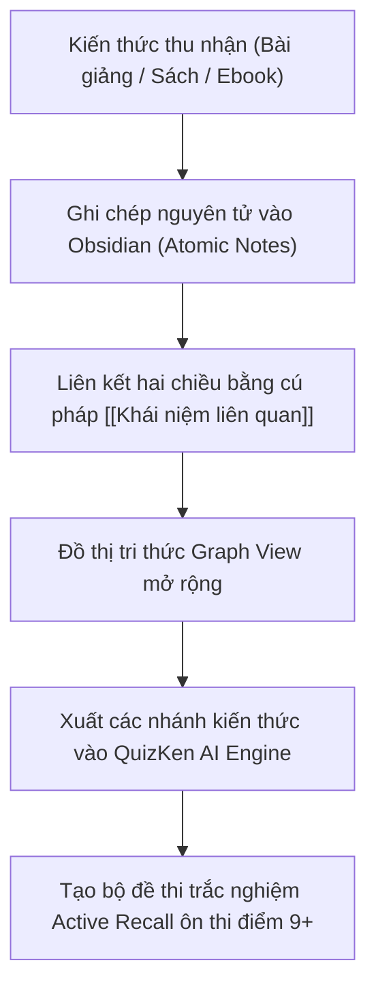

> **TL;DR (Tóm tắt nhanh):**  
> Việc ghi chú rời rạc trên nhiều cuốn sổ tay hay trên các ứng dụng lưu trữ đám mây dễ khiến sinh viên quên sạch kiến thức sau mỗi kỳ thi. **Obsidian** là phần mềm quản lý tri thức cá nhân (PKM) mã nguồn mở miễn phí vĩnh viễn, hoạt động hoàn toàn offline trên định dạng tệp thuần Markdown (`.md`). Bằng cách sử dụng phương pháp liên kết hai chiều (`[[Tên bài viết]]`) và đồ thị mạng nhện **Graph View**, Obsidian giúp biến toàn bộ kiến thức 4 năm đại học thành một "Bộ não thứ hai" (Second Brain) sống động. Kết hợp các tóm tắt từ Obsidian đưa vào **QuizKen AI**, bạn có thể tạo ngay bộ câu hỏi trắc nghiệm kiểm tra phản xạ tự động!

---

# Hướng Dẫn Dùng Obsidian Xây Dựng Second Brain Ghi Chú Markdown Miễn Phí (2026)

Hầu hết sinh viên hiện nay đều đối mặt với tình trạng **"Học trước quên sau"**:
* Khi học môn sau, bạn nhận ra nó có liên quan mật thiết đến một chương trong môn học của kỳ trước, nhưng bạn không tài nào tìm lại được cuốn sổ hay file Word ngày xưa đã ghi chép cái gì.
* Các ứng dụng ghi chú như Notion yêu cầu kết nối Internet liên tục, tải trang chậm khi dữ liệu lớn và dữ liệu nằm trên máy chủ của công ty khác (có rủi ro mất quyền truy cập hoặc đổi chính sách thu phí).

Phương pháp **Xây dựng Bộ não thứ hai (Building a Second Brain - BASB)** của chuyên gia năng suất Tiago Forte kết hợp cùng công cụ **Obsidian** là câu trả lời toàn diện nhất cho sinh viên thế hệ mới.

---

## 1. Vì Sao Obsidian Vượt Trội Hơn So Với Word & Notion?

| Tiêu chí | Microsoft Word | Notion (Gói miễn phí) | Obsidian (Miễn phí vĩnh viễn) |
| :--- | :--- | :--- | :--- |
| **Định dạng lưu trữ** | File `.docx` nhị phân, dễ bị lỗi font hoặc hỏng file. | Dữ liệu lưu trên máy chủ đám mây của Notion. | **File thuần Markdown (`.md`)** lưu ngay trong ổ cứng máy tính của bạn. Dữ liệu thuộc về bạn 100% mãi mãi. |
| **Khả năng liên kết** | Khó liên kết các file khác nhau. | Có liên kết trang cơ bản nhưng tải trang nặng. | **Liên kết 2 chiều siêu tốc (`[[Link]]`):** Mọi ý tưởng đều có thể kết nối với nhau như nơ-ron não bộ. |
| **Đồ thị tri thức (Graph View)** | ❌ Không có | ❌ Không có | **Đồ thị 3D tương tác:** Trực quan hóa toàn bộ mạng lưới kiến thức, chỉ ra những điểm mù bạn chưa liên kết. |
| **Tốc độ & Tính bảo mật** | Trung bình | Yêu cầu mạng, có độ trễ tải trang. | **Mở ngay lập tức trong 0.1 giây**, hoạt động hoàn toàn offline khi không có Internet. |

---

## 2. Các Bước Xây Dựng Second Brain Bằng Obsidian

### Bước 1: Cài đặt và tạo Kho tri thức (Vault)
1. Tải phần mềm miễn phí tại: `obsidian.md` (hỗ trợ cả Windows, macOS, Linux, iOS, Android).
2. Tạo một thư mục mới trên máy tính (ví dụ đặt tên là `My_Second_Brain`).

### Bước 2: Ứng dụng quy tắc "Ghi chú nguyên tử" (Atomic Notes)
* Thay vì viết một file Word dài lê thê 50 trang gom hết mọi thứ, hãy chia nhỏ kiến thức thành từng ghi chú ngắn gọn xoay quanh một khái niệm cốt lõi (Ví dụ: Một file ghi về *Hiệu ứng nhà kính*, một file ghi về *Quang hợp ở thực vật C3*).
* Sử dụng cú pháp dấu ngoặc vuông đôi: Khi đang viết về *Quang hợp*, bạn gõ `[[Hiệu ứng nhà kính]]` để tạo một đường dẫn kết nối trực tiếp hai ghi chú này lại với nhau.

### Bước 3: Khám phá Graph View – Ngắm nhìn "Bộ não kỹ thuật số" của bạn
Nhấn tổ hợp phím **`Cmd + G`** (trên Mac) hoặc **`Ctrl + G`** (trên Win), màn hình sẽ hiển thị hàng trăm quả cầu phát sáng tượng trưng cho từng bài học, nối với nhau bằng các sợi dây phát sáng. Nhìn vào đây, bạn sẽ lập tức nhận ra môn học nào bạn đã nắm vững và phần nào còn đang bị cô lập.

---

## 3. Cầu Nối Đột Phá: Từ Obsidian Sang Đề Thi Thử Trên QuizKen

Ghi chú dù có đẹp và khoa học đến đâu nhưng nếu bạn chỉ để đó và không kiểm tra lại thì trí nhớ vẫn sẽ phai nhạt dần theo thời gian (Đường cong quên lãng Ebbinghaus).

**Cách kết hợp hoàn hảo cùng QuizKen:**
1. Mở một ghi chú tóm tắt ôn tập trong Obsidian.
2. Copy toàn bộ văn bản hoặc xuất ra file PDF/Markdown.
3. Tải lên nền tảng [https://app.quizken.com](https://app.quizken.com).
4. QuizKen AI sẽ đóng vai trò như một người thầy khảo thí nghiêm khắc: Tự động phân tích các liên kết logic trong ghi chú của bạn và sinh ra bộ 20 câu hỏi trắc nghiệm kiểm tra phản xạ tức thì.

Bắt đầu xây dựng bộ não thứ hai và biến kiến thức thành điểm số cao tại: [https://app.quizken.com](https://app.quizken.com).
